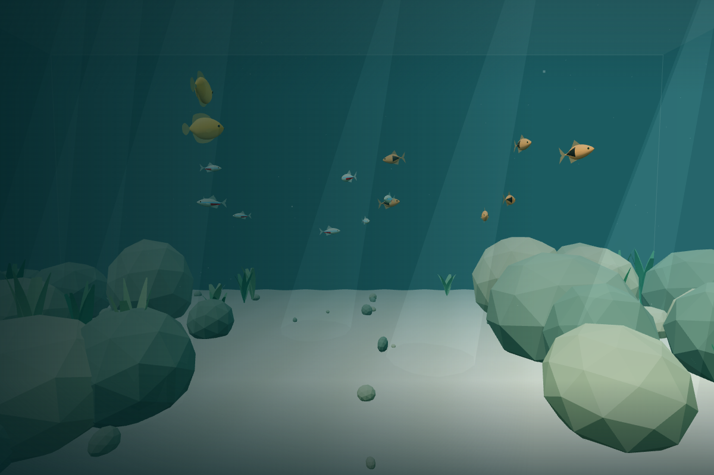

# Cozy Diver

A quiet little world beneath the surface. **v0.2 / Pass 004B — Aquarium Biodiversity & Habitat Expansion** is a first-person, browser-based aquarium prototype: swim at your own pace through sand, rocks, plants, and soft blue-green water. No scores, timers, combat, accounts, or external assets.

## Stack and requirements

Vite, strict TypeScript, Three.js, Vitest, ESLint, and Prettier. Use Node.js **22.12+** (Node 24 was used for this pass), npm, and a modern desktop browser with WebGL and pointer lock enabled. No backend, API keys, or services are needed. Chrome, Firefox, Safari, and Edge are the intended targets; see the validation record for browsers actually tested.

## Get started

```bash
npm install
npm run dev
```

Open the address printed by Vite. Click **Enter the Water** to give the canvas mouse capture. Escape pauses swimming and shows the resume overlay. Settings are accessible before entering or while paused.

For an existing lockfile in CI or a clean checkout, use `npm ci`.

| Command             | Purpose                                    |
| ------------------- | ------------------------------------------ |
| `npm run dev`       | Start the development server               |
| `npm run build`     | Typecheck and produce `dist/`              |
| `npm run preview`   | Serve the production build locally         |
| `npm run test`      | Run the unit tests once                    |
| `npm run typecheck` | Check strict TypeScript types              |
| `npm run lint`      | Check ESLint rules and Prettier formatting |
| `npm run format`    | Apply Prettier formatting                  |

Vite binds to all interfaces for cloud development; use `npm run dev -- --host 127.0.0.1` to restrict it to your own machine. Deployment is a static `dist/` directory; no server-side application is required.

## Swimming controls

| Input  | Action                                  |
| ------ | --------------------------------------- |
| W / S  | Swim forward / backward along your view |
| A / D  | Strafe left / right                     |
| Mouse  | Look around                             |
| Escape | Release mouse capture and pause         |

Click **Return to the Water** to resume. Look up or down and use W/S to change depth; A/D always strafe horizontally. Space and Shift have no swimming action. Pausing or losing browser focus clears held input and propulsion momentum while retaining a resting breath’s phase and small vertical velocity. Diagonal input is normalized. Subtle stroke-related pitch feedback stays below 0.07 degrees, with no roll or visual position offsets. Looking straight up/down is limited.

## Current features

- Seeded procedural aquarium with rippled sand, embedded rocks, planted banks, visible glass seams, and 45 freshwater fish across six species with distinct social behavior.
- Five procedural freshwater plant families in seeded habitat patches, with shared-current vertex bending, stable bases and smooth reduced-motion settling. Suspended particles, translucent light shafts, hemisphere and surface lighting, and distance fog.
- First-person swimming with smooth kick-and-glide propulsion, weighted direction changes, progressive water drag, and damped breathing buoyancy. Bounded 1/240-second steps sample forces and integrate linear drag analytically; long frame gaps are capped at 100 ms.
- A safe starting position, clearance from all six aquarium boundaries, and sliding collisions against the 34 major generated rocks and 39 convex ornament components. Thin foliage and decorative pebbles remain passable.
- Pointer lock only following an explicit button click. Escape, loss of focus, and hidden tabs pause controls.
- Mouse sensitivity, movement speed, swimming feel, and reduced-motion preferences saved locally. Storage failure falls back to session settings. System reduced-motion preference is respected on first visit; the option uses direct mouse-look and freezes ambient sway.
- Responsive canvas, device pixel ratio capped at 1.75, and messages for unavailable WebGL, lost graphics context, or denied pointer lock.
- Explicit cleanup of listeners, animation frames, geometries, materials, renderer, and DOM on disposal / hot reload.

## Architecture

```text
src/
  app/          Application lifecycle, animation loop, system coordination
  config/       Aquarium dimensions, spawn, and movement tuning
  controls/     Pointer lock, keyboard, and smoothed yaw/pitch
  environment/  Deterministic procedural scenery and owned fish lifecycle
  fish/         Species, seeded spawning, pure steering, shared models, interpolation
  player/       Pure movement physics, convex collision sweeps, and sliding
  rendering/    Renderer, camera, fog, lighting, and resize lifecycle
  ui/           Welcome/pause HUD, controls, storage, settings validation
```

`Application` owns and disposes the systems. `Aquarium` owns its generated resources. The environment root is a Three.js group so future environment loaders can replace it without changing movement. Physics and settings have no dependency on the renderer and are tested in Node. Mouse deltas describe displacement and are not multiplied by frame time; look smoothing uses an exponential, delta-time-based blend. Movement follows the same yaw/pitch convention as the camera.

Tune aquarium dimensions, clearance, and all physical/feedback parameters in `src/config/world.ts`; speed defaults/ranges and preset validation live in `src/ui/settings.ts`. Keep seabed variation below the floor clearance. Camera FOV and pixel ratio live in `src/rendering/UnderwaterScene.ts`.

## A living freshwater aquarium

The initial population is **8 neon tetras**, **6 harlequin rasboras**, and **2 honey gouramis**. Neon tetras have blue/red lateral stripes and agile cruising; copper rasboras carry a dark rear wedge and make gentler turns; larger honey gouramis have deeper oval bodies, rounded fins, and slower upper-water movement. These are procedural, dimensional meshes with eyes, separate tails, dorsal/lower fins, and pectorals. Body size is a presentation scale for this miniature-diver world, rather than a claim about real adult lengths.

Fish appear immediately and begin swimming when you enter the water. They use their own **fixed 30 Hz simulation**, with interpolated poses at the render frame rate and bounded catch-up. Holding pause or hiding the page freezes positions and animation without advancing their clock. Reduced motion suppresses optional banking and halves rear-body flex; essential tail and pectoral motion remains visible.

Persistent individual targets, bounded speed/turn changes, soft preferred depths, and predictive rock/wall steering remain the basis of each fish’s movement. Neon tetras now form moderately cohesive schools; harlequin rasboras coordinate in looser groups; honey gouramis explore independently. All species maintain personal space through size-aware separation, including across species. Fish read the existing major-rock hulls without running or changing the player's collision solver. Conservative body radii and a final candidate-position guard protect against unusual near-contact conditions. Foliage and decorative pebbles remain passable. At every 30 Hz step, a consistent population snapshot supplies bounded nearest-neighbor alignment/cohesion and all-neighbor close separation. Obstacle danger fades social attraction and removes separation directed into the avoidance force, allowing schools to split around scenery and reconnect through ordinary swimming. There are no leaders, scripted paths, position tethers, or synchronized timers. A nearby diver smoothly raises awareness; close contact or faster approach produces stronger, individually varied escape steering. School attraction recedes during scatter and returns gradually afterward. Gouramis react more calmly. Individual seeded activity schedules now add occasional exploration, local resting, subtle surface foraging, and safe observation of a calm diver. Tetras favor social cruising, rasboras investigate more loosely, and gouramis hover longer and observe more often. Recent disturbance suppresses voluntary activity during bounded individual recovery. There is no hunger, food resource, or required feeding.

The existing eight tetras, six rasboras and two gouramis remain. Five panda corydoras explore near the substrate, four individually marked Endler’s livebearers explore independently, and twenty tiny chili rasboras form a larger mid/upper-water school with occasional asynchronous dart-and-glide movements. New fish use shared articulated render batches while retaining real 3D bodies, eyes and fins. Population counts are centrally configured; 16/25/45/60-fish scenarios support regression and performance checks.

Population counts, body proportions, colors, habitat preferences, speed/turn limits, animation cadence, schooling, and diver-reaction parameters live in `src/fish/FishSpecies.ts`. The default seed reproduces initial positions and individual variations on refresh; live positions are not saved. Models/materials are shared per species and disposed through the environment lifecycle. See [fish architecture and tuning](docs/FISH.md) for ownership, movement, extension points, and limitations.



## Swimming physics and tuning

Holding a movement key repeats an active stroke followed by a glide. A squared-sine envelope builds and fades the propulsion **force**, which is filtered before integration; velocity and position are never multiplied by a wave. A small baseline thrust softens the rhythm. Releasing input cuts thrust while velocity decays under water drag, settling tiny horizontal residuals to zero. Direction changes redirect the filtered force without resetting velocity. Diagonal normalization and pitch-relative forward movement are preserved; all three propulsion axes use the same force pulse, filtering, drag, and coasting, including nearly vertical swimming.

Choose **Relaxed**, **Natural** (default), or **Responsive** in Settings. Existing v1 storage remains valid; missing/invalid feel values become Natural without losing other preferences. Speed is a nominal average horizontal speed: instantaneous speed varies across the stroke.

| Preset     | Cycle (s) | Active fraction | Drag (1/s) | Force response (1/s) | Rhythmic fraction | Breathing force (m/s²) |
| ---------- | --------- | --------------- | ---------- | -------------------- | ----------------- | ---------------------- |
| Relaxed    | 1.4       | 0.35            | 0.8        | 5                    | 0.85              | 0.14                   |
| Natural    | 1.1       | 0.45            | 1.1        | 8                    | 0.75              | 0.20                   |
| Responsive | 0.8       | 0.50            | 1.8        | 12                   | 0.30              | 0.12                   |

The independent five-second breathing force acts around a neutral depth with a 1.6/s² restoring spring and 2.4/s vertical damping. Natural hovering displacement is approximately **13.3 cm peak-to-peak** (about ±6.65 cm), up from 9.3 cm. Relaxed is about 9.3 cm and Responsive about 8.0 cm. Intentional depth changes suppress breathing and move the neutral depth toward the projected coasting endpoint; release settles naturally there. Buoyancy fades within 25 cm of floor/surface, preventing repeated contact and boundary-induced drift. All integrated motion respects the existing clearance and outward-velocity cancellation.

`SwimState.position` and `velocity` are authoritative physical state. `thrust` is the filtered propulsion acceleration; stroke/breath timers are independent and bounded. `neutralDepth` anchors buoyancy. `bodyPitch` is optional visual feedback only: it never changes position, velocity, collision, or input direction. No camera position offset is added. Future animation/audio/body systems can read stroke time, thrust, and breath time without owning movement or advancing its clocks.

Reduced motion suppresses breathing force and visual pitch feedback while keeping smooth propulsion/inertia, direct mouse-look, and frozen ambient sway. Enabling it during a breath lets spring/damping settle naturally. Before the first entry, only physical resting buoyancy advances: no input, fish simulation, or ambient clock starts. A quarter-cycle initial phase gives an immediate gentle acceleration rather than waiting for a zero crossing. Entry uses the same position, phase, anchor, and resting velocity.

After entry, pause/lock loss and visibility changes freeze every simulation clock and physical position. Propulsion resets; a resting breath retains its anchor and small vertical velocity for continuous resume. Pausing during intentional depth change captures the current resting depth and clears ascent/descent momentum. Natural steady peak vertical speed is about 8.3 cm/s; boundaries and rock contact can reduce breathing travel.

## Living vegetation and decorative hardscape

Vallisneria ribbons frame the rear/side banks, while Amazon Sword rosettes, Java Fern fronds, compact Anubias and low Hairgrass tufts add variety near rocks and sand edges. The central swimming channel stays open. Eight irregular freshwater grass meadows mix short strands with occasional taller ribbons. Thin foliage remains passable. Nine branching, lobed and plate ornaments add coral-inspired freshwater hardscape; their convex components are solid alongside the unchanged rock hulls. Instanced templates share a current-driven material, and plant habitat metadata feeds existing fish investigation. See [vegetation architecture](docs/PLANTS.md) for generation, animation, ownership and limits.

## Environmental collision

The player has a **28 cm spherical collision radius**, independent of the existing 65 cm glass/floor/surface clearance and the camera’s 8 cm near plane. The environment extracts static convex hull planes from the exact convex triangles and scale/tilt/position used to draw each major rock. Six pooled major templates and three pebble templates mix weathered boulders, sedimentary slabs, and fractured stones. Seeded low-frequency deformation, layered contours, creased normals, and restrained mineral vertex colors replace flat low-detail primitives. Displaced points are explicitly rebuilt with Three.js ConvexGeometry before either rendering or collider extraction; arbitrary concave triangle planes are never treated as hull planes. No separately guessed rock positions or extra runtime assets are used. The scenery seed and random-number sequence are unchanged.

`src/environment/rockCollider.ts` performs one-time geometry extraction; `Aquarium.collision` owns the resulting `CollisionWorld`. The pure TypeScript solver in `src/player/collision.ts` uses a swept bounding-box rejection followed by expanded convex-plane intersection. Each bounded swimming substep submits its displacement after force integration. The earliest scenery or aquarium-wall contact removes only inward velocity and displacement; tangential motion slides along the contact. Several contacts can constrain a corner without clearing propulsion, breathing clocks, neutral depth, or the whole movement state. Sweeps prevent tunneling even across a large displacement. Exceptional initial overlaps recover toward a nearby free point outside the connected rock union, within the aquarium, rather than teleporting to spawn.

All current plants are thin seagrass/leaf planes without substantial woody stems or structural bases, so **none are collidable**. The 55 decorative pebbles also remain passable. This avoids large invisible barriers around foliage. Future thick stems can register static convex hulls through the same collision interface without altering propulsion.

Tune `COLLISION.playerRadius`, contact budget, numerical skin, and tolerance in `src/config/world.ts`. Broad-phase rejection, reusable contact buffers, and a bounded eight-contact solver keep normal steps allocation-free; there is no physics-engine dependency or extra rendering pass. Expanded face planes approximate a sphere against a convex rock conservatively at sharp edges/vertices, with a slight extra corner margin. Hulls are static and assume the environment root remains untransformed; rebuilding/moving scenery requires regenerating colliders. Sand still uses the existing floor clearance, rather than per-triangle terrain collision.

For later tuning, adjust cadence/active fraction together, then drag/force response for glide and control. Reduce rhythmic fraction for steadier speed; lower breathing force or visual pitch for comfort. Subjective comfort and laptop GPU performance still need human playtesting.

## Validation and manual testing

See [v0.2 Pass 004B biodiversity validation](docs/VALIDATION_V02_PASS_004B.md), [v0.2 Pass 004 vegetation validation](docs/VALIDATION_V02_PASS_004.md), [v0.2 Pass 003 behavior validation](docs/VALIDATION_V02_PASS_003.md), [v0.2 Pass 002B validation](docs/VALIDATION_V02_PASS_002B.md), [v0.2 Pass 002 schooling validation](docs/VALIDATION_V02_PASS_002.md), [v0.2 Pass 001 fish validation](docs/VALIDATION_V02_PASS_001.md), [the Pass 003 validation record](docs/VALIDATION_PASS_003.md), [Pass 002 results](docs/VALIDATION_PASS_002.md) and [historical Pass 001 results](docs/VALIDATION.md) for executed checks, screenshots, and practical limits. Unit tests cover movement direction, diagonal normalization, pitch-relative forward movement, vertical movement, acceleration, drag, frame-rate equivalence, frame-gap protection, all six boundaries, valid spawn, and settings validation/storage.

To test manually:

1. Run the dev server and confirm sand, rocks, plants, fog, and light shafts render without errors.
2. Open Settings; change sensitivity/speed/reduced motion, refresh, and confirm the preferences persist.
3. Enter the water. Check every movement key, including combinations. Release keys to feel drag.
4. Look left/right/up/down: motion should follow the mouse, stop short of a vertical flip, and never roll. Forward swimming should follow your view.
5. Look up/down and use W/S toward the surface/floor; swim toward every glass wall. The camera must remain inside with clearance.
6. Press Escape while moving. Verify movement stops, then resume. Repeat after switching tabs or browser focus.
7. Compare all three feel presets: hold W through several strokes, release to coast, and reverse direction repeatedly. There should be no full stops between strokes or sudden reversals.
8. Hover for several breathing cycles, then ascend/descend and release. Verify subtle bounded breathing at the new depth. Repeat within 25 cm of floor/surface and with combined diagonal input against glass.
9. Enable reduced motion and confirm breathing/sway stop while propulsion remains smooth. Pause near a boundary, wait, resume without held keys, and repeat after focus/tab loss.
10. Approach major rocks from the front, side, above, below exposed edges, and diagonally. Continue holding input through several strokes: expect solid contact and smooth sliding, not vibration. Reverse away and check overlapping banks and nearby glass.
11. Swim through seagrass and over decorative pebbles: there should be no large invisible plant barriers. Hover just above a rock and pause/resume in contact.
12. Inspect all three fish species up close from the side and front. Check markings, eyes, fins, articulated tails, deliberate gouramis, and quicker tetras. Observe the tighter tetra school, looser rasbora group, independent gouramis, personal space, and rock/glass avoidance without synchronized circles.
13. Pause while watching fish, wait, and resume. Check that positions and fin animation freeze exactly, then continue smoothly. Repeat with reduced motion, tab/focus loss, and a refresh.
14. Resize the browser and check canvas proportions and UI. Test a fresh visit with WebGL disabled to inspect the fallback message.

## Known limitations

- Desktop keyboard/mouse only; mobile touch controls are outside this pass.
- Collision covers major static rocks, solid ornament components and aquarium limits. Delicate foliage and decorative pebbles remain passable; there is no plant deformation, per-triangle sand collision, or dynamic rigid-body physics.
- Schooling is local steering rather than global pathfinding or hard fish collision. Occasional close passes or temporary fragmentation are possible. Diver reactions are soft avoidance rather than hard player-fish collision. Foraging is visual activity only; there is no food system or identification UI. No office, passages, customization, ocean, sound, or progression.
- Sand and light shafts are intentionally simple; this is a procedural first prototype, not final art. The water surface is a visual plane, not a fluid simulation.
- Player position is not persisted. Only settings are saved, per origin in browser local storage.
- Pointer lock may be restricted by embedded frames or browser policies; use a top-level page. Graphics-context loss requires reloading.
- The build reports a bundle-size advisory for Three.js (see the current validation record for measured size). No runtime asset downloads are needed.
- Browser coverage and performance claims are limited to the actual results in the validation record. Software-rendered Chromium does not establish ordinary-laptop GPU performance.

The [roadmap](docs/ROADMAP.md) is provisional; future passes should preserve the quiet, low-pressure experience.
