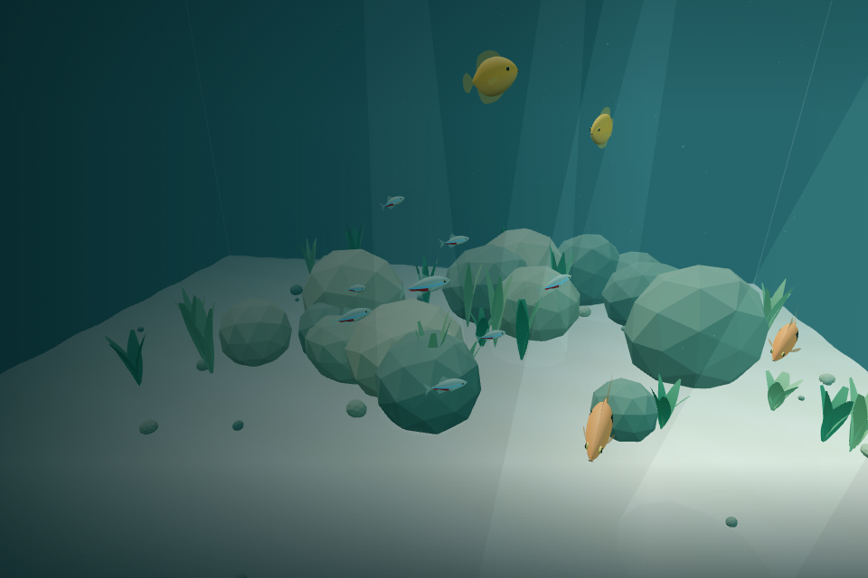
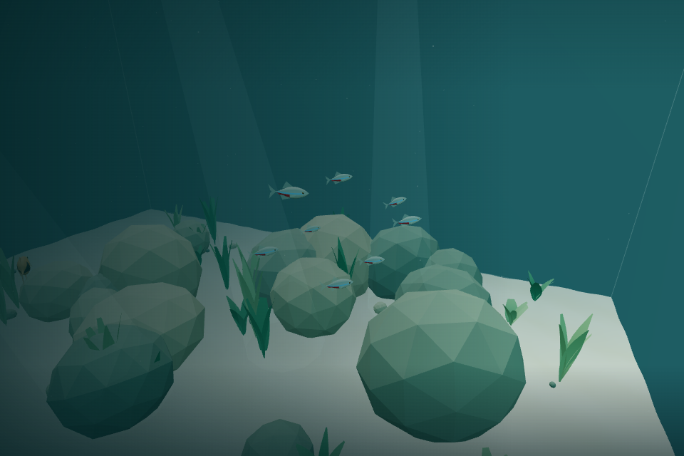
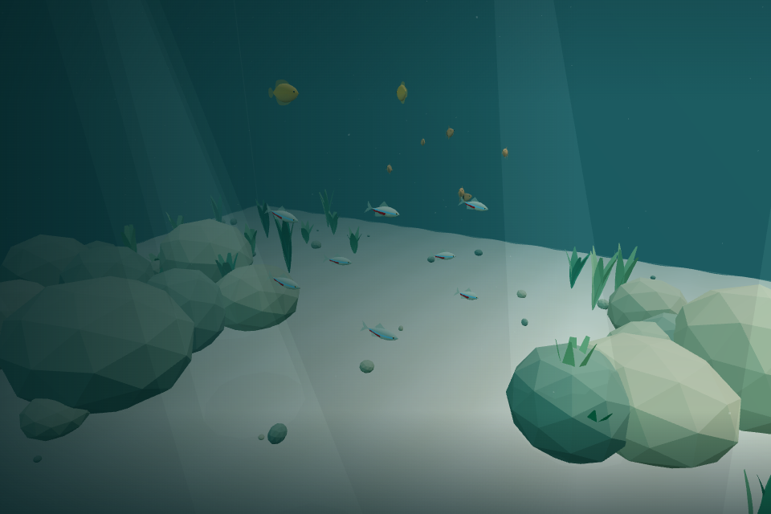

> Historical Pass 002 PR description. Current population, controls and candidate status are documented in [README](../README.md) and [Pass 006 validation](VALIDATION_V02_PASS_006.md). Counts and checklist items below describe that earlier pass.

# v0.2 Pass 002 — Schooling & Group Intelligence

The existing 8 neon tetras now form recognizable, imperfect schools; 6 harlequin rasboras coordinate in looser groups; 2 honey gouramis continue independent exploration. All species steer away from nearby bodies, including other species. Models, colors, animation, population, player swimming/collision, camera, preferences, timing, and resource ownership are preserved.

## Social steering and species differences

`FishSchooling` computes all influences from a consistent fixed-step snapshot before any fish moves. Stable unique-id evaluation and nearest-neighbor tie-breaking make updates deterministic regardless of fish iteration order. Typed scratch arrays and per-fish force buffers are allocated once; the existing 30 Hz accumulator and bounded catch-up remain intact.

- Size-aware **separation** grows smoothly at close range, caps repulsion, and uses relative closing motion for gentle deceleration. It applies across species; exact overlaps have a deterministic finite fallback direction.
- Same-species **alignment** gently follows nearby mean headings through existing angular limits, preserving individual targets, speed/temperament differences, and independent animation phases.
- Local **cohesion** attracts outside a comfortable spacing dead zone. Finite-distance reconnection lets stragglers return by ordinary swimming; there is no leader, global group waypoint, scripted path, tether, or position correction.

Tetras have stronger alignment/cohesion and less wander influence. Rasboras have larger personal gaps, weaker attraction, and more wandering. Gouramis have no social alignment or cohesion, including toward one another. Species tuning and common safety-priority parameters are centralized in `FishSpecies.ts`; no species-name checks select behavior in the new schooling module.

## Obstacle priority and stability

Existing rock/glass avoidance remains authoritative. Social attraction fades with obstacle danger, separation directed into the avoidance force is removed in restricted space, and individuals retain their own avoidance routes. Separation and closing-speed response stay below original obstacle safety. Heading/speed limits and the final candidate-position guard remain in place. Groups can stretch, split around scenery, and gradually reconnect instead of pushing one another through rocks or against glass.

## Validation and performance

All **106 tests** pass, including the existing 87 regressions, with typechecking, linting, and the production build passing. New tests cover separation/size/cross-species encounters, overlapping centers, gradual local alignment, cohesion spacing/reconnection, independent gouramis, update-order invariance, 30/60/120 FPS consistency, pause/resume, long real-aquarium simulations, obstacle splitting/regrouping, narrow passages, rocks near glass/corners, and changing depths.

See `docs/VALIDATION_V02_PASS_002.md` for measured schooling behavior, browser observations over several simulated minutes, the 32-fish stress scenario, CPU results, and honest validation limits. `docs/FISH.md` describes the snapshot architecture and complete tuning values.

The measured full population step averaged **0.054 ms for 16 fish** and **0.145 ms for 32**, with approximate p95 values of 0.100 / 0.200 ms. Timing was noisy, with rare 29.8 / 33.9 ms maxima; full details and comparison limits are recorded. Both populations retained **17 shared geometry buffers and 7 materials**. Over 180 simulated seconds observed in the renderer, 21,720 sampled pairs had zero body-envelope overlaps and zero containment corrections; a separate real-bank fixture remained clear and continued moving.

The new code adds no geometry, materials, per-fish draw cost, render passes, listeners, or per-frame model/vector allocation. The existing fish models and rendering code are unchanged. Hardware macOS performance and subjective comfort require the manual checklist below; software-browser data does not establish a hardware 60 FPS claim.

## Rendered observations

The sequence advances genuine fixed steps between rendered observations; it is not a hardware 60 FPS claim. Models and animation code are unchanged.

## Known limitations and preparation for Pass 003

Personal space and group membership are soft local preferences, not rigid collisions or global navigation. Forced/dense encounters can produce brief close passes, and fish beyond finite reconnection range can remain separated until their paths meet again. These limits allow temporary fragmentation without teleportation or abrupt acceleration. Static collider/body approximations and the original emergency containment safeguard remain unchanged.

Future individual behavior intents can feed the existing target/social/safety pipeline. Preserve per-fish RNG, consistent snapshots, unique identities, timing, and motion caps. No feeding, resting, curiosity, caution, player reaction, new species, or population increase is implemented.

## Manual macOS acceptance checklist

- [ ] Neon tetras visibly form a recognizable but imperfect school.
- [ ] Harlequin rasboras group more loosely than the tetras.
- [ ] Honey gouramis remain largely independent.
- [ ] Fish maintain natural personal space.
- [ ] Different species avoid overlapping where practical.
- [ ] Schools change shape organically.
- [ ] Individual fish retain independent swimming characteristics.
- [ ] Schools can separate around rocks and gradually regroup.
- [ ] Fish do not become trapped against glass.
- [ ] Fish do not turn or accelerate simultaneously.
- [ ] Fish models and tail animations remain natural.
- [ ] Aquarium population remains balanced at 16 fish.
- [ ] Player swimming and camera comfort remain unchanged.
- [ ] Pause/resume and reduced-motion preferences continue working.
- [ ] Performance remains smooth on macOS.

Do not merge automatically.
