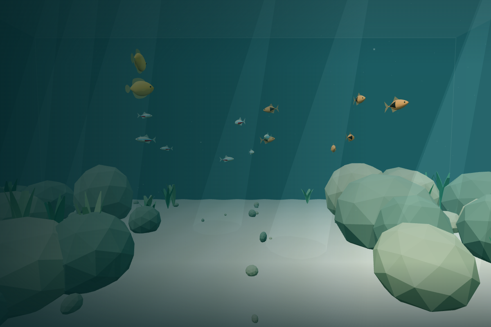
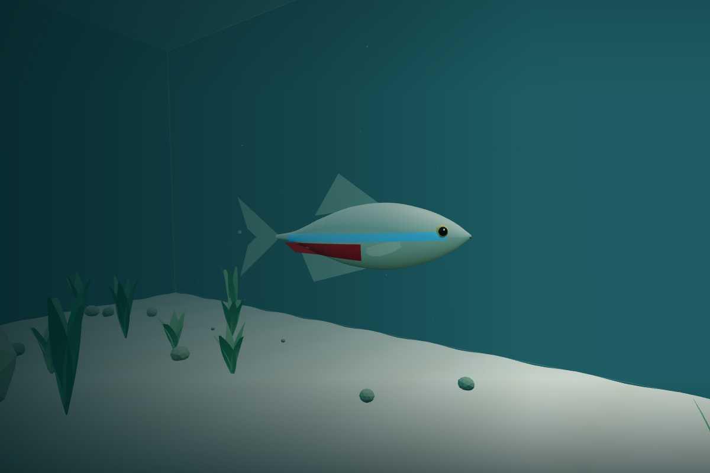
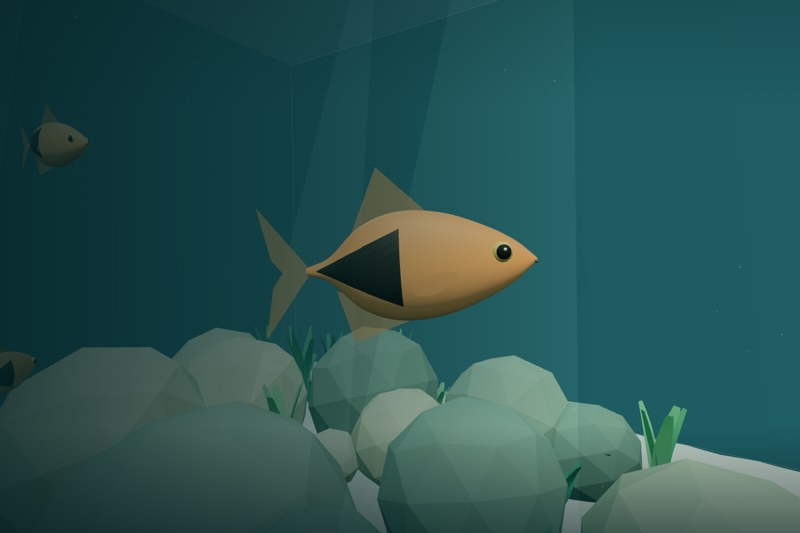
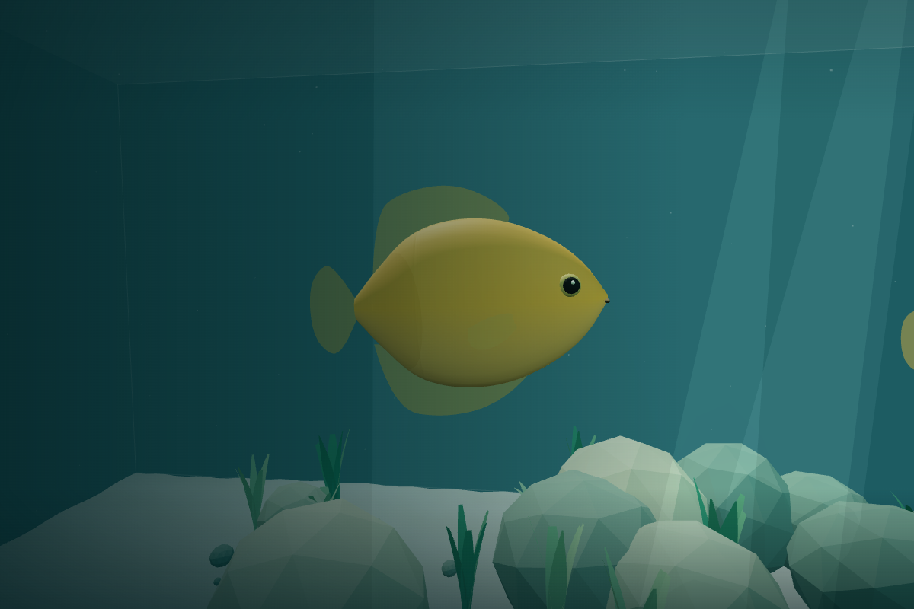

# v0.2 Pass 001 — Fish Architecture & First Species

The aquarium now contains **16 independently swimming fish**: 8 neon tetras, 6 harlequin rasboras, and 2 honey gouramis. Fish are owned by the environment and freeze with gameplay. Existing player swimming, breathing, collisions, controls, camera, preferences, scenery, and pixel-ratio cap are preserved.

## Architecture and presentation

The new `src/fish/` subsystem separates the species registry, authoritative individual state, seeded safe spawning, pure movement/habitat logic, shared model templates, and environment-owned simulation/render bridge. Three procedural silhouettes include lofted organic bodies, head/tail regions, eyes, separate caudal fins, dorsal/lower fins, and pectorals. Neon tetras carry blue/red skin bands; copper rasboras have a dark curved rear wedge; golden gouramis have deeper oval bodies and rounded fins. Shared geometry and materials belong to per-species templates and are disposed once.

A lightweight articulated rear section, caudal joint, and pectoral poses animate at individual phases. Cadence/amplitude follow actual movement speed, with restrained turn banking. Reduced motion removes bank and halves optional flex while retaining essential fin animation. No external runtime assets, new dependency, global rendering pass, or skeletal framework is introduced.

## Movement, avoidance, and timing

A pure **30 Hz fixed simulation**, bounded four-step catch-up, and interpolated visual transforms keep fish independent from player physics and render FPS. Per-fish persistent targets, preferred depths, bounded acceleration and angular speed, seeded variation, and individual timing produce distinct independent paths. Outward target samples are rejected rather than repeatedly clamped onto glass corners.

Predictive wall/rock steering reads the existing major-rock hulls through a read-only habitat, without invoking or modifying the player's swept solver. Conservative body radii and a final candidate-position safeguard prevent escaped or embedded fish. Initial population placement excludes rocks, glass, other fish bodies, and the initial diver. Foliage remains passable. There is no schooling, runtime fish separation, feeding, or diver reaction yet.

## Validation and performance

All **87 tests** pass, including all 68 existing regressions, along with typechecking, linting, and the production build. Browser checks passed for real fish/player movement, rock avoidance, pause/resume, reduced motion, preferences, 32-fish stress, and cleanup. Ten-minute simulations record zero final-guard corrections. Pure fish simulation averaged about **0.102 ms/step for 16** and **0.148 ms/step for 32** in this environment.

The fixed overview measured **270 scenery draws**, **382 with 16 fish**, and **494 with 32 fish**. Both populations share **17 geometry buffers and 7 materials**; all owned resources dispose once. Thin fins render in one pass and static eye detail shares the body draw. SwiftShader frame intervals were slow and noisy even without fish, so **60 FPS and MacBook hardware performance are not established**; see the full timing table and spike measurements in the validation record. The existing bundle advisory remains.

See `docs/VALIDATION_V02_PASS_001.md` for automated results, measured normal/32-fish scenarios, browser checks, resource cleanup, and limits. `docs/FISH.md` documents ownership, timing, tuning, and preparation for Pass 002 steering forces.

## Screenshots

Captured from real Chromium rendering in the existing aquarium; close-ups move the test camera beside individual fish without replacing the environment.

## Manual macOS acceptance checklist

- [ ] Identify all three species from the side, front, and above; inspect fins, eyes, and species markings.
- [ ] Confirm fish swim nose-first with articulated tails and subtle body/pectoral movement.
- [ ] Compare agile tetras, moderate rasboras, and slower deliberate gouramis.
- [ ] Observe several minutes: smooth acceleration/turns, independent phases/paths, no synchronized loops.
- [ ] Watch glass corners and rocky banks: early turns, no embedding, clipping, or persistent jitter.
- [ ] Confirm 16 fish feel populated without overcrowding and delicate foliage remains passable.
- [ ] Pause while watching fish, wait, resume, switch tabs/focus, and refresh. Verify frozen poses and no catch-up jump.
- [ ] Enable reduced motion: optional bank/flex recedes while tail/pectoral animation remains visible.
- [ ] Swim among visible fish and check mouse-look, breathing, all movement keys, glass limits, and rock sliding.
- [ ] Reload settings; verify preferences and deterministic initial fish population.
- [ ] Assess smooth frame rate and extended comfort on a hardware-GPU macOS browser; repeat across target browsers.

## Limitations and Pass 002 preparation

Independent local steering is not schooling or global pathfinding. Fish may overlap after spawning; runtime separation, alignment, and cohesion are reserved for Pass 002. Fish do not react to or collide with the diver. Conservative body spheres can avoid narrow gaps; an emergency containment guard can briefly hold an externally forced near-contact fish while it turns. Hulls assume static, untransformed environment coordinates. Individually articulated meshes use shared resources but still add draw calls; larger populations need measured batching/neighbor-indexing work. Procedural models are lightly stylized and use a miniature-world presentation scale.

Pass 002 can add group steering vectors over the existing authoritative entity states before avoidance and heading/speed caps. Keep individual RNG/timing, environment ownership, and final containment independent of group behavior.

No MacBook Air hardware performance or cross-browser claim is made from software-rendered Chromium. Do not merge automatically.
