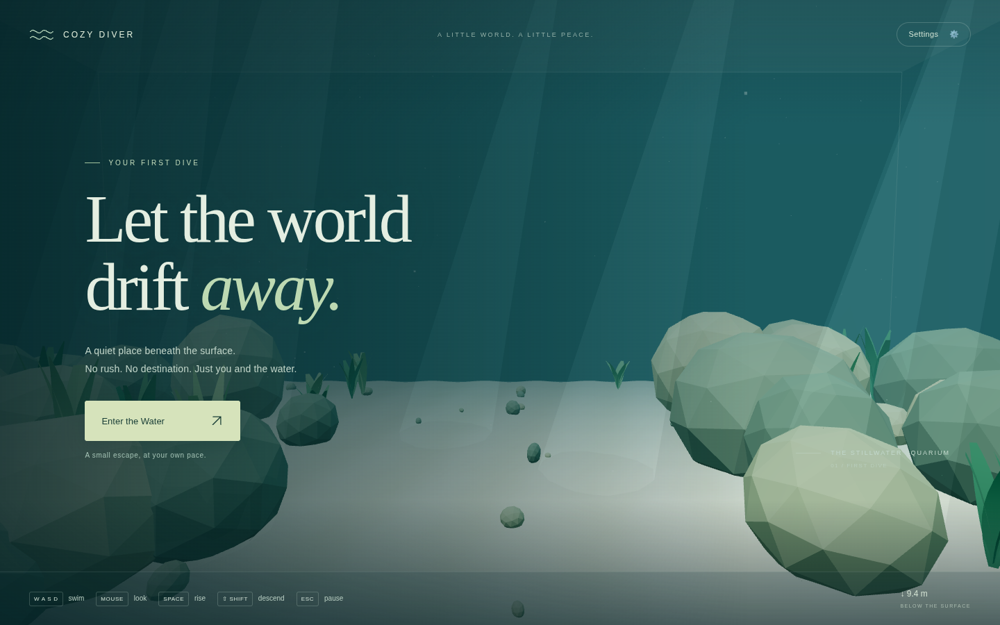
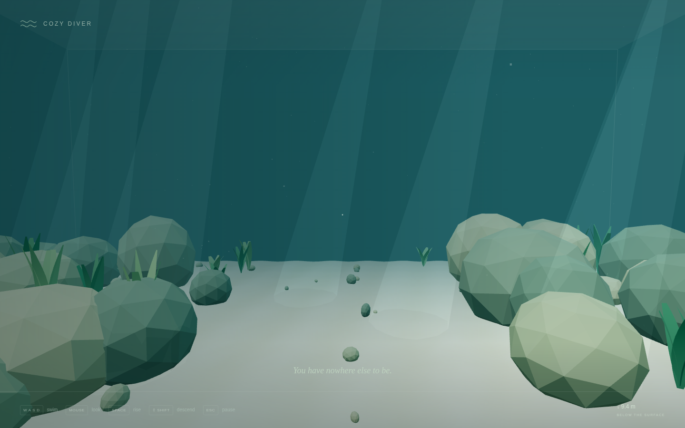

# v0.1 / Pass 001: First Dive foundation and swimming prototype

## Summary

Create Cozy Diver's first playable desktop browser prototype from the empty repository. Players enter a procedural aquarium, swim in three dimensions with calm acceleration and drag, pause with Escape, and resume. Local settings control sensitivity, swimming speed, and reduced motion. There are no backend services or remotely hosted assets.

## Architectural decisions

- Vite, strict TypeScript, and Three.js, with npm lockfile, Vitest, ESLint, and Prettier.
- Application lifecycle, rendering, environment generation, input, pure swimming logic, and UI/settings are separate modules.
- Use exact exponential movement integration and normalized camera-relative input rather than a physics engine. Clamp the player with clearance on all six aquarium boundaries.
- Generate deterministic sand, embedded rocks, plants, glass boundaries, suspended particles, and restrained light shafts from code. Cap pixel ratio and explicitly dispose owned GPU resources and listeners.
- Acquire pointer lock only following user action. Clear input/momentum on pause. Handle WebGL, storage, and pointer-lock failures with user-facing messages.
- Persist settings only. Honor system reduced motion initially and offer direct-look/reduced ambient motion.

## Tests and results

- Dependency installation and Vite development/preview startup passed.
- `npm run build`, `npm run typecheck`, and `npm run lint` passed.
- `npm run test`: 26 passed across 2 files; none skipped.
- Chromium/SwiftShader browser smoke: render, entry, WASD, mouse-look, pitch limits/no roll, vertical movement, momentum/drag, floor/surface bounds, Escape/pause/resume, settings persistence after refresh, responsive sizing, and no normal gameplay console errors passed.
- Production preview: rendering, entry/resume, WebGL unavailable/context-loss messages, blocked storage, and denied pointer lock passed.
- Build retains a nonblocking Three.js bundle-size advisory (~140.58 KB gzip JavaScript).

See [validation evidence and screenshots](VALIDATION.md). Firefox, Safari, Edge, and hardware-GPU performance were not verified. Browser tests exercised the floor/surface directly; unit tests cover all six boundaries.

## Screenshots

## Manual browser test

1. `npm ci`, then `npm run dev`; open Vite's printed address in a desktop browser.
2. Change settings, refresh, and confirm persistence. Click Enter the Water.
3. Test WASD, mouse, Space, and Left Shift, including diagonals; release keys and observe drag.
4. Look in all directions and verify no roll/flip. Swim toward each wall, the floor, and surface.
5. Escape while moving; verify pause. Resume and repeat after switching focus/tabs.
6. Resize the viewport and inspect UI/canvas. Check the console for unexpected errors.

## Known limitations

Desktop only. Rocks/plants are non-colliding scenery; only aquarium volume bounds constrain movement. No office, fish AI, customization, passages, ocean, sound, progression, accounts, or backend. Graphics-context loss requires reload. Position is not saved. Visuals are intentionally simple and need hardware-GPU/cross-browser playtesting.

## Next pass

First gather swimming-feel feedback and measure hardware-GPU performance across target browsers. Then develop v0.2 Living Aquarium with modest marine life and scene refinement within the measured budgets. The roadmap remains provisional.

## Delivery note

The remote was empty at the start. With explicit user authorization, main was created at the empty initial-history commit `6d541e4`; all prototype files remain on `codex/v0.1-pass-001-foundation`. GitHub API access still requires api.github.com to be allowed by the environment's network settings; a new domain addition was saved to the draft but not published. The API retry after creating main was denied by the network policy.
