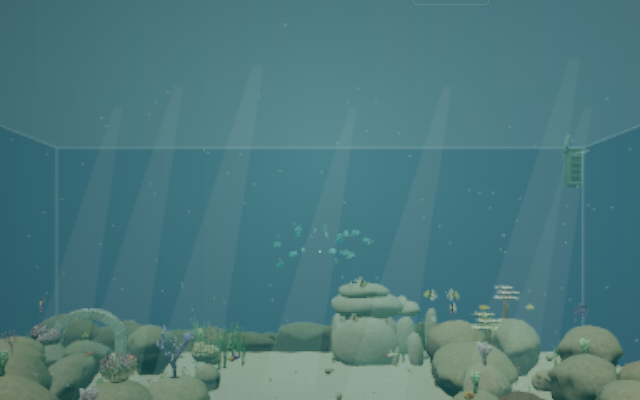
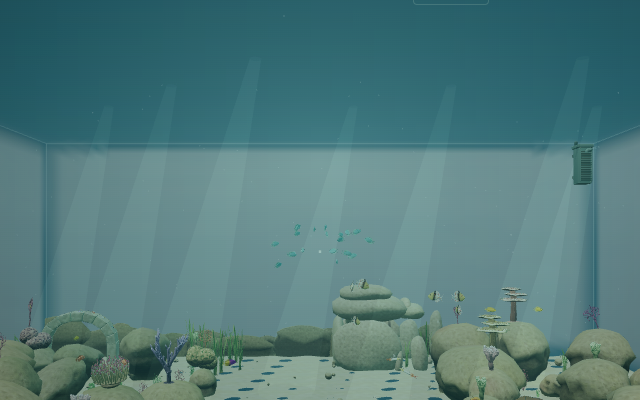
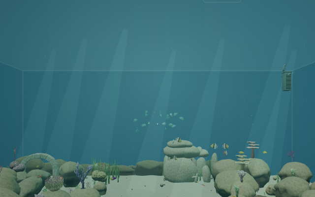

# Review of PR #43 — The glass office

Reviewed November 12, 2026 against merged `main` at `27a517868bba392020b3db470d2fa2479afac249` (`0.4.0-alpha.6`). Scope: PR #43's changes from `4d91cc2`, their integration with the existing office/dive lifecycle, and relevant checks on current main. This report does not change runtime behavior.

**Resolution:** The backdrop regression below was fixed in [PR #45](https://github.com/bryce496913/Cozy-Dive/pull/45). This report retains the original finding and evidence from `27a5178`.

## Finding

### P2 — Preserve the backdrop across the dive's scene switch

Location: `src/rendering/UnderwaterScene.ts:314–316` (new unconditional hiding of the outlook in `renderView`), in conjunction with the direct render at lines 233–234 and the office call at `src/rendering/OfficeScene.ts:323`.

With ordinary motion enabled, stand in front of the aquarium and press E to dive. At the scene switch, about 2.35 seconds into the path, the background abruptly changes from blue water to a much lighter captured office wall, with a dark area above it. This breaks the existing continuous crossing even though the camera poses and fog are matched.

The office-side frame calls `renderView`, which hides `outlook.mesh`. The first aquarium-side frame calls `render` with the outlook restored to visible. The scene switch therefore introduces an opaque backdrop in a single frame. The contact veil is partial (0.32), so it does not conceal the change. This is separate from the documented still-image/no-parallax limitations.

Keep the background consistent on both sides of the crossing, or introduce the new outlook gradually during the underwater settling phase. Ordinary office miniature rendering can still omit it. Exercise this with normal motion enabled; the reduced-motion fade can conceal the problem.

### Rendered evidence

These are real Chromium/SwiftShader renders at 640 × 400. E starts the actual dive path; its elapsed time is then staged immediately before and after `switchTime` (±0.0001 s) with zero simulation delta. Positions are staged for reproducibility. No draw calls or runtime rendering methods were stubbed. The final diagnostic frame hides only `outlook.mesh`, using the same post-switch camera, to isolate the background change. Screenshot similarity is not used as a gameplay assertion.

| Last office-side frame (2.3499 s)                                                  | First aquarium-side frame (2.3501 s)                                                                         |
| ---------------------------------------------------------------------------------- | ------------------------------------------------------------------------------------------------------------ |
|  |  |

Hiding the outlook removes the new light wall/dark upper background. Existing differences from miniature render resolution and camera FOV are outside this finding.

## Validation

- `npm run build`, `npm run typecheck`, and `npm run lint`: pass. Build retains the existing large-chunk advisory.
- Unit suite: 474 tests across 51 files. The first run passed 471 and timed out three existing simulation tests at their unchanged five-second deadlines while build/lint also ran. Rerunning their three files alone passed all 52 tests: `tests/biodiversity.test.ts`, `tests/reef-environment.test.ts`, and `tests/fish-schooling.test.ts`. No assertion failures remained; timeouts were not increased.
- Focused real browser checks: entering the office captures the outlook; held W moves the player; Escape freezes fish, plants and office time; re-entry restores control; E starts the dive and surfacing; surfacing ends at standing eye height. Both scene switches were rendered and inspected.
- GPU geometry/texture counts before the dive and after surfacing: **431 / 116**, unchanged. Application disposal, called twice, disposes the cube render target and the outlook geometry/material exactly once each.
- No browser console warnings, console errors, page errors or WebGL errors were observed. The [runtime snapshot](screenshots/review-pr043/runtime.json) records the measured states and resource counts.
- Source review covered office placement/footprints, merged geometry and texture ownership, cube capture orientation/lifetime, shader sampling/fog, miniature exclusion, and dive/surface integration. No additional actionable regression was confirmed.

## Limits

All browser evidence uses Linux Chromium with SwiftShader. It does not establish macOS performance, other browsers, or a continuous full-duration transition playtest: switch poses were staged to inspect the seam precisely. The full stress suite and the full office/dive/lifecycle harnesses reported in PR #43 were not independently rerun; this review used the focused checks above. Static capture, no parallax and simple open-plan lighting remain the PR's documented design limitations.
