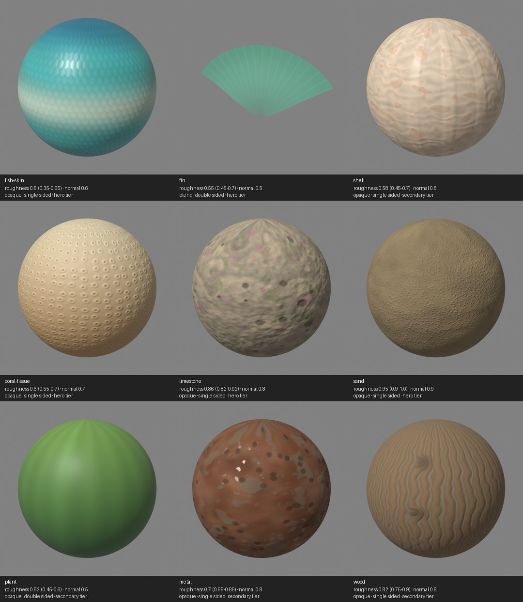

# V0.7 art production specification (Pass 063)

This is the production standard for every new or remade creature and environment asset in V0.7. It turns the approved Pass 062 benchmark treatment, **B: Crafted Stylized Realism**, into rules, templates, tools and checks.

- **The rules here are the contract.** Future art passes should follow them instead of re-deciding modelling or material conventions.
- **Where a rule needs a number**, the number lives in [`tools/art/v07/standards.json`](../tools/art/v07/standards.json). The Blender helpers and the GLB validator read that file, so the tools and this document cannot drift apart.
- **Visual acceptance stays with the user.** Passing the checks below means an asset is technically sound, not that it is approved art.

Contents:

1. Approved references
2. The style in one paragraph
3. Anatomy and proportions
4. Shape simplification and silhouette
5. Coral and plant geometry
6. Terrain and rock construction
7. Materials
8. Textures, sizes and palettes
9. Animation and deformation
10. Lighting and atmosphere
11. Transforms, naming and channels
12. Levels of detail
13. Morphs, rigs and collision
14. Ownership, disposal and loading
15. Blender workflow
16. Validation
17. Pipeline verification

## 1. Approved references

The approved assets are the Pass 062 Crafted (B) files. Treat them as the visual and technical reference for their categories.

| Reference                                  | Files                                                                                                                                                                                           |
| ------------------------------------------ | ----------------------------------------------------------------------------------------------------------------------------------------------------------------------------------------------- |
| Scene, four fixed views                    | [`docs/art-reference/v07/approved-scene-*.jpg`](art-reference/v07/) (swimming, medium, close-brain, close-staghorn). Rendered live by `style-benchmark.html?assets=crafted&lighting=crafted`.   |
| Turnarounds (four azimuths, neutral light) | `approved-rock.jpg`, `approved-brain.jpg`, `approved-branching.jpg`, `approved-seagrass.jpg`, `approved-chromis.jpg`, `approved-clownfish.jpg`                                                  |
| Models (Draco + KTX2)                      | [`src/benchmark/style/assets/style-crafted.glb`](../src/benchmark/style/assets/style-crafted.glb), `crafted-chromis.glb`, `crafted-clownfish.glb`                                               |
| Editable sources                           | [`tools/art/pass062/style-crafted.blend`](../tools/art/pass062/style-crafted.blend), `crafted-chromis.blend`, `crafted-clownfish.blend`                                                         |
| Construction code                          | [`tools/art/pass062/style_geometry.py`](../tools/art/pass062/style_geometry.py) (the `'crafted'` branches), `style_textures.py` (`*_crafted`), `fish_styles.py`                                 |
| Material library                           | [`tools/art/v07/reference/material-library.blend`](../tools/art/v07/reference/material-library.blend) and its swatch sheet [`material-reference.jpg`](art-reference/v07/material-reference.jpg) |

**Why B was chosen** (Pass 062, [`docs/V07_STYLE_BENCHMARK.md`](V07_STYLE_BENCHMARK.md)):

- It reads at every distance, including normal swimming distance.
- It feels calm and inviting.
- It is cheaper than what ships.

**The provisions that came with the approval:**

- Build forms with Natural's construction methods (slab-built rock, single grounded colonies, real antler anatomy) at Crafted's budgets.
- Keep fine pits, crusts and broken tips as close-up accents only.
- Keep the accepted fish standard.
- Adopt the sun shadow only after a hardware measurement.

## 2. The style in one paragraph

Real biology, organised for reading.

- Every animal, coral and plant is anatomically right, but its forms are grouped into a few large, clean masses.
- Those masses carry a small number of crisp accents: a ledge, a rim, a rounded tip, a bar edge.
- Colour comes in calm, controlled fields, with one gradient per surface rather than noise.
- Detail lives where the eye lands at the distance the player will see it from, and nowhere else.
- When a choice is between more detail and more clarity, choose clarity. When it is between clarity and biological truth, keep the truth and simplify around it.

## 3. Anatomy and proportions

- **Start from the real animal.** Build the species' actual body plan: cross-section, fin count and placement, mouth position, eye placement and size, tail shape. Recognisability comes from correct anatomy, not exaggeration.
- **Allowed appeal adjustments** (the approved B fish):
  - body depth up to +5 %;
  - eyes up to +12 % about their own centre;
  - median fins up to +6 % taller;
  - pectorals up to +8 %.

  Nothing beyond this. Never change fin count, mouth type, tail shape or relative fin positions. Check every adjustment in motion in the tank; if it no longer reads as the species, remove it.

- **Scale:** game units are the tank's scale, roughly real size × 5.75 (a 8 cm chromis is 0.46 m). Large animals are scaled per encounter at runtime, but are authored at their own sensible size. Category ranges are in `standards.json` (for example fish 0.08–3 m).
- **Fish** reuse the accepted chromis rig (Pass 012/016):
  - the cross-section schedule;
  - the continuous skin over the body and median fins;
  - separate pectoral pivots;
  - dimensional eyes, gills and mouth.

  New species are reshaped from it (`tools/art/pass016/fish.py`, `tools/art/pass062/fish_styles.py`), never rebuilt from primitives.

- **Large creatures** (sharks, rays, mammals): a lofted body along a curved spine with real cross-sections (`IceAnimals.ts`, Pass 025 Blender creatures).
  - Fins and flippers are separate flattened lofts, joined smoothly.
  - Avoid tubes with stuck-on cones, and blobs.

## 4. Shape simplification and silhouette

- **Three levels of form, in order:**

  | Level           | What it is            | Example                                                                   | Where it lives       |
  | --------------- | --------------------- | ------------------------------------------------------------------------- | -------------------- |
  | Primary mass    | What it is from 10 m. | The rock's slabs, the brain colony's dome, the staghorn's antler cluster. | Geometry             |
  | Secondary forms | What it is from 3 m.  | Strata steps, meander valleys, fork angles.                               | Geometry             |
  | Tertiary detail | What it is up close.  | Pores, septa, corallite cups, scale rows.                                 | Normal and base maps |

- **Silhouette first.** Review every asset as a black silhouette from four azimuths before texturing. Its outline must name it.
- **No primitives that read as primitives.** No ball-on-ball stacks, no cylinder forks, no cubes with a bevel. Primitives are allowed as construction steps (the slab superellipsoids, tubes along curves) when the result no longer reads as one.
- **Clean beats busy:**
  - B removes noise from silhouettes: even fork spacing with a clearance rule, rounded tips, a few large planes.
  - Irregularity is kept where the biology requires it (asymmetric colonies, uneven strata). It is not added for its own sake.
- **Grounding:**
  - Everything that sits on the bottom grows out of it: a buried skirt, a flared base, a holdfast, a weathered undercut.
  - Nothing floats a few centimetres up, and nothing is a sphere resting on sand.

## 5. Coral and plant geometry

**Massive and brain corals**

- One colony per model: an oval, gently lobed dome with a flared skirt into the sand.
- Never stacked spheres.
- Meandering valleys come from the zero-crossings of band-limited 3D noise:
  - about 14 broad, rounded valleys across a colony, so they read at swimming distance;
  - septa only in the maps.
- A dead or turf-covered fringe at the base is allowed.

**Branching corals**

- Near-cylindrical branches that keep their diameter: taper at most 15 % per branch.
- Wide fork angles.
- Rounded or slightly swollen growing tips, paler than the base.
- A clearance rule keeps branch tips at least 0.2 m apart at hero scale.
- A thicket grows from a fused base; there are no visible disc pedestals.

**Plate, fan and soft corals** follow the same logic:

- a clear primary mass;
- regular but not repeating secondary structure (fan lattice cells, plate growth rings);
- the gradient from base to edge carried in vertex colour.

**Seagrass and algae**

- Strap blades with a consistent width, a gentle S-curve and rounded tips.
- 3-column ribbons with a slight midrib fold.
- Shoots of 2–5 blades.
- Colour runs deep green at the base to light green at the tip, in vertex colour.
- Macroalgae: segments or blades with real attachment.

**Budgets:**

| Asset       | Triangles                                    |
| ----------- | -------------------------------------------- |
| Hero coral  | ≤ 20 k (approved staghorn 6.8 k, brain 20 k) |
| Plant clump | 200–1,500                                    |

**Plant sway:**

- Plants carry their per-stem phase in UV1 (`Phase`).
- The runtime's plant-motion contract bends with normalised height, so author plants upright from y = 0.

## 6. Terrain and rock construction

**Rocks**

- Build rocks as the union of a few overlapping slab blocks (superellipsoids with exponent about 3.2–3.4), sampled along rays from a common centre. This gives real ledges and overhangs (`style_geometry.rock`).
- Then add:
  - broad strata steps (two or three, softly rounded);
  - a few clean hollows;
  - one tilted top face;
  - a weathered undercut at the sand line.
- Smooth so the planes read first.
- Bury the foot about 0.1 m.
- A hero rock is ≤ 20 k triangles.

**Terrain**

- Large terrain (walls, seabeds, caves) is procedural geometry with the shared world-space triplanar material (`src/rendering/Triplanar.ts`).
- Add rock detail through:
  - geometry for ledges and breaks;
  - the limestone maps for surface.
- A regular ridge pattern must be broken up by a second, irregular frequency.

**Vertex colour**

- Carries cavity AO, cooler undersides, lighter sun-facing tops and sand-staining near the base.
- The maps stay neutral luminance and mineral detail, so one map set serves many tints.

**Sand**

- Is the shared tank sand (Pass 014 maps).
- Large ripples stay in geometry.
- Contact darkening near structures goes in vertex colour.

## 7. Materials

Every visible material is built from a template in `standards.json` with `cozy_art.pbr_material`. Templates fix the roughness range, metalness, normal strength, sidedness, alpha mode and required maps.

| Template       | Roughness | Metal        | Normal | Sides / alpha  | Maps              | Tier      | Notes                                                               |
| -------------- | --------- | ------------ | ------ | -------------- | ----------------- | --------- | ------------------------------------------------------------------- |
| `fish-skin`    | 0.35–0.65 | 0            | 0.6    | single, opaque | base, normal, ORM | hero      | Calm scale relief; species colour in the base map.                  |
| `fin`          | 0.45–0.7  | 0            | 0.5    | double, blend  | base (with alpha) | hero      | Ray detail and edge alpha in the base map; depth write off.         |
| `shell`        | 0.45–0.7  | 0            | 0.8    | single, opaque | base, normal, ORM | secondary | Growth ridges in geometry; gloss only on worn crests.               |
| `coral-tissue` | 0.55–0.7  | 0            | 0.75   | single, opaque | base, normal, ORM | hero      | Cups and septa in maps; base-to-tip gradient in vertex colour.      |
| `limestone`    | 0.82–0.92 | 0            | 0.8    | single, opaque | base, normal, ORM | hero      | Triplanar at runtime; AO from cavity in vertex colour.              |
| `sand`         | 0.9–1.0   | 0            | 0.9    | single, opaque | base, normal, ORM | hero      | Shared tank sand.                                                   |
| `plant`        | 0.45–0.6  | 0            | 0.5    | double, opaque | base, normal, ORM | secondary | Veins and midrib in maps; gradient in vertex colour; phase in UV1.  |
| `metal`        | 0.55–0.85 | 0–0.85 (map) | 0.8    | single, opaque | base, normal, ORM | secondary | Metal only on worn bare edges; crust and rust are rough dielectric. |
| `wood`         | 0.75–0.9  | 0            | 0.8    | single, opaque | base, normal, ORM | secondary | Waterlogged: soft grain, worn edges, silt in grooves.               |

**Specular response**

- Everything organic is dielectric (metalness 0).
- Highlights should reveal curvature, never chrome.
- Wet tissue sits in the 0.55–0.7 roughness range; mineral surfaces at 0.82 and above.
- Gloss is a local accent: worn rib crests, bare metal edges. Never a whole-surface property.

**No new shader for each asset.** The runtime has three material paths:

- standard PBR (`MeshStandardMaterial`);
- triplanar terrain;
- the plant-motion material.

A new shader needs a measured reason and its own review.

**Reference:** every template is applied to a standard swatch in `tools/art/v07/reference/material-library.blend`. Append materials from there to start a new asset.



## 8. Textures, sizes and palettes

**PBR map set**

| Map                 | Colour space | Contents                                                                                                          |
| ------------------- | ------------ | ----------------------------------------------------------------------------------------------------------------- |
| `<stem>-base.png`   | sRGB         | Luminance and mineral detail. Species hue comes from vertex colour unless the map is a painted skin, as for fish. |
| `<stem>-normal.png` | linear       | Tangent-space normal map.                                                                                         |
| `<stem>-orm.png`    | linear       | R occlusion, G roughness, B metalness.                                                                            |

- Fins use `<stem>-fins.png` with alpha.
- Stems are lowercase-kebab, prefixed by pass: `p062-crafted-rock`, `p063-metal`.
- Authoring PNGs live in `tools/art/textures/<pass>/`; `compress.mjs` re-encodes from them by name.

**Texture size follows screen importance, not the asset's size in the world:**

| Tier         | Edge    | For                                                                                                                                                                   |
| ------------ | ------- | --------------------------------------------------------------------------------------------------------------------------------------------------------------------- |
| `hero`       | 512 px  | Anything seen at close range in ordinary exploration: fish, hero corals and rocks, tank sand.                                                                         |
| `secondary`  | 256 px  | Mid-ground repeats: plant clumps, shells, wreck fittings, debris.                                                                                                     |
| `background` | 128 px  | Distant scenery, far creatures, encounter animals seen briefly.                                                                                                       |
| maximum      | 1024 px | Only with a measured, visible improvement at the views where it matters. Pass 062 A showed 1024 px costs 4× GPU memory for detail that shimmers at swimming distance. |

The validator warns above an asset category's tier and errors above 1024.

**Detail rules**

- Normals are low-frequency and calm: crafted maps use about 0.6× the natural slope.
- Accents are crisp but sparse: a few varied pockets, not polka dots.
- No large regular repeats.
- Colour fields are evened: value pulled toward a broad local mean.

**Core palette** (sRGB vertex tints from the approved B benchmark; maps stay near neutral):

| Surface              | Base                         | Accent / tip                 |
| -------------------- | ---------------------------- | ---------------------------- |
| Staghorn tissue      | `#CC9961` ochre              | `#FAEDCC` cream tips         |
| Brain coral          | `#C29E61` ridge ochre        | `#94B88F` mint valleys       |
| Seagrass             | `#38663D` deep green (base)  | `#80AD57` light green (tip)  |
| Limestone            | `#FFF7EB` × map (warm stone) | cooler, darker undersides    |
| Sand                 | `#AD9E85`                    | crest-lit +4 % lightness     |
| Tank water (B light) | `#2A6E86`                    | key `#FFE6BF`, rim `#8ADBE4` |

**Colour rules**

- Keep saturation controlled: one saturated hue per animal (the clownfish orange, the chromis teal), surrounded by calmer neutrals.
- Warm keys against cool water.
- No neon, no pure white except small highlights (clownfish bars, coral tips).

## 9. Animation and deformation

- **Fish and swimming creatures deform; they are never rotated rigidly.** The contract is two morph targets named exactly `Stroke_Left` and `Stroke_Right`:
  - on `Body` and `Median_Fins` (fish);
  - on `Body` (creatures);
  - transferred to every `_LOD1` mesh.

  The runtime sets the influence from swimming effort (`creatureStroke`, `PosedFish`). There are no timers in the asset.

- **Paired fins** are separate meshes on pivot nodes (`Pectoral_Left`, `Pectoral_Right`). The runtime drives their flutter. Their node translation is the pivot and must be preserved.
- **Bend shape:** the bend is continuous from behind the head to the tail tip. The head stays nearly still and the peduncle bends most. Median fins follow the same deformation field as the body.
- **Optional clips:** glTF animation clips (such as `SwimPreview`) are allowed for authoring and review. The game drives morphs procedurally, so clips are never required. Every channel must target an existing node, and weight samplers must carry keys × targets outputs; the validator checks this.
- **Plants** sway from their UV1 phase and normalised height. Corals and rocks are static.
- **Pause and reduced motion** are handled by the runtime. Assets must not bake motion into geometry.

## 10. Lighting and atmosphere

The approved direction is B's:

- clearer, slightly warmer water with gentle depth falloff;
- a warm directional key;
- a cool rim or fill that separates silhouettes from the water;
- moderate ambient, never so high that it flattens forms;
- grounding from contact shadow.

**Implementation is staged, not part of this pass:**

- **Shadows:** the soft sun shadow is the largest grounding gain and the largest cost (about +75 % draws in the benchmark scene). It is adopted only after a hardware measurement, probably as a camera-local shadow.
- **Fog and colour:** fog density, colours and exposure are per-world tuning. The tank's values are shared config (`src/config/tankLighting.ts`).
- **Atmosphere:** depth darkening in the outer blue and the wreck's low visibility are approved per-world moods (Pass 061). Keep them.
- **No bloom, full-screen postprocessing or particles** to rescue weak assets. Fix the asset.

**Author for the light the game uses:**

- Review new assets in the style benchmark page under B lighting.
- Then review them in the target world.
- Neutral turnarounds (grey, one key, Standard transform; `tools/art/pass062/turnaround.py`) are for judging shape and material without water.

## 11. Transforms, naming and channels

| Rule               | Standard                                                                                                                                                                                                                                                |
| ------------------ | ------------------------------------------------------------------------------------------------------------------------------------------------------------------------------------------------------------------------------------------------------- |
| Units              | Metres in game units; author at final size, never rely on node scale.                                                                                                                                                                                   |
| Up axis            | glTF / game +Y. Author in Blender +Z and export with `export_yup=True`. `cozy_art` takes game-space arrays and converts.                                                                                                                                |
| Forward            | Fish and creatures face +X; head toward +X, dorsal toward +Y.                                                                                                                                                                                           |
| Origin             | **Fish:** body centre on the lateral line. **Swimming creatures:** body centre. **Crawlers:** ventral contact point. **Reef pieces and props:** on the ground plane at the footprint centre, with any buried part below 0. **Plants:** at the holdfast. |
| Transforms         | Apply rotation and scale before export: mesh nodes have unit, positive, uniform scale. Only pivots (pectorals) and the library-staging root carry translations. Negative scale is an error (it mirrors winding).                                        |
| Root               | One `<Asset>_Root` empty per asset, carrying `category`, `standards` version and provenance extras. The runtime ignores its translation.                                                                                                                |
| Node names         | `PascalCase_With_Underscores` (`Body`, `Median_Fins`, `Coral_Branching`, `Seagrass_0`). Variants are `_0`, `_1`, …. Distance levels are `_LOD1`, `_LOD2`.                                                                                               |
| Helper nodes       | `COLLIDER_<name>_<i>` (convex hull point sets, hidden, `collision_points` extra). `DYNAMIC_<name>` (movable parts).                                                                                                                                     |
| Materials          | `<Asset>_<Template-ish>` (`Crafted_Rock`, `Chromis_Scale_Skin`), with a `template` extra naming its standards template.                                                                                                                                 |
| Textures           | `p<pass>-<asset>-<material>-{base,normal,orm,fins}`.                                                                                                                                                                                                    |
| Vertex data        | `Col` (linear RGBA, from sRGB authoring tints) and UV0 `UVMap`. UV1 `Phase` only for plants.                                                                                                                                                            |
| Animation channels | Morph names exactly `Stroke_Left`, `Stroke_Right` (glTF `extras.targetNames`). Clip names are PascalCase.                                                                                                                                               |

## 12. Levels of detail

| Level | Screen distance           | Expectation                                                                                                         |
| ----- | ------------------------- | ------------------------------------------------------------------------------------------------------------------- |
| LOD0  | Close (under about 4 m)   | The full authored mesh.                                                                                             |
| LOD1  | Medium (about 4–12 m)     | 12–35 % of LOD0 triangles. Silhouette kept, morphs transferred; tiny appendages (pectorals, small spines) may drop. |
| LOD2  | Distant (12 m and beyond) | 4–12 % of LOD0. Static scenery only. Fish and creatures stop at LOD1; no impostors.                                 |

- **Fish:** the accepted fish have LOD1 at about 1.8 k triangles against 12.7 k (`tools/art/pass017/fish_lod.py`, which transfers the stroke morphs). New fish must ship with it.
- **Static assets:** use `cozy_art.add_lod(obj, ratio, level)`, a decimated copy within the standard ratio range. It refuses morph-carrying meshes.
- **Don't add triangles to look detailed.** Budgets are ranges, not targets, and the hero ceiling is a ceiling (`standards.json` `budgets`). The approved B rock and brain are 20 k; the staghorn is 6.8 k.
- **No pop-in by position.** The outer reef draws one detail level to 30 m by request (#108). New level-of-detail switching must not reintroduce visible popping. When in doubt, choose a lighter LOD0.

## 13. Morphs, rigs and collision

- **Morphs:**
  - every primitive of a morphing mesh carries the same targets;
  - every target has `POSITION` deltas for every vertex;
  - weights length equals targets;
  - target names are exported;
  - LOD meshes carry the same names as their LOD0.

  Reshaping a fish (proportions, eye size) must move the basis and every morph target by the same per-vertex offset (`fish_styles.reshape`). This keeps the bend identical.

- **Pivots:** pectoral fin nodes keep their pivot translation. Scale their mesh data, not the node.
- **Collision:**
  - Structural pieces carry hidden convex point sets (`COLLIDER_*`, `collision_points: true`; `cozy_art.collider_from_points`). These are rebuilt into exact convex hulls at runtime (`AssetCollision`, `reefColliders`).
  - Collision follows the visible form's primary mass, not its surface detail.
  - A new asset that replaces a collidable one must keep or regenerate its collision. The swimmer's and fish's collision paths must stay valid (`tests/*collision*`).
- **Skinned rigs:** none ship today (morph deformation is the contract). If one is introduced, `AssetLoader` clones skeletons with `SkeletonUtils`, and validation must be extended.

## 14. Ownership, disposal and loading

- **`AssetLoader`** (`src/assets/AssetLoader.ts`):
  - Owns decoded geometries, materials, textures and image bitmaps: one cache entry per asset ID.
  - `acquire(id)` returns a lease, a cloned hierarchy that owns only its clone state.
  - `release()` is idempotent. Shared resources are disposed after the last lease is released.
  - Draco and KTX2 decoders are local (`public/assets/draco`, `public/assets/basis`). External URLs are rejected.
- **Registration:** every shipped model is registered in `src/assets/AssetRegistry.ts` with its required nodes, authored dimension range and morph requirement. `validateAsset` runs on load.
- **Procedural assets** (`PROCEDURAL_ASSETS`) build in code but go through the same lease and validation path.
- **Systems own what they create.** A system owns:
  - its material clones (triplanar variants, tinted copies);
  - its instanced meshes;
  - its morph and instance buffers.

  It disposes them in its `dispose()`. Nothing is rebuilt each frame.

- **Shared resources** are disposed once, by their owner. Use the `own()` / `disposeAsset` patterns already in `AuthoredReef`, `StyleBench` and the world scenes.
- **No benchmark-only or reference asset enters `public/`.** Benchmark models live in `src/benchmark/**/assets` and are bundled only by `npm run build:benchmark`.

## 15. Blender workflow

The Blender 5.1 Python module (`pip install bpy==5.1.2`) or `blender -b --python`. Shared helpers: [`tools/art/v07/cozy_art.py`](../tools/art/v07/cozy_art.py).

```python
import sys; sys.path.insert(0, 'tools/art/v07')
import cozy_art as ca

ca.reset_scene()
root = ca.create_root('Grouper_Root', category='creature', species='queensland-grouper')
skin = ca.pbr_material('Grouper_Skin', 'fish-skin', 'p070-grouper-skin', roughness=0.5)
body = ca.mesh_from_arrays('Body', positions, faces, uvs, colours, skin, root)  # game-space arrays
for warning in ca.check_scene('creature'):  # raises on export mistakes
    print(warning)
ca.save_blend('tools/art/pass070/grouper.blend')  # packed, compressed, editable
ca.export_glb('tools/art/pass070/out/grouper.glb')  # the one standard export configuration
```

Then compress and validate:

```bash
node tools/art/pass017/compress.mjs public/assets/models
```

```bash
node validation/AssetStandards.ts public/assets/models/creatures/grouper.glb
```

**Order of work for a new asset:**

1. Gather species references and choose the category and template.
2. Block the primary mass and check the silhouette (four azimuths).
3. Add secondary forms.
4. Write or choose maps at the right tier.
5. Apply vertex tints.
6. Add LOD, collision and morphs.
7. Run `check_scene`, save the `.blend` and export.
8. Compress.
9. Validate.
10. Do a neutral turnaround (`tools/art/pass062/turnaround.py` pattern).
11. Review in the style benchmark and in the target world.
12. Get user visual acceptance.

**Rules**

- **Reproducibility:** authoring is code. Use seeded numpy construction, with the scripts beside their `.blend` and textures. Generated texture PNGs may be git-ignored when they are deterministic and packed in the `.blend`, as for Pass 062.
- **Re-importing a shipped GLB is not supported:** Blender cannot import KTX2. Scripts that start from an existing model read the uncompressed authoring copy (for example `tools/art/pass017/accepted/*.glb`).

## 16. Validation

**Automated:** [`validation/AssetStandards.ts`](../validation/AssetStandards.ts), run as `node validation/AssetStandards.ts --all` and by `tests/asset-production.test.ts`.

**Errors:** export mistakes that break or visibly damage an asset.

| Check          | Error when                                                                                                                                                                                                       |
| -------------- | ---------------------------------------------------------------------------------------------------------------------------------------------------------------------------------------------------------------- |
| Required nodes | A category node is missing (fish: `Body`, `Median_Fins`, `Eyes_Gills_Mouth`, `Pectoral_Left`, `Pectoral_Right`).                                                                                                 |
| Scale          | The largest visible dimension is outside the category range: wrong units or unapplied scale.                                                                                                                     |
| Transforms     | Non-finite values or negative scale.                                                                                                                                                                             |
| Geometry       | Missing `POSITION`/`NORMAL`/`TEXCOORD_0`, non-finite data, indices out of range, index count not a multiple of 3, or more than 2 % degenerate triangles.                                                         |
| PBR maps       | A textured material with only part of the base/normal/ORM set (the blended `fin` template needs base only).                                                                                                      |
| Texture size   | Above 1024 px.                                                                                                                                                                                                   |
| Morphs         | Mismatched target counts across primitives, missing target names, weights ≠ targets, missing or non-finite deltas, a required morph missing (`Stroke_Left`/`Stroke_Right`), or LOD morphs that differ from LOD0. |
| Animation      | A channel without target or sampler, weights on a mesh without targets, wrong sampler output count, or non-finite keys.                                                                                          |

**Warnings:** for review.

- Untextured materials, except eyes and similar small parts.
- Textures above the category tier.
- Non-power-of-two textures.
- Missing LOD1.
- Non-uniform scale.
- Naming deviations.
- Any degenerate triangles.
- Metal without an ORM map.

**Today's state:** all 55 shipped and benchmark GLBs pass with zero errors. Notable warnings:

- The wreck props' untextured `Metal`, `Equipment`, `Dark`, `Growth` and `Sand` materials (`reef-props.glb`).
- 12 degenerate triangles in the frogfish lure.
- The benchmark candidate fish have no LOD1.
- Pass 062 A's 1024 px maps are over tier, as intended for a rejected treatment.

These are the first items for the art passes that touch those assets.

**Asset checklist** (copy into each art PR):

- [ ] Category, template(s) and texture tier chosen; species reference gathered.
- [ ] Silhouette reviewed from four azimuths, with no primitive read and no stacked forms.
- [ ] Correct anatomy; appeal adjustments within the section 3 limits.
- [ ] Grounded: buried skirt, holdfast or undercut; nothing floats.
- [ ] Units, +Y up, +X forward, origin rule, transforms applied, no negative scale.
- [ ] Names: `<Asset>_Root`, `PascalCase` nodes, `_LOD1`, `COLLIDER_*`, template extra on materials.
- [ ] Base, normal and ORM maps (fins: base with alpha) at the screen-importance tier; maps neutral, hue in vertex colour.
- [ ] Morphs `Stroke_Left`/`Stroke_Right` on the contract meshes and their LODs; pivots preserved.
- [ ] LOD1 within 12–35 % (LOD2 for static scenery); triangle count inside the budget range.
- [ ] Collision kept or regenerated for structural pieces.
- [ ] `check_scene` clean, `.blend` saved and packed, exported with `export_glb`, compressed with `compress.mjs`.
- [ ] `node validation/AssetStandards.ts <file>`: zero errors, warnings explained.
- [ ] Registered in `AssetRegistry` with the dimension range and morph requirement; loads and disposes through `AssetLoader`.
- [ ] Neutral turnaround plus style-benchmark (B lighting) plus target-world screenshots in the PR.
- [ ] Draw calls, triangles and texture memory recorded against the asset it replaces.
- [ ] User visual acceptance requested (passing checks is not acceptance).

## 17. Pipeline verification (Pass 063)

The Pass 062 build scripts now use the shared helpers (`pbr_material`, `mesh_from_arrays`, `check_scene`, `save_blend`, `export_glb`). The approved Crafted assets were regenerated through them and compared with the approved Pass 062 exports:

| Asset                                                           | Binary buffers (geometry, morph deltas, images) | glTF JSON, ignoring extras | Difference                                     |
| --------------------------------------------------------------- | ----------------------------------------------- | -------------------------- | ---------------------------------------------- |
| `style-crafted.glb`, `style-natural.glb`                        | identical                                       | identical                  | Each material gains a `template` extra.        |
| `crafted-chromis.glb`, `crafted-clownfish.glb`, `natural-*.glb` | identical                                       | identical                  | Skin and fin materials gain `template` extras. |

**Geometry, UVs, vertex colours, morph targets, pivots, materials and textures are preserved byte for byte.** After compression, the in-engine Crafted benchmark captures match the Pass 062 approved captures (see the PR for hashes).
