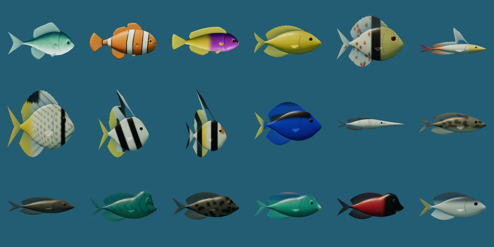
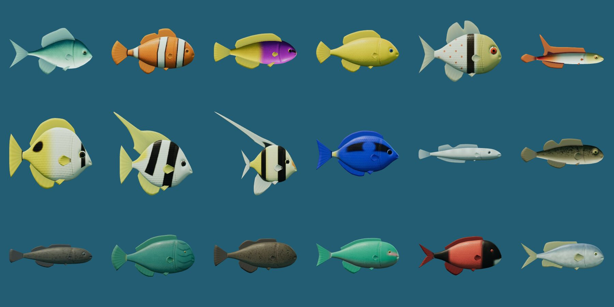

# V0.7 fish roster overhaul (Pass 066)

All 18 fish species are now built on the approved Pass 065 hero-fish builder (`tools/art/pass065/hero_fish.py`). The roster specifications are in [`tools/art/pass066/roster.py`](../tools/art/pass066/roster.py), with Blender sources beside it.

Before this pass, all 15 non-hero species were reshaped, recoloured copies of one chromis rig. Each now has species anatomy from one of four body families, its own tail type and fin layout, and its own painted markings.

What did not change:

- each species' authored size and root name;
- the runtime rig contract: `Body`, `Median_Fins`, `Eyes_Gills_Mouth`, pivoted pectorals, `Stroke_Left/Right` morphs and `_LOD1` levels.

So swimming, schooling, habitats, avoidance, the catalog and aquarium customization behave exactly as before. There are no runtime code changes, and no species, populations or encounter rates changed.

## Species-quality matrix

| Species              | Body family         | Silhouette and anatomy                            | Tail       | Markings and material                                 |
| -------------------- | ------------------- | ------------------------------------------------- | ---------- | ----------------------------------------------------- |
| Blue-green chromis   | Oval damsel (hero)  | Compressed oval                                   | Forked     | Blue-green countershading                             |
| Ocellaris clownfish  | Oval damsel (hero)  | Stout; notched dorsal fin                         | Rounded    | Three white bars with black margins; black fin edges  |
| Royal gramma         | Oval basslet (hero) | Elongate oval                                     | Truncate   | Violet to gold; black eye line                        |
| Yellow assessor      | Oval basslet        | Stocky oval                                       | Rounded    | Golden yellow, darker back                            |
| Pajama cardinalfish  | Oval, deep-bodied   | Deep body, large eye, split dorsal fin            | Forked     | Yellow-olive head, dark mid band, red spots, red iris |
| Firefish             | Elongate            | Slender body, tall first-dorsal pennant           | Rounded    | Cream and yellow head, red to crimson tail            |
| Butterflyfish        | Compressed disc     | Tall disc, short snout                            | Truncate   | Yellow rear, black eye bar, dark spot near the tail   |
| Bannerfish           | Compressed disc     | Disc with a long dorsal banner                    | Truncate   | Two black diagonal bands, yellow rear                 |
| Moorish idol         | Compressed disc     | Tall disc, protruding snout, long trailing dorsal | Lunate     | Black bands, orange snout saddle                      |
| Blue tang            | Compressed disc     | Oval disc, long low dorsal and anal fins          | Emarginate | Royal blue, black "palette" marking, yellow tail base |
| Antarctic icefish    | Elongate            | Broad flat head, large eye, two-part dorsal       | Truncate   | Pale translucent grey with faint bars; rougher skin   |
| Notothen             | Elongate            | Blunt head, two-part dorsal, large pectorals      | Rounded    | Mottled olive-brown with dark blotches                |
| Patagonian toothfish | Elongate            | Long robust body, two-part dorsal                 | Truncate   | Dark grey, mottled                                    |
| Humphead wrasse      | Robust / large      | Forehead hump, deep body                          | Rounded    | Green-blue with wavy head lines; yellow fin edges     |
| Giant sea bass       | Robust / large      | Heavy body, spiny dorsal                          | Truncate   | Dark bronze with black spots                          |
| Parrotfish           | Robust / large      | Robust body, fused beak                           | Emarginate | Teal with a pink belly and face stripe; pale beak     |
| California sheephead | Robust / large      | Forehead hump                                     | Lunate     | Black head and tail, red middle, white chin           |
| Trevally             | Robust / large      | Deep fusiform jack body                           | Lunate     | Silver flanks, blue-grey back, low roughness          |

## Performance

- **Per fish:** every species is below the old rig. Near detail is about 10–11.6k triangles, down from 12,686. The distance level is under 2.6k triangles, with skin and fins morphing.
- **Gallery (all 18 fish, near detail):** 195 → 180 draw calls, and 292k → 277k triangles.
- **Files:** about 0.69–0.75 MB each with Draco and KTX2. Each species now has its own four 512 px maps rather than shared, retinted chromis maps, so the download is larger.

## Validation

- **Gallery renderer:** `validation/v07/gallery.html` and `gallery.mjs` render all 18 shipped GLBs in-engine, through `AssetLoader`, under the tank's water and light rig. Before and after shots are above.
- **Tests:**
  - `tests/hero-fish.test.ts` checks that all 18 species pass the V0.7 production checks with no errors or warnings, and stay within the near and distance budgets.
  - `tests/fish-assets.test.ts` now checks the runtime rig contract instead of matching the old chromis topology.
  - The fish, asset, tank, outer, wreck, kelp and ice suites pass.
- **Checks:** typecheck, lint and build all pass.

## Limitations

- **Gramma:** the dorsal-fin spot is still not modelled, and each fish uses one fin map, so fins can't differ in colour per fin.
- **Visual review:** stills only, through SwiftShader. Schooling overlap and fin translucency need a short look in the real game.
- **Aquarium additions:** these use the same files, so they display identically to the main-world fish.
