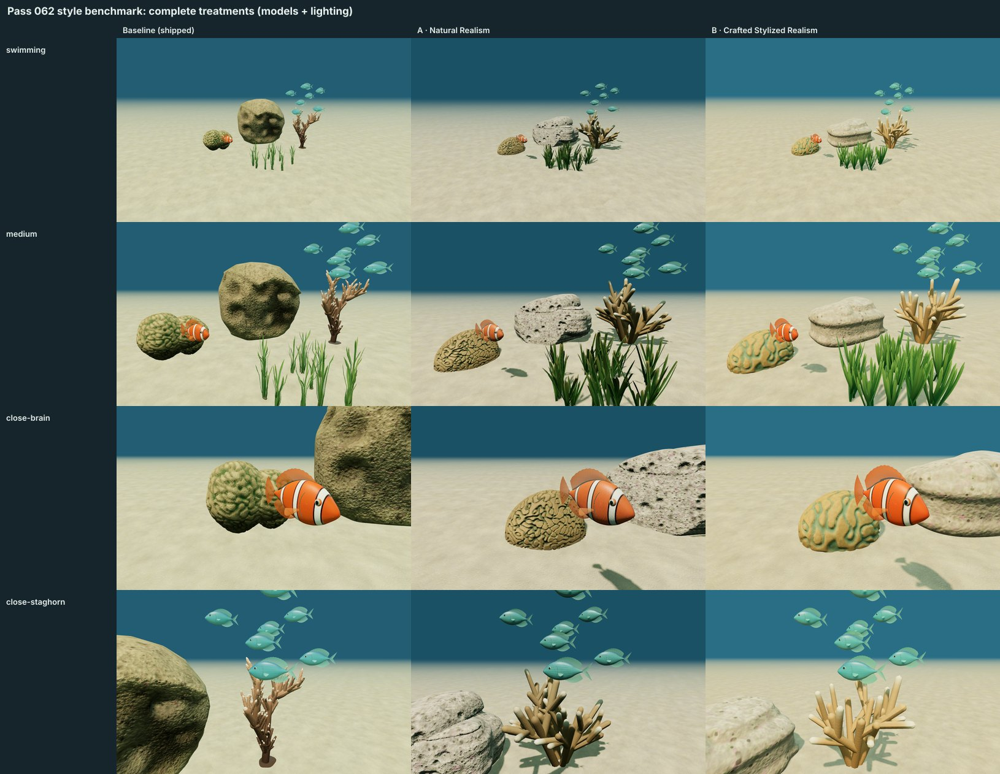
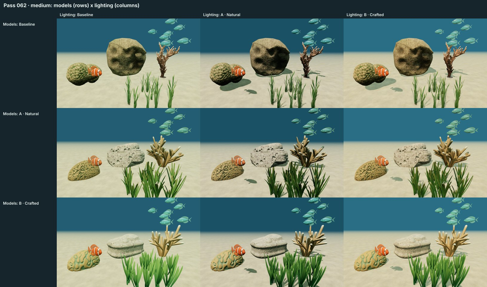
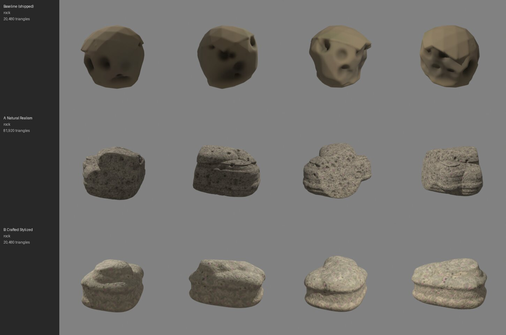
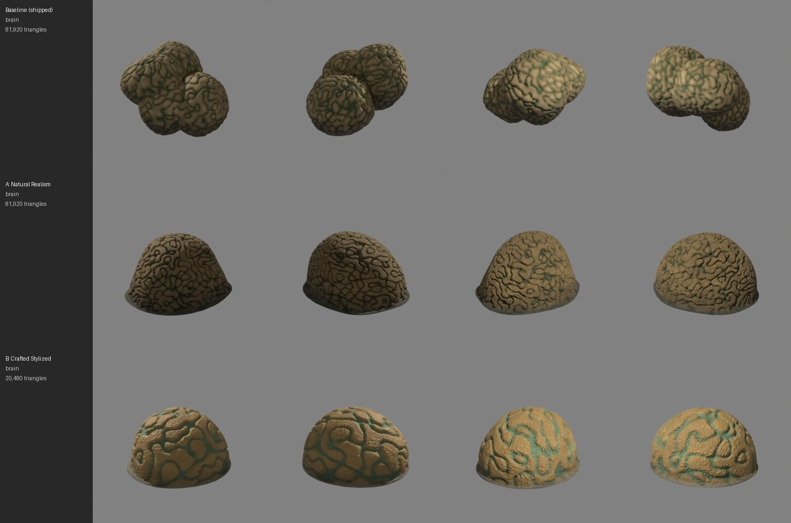
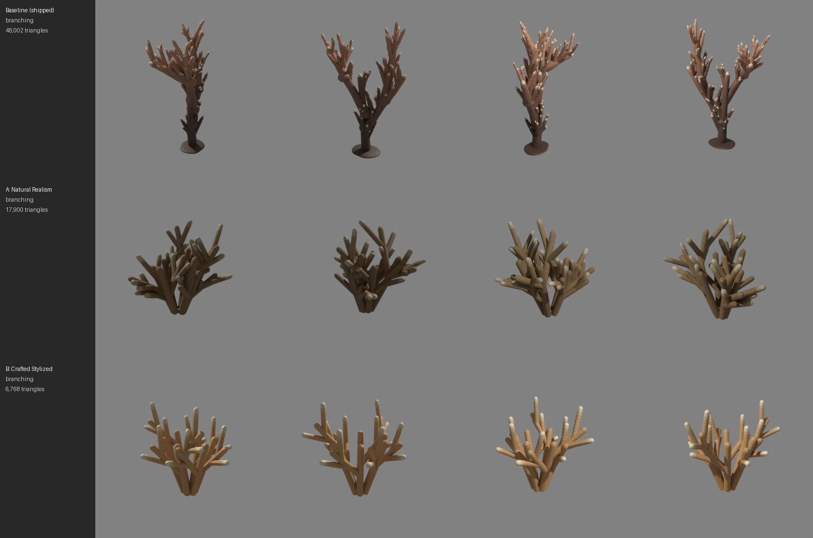
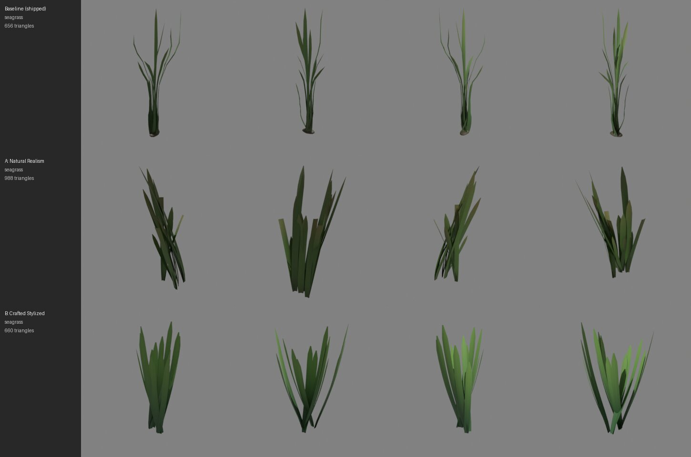
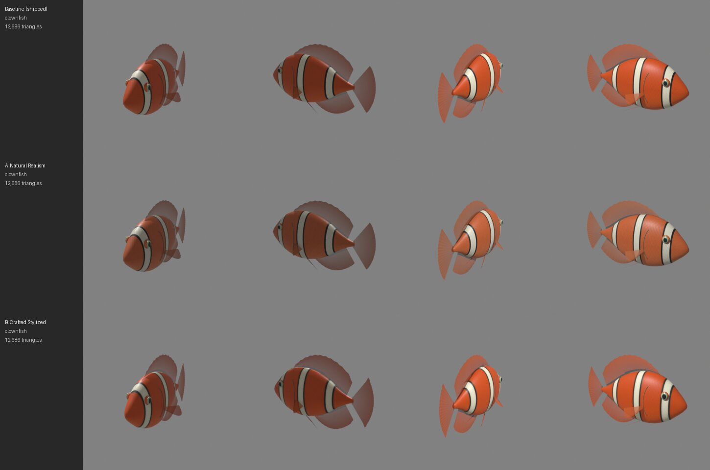
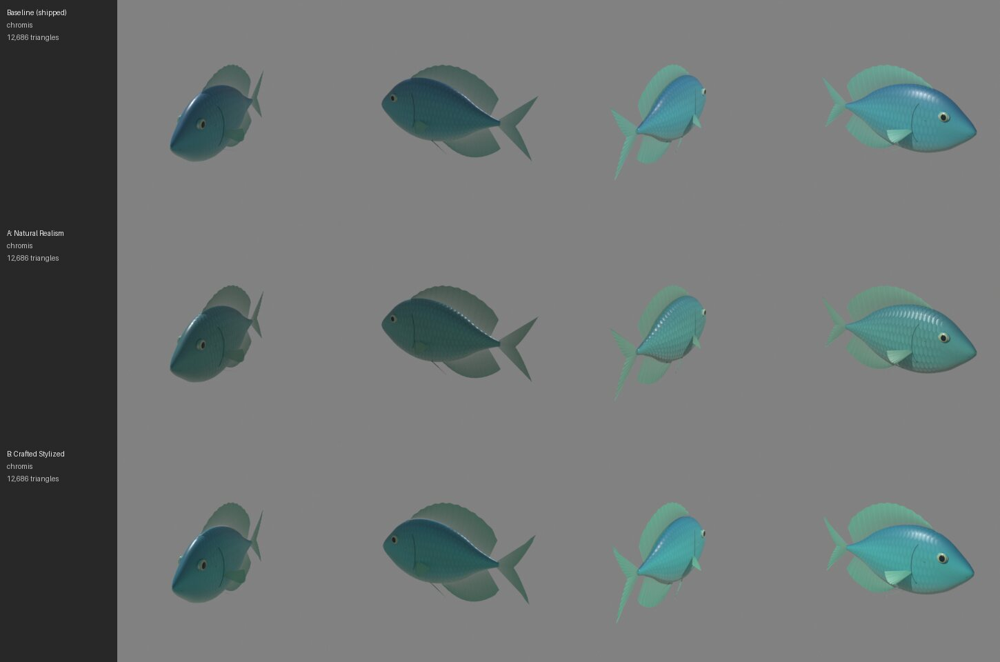

# V0.7 style benchmark (Pass 062)

Pass 062 builds two complete candidate art treatments for the same small aquarium scene and compares them with the shipped baseline:

- **A, Natural Realism**
- **B, Crafted Stylized Realism**

Neither treatment touches the game. They live only on the benchmark page `style-benchmark.html`, which ships only in `npm run build:benchmark`. The game's approved visuals are unchanged.

**The recommendation in section 7 is a proposal.** The artistic choice, and the go-ahead for any mass conversion, belong to the user. This pass stops here.

## 1. The benchmark scene

Every combination uses one layout (`src/benchmark/style/treatments.ts`):

- one reef rock;
- one massive (brain) coral;
- one staghorn branching coral;
- a seagrass patch of 11 clumps (3 templates);
- a school of 7 chromis;
- one clownfish;
- the tank's own sand and water.

**Held equal across every combination:**

| Held equal         | How                                                                                                                                                                                                                                                          |
| ------------------ | ------------------------------------------------------------------------------------------------------------------------------------------------------------------------------------------------------------------------------------------------------------ |
| Camera             | Four fixed views at the game's field of view (64°): `swimming` (normal swimming distance), `medium` and two `close` views (`close-brain` with the clownfish, `close-staghorn` with the chromis).                                                             |
| Scale              | Each subject is scaled so its **largest dimension** matches the slot's size, then pressed into the sand by the same depth. Footprint and burial are identical whatever the model's source scale.                                                             |
| Seabed and water   | The shipped sand material, ripples and colouring, and the tank's water (`TANK_LIGHTING`, now shared config). The sand is identical in every combination.                                                                                                     |
| Materials pipeline | The rock and brain coral wear the game's world-space triplanar material at the tank's texel scales. Other subjects use their authored PBR material. All models go through the same Blender → GLB → Draco + KTX2 pipeline (`tools/art/pass017/compress.mjs`). |
| Time               | Captures render at the same simulation time (1.2 s), so the fish tail strokes match.                                                                                                                                                                         |

**Lighting is a separate axis from models.** The page takes `assets=` and `lighting=` independently, each `baseline`, `natural` or `crafted`. The 3×3 matrix therefore shows:

- what each model set does under the shipped light;
- what each light does to the shipped models.

The lighting treatments:

| Lighting   | What changes                                                                                                                                                                 |
| ---------- | ---------------------------------------------------------------------------------------------------------------------------------------------------------------------------- |
| Baseline   | The shipped tank rig: hemisphere 2.6, sun 3.2, fill 0.7, fog 0.026, exposure 1.35, no shadows.                                                                               |
| A, Natural | Deeper, bluer, more attenuated water (fog 0.036). A stronger neutral sun (4.4) against low ambient (1.6) for restrained colour and higher contrast. One soft sun shadow map. |
| B, Crafted | Clearer, slightly warmer water (fog 0.020). A warm key (3.9), a cool rim light (1.15) that separates silhouettes, moderate ambient (2.0). The same soft sun shadow map.      |

## 2. What each treatment changes

| Subject            | A · Natural Realism                                                                                                                                                                                                                                                       | B · Crafted Stylized Realism                                                                                                                                                                                                                               |
| ------------------ | ------------------------------------------------------------------------------------------------------------------------------------------------------------------------------------------------------------------------------------------------------------------------- | ---------------------------------------------------------------------------------------------------------------------------------------------------------------------------------------------------------------------------------------------------------- |
| Reef rock          | Four overlapping flat-faced slabs (no longer a ball), thin bedding planes of uneven hardness, solution pits, two fracture faces, a weathered undercut at the sand line, fine ridged weathering. 1024 px limestone maps with turf film, coralline crust and sponge stains. | The same slab massing in three softer blocks. Two broad strata steps, five clean hollows, one tilted top face, smoothed so the big planes read first. 512 px maps with soft bedding and a painterly light-top / cool-underside value design.               |
| Brain coral        | One oval colony (not stacked balls) with a flared skirt into the sand and narrow, deep meandering valleys (about 26 across). Brown ridges, grey-green grooves and a dead, turf-covered fringe. 1024 px septa maps.                                                        | The same colony form with about 14 broad, rounded valleys and a clean two-tone ochre / mint palette. Calmer 512 px septa maps.                                                                                                                             |
| Staghorn coral     | Seven trunks of near-cylindrical antlers with irregular forks, a few broken stubs and slightly pointed, pale growing tips. Sharp corallite-cup maps.                                                                                                                      | Six trunks with even fork angles, a clearance rule so branches never tangle, gently arcing branches with rounded tips, and a clean ochre-to-cream gradient.                                                                                                |
| Seagrass           | Strap blades of varied width and length, broken and grazed tips, brown-green tips, epiphyte-spotted maps.                                                                                                                                                                 | Consistent straps with a gentle S-curve, rounded tips, a deep-to-light green gradient and clean vein maps.                                                                                                                                                 |
| Chromis, clownfish | The accepted rig and anatomy are unchanged. The shipped maps get a naturalistic grade: less saturated, slightly darker, chromis shifted toward its real apple-green, faint mottling. Full-strength scale normals and a rougher, less glossy skin.                         | The accepted rig with subtly appealing proportions that stay anatomically correct: body 4 % deeper, eyes 12 % larger, median fins 6 % taller, pectorals 8 % larger. A clean grade with smoothed noise and evened colour fields, and 60 % softened normals. |

**The fish change much less than the reef subjects, on purpose.** Pass 061 named the authored chromis family as the quality reference to preserve. Both treatments therefore keep its rig, topology and stroke-morph contract (5,196 body triangles, the same morphs), and differ only in grade, materials and (B) small proportion changes.

## 3. Screenshots

All shots are in `docs/screenshots/v07-pass062/`. They are actual in-engine captures (SwiftShader, 960×600, DPR 1) and neutral Blender turnarounds.

- **`side-by-side.jpg`:** the three complete treatments (models plus their own lighting) at all four views.
- **`matrix-<view>.jpg`:** for each view, models (rows) × lighting (columns). Read across a row to see a lighting change alone. Read down a column to see a geometry and material change alone.
- **`full-<treatment>-<view>.jpg`:** single full-size frames of each complete treatment.
- **`turnaround-<subject>.jpg`:** each subject in all three treatments, from four azimuths at 18° elevation. Cycles, mid-grey background, one key light, Standard view transform, no water or fog.

















## 4. Cost

### Per subject

Counted per complete treatment at the swimming view. Triangles cover every instance: 11 seagrass clumps and 7 chromis. Texture memory is estimated from the transcoded KTX2 mip data that the browser uploaded (SwiftShader's chosen format), including mips.

| Models    | Subject   | Triangles (all instances) | Meshes | Materials | Textures | Max texture | Texture memory |
| --------- | --------- | ------------------------: | -----: | --------: | -------: | ----------: | -------------: |
| Baseline  | rock      |                    20,480 |      1 |         1 |        3 |         512 |        1.00 MB |
| Baseline  | brain     |                    81,920 |      1 |         1 |        3 |         512 |        1.00 MB |
| Baseline  | branching |                    48,002 |      2 |         1 |        3 |         512 |        1.00 MB |
| Baseline  | seagrass  |                     7,504 |     11 |         1 |        3 |         512 |        1.00 MB |
| Baseline  | chromis   |                    88,802 |     56 |         5 |        4 |         512 |        1.33 MB |
| Baseline  | clownfish |                    12,686 |      8 |         5 |        4 |         512 |        1.33 MB |
| A Natural | rock      |                    81,920 |      1 |         1 |        3 |        1024 |        4.00 MB |
| A Natural | brain     |                    81,920 |      1 |         1 |        3 |        1024 |        4.00 MB |
| A Natural | branching |                    17,900 |      1 |         1 |        3 |        1024 |        4.00 MB |
| A Natural | seagrass  |                    12,792 |     11 |         1 |        3 |        1024 |        4.00 MB |
| A Natural | chromis   |                    88,802 |     56 |         5 |        4 |         512 |        1.33 MB |
| A Natural | clownfish |                    12,686 |      8 |         5 |        4 |         512 |        1.33 MB |
| B Crafted | rock      |                    20,480 |      1 |         1 |        3 |         512 |        1.00 MB |
| B Crafted | brain     |                    20,480 |      1 |         1 |        3 |         512 |        1.00 MB |
| B Crafted | branching |                     6,768 |      1 |         1 |        3 |         512 |        1.00 MB |
| B Crafted | seagrass  |                     7,260 |     11 |         1 |        3 |         512 |        1.00 MB |
| B Crafted | chromis   |                    88,802 |     56 |         5 |        4 |         512 |        1.33 MB |
| B Crafted | clownfish |                    12,686 |      8 |         5 |        4 |         512 |        1.33 MB |

### Whole frame, all 36 combinations

Hashes are of the 960×600 PNG captures. **Two complete runs produced identical hashes and counts for all 36 captures.**

| Models    | Lighting  | View           | Draw calls | Triangles | Textures | Programs | Hash               |
| --------- | --------- | -------------- | ---------: | --------: | -------: | -------: | ------------------ |
| Baseline  | Baseline  | swimming       |        105 |   403,828 |       28 |       11 | `c0e5799f05ffbe66` |
| Baseline  | Baseline  | medium         |        105 |   403,828 |       28 |       11 | `e0eafdf8ecd05e8f` |
| Baseline  | Baseline  | close-brain    |         16 |   234,598 |       28 |       11 | `20410b0397f0f7f1` |
| Baseline  | Baseline  | close-staghorn |         80 |   295,760 |       28 |       11 | `2e5969b112b4413b` |
| Baseline  | A Natural | swimming       |        184 |   663,222 |       30 |       25 | `53d4c8f675a8adc9` |
| Baseline  | A Natural | medium         |        184 |   663,222 |       30 |       25 | `54467a738a183976` |
| Baseline  | A Natural | close-brain    |         95 |   493,992 |       30 |       25 | `e4e79ef90672a1ec` |
| Baseline  | A Natural | close-staghorn |        159 |   555,154 |       30 |       25 | `28e17e2d43fd957d` |
| Baseline  | B Crafted | swimming       |        184 |   663,222 |       30 |       25 | `2b22d7a6bf8940b3` |
| Baseline  | B Crafted | medium         |        184 |   663,222 |       30 |       25 | `51679ae3776d319c` |
| Baseline  | B Crafted | close-brain    |         95 |   493,992 |       30 |       25 | `83e966321c5a7824` |
| Baseline  | B Crafted | close-staghorn |        159 |   555,154 |       30 |       25 | `38d773c603e2573d` |
| A Natural | Baseline  | swimming       |        104 |   440,454 |       28 |       11 | `98f66fc6c4bb8f55` |
| A Natural | Baseline  | medium         |        104 |   440,454 |       28 |       11 | `201d5eac4f652cca` |
| A Natural | Baseline  | close-brain    |         17 |   297,722 |       28 |       11 | `51b8baaa5d8e5738` |
| A Natural | Baseline  | close-staghorn |         79 |   327,098 |       28 |       11 | `25269081d071d402` |
| A Natural | A Natural | swimming       |        182 |   736,474 |       30 |       25 | `82a217a22897ea02` |
| A Natural | A Natural | medium         |        182 |   736,474 |       30 |       25 | `a29af82127896d33` |
| A Natural | A Natural | close-brain    |         95 |   593,742 |       30 |       25 | `f5252c36689c59e0` |
| A Natural | A Natural | close-staghorn |        157 |   623,118 |       30 |       25 | `bc5904a9b64bced0` |
| A Natural | B Crafted | swimming       |        182 |   736,474 |       30 |       25 | `40887d07dd5a8b13` |
| A Natural | B Crafted | medium         |        182 |   736,474 |       30 |       25 | `a592c8ea3d5cc804` |
| A Natural | B Crafted | close-brain    |         95 |   593,742 |       30 |       25 | `3f75739cb6b6c90d` |
| A Natural | B Crafted | close-staghorn |        157 |   623,118 |       30 |       25 | `b06cc11ad2e429fe` |
| B Crafted | Baseline  | swimming       |        104 |   300,910 |       28 |       11 | `8e3be43f5957972a` |
| B Crafted | Baseline  | medium         |        104 |   300,910 |       28 |       11 | `b55a45235d0a8eca` |
| B Crafted | Baseline  | close-brain    |         16 |   173,162 |       28 |       11 | `20d2125c58712831` |
| B Crafted | Baseline  | close-staghorn |         79 |   254,526 |       28 |       11 | `40f4dddfd761d87e` |
| B Crafted | A Natural | swimming       |        182 |   457,386 |       30 |       25 | `50748d7f372933ed` |
| B Crafted | A Natural | medium         |        182 |   457,386 |       30 |       25 | `99111f2eb43568a2` |
| B Crafted | A Natural | close-brain    |         94 |   329,638 |       30 |       25 | `3eb564ce870d39d7` |
| B Crafted | A Natural | close-staghorn |        157 |   411,002 |       30 |       25 | `0acd32ad0292752a` |
| B Crafted | B Crafted | swimming       |        182 |   457,386 |       30 |       25 | `e75cbec5986873c9` |
| B Crafted | B Crafted | medium         |        182 |   457,386 |       30 |       25 | `3e16b137ebbc248b` |
| B Crafted | B Crafted | close-brain    |         94 |   329,638 |       30 |       25 | `bbd6e96c9884ed86` |
| B Crafted | B Crafted | close-staghorn |        157 |   411,002 |       30 |       25 | `a657048f3460245d` |

### File sizes (Draco + KTX2)

| File                                                  |                                                       Baseline |                 A · Natural |                 B · Crafted |
| ----------------------------------------------------- | -------------------------------------------------------------: | --------------------------: | --------------------------: |
| Reef subjects (rock, brain, staghorn, 3 grass clumps) | in `reef-environment.glb` (6.1 MB, the whole 60-asset library) | `style-natural.glb` 7.66 MB | `style-crafted.glb` 1.30 MB |
| Chromis                                               |                                            0.61 MB (with LOD1) |                     0.55 MB |                     0.48 MB |
| Clownfish                                             |                                            0.47 MB (with LOD1) |                     0.42 MB |                     0.37 MB |

The candidate fish have no LOD1 yet; the shipped ones do. The `.blend` sources are 6.2 MB (A) and 1.6 MB (B), with images packed. The fish sources are 0.7–1.1 MB each.

### Reading the numbers

- **Models, measured under the shipped lighting:**

  | Models   | Triangles (swimming view) | Change |
  | -------- | ------------------------: | -----: |
  | Baseline |                   403,828 |      — |
  | A        |                   440,454 |   +9 % |
  | B        |                   300,910 |  −25 % |
  - Draw calls are the same (≈104) for all three: one mesh per subject, so swapping models does not add draws.
  - **B is cheaper than what ships.** Its rock and brain coral are 20 k triangles each, against the shipped 82 k brain. Its staghorn is 6.8 k, against the shipped 48 k branching coral.
  - **A spends four times the texture memory per reef subject:** 1024 px maps, 4 MB each on the GPU, against 1 MB at 512 px. Its rock is 82 k triangles, four times the shipped rock.

- **Lighting, measured with the same models:** the soft sun shadow map is the only added cost, and both candidate lights use it. It adds:
  - about 79 draw calls (the shadow pass re-draws every caster: 104 → 184);
  - about 260 k triangles;
  - 14 more shader programs (11 → 25).

  Fog and colour changes are free.

- **No frame times are claimed.** SwiftShader is a CPU rasteriser. Draw calls, triangles, textures, programs and texture memory are the comparable figures here. The shadow cost must be measured on real hardware before it is adopted, and a shadow scoped to the camera's surroundings is the likely form.

## 5. Artistic differences

**What both candidates fix (the Pass 061 problems):**

- The rock stops being a ball. It is built from slabs with ledges, bedding and an undercut, and is pressed into the sand.
- The brain coral is one grounded colony with a skirt, not stacked balls.
- The staghorn has real antler anatomy, not a uniform violet tree.
- The seagrass has curved, varied straps instead of flat, uniform ribbons.
- With the sun shadow map, everything sits on the sand. Grounding comes as much from lighting as from geometry.

**A · Natural Realism:**

- Reads as a documentary photograph: muted browns and greys, dense pitting and crusts, narrow deep coral valleys, broken tips.
- Up close it is the most convincing material work.
- At normal swimming distance much of that detail turns into noise and darker values. The brain coral's narrow valleys and the rock's pits shimmer at a distance, because detail is finer than a screen pixel. Under its own deeper water the scene becomes heavy and less inviting.
- It also asks the most from the pipeline: 1024 px maps, 82 k-triangle heroes, and more irregular authoring that is harder to repeat consistently across hundreds of assets.

**B · Crafted Stylized Realism:**

- Keeps the same biology, but organises it:
  - large readable planes on the rock;
  - broad, legible meanders on the brain coral;
  - spaced antlers with clear rounded tips;
  - clean blade gradients;
  - a warm key light and cool rim that separate silhouettes from the water.
- The scene reads at a glance from every distance, including the swimming view, and feels calmer and more inviting, which fits a no-pressure relaxation game.
- The risks:
  - it can tip into "toy-like" if saturation or smoothing go further;
  - the rock texture's crafted pockets and the brain coral's two-tone colour sit closest to that line.
- It also uses the fewest triangles and the least texture memory of all three treatments.

**Fish:** the differences are small by design. B's slightly larger eyes and deeper body give a touch more appeal. A's grade is closer to the real animals' colour.

## 6. Preserved and changed systems

- **Not changed:**
  - game code, assets, swimming, AI, sightings, saves and loading;
  - the normal build: `npm run build` emits only the game. The candidate models are imported only by the benchmark entry and are not in `public/`.
- **Refactor, no visual change:** the tank's light and water values moved into `src/config/tankLighting.ts`. `UnderwaterScene` uses them unchanged, and the benchmark's baseline reads exactly the same values (tested).
- **Small tool change:** `compress.mjs` takes an optional directory, so benchmark assets get exactly the shipped Draco and KTX2 settings.

## 7. Recommendation

**Adopt B, Crafted Stylized Realism, as the final visual standard, with three provisions taken from the comparison:**

1. **Borrow A's construction, not its noise.**
   - Keep B's budgets: ≤ 20 k triangles per hero rock or coral, 512 px maps.
   - Build forms with A's methods: slab-built rock with bedding and undercuts, single grounded colonies, antler anatomy, broken silhouettes where nature has them.
   - Reserve fine pits, crusts and broken tips for close-up accents.
2. **Lighting: adopt B's direction** (clearer water, warm key, cool rim), **but only adopt the sun shadow after a hardware measurement.**
   - It is the biggest single improvement in grounding, and also the biggest cost: about +75 % draws in this scene.
   - Prototype it as a camera-local shadow before any world uses it.
3. **Keep the fish standard as it is.**
   - Apply B's calm grade and softened normals.
   - Apply its small proportion changes only if they still read as the right species in motion. Judge that in the tank, not in stills.

The user's selection is the approval gate. Nothing will be converted until a treatment is chosen and approved.

## 8. How to run it

```bash
npm run dev -- --host 127.0.0.1 --port 5173 --strictPort
```

Then open `http://127.0.0.1:5173/style-benchmark.html`. Pick Models, Lighting and View in the panel, or use the URL directly: `?assets=crafted&lighting=baseline&view=close-brain`. `&ui=0` hides the panel for captures.

```bash
COZY_URL=http://127.0.0.1:5173 COZY_OUTPUT=/tmp/v07-style node validation/v07/style.mjs
```

This renders all 36 captures (3 models × 3 lights × 4 views), records the statistics in `style.json` and composes the sheets.

**Regenerating the assets**

Uses the Blender 5.1 Python module (`pip install bpy==5.1.2`) or `blender -b --python`:

```bash
python3 tools/art/pass062/style_textures.py
```

```bash
python3 tools/art/pass062/build.py
```

```bash
python3 tools/art/pass062/fish_styles.py
```

```bash
node tools/art/pass017/compress.mjs src/benchmark/style/assets
```

```bash
python3 tools/art/pass062/turnaround.py
```

`turnaround.py` must run before compression, because it reads the uncompressed `tools/art/pass062/out/*.glb` (Blender cannot import KTX2).

- **Generated texture PNGs** (`tools/art/textures/pass062`) are deterministic and git-ignored. They are also packed inside the `.blend` sources.
- **Tests:** `tests/style-benchmark.test.ts` covers the shared layout and views, independent selection, the scale rule, baseline = tank lighting, and the exported models: compression, PBR maps, the fish rig contract and triangle budgets.

## 9. Limitations

- **Software rendering only.**
  - SwiftShader in a headless container; no hardware GPU was measured.
  - Colours can differ slightly from hardware.
  - No frame-time or laptop claims.
- **Still images.**
  - Grass and corals do not sway in the benchmark: the game's plant-motion shader is not attached, identically in all treatments.
  - Fish tails are posed at a fixed time.
  - Shimmer of fine detail in motion (the main risk for A) needs a playable check.
- **Not in the comparison:**
  - The candidate reef subjects and fish have no distance levels (LOD1) yet; the shipped assets do.
  - Caustics and the tank's light-shaft planes are absent from all three lighting treatments, so they are not compared.
- **Production-ready assets would need more work.** These are benchmark candidates authored procedurally in Blender (seeded numpy construction, as in Pass 014), not hand-sculpted. Production versions of the chosen style would need collision hulls, LODs, more variants and an art review per asset.
