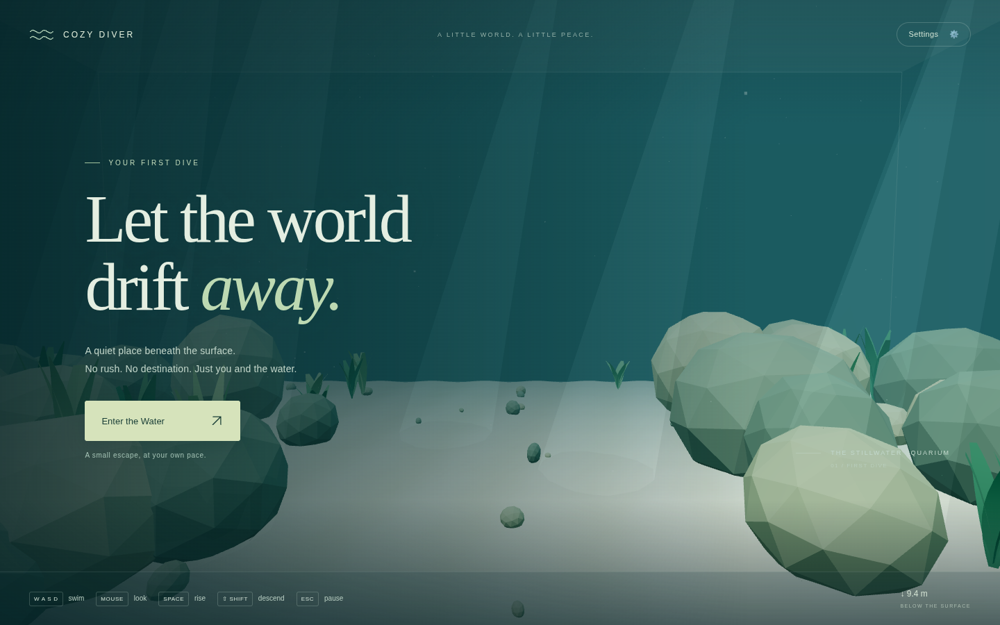
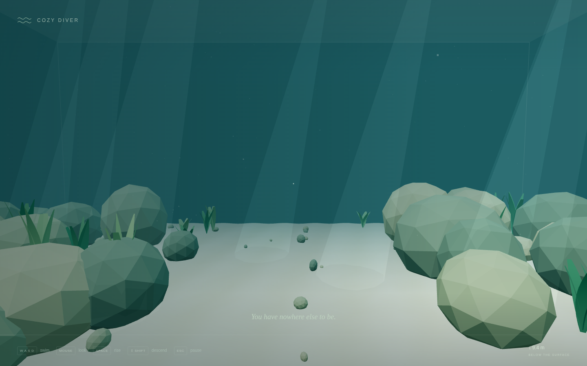

# v0.1 / Pass 001 validation

Validated on November 5, 2026. This record separates executed checks from intended browser support.

## Automated project checks

| Check                            | Result                                                             |
| -------------------------------- | ------------------------------------------------------------------ |
| `npm install` and clean `npm ci` | Passed; npm lockfile generated and committed                       |
| `npm run dev -- --port 5173`     | Started successfully; used for functional browser checks           |
| `npm run build`                  | Passed; production assets generated                                |
| `npm run test`                   | **26 passed**, 2 test files; none skipped                          |
| `npm run typecheck`              | Passed                                                             |
| `npm run lint`                   | Passed, including Prettier                                         |
| `npm run preview -- --port 5174` | Started successfully; production application exercised in Chromium |

Vite emitted a nonblocking advisory for a 558.82 KB JavaScript chunk (140.58 KB gzip), primarily Three.js. CSS was 5.86 KB (2.08 KB gzip). The warning is retained rather than hidden by raising its threshold.

## Browser checks actually executed

Used system Chromium in headless mode with Playwright, a 1440 × 900 viewport, and the SwiftShader software WebGL backend. Browser tooling was installed outside the project in `/tmp/cozy-browser`; it is not a runtime dependency. The development smoke harness temporarily exposed the existing application instance through a response-only Vite module instrumentation; no production debugging API was added. Assertions inspected simulation state while driving actual browser keyboard/mouse and pointer-lock events. Screenshots were reviewed visually; no exact GPU-image comparisons were used.

The complete development smoke run passed:

- Aquarium renders through WebGL with visible scenery.
- No pointer lock on initial load; entry button requests and acquires it.
- W/S forward and backward; A/D strafing; Space/Left Shift vertical movement.
- Acceleration, continued momentum after release, and decreasing velocity under drag.
- Actual pointer motion changes camera yaw; camera roll remains zero. A large mouse displacement is bounded by the pitch limit.
- Sustained ascent reaches the water-surface clearance and descent reaches the floor clearance without crossing either.
- Escape releases pointer lock, shows the resume overlay, stops movement, and ignores movement keys while paused. The resume button reacquires pointer lock.
- Speed, sensitivity, and reduced-motion preferences survive a real page refresh.
- Canvas responds to a resize to 800 × 650.
- No console errors or uncaught page exceptions during normal gameplay.

The production-build browser run also passed:

- Render, enter, Escape, and resume work from `npm run preview`.
- Simulated context loss releases pointer lock, disables entry, and retains the reload explanation after the lock-change event.
- Simulated unavailable WebGL displays a clear fallback with disabled entry and no uncaught exception. Three.js logs its expected graphics-initialization error for this failure scenario.
- Denied local storage does not prevent startup or settings changes; the UI explains that preferences apply for the current visit.
- A rejected pointer-lock request displays a retry explanation without an uncaught exception.

All six aquarium boundaries are covered by unit tests, including sustained movement and outward velocity cancellation. Browser smoke testing directly exercised floor/surface limits; four side walls were not individually traversed in the browser. Unit tests separately compare displacement and velocity at 30, 60, and 144 Hz.

## Screenshots

Captured from the real Chromium render at the initial safe spawn:

## Limits and follow-up

- Firefox, Safari, and Edge were not run. They remain target browsers, not verified compatibility claims.
- Software rendering is useful for functionality but does not establish hardware-GPU frame rates, battery use, or ordinary-laptop performance. No hardware-performance claim is made.
- Mobile/touch behavior is outside this pass. The 800 × 650 check verifies layout and canvas sizing, not mobile controls.
- Rocks/plants have no collision in this prototype; aquarium bounds are the only collision volume.
- Office, fish AI, customization, ocean passages, and other later features remain unimplemented.
- Full manual steps are in the README. Next pass should begin with hardware-GPU and cross-browser playtesting, tune swimming feel from that feedback, then consider simple marine life within measured rendering budgets.
