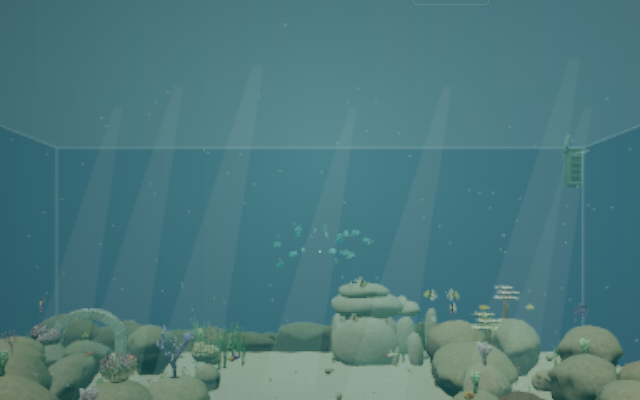
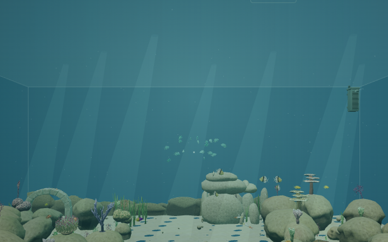
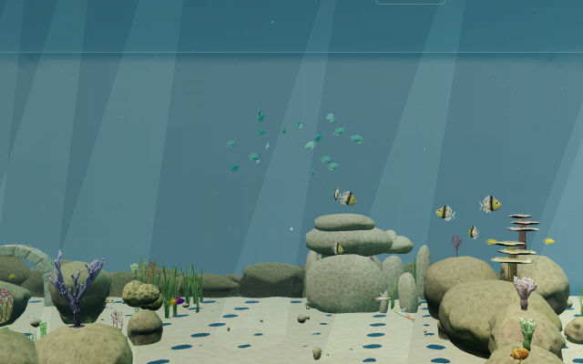

# Dive backdrop continuity

Fix for the P2 documented in [the PR #43 review](https://github.com/bryce496913/Cozy-Dive/pull/44): normal diving switched from the office miniature's blue background to an opaque captured office wall in a single frame.

The dive frame now supplies an outlook reveal value. It is zero through the scene switch, then follows a smoothstep over underwater settling to reach one before control returns. The shader blends the fogged, tone-mapped capture against the aquarium background after output colour conversion; zero therefore matches the untone-mapped scene background rather than introducing a differently exposed blue. The box remains opaque, preserving glass ordering and the existing draw budget.

The reveal uses active path time, with no separate animation loop or timer. Pausing preserves it, and completing or cancelling a transition restores one. Surfacing, pause-screen fades and reduced-motion entry retain the full backdrop. The office miniature continues to omit the capture.

## Regression coverage

- `tests/dive.test.ts`: both sides of the switch, monotonic settling, midpoint/endpoints, repeated paused samples, reduced motion, surfacing and pause-screen fades.
- `validation/dive.mjs`: the last office frame stays blue, the first aquarium frame has negligible reveal, and normal/reduced-motion entry both finish fully revealed.
- `validation/dive-interrupt.mjs`: a paused transition preserves its reveal and cancellation restores full visibility.

## Verification — November 12, 2026

- Production build, standalone typecheck and lint pass. All **476 tests in 51 files** pass in one clean run with unchanged timeouts; build/lint and browser rendering were run separately from the unit suite.
- Real Chromium/SwiftShader rendering at 640 × 400 confirms the bright office-wall jump is removed. The capture is absent at the exact switch, approximately zero immediately after, 0.15625 a quarter of the way through settling, 0.5 halfway through, and fully visible on completion.
- Real pointer lock, held W, Escape and E exercise entry, pause/resume, cancellation back to the office, a second dive, surfacing and reduced-motion entry. The reveal freezes while paused, advances after resuming, and resets to one after cancellation/completion. Reduced motion keeps the full backdrop behind its existing fade.
- GPU counts before and after: **431 geometries / 116 textures**, unchanged. Calling application disposal twice disposes the capture target and outlook geometry/material once each. No console warnings, errors, page errors or WebGL errors were observed. See the [runtime snapshot](screenshots/dive-backdrop-fix/runtime.json).

| Just before the scene switch                                                       | Just after the scene switch                                                                  |
| ---------------------------------------------------------------------------------- | -------------------------------------------------------------------------------------------- |
|  |  |

The shader is rendered normally; no draw calls are stubbed. Switch and settling poses are staged at precise path times with zero simulation delta to inspect the background, with real stepped frames for the pause/resume checks. Screenshot equality is not used as a gameplay test. Existing miniature-resolution and camera-FOV differences remain outside this fix. Evidence is Linux Chromium/SwiftShader only, not a macOS performance measurement or a full continuous 60 FPS playtest. The full stress and full-duration dive/interruption harnesses were not rerun; their new assertions supplement the focused browser checks above.
