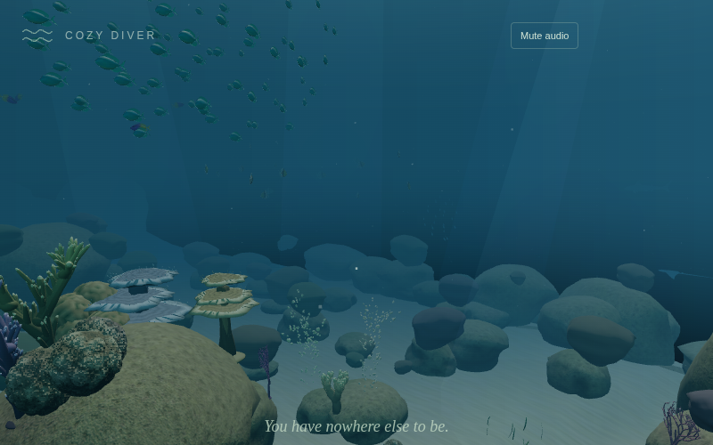
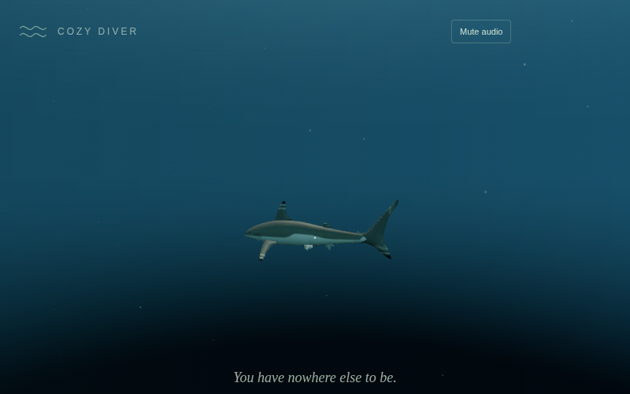

# Outer reef life — 0.4.0-rc.3

Requested enrichment of the outer reef after Pass 028. The coral top retains its original schools; three additional chromis shoals populate the approach and the water beside the wall. Population rises from 169 to 235 small fish. Existing instanced fish batches and cached local models are reused.

The large-animal population rises from six to nine: three reef sharks, four eagle rays and two turtles. Adults vary from 5–20% above the original size. Physical radius, reef clearance and player comfort distances scale with the rendered animal. Sharks occupy three depth bands, rays follow a broader circuit and turtles have separate upper/lower routes. Existing sightings species remain unchanged.

Wall fish now steer away from rising seabed using a look-ahead floor query. The final movement guard rejects unsafe steps without teleporting fish upward. This floor query applies only to outer waters; the aquarium retains its existing movement behavior.

## Verification

- Build, typecheck, ESLint/Prettier and all 486 unit tests (52 files) pass.
- New tests cover proportional creature sizing, all nine route clearances, wall-school placement, actual-layout spawning and a 90-second sloping-floor simulation without penetration or position snaps.
- Repeatable browser harness: `validation/reef-life.mjs`. It uses actual loaded models, staged camera/world positions and accelerated simulations. Native pointer lock, pause/resume and keyboard swimming are exercised separately.

This remains a v0.4 candidate awaiting the user's macOS play-through. Cloud Chromium uses SwiftShader; its CPU measurements and staged views do not establish target-device FPS, Safari behavior or subjective comfort. No release or deployment is made by this pass.

## Browser results

Chromium/SwiftShader at 800×500 completed the focused harness with no console or page errors:

- 205,560 animated body-vertex samples over 180 accelerated simulation seconds: zero reef intersections and positive seabed clearance.
- All 235 fish checked every second over 90 accelerated seconds: zero unsafe positions.
- Native entry, Escape pause, resume and W swimming passed. Renderer memory returned from the reef to the original 362 geometries / 112 textures after disposal.
- Six staged views used 25–73 draw calls and roughly 436k–1.64m triangles. Views were inspected, including the approach, reef top, wall and large shark.
- Three CPU simulation batches measured 3.76–4.74 ms/step for the previous 169 fish and 5.93–6.93 ms/step for the enriched 235 fish. Median cost rose from 4.25 to 6.41 ms/step; these are isolated simulation timings, not frame rates. Confirm acceptable performance on the target Mac before merging.

[Raw browser report](images/outer-reef-life/browser-report.json)

