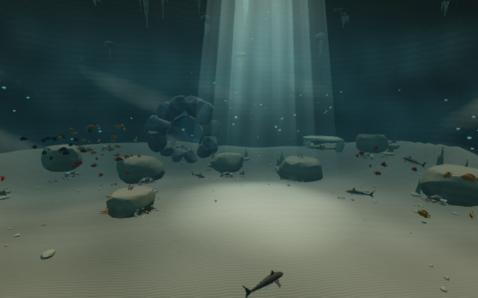
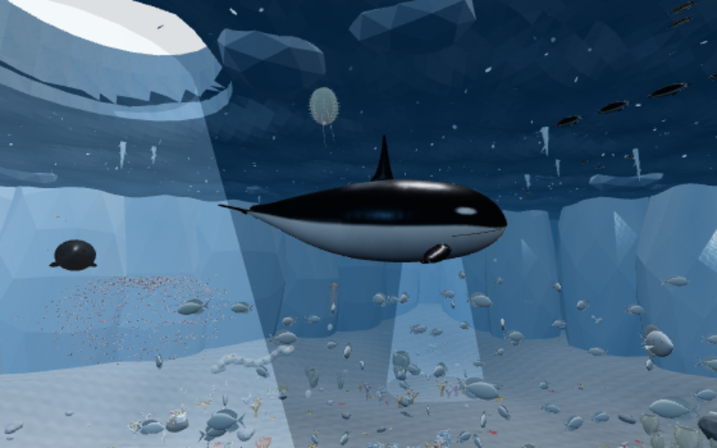
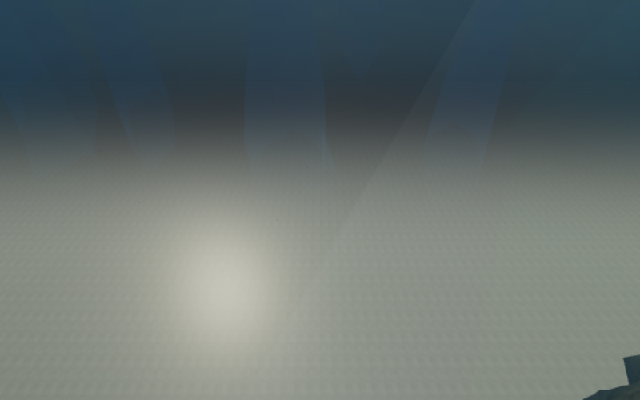

# Reef, cave and ice follow-up — 0.6.0-rc.23

Reviewed main through `d785813` (PR #96). Claude's recent work already supplies the cave habitats, ice wildlife, surface exits, kelp reactions, and one-orca encounter. This pass builds on those systems.

## Changes

- **Reef:** back glass moves from z −63.4 to −59.4, close to the reef lip. Existing passing lanes and encounter positions follow that plane. Beyond the glass, a floor at its base (y −24) uses the office's existing porcelain tile texture and physical tile spacing. The reef retains its sand and rock. The distant floor fades into the actual background rather than ending in a visible straight edge. Large cruisers, visitors, the sunfish and great white have conservative full-model clearance, covering both LODs, morph endpoints, pitch and bank. The distant horizon silhouettes already swim well above this elevation.
- **Cave:** fractured limestone hulls replace the rounded boulders; collision uses the same hulls. Limestone, sand, formations and tunnel surfaces gain local triplanar normal/roughness detail. Shaded rock-side corals attach to actual boulder faces. Both tunnel mouths use irregular embedded limestone, and the front passage shares the detailed tube implementation. The skylight shaft/pool and particles are quieter. Crabs and lobsters have individual leg gaits driven by walking/retreating behaviour, without additional draws; existing antennae, cleaning visits, resting sharks, turtle breathing trips, moray and lionfish behaviours remain.
- **Ice creatures:** minke and orca bodies gain jaw contours, blowhole lips and finer skin relief; the minke has ventral pleats. Flukes drive the swimming stroke with gentle pectoral trim. Leopard seals gain whiskers/skin relief and slower strokes; bear paws paddle alternately with fur relief. Nurse shark skin gains gill detail. The squid gains a mantle, paired fins and eight tapering, animated arms in one body draw.
- **Ice entrances/exits:** whales use the enlarged main breathing hole. They descend vertically until their whole body is below the ceiling, make their pass with slow strokes, align under the opening, turn below the ice and rise vertically. They remain present until their tails clear. The ceiling clamp no longer prevents ascent, and a swimmer camping on a route/exit cannot indefinitely block departure. Exactly one orca appears.
- **Delivery:** regenerated GLBs retain their roots, two LODs, PBR maps, morph names and local assets; KTX2 compression and the asset inventory are regenerated. The version increment invalidates cached model URLs. New surfaces, geometry, materials and textures follow world disposal.

## Validation

- `npm run build`, `npm run typecheck`, `npm run test` (751 tests), `npm run lint`.
- Regression coverage: full-body hole clearance at 30/60 Hz, one orca, departure with a swimmer beneath the exit, rotated/morphed floor clearance, floor placement/texture disposal, finite squid geometry, and the five regenerated assets' runtime dimension limits including morph bounds.
- `validation/habitat-polish.mjs` loads the actual cave, ice and outer scenes with the real asset loader, checks preparation, renders selected views and cues both whale encounters. All scene components reported ready with no page/console errors. A separate outer-only rerun checked the final floor fade.
- The focused rendering review used Chromium with SwiftShader, an 800 × 500 viewport and renderer pixel ratio 0.7. It directly constructs scenes and cues encounters; it is not a full player journey or a hardware performance measurement. No Safari/Firefox/mobile claims.

Reproduce the scene review with the local dev server running:

```bash
COZY_PLAYWRIGHT=/path/to/playwright/index.mjs \
COZY_CHROMIUM=/usr/bin/chromium \
node validation/habitat-polish.mjs
```

Use `COZY_WORLDS=outer` to review only the final floor, and `COZY_OUTPUT=/tmp/cozy-review` to choose the output directory.

## Rendered views

Cave geology, habitat clusters and softened skylight:



One orca on its pass beneath the main opening:



Room tile finish beyond the reef glass, fading into the blue:



## Player review

Swim to the reef lip and look down through the glass; watch rays, sharks and visitors over the tiled floor. In the cave, approach the shaded boulder faces, crabs, lobster dens and nurse shark, then travel through each tunnel. Under the ice, watch a whale arrive, make its pass and leave through the main opening. The new floor is interpreted as the room finish beyond the glass, not a replacement for the reef's substrate.
