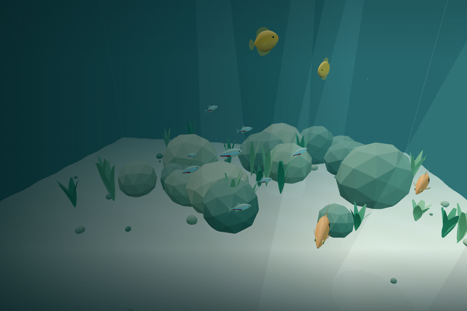
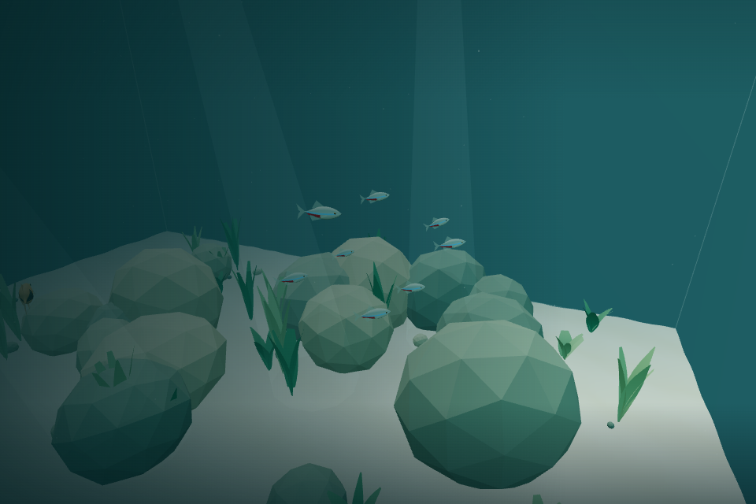
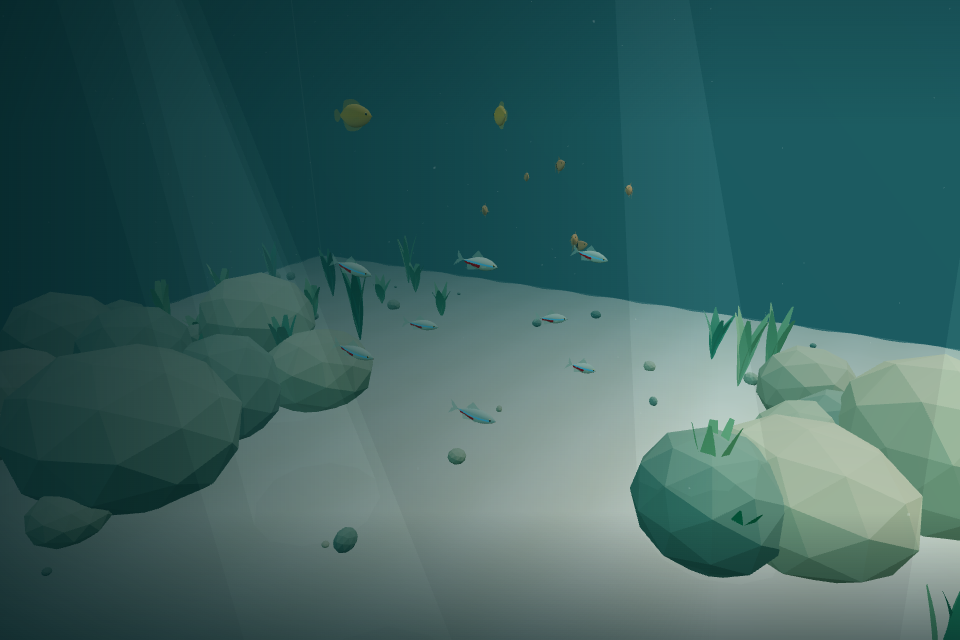

# v0.2 Pass 002 — Schooling validation

Validated November 5, 2026, starting from `e4066e2` (merged Pass 001). The user reports successful macOS acceptance of Pass 001; that is baseline context, not a new hardware measurement from this pass.

## Automated project checks

| Check               | Result                                                                          |
| ------------------- | ------------------------------------------------------------------------------- |
| `npm run test`      | **106 passed**, seven files, none skipped; all 87 existing tests remain passing |
| `npm run typecheck` | Passed                                                                          |
| `npm run lint`      | Passed, including Prettier                                                      |
| `npm run build`     | Passed; 616.23 KB JS / 159.19 KB gzip; CSS unchanged at 6.04 KB / 2.13 KB gzip  |
| `git diff --check`  | Passed                                                                          |

The existing Three.js bundle advisory remains. There are no new dependencies. Production changes are confined to `FishSchooling.ts`, social configuration in `FishSpecies.ts`, and the small movement-pipeline integration in `FishMovement.ts`. Fish geometry, colors, fin animation, renderer, lifecycle/ownership, player swimming, collision semantics, controls, settings, population counts, and spawn seed are unchanged.

## New behavioral coverage

The 19 schooling tests cover:

- Smoothly stronger separation at shorter distances, body-size clearance, cross-species personal space, and finite antisymmetric responses to exact/nearly coincident bodies.
- Head-on avoidance with bounded turns, bounded acceleration, continued physical movement, and no displacement corrections.
- Local same-species alignment, no distant/cross-species alignment, independent targets/headings/phases, comfortable cohesion dead zones, finite reconnection influence, and no formal gourami pairing.
- Bounded neighbor counts; a complete simulation with repeatedly reversed update order produces identical entity states and neighbor influences. Computed forces remain stable while another fish advances.
- Identical fixed-step schooling at 30/60/120 FPS render deltas; pause freezes entities, time, cached influences, and the existing visual pose; resume has no accumulated step.
- Five-minute real-aquarium behavior: cohesive but imperfect tetras, a looser rasbora distribution, independent phases, valid finite state/forces, personal space, and zero containment corrections.
- Controlled splitting to both sides of a substantial obstacle, progress past it, and later regrouping. Narrow channels, glass corners, a rock beside glass, and changing depths also retain containment and continued movement without repeated guard corrections.

The existing suite additionally checks ten-minute real-habitat safety, bounded catch-up, invalid deltas, spawning, resource disposal, animation phase continuity, reduced motion, player movement/rock sliding, breathing drift/bounds, and settings persistence.

## Seeded tuning observations

A five-minute diagnostic using the real habitat compared enabled social steering with the same population retaining separation but no social alignment/cohesion. Samples every thirty seconds showed the enabled tetra school's root-mean-square distance from its centroid around **1.6–2.0 world units**, rather than the roughly **7–11** of independent/separation-only tetras after dispersal. Rasboras stayed looser, around **2–4** for most of the run. These are aggregate diagnostics, not formation constraints or fixed destinations.

The final rendered-browser sequence below independently confirms a tighter tetra group and looser rasboras. Heading alignment is the magnitude of the average unit heading: 1 means identical directions, 0 means complete cancellation. High instantaneous alignment can occur by chance even for the two independent gouramis; absence of a formal pair is verified by their zero alignment/cohesion forces, not inferred from a single heading measurement.

## Browser validation actually performed

System Chromium, Playwright, SwiftShader software WebGL, 960 × 640 viewport. A response-only test hook exposes the application instance; no debug API, harness, dependency, or UI is shipped. Actual pointer-lock, keyboard, mouse, Escape/resume, and Settings events exercised:

- Initial frozen population, explicit entry, and independent fin/body movement.
- W swimming/coasting, mouse-look, and Space ascent with schooling active.
- Exact pause of fish state, influence cache, and rendered poses; gradual resume.
- Reduced-motion banking suppression while essential tail motion remains visible.
- Final application cleanup, with the canvas removed and no captured console errors or uncaught exceptions in the completed run.

After these live checks, the player was paused and the existing fish system advanced by **thirty genuine 1/30-second steps per rendered sample**. The test observed **180 simulated seconds**, captured time-separated images, followed the group with the inspection camera, and checked all bodies against glass and real rock hulls at each sampled second. This is accelerated/sampled observation, not a claim of 180 seconds at a measured 60 FPS. The observation phase retained reduced-motion settings from the live check; essential animation and model appearance remained intact.

| Simulated time | Tetra spread | Tetra alignment | Rasbora spread | Rasbora alignment |
| -------------- | -----------: | --------------: | -------------: | ----------------: |
| 0 s            |        2.481 |           0.144 |          2.720 |             0.420 |
| 30 s           |        1.768 |           0.966 |          2.341 |             0.981 |
| 60 s           |        1.752 |           0.979 |          2.509 |             0.970 |
| 90 s           |        1.590 |           0.980 |          1.986 |             0.909 |
| 120 s          |        1.834 |           0.994 |          2.077 |             0.938 |
| 150 s          |        1.824 |           0.974 |          2.031 |             0.939 |
| 180 s          |        1.763 |           0.996 |          2.271 |             0.941 |

All 16 fish remained in the environment. Across **21,720 sampled fish pairs**, there were **zero body-envelope overlaps**; the complete run recorded **zero final-containment corrections**. Tetras maintained an uneven, visibly coordinated group with independent spacing, depth, speed variation, and fin phases. Rasboras were more spread out; gouramis explored separately. These samples do not prove that no brief close pass can ever occur between observations.

A separate low-depth fixture upstream of generated rock 27 checked 90 simulated seconds of real-bank clearance and continued movement. Fish selected their own safe alternatives, rose toward preferred depths, left the bank, and remained a cohesive group without corrections (spread expanded from 1.51 to 1.95, later 1.58). This demonstrates safe redirection/continued movement, not a claim that every fish must cross the far side of that particular rock. Explicit two-sided splitting and subsequent regrouping are covered by the controlled obstacle tests above.

### Rendered captures

## Performance and resource validation

The 16-fish observation view rendered **294 draws / 63,589 triangles** at one sample. Totals depend on camera position and which fish/scenery are visible; this is not a like-for-like frame-time comparison with the prior pass. The model/rendering code is unchanged: the same per-fish draw budget, **17 shared geometry buffers**, and **7 materials** remain. No meshes, materials, passes, shaders, or render-loop callbacks were added.

A temporary **32-fish** system ran another **180 simulated seconds**, rendered successfully, retained the same 17 buffers / 7 materials, and recorded zero containment corrections. Shipping counts remain 8/6/2. Existing disposal tests remain passing, and complete browser application cleanup also passed.

Browser CPU measurements used 500 warm-up updates and 2,000 measured population steps per case. The individual baseline calls the unchanged single-fish locomotion without social forces; the full case runs the fixed-step pipeline including schooling; the isolated neighbor measurement repeatedly evaluates a fixed population snapshot. Geometry construction, WebGL, and presentation transforms are excluded.

| Population | Individual mean | Full schooling mean | Full p95 | Full maximum | Neighbor-only mean |
| ---------- | --------------: | ------------------: | -------: | -----------: | -----------------: |
| 16         |        0.020 ms |            0.054 ms | 0.100 ms |      29.8 ms |           0.032 ms |
| 32         |        0.073 ms |            0.145 ms | 0.200 ms |      33.9 ms |           0.044 ms |

Isolated neighbor p95 was approximately 0.100 ms in both cases; isolated maxima were 33.4 / 29.4 ms. These noisy browser measurements have quantized timing and occasional scheduling/GC/JIT-scale outliers; the causes were not isolated, and the maxima are retained rather than hidden. Baseline/full trajectories visit different obstacles, so their mean difference is not a precise causal isolation of neighbor cost. No heap profiler was run. Code inspection confirms preallocated force vectors, canonical entity storage, and reusable typed scratch buffers; normal neighbor updates allocate no new arrays/vectors or model resources.

No hardware-GPU frame-rate, MacBook performance, or cross-browser claim is made. The previous pass documented very slow/noisy SwiftShader pacing, including without fish; this pass does not establish a hardware 60 FPS result. Human assessment of extended comfort, natural-looking group movement, and macOS performance remains required.

## Known limitations

- Separation and cohesion are soft local steering. Dense/forced encounters can still produce brief close passes; they do not trigger teleportation or rigid body constraints.
- Finite local reconnection is not global pathfinding. Temporary fragments or stragglers outside reconnection range can remain apart until their paths bring them closer.
- Body/rock approximations and the original emergency containment guard remain unchanged; future dense scenery can need navigation work.
- Browser observations were sampled/accelerated under software WebGL. Two-sided splitting was verified in controlled simulation, while the real-bank fixture allowed fish to choose safe alternative routes. Subjective full-speed macOS behavior still needs playtesting.
- No feeding, resting, curiosity, caution, diver reactions, new species, population increase, or model redesign is included. Future intents should feed the existing social/safety/locomotion pipeline.

## Manual macOS acceptance checklist

- [ ] Neon tetras visibly form a recognizable but imperfect school.
- [ ] Harlequin rasboras group more loosely than the tetras.
- [ ] Honey gouramis remain largely independent.
- [ ] Fish maintain natural personal space.
- [ ] Different species avoid overlapping where practical.
- [ ] Schools change shape organically.
- [ ] Individual fish retain independent swimming characteristics.
- [ ] Schools can separate around rocks and gradually regroup.
- [ ] Fish do not become trapped against glass.
- [ ] Fish do not turn or accelerate simultaneously.
- [ ] Fish models and tail animations remain natural.
- [ ] Aquarium population remains balanced at 16 fish.
- [ ] Player swimming and camera comfort remain unchanged.
- [ ] Pause/resume and reduced-motion preferences continue working.
- [ ] Performance remains smooth on macOS.
