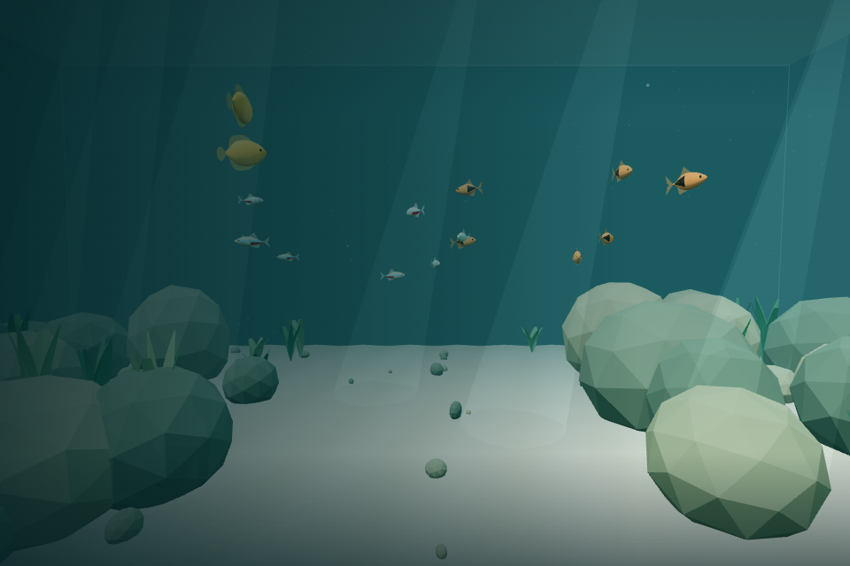
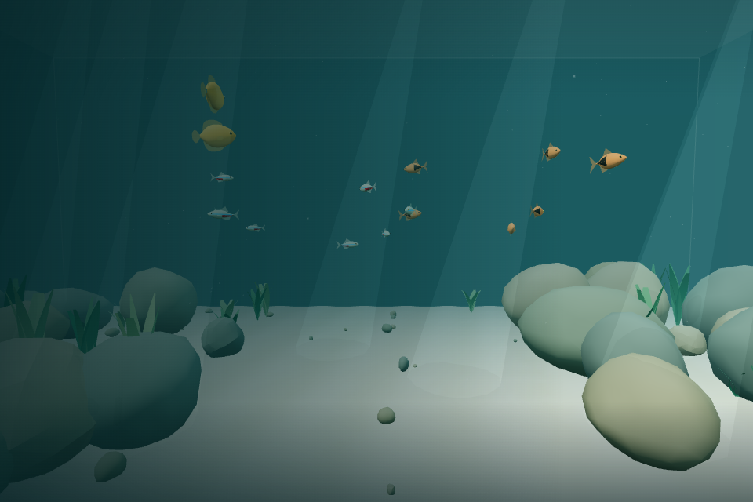
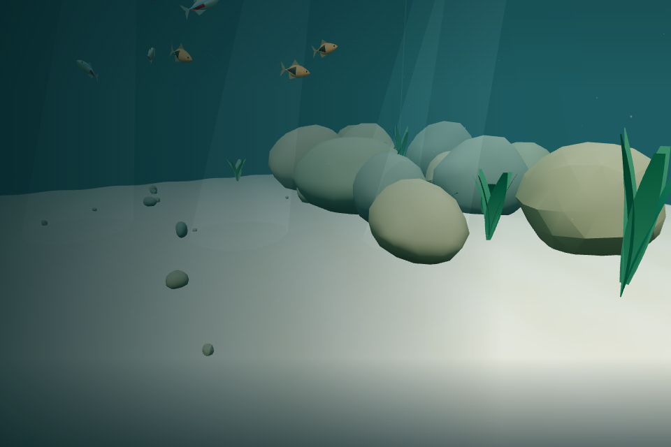

# v0.2 Pass 002B — Ecosystem Interaction, Swimming & Rock Refinement

Validated 2026-11-05 session (2026-11-06 UTC), Linux / Node 24 / headless Chromium with SwiftShader. Manual macOS acceptance remains outstanding. Do not merge automatically or begin Pass 003 before that acceptance.

## Implemented changes

- Live read-only physical diver position/velocity feeds species-configured awareness, scatter, and recovery. Body-size-aware surface gaps, relative closing speed, smooth envelopes, and persistent individual escape directions produce stronger fast approaches and calmer gouramis. A stationary close diver still matters. There are no new species, fish, behavior states, player collision walls, or player pushes.
- Rock/glass safety keeps priority; inward escape is projected out, with bounded safe tangent probes. Separation stays active, school attraction fades during scatter, and wandering recedes. Escape speed, acceleration, and turn rate have explicit limits; normal local schooling returns as awareness decays. See [FISH.md](FISH.md) for every species parameter.
- W/S propel along the camera's full 3D axis; A/D remain horizontal. Space and both Shift keys have no swimming action; the dedicated `up` input is removed. Every propulsion axis shares the preset force envelope, filtered thrust, water drag, normalized direction, and kick/glide cycle. Intentional ascent/descent suppresses hover forces; releasing input coasts toward a projected neutral depth before breathing returns.
- Natural breathing force increases from 0.14 to 0.20 m/s², Relaxed from 0.098 to 0.14, Responsive from 0.084 to 0.12. Five-second period, 1.6/s² spring, and 2.4/s hover damping remain. Before entry, only physical hovering advances; fish/input/ambient clocks stay frozen. Initial quarter-cycle phase produces prompt gentle acceleration. Entry preserves position, phase, neutral depth, and resting velocity. After entry, pause freezes everything; resting breath state resumes continuously, while active propulsion momentum is cleared. Reduced motion suppresses breathing.
- Six major-rock templates and three pebble templates share four rough, nonmetallic materials. Seeded low-frequency deformation, directional layering, three shape families, creased normals, and restrained vertex mineral variation replace the old flat icosahedra. The displaced point cloud is explicitly rebuilt as a convex hull; **that exact hull** is both rendered and transformed into collider planes. Coplanar planes are deduplicated at initialization. No arbitrary concave triangles are treated as support planes. Deep concave cavities are deliberately not modeled.

Rock placement RNG calls, transforms, aquarium bounds, open channel, 34 solid major rocks, 55 passable pebbles, vegetation, and population (8 tetras / 6 rasboras / 2 gouramis) are preserved. Shape generation uses its own seed and pooled geometry; environment disposal owns each resource once. No new package dependency, runtime assets, rendering pass, timer, or per-step vector allocation was added.

## Automated results

All required commands pass:

| Command             | Result                                                                        |
| ------------------- | ----------------------------------------------------------------------------- |
| `npm run build`     | TypeScript + production build pass; 30 modules; JS 633.96 kB / 164.94 kB gzip |
| `npm test`          | 130 tests in 10 files pass                                                    |
| `npm run typecheck` | Pass                                                                          |
| `npm run lint`      | ESLint + Prettier pass                                                        |

The build retains the Three.js bundle-size advisory (>500 kB). Convex hull generation is included in the local bundle; no external asset loads are needed.

Coverage includes:

- Camera-directed W/S signs, horizontal A/D, ignored Space/left/right Shift, combined normalization, and no-input behavior.
- Coherent propulsion from level through nearly vertical pitch, rhythmic vertical acceleration/glide, coasting, reversal, 30/60/120 Hz consistency, new resting-depth capture, boundaries, reduced motion, immediate preview, entry continuity, repeated resting pause without neutral-depth drift.
- Existing swept collision, tunneling, multi-contact sliding, bank/glass escape, initial-overlap recovery, sustained input, all six walls, and rock-contact breathing. The resume contact tolerance now permits one ordinary breathing step (<2 mm), rather than assuming breathing velocity resets to zero.
- Diver outside/inactive equivalence to ordinary movement; stationary close response; faster closing response; calmer gourami; finite exact overlap; smooth recovery; bounded escape speed/acceleration/turn; fixed cadence and paused envelopes.
- A controlled tetra ring spreads by >30% during a four-second close encounter, then has smaller spread after 40 seconds of ordinary steering. A three-minute generated-habitat run repeatedly places an approaching diver near individuals for 90 seconds, then allows 90 seconds of recovery: all fish remain safe and moving, all envelopes fully recover, **zero containment corrections**.
- Existing ten-minute real-habitat fish and schooling regressions pass with the new hulls.
- Three independent geometry seeds check determinism, finite vertices, unit normals, origin-centered unit envelope, valid bounds, and every vertex behind every hull support plane. Transformed rendered vertices match collider support to <0.000001 world units. Major templates have 172–180 triangles (previously 80).
- All 89 recorded rock transforms match the pre-change SHA-256 `7e16e45eaba4ba91dfb195589b23475f3b5daa450c68b01298c74b959357998a`. Nine shared geometries/four materials dispose exactly once; fish and player spawning remain valid.

## Browser results

Two local Playwright harnesses exercised actual Chromium/WebGL rendering and real pointer-lock, mouse, and keyboard events. Test-only response instrumentation exposed the application instance without adding a production debug API. Controlled positions and pure-module imports supplemented the real-input checks; those fixtures are not shipped gameplay.

Passed:

- Initial hovering changes physical position before entry while fish remain exactly frozen and pointer lock remains absent.
- Natural steady physical breath **13.2807 cm peak-to-peak**, peak vertical speed **8.3445 cm/s**, no neutral-depth shift. Initial physical rise **1.6245 cm at 0.5 simulated seconds**. Reset/entry preserves all resting position/velocity/phase/anchor values.
- At 1.5 seconds, speed is **2.32423 m/s** at pitches 0, 0.4, 1.2, and nearly π/2 radians under identical reduced-motion input (difference <0.000001 m/s).
- Real W swimming, release/coasting, mouse look, upward pitched W, and near-vertical W. Real Space + Shift held together for >15 fish steps in reduced-motion clear water cause exactly zero depth change.
- Live stationary-close fixture reacts through the normal application pipeline: awareness 0.591 and scatter 0.685, with `PlayerPresence.position` confirmed to reference authoritative physical position. Fast/slow/species/recovery comparisons are covered by pure tests rather than claimed as manual observations.
- Escape freezes complete physical and fish state; resume is bounded. Fish positions/fin poses freeze; essential fin movement continues after resume with reduced motion. Settings persist through reload.
- Real W input against a generated major rock remains outside its collider while fish continue updating. A separately arranged fish approach to generated rock data also remains safe.
- All 16 fish / three species render; 32-fish temporary stress population reuses species geometry. All 24 fish geometry/material resources emit exactly one disposal event, renderer geometry memory drops, and full application disposal removes the canvas. No page or console errors.

### Screenshots

Same 960 × 640 initial viewpoint, UI hidden, before and after. Breathing preview slightly changes camera height; these are visual inspections, not image-equality tests.

Before:

After:

Closer bank view:

## Performance observations

The fixed initial-view capture changes from 88,314 to 90,628 triangles (**+2.6%**) and 221 to 229 uploaded geometries (one old rock geometry replaced by nine templates). Draw calls are 382 before / 381 after; the one-call variation reflects view/culling, not an instancing improvement. No new shader pass is introduced. Six major templates contain 172–180 triangles each; detail is pooled rather than unique per rock.

Additional 1200 × 800 live/stress observations:

| Population     | Draw calls | Triangles | Uploaded geometries |  rAF median / p95 |
| -------------- | ---------: | --------: | ------------------: | ----------------: |
| 16             |        348 |    73,439 |                 338 |  416.7 / 666.6 ms |
| 32 (test only) |        395 |   107,116 |                 337 | 500.0 / 1099.9 ms |

These views followed navigation and differ from the fixed comparison. Uploaded geometry totals include scenery that becomes visible during navigation. Stress replaces/disposes the original fish system; it does not allocate per-fish geometry. SwiftShader is extremely slow and variable here, so these values **do not establish smooth macOS, hardware-GPU, or 60 FPS performance**.

Browser CPU sampling used 1,000 warmup steps and 2,000 measured fixed steps against the new real rock hulls, with a stationary-position moving-velocity diver presence:

| Population | Mean / p95 simulation step |     Max | Guard corrections |
| ---------- | -------------------------: | ------: | ----------------: |
| 16         |           0.243 / 0.500 ms | 38.2 ms |                 0 |
| 32         |           0.156 / 0.300 ms | 38.7 ms |                 0 |

The reversed means and long outliers show warmup/scheduling noise; they are not evidence that doubling population is faster. Normal updates use bounded neighbor buffers, hull broad-phase rejection, and reused presence/probe vectors. Hardware profiling remains a manual acceptance item.

## Known limitations

- Diver avoidance and fish personal space are soft steering, not rigid fish-player collision: emergency close passes remain possible, especially forced overlap or high-speed/dense situations. No player shove or blocking sphere is added. Recovery uses local finite-range school attraction; permanently separated fish have no global tether.
- Rock shapes remain convex. True concave crevices would require several convex parts or a different collision representation. Expanded support planes retain the existing small conservative corner margin. Thin foliage/pebbles remain passable; sand uses existing floor clearance.
- Browser checks cover Linux Chromium with a software renderer. macOS Safari/Chrome/Firefox, subjective comfort, long play sessions, and hardware performance need the checklist below. Hidden-tab/focus wiring is preserved; this pass directly tested Escape pause rather than a real OS focus switch.
- Phase continuity is preserved for a resting breath. Pausing active ascent/descent intentionally clears propulsion and captures current depth for a safe resume. Reduced motion can settle an already displaced physical breath rather than teleporting the camera.
- No Pass 003 individual behaviors have started.

## Manual macOS acceptance checklist

Leave these unchecked until the macOS playtest. Run `npm ci`, `npm run dev`, and test a top-level desktop browser with pointer lock enabled. Compare all three feel presets, upward/downward W and backward S, diagonal A/D combinations, release/reverse near steep pitch, floor/surface, rock banks/glass, reduced motion, and repeated Escape/focus/tab switches.

### Fish and Schooling

- [ ] Approaching fish causes gentle awareness and avoidance.
- [ ] Swimming toward a school causes a noticeable scatter reaction.
- [ ] Fish do not remain stationary while the diver passes through them.
- [ ] Fish scatter in different directions rather than uniformly.
- [ ] Fish do not become stuck against rocks or glass.
- [ ] Schools gradually regroup once the player moves away.
- [ ] Honey gouramis react more calmly than schooling species.
- [ ] Fish movement and tail animations remain natural.

### Swimming and Breathing

- [ ] Space no longer moves the player upward.
- [ ] Shift no longer moves the player downward.
- [ ] Looking up and swimming with W causes ascent.
- [ ] Looking down and swimming with W causes descent.
- [ ] Horizontal swimming remains natural.
- [ ] Vertical swimming now has believable kick-and-glide.
- [ ] Hovering produces more noticeable breathing movement.
- [ ] Breathing feels present from the initial experience.
- [ ] Breathing resumes naturally after swimming.
- [ ] The player does not drift uncontrollably.
- [ ] Pausing and resuming remain comfortable.

### Rocks and Environment

- [ ] Rocks look noticeably more organic and detailed.
- [ ] Rock colors complement the underwater environment.
- [ ] Major rocks remain solid.
- [ ] Fish avoid the updated rocks correctly.
- [ ] No obvious invisible barriers or visual clipping.
- [ ] The aquarium remains comfortable to explore.
- [ ] Performance remains smooth on macOS.
