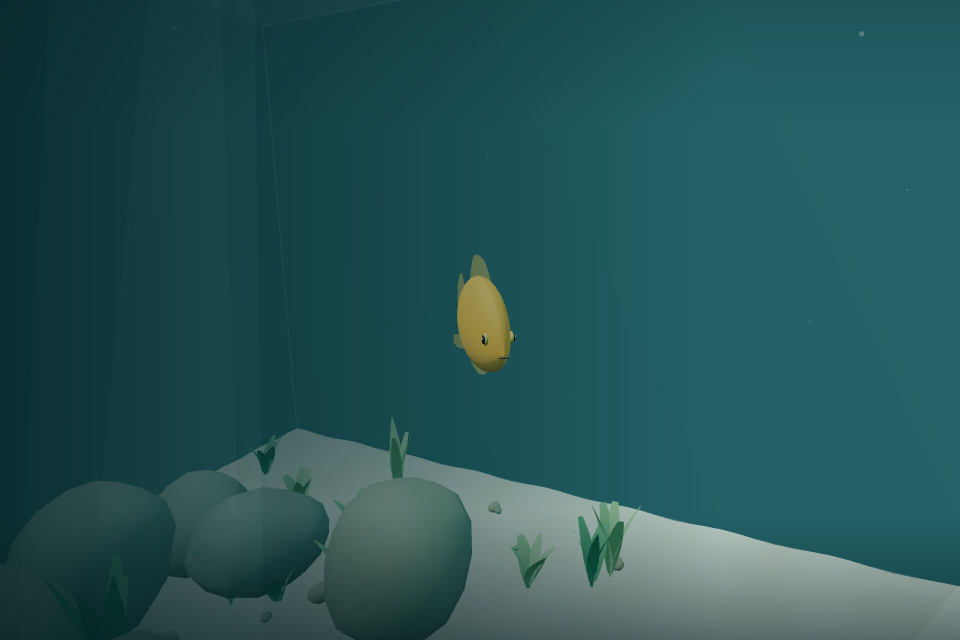
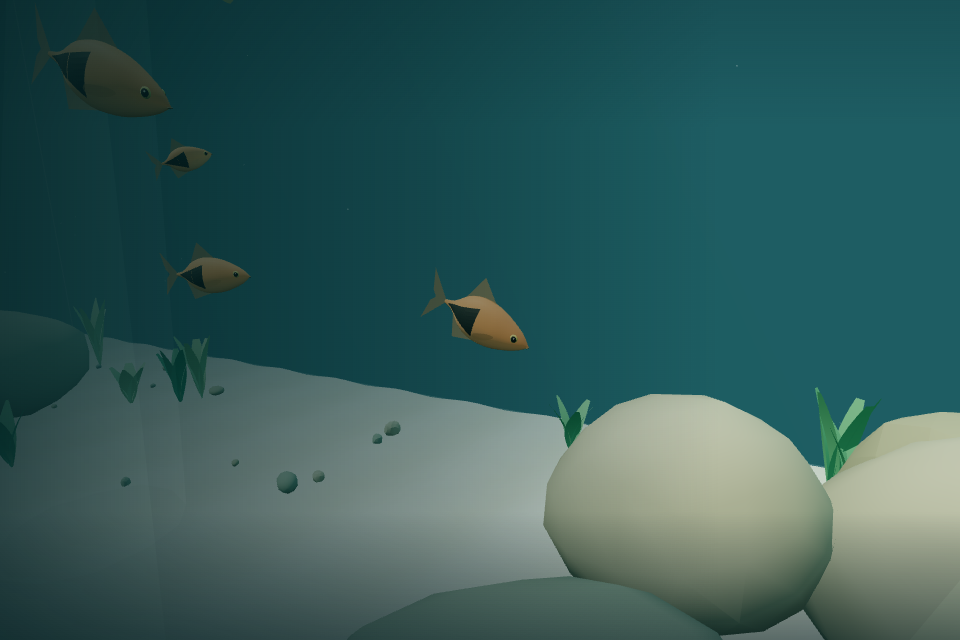
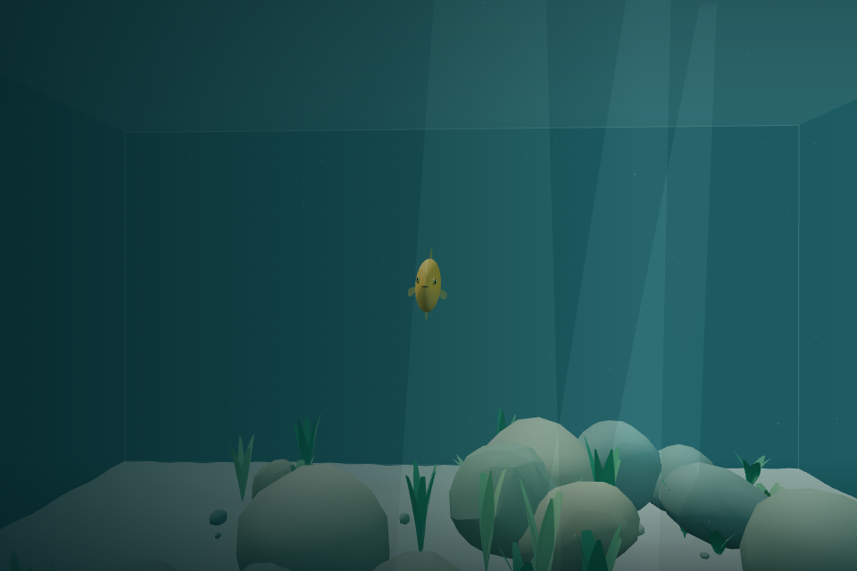
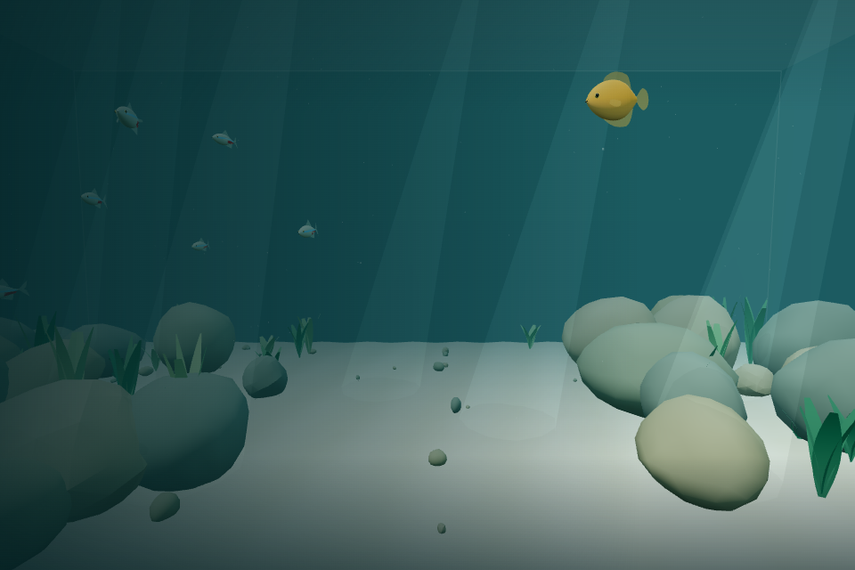

# v0.2 Pass 003 — Individual Behaviors

Validated **2026-11-06** on Linux, Node 24, and headless Chromium / SwiftShader. Base: `71b08d1` (merged Pass 002B). The user confirmed Pass 002B manual macOS acceptance in this pass's implementation prompt. This record covers automated/browser checks for Pass 003; its manual checklist remains unchecked.

## Changes and architecture

The existing population, models, shared resources, aquarium layout, rock geometry/colliders, controls, player swimming and breathing are preserved. No new packages, scene assets, particles, render passes, global timers, physics engines or persistence were added.

`FishBehavior.ts` and `FishBehaviorTypes.ts` implement a small per-fish intention scheduler with six activities: cruising, exploring, resting, foraging, observing and recovering. Species choose meaningful intervals, weighted preferences, dwell ranges, resting speed, social retention and recovery duration. Individuals have deterministic initiative, rest preference, curiosity and recovery traits, forked from the existing seeded individual RNG without consuming spawn/layout or wandering randomness.

The fixed-step pipeline stays intact: first calculate every schooling influence from the same snapshot; then update each fish's existing diver reaction, its own behavior intention, safety steering, and bounded locomotion. Behavior never integrates position/velocity or mutates neighboring fish. Intent weight, preferred speed, social influence and optional inspection pitch blend at 1.8/s. Obstacle steering and final containment remain authoritative; personal-space separation is retained. Awareness/scatter suppress optional intentions at steering time as well as ending voluntary activities.

### Activities

- **Cruising:** existing persistent wandering and species schooling, with long quiet intervals between activity decisions.
- **Exploring:** nearby plant/rock/open-water target or a bounded local fallback. Gradual approach, brief arrival pause, then normal cruising. Six seconds without meaningful progress abandons a target.
- **Resting:** local anchor and stable heading with low-speed drift/correction; gradual deceleration, active essential fins, occasional longer gourami hovering. A diver can interrupt immediately.
- **Foraging:** approach a safe surface offset, slow near arrival, make at most two restrained inspection dips (maximum 0.07 radians, approximately four degrees) over four seconds, and return to cruising after five seconds of inspection. There is no food, hunger, mouth animation, resource or feeding requirement.
- **Observing:** occasionally orient toward a calm active diver outside the species awareness radius + 0.6 surface-gap units; keep distance rather than pursue. Observe for 5–8 seconds with a 35–60-second cooldown. A fast/close approach or rising existing awareness ends observation.
- **Recovering:** read existing awareness/scatter; suppress optional activities while ordinary social cruising returns. After disturbance subsides, a bounded individual/species dwell ends caution. No second threat/fear computation or persistent memory is introduced.

### Species configuration

| Setting                                   | Neon tetra            | Harlequin rasbora     | Honey gourami         |
| ----------------------------------------- | --------------------- | --------------------- | --------------------- |
| Cruise decision interval (s)              | 32–64                 | 28–60                 | 20–42                 |
| Explore / rest / forage / observe weights | .65 / .08 / .22 / .05 | .45 / .22 / .25 / .08 | .30 / .30 / .20 / .20 |
| Explore/forage maximum dwell (s)          | 7–12                  | 10–17                 | 15–24                 |
| Rest duration (s)                         | 3–6                   | 5–9                   | 10–18                 |
| Rest speed fraction                       | .30                   | .22                   | .16                   |
| Activity social retention                 | .90                   | .70                   | 1 (independent)       |
| Base recovery dwell (s)                   | 5                     | 7                     | 10                    |

Traits vary initiative [.8, 1.2], rest preference [.7, 1.3], curiosity [.6, 1.4], and recovery approximately [.72, 1.32] including temperament. Tetras remain mainly active/social/cautious, rasboras more loosely exploratory, and gouramis more relaxed and observant. Frequencies are tendencies, not a fixed activity sequence. Successful arrival, blocked progress or disturbance can shorten the maximum dwell. See [FISH.md](FISH.md) for detailed thresholds and extension points.

### Habitat and animation

`FishHabitat.interests` exposes plain read-only positions, outward normals and kinds. `Aquarium` derives **65 plant-tip regions, 102 rock edge/top points and five open-water regions** from existing generated data. No layout RNG calls or scenery transforms change. Fish do not traverse scene graphs or raycast plants.

At most 24 interest candidates are sampled, within 4.5 units for foraging / 6 for exploration. Targets include the fish radius plus a 0.45-unit outward surface offset and small individual tangent variation; full body containment and extra margin are checked. A conservative straight-route expanded-convex-plane intersection rejects targets behind solid scenery. Exploration has eight local fallback attempts; foraging without a suitable point returns quietly to cruising. Invalid/stalled targets are abandoned rather than continuously retried.

Existing speed-dependent tail cadence/amplitude and pectoral motion express slowing without resetting animation phase. `FishSystem` interpolates only one new optional presentation channel: inspection pitch. Reduced motion suppresses that gesture and existing optional bank, preserving essential fins and locomotion. No model meshes or GPU resources are added.

## Required automated checks

| Command             | Result                                                                          |
| ------------------- | ------------------------------------------------------------------------------- |
| `npm run build`     | Pass: TypeScript and Vite, 31 modules                                           |
| `npm test`          | **150 tests in 11 files pass** (all 130 previous tests preserved, 20 new tests) |
| `npm run typecheck` | Pass                                                                            |
| `npm run lint`      | ESLint and Prettier pass                                                        |

Production JS: **640.35 kB / 166.94 kB gzip**, versus Pass 002B's 633.96 / 164.94 kB. The existing >500 kB bundle advisory remains. No external runtime assets or dependencies were introduced.

### New behavior coverage

- Valid independent seeded initialization, varied traits/durations, unchanged wandering RNG stream, invalid/zero delta handling, complete pause freeze.
- Identical behavior and physical results over 150 simulated seconds at 30/60/120 FPS; identical results when fish update order is reversed.
- Species personality ordering, and 200 seeded initial decisions per species showing observation occurs more often for gouramis than rasboras, and more often for rasboras than tetras.
- Gradual resting deceleration, local hovering, active tail/pectoral animation, normal exit, and divergence from resting/foraging/observing/exploring when the existing reaction rises.
- Safe interest offsets, blocked straight routes through real rocks, unreachable candidate rejection, normal locomotion reaching a valid region, invalid/stalled target abandonment.
- Bounded finite inspection pitch, completion after arrival, reduced-motion suppression with essential fins still moving.
- Calm/distance/cooldown curiosity gates; bounded turning toward the actual player direction, safe observation distance, immediate interruption by rapid approach before scatter builds, no repeated proximity state oscillation, eventual recovery and bounded individual dwell variation.
- **Ten-minute real-aquarium simulation:** all fish finite and contained; zero containment corrections; >65% of aggregate fish-time cruising; every fish visits at least three activity types and makes 8–64 transitions; resting gouramis and completed foraging occur; no stuck activity state.

All previous locomotion, deterministic spawning, schooling, scatter/recovery, ten-minute habitat safety, generated rock agreement, swept player collision, breathing, controls, settings and resource-disposal regressions pass unchanged.

## Browser validation

Headless Chromium rendered the actual aquarium at 960 × 640 with SwiftShader. Test-only response instrumentation exposed the app instance without shipping a debug API. Real browser input checks were followed by accelerated observation using **30 genuine 1/30-second updates per rendered sample**, not a changed simulation delta. The application was paused while the harness advanced the fish system and framed individuals. Screenshots are state-backed observations, not image-equality tests or a real-time five-minute play session.

### Controls and lifecycle

Passed actual pointer lock / welcome and resume buttons, W propulsion, mouse look, Escape pause, and reduced-motion settings. Complete physical/fish state remained frozen while paused. Near-vertical W still ascends, while actual Space + Shift held for more than eight fixed steps in clear water caused exactly zero depth change under reduced motion. Initial fish remain frozen before entry while the existing hover preview continues.

The first harness attempt timed out on its initial held-key check. The corrected harness waits for both pointer lock **and the completed lock-change UI update** before holding W; this avoids the input-clear race in test setup. The subsequent complete run passed. No gameplay control changes were made to address the harness.

### Five-minute observation

The default seeded 16-fish population was observed for **300 simulated seconds**. A calm test diver was present at a fixed position from seconds 80–190; a close approaching-diver fixture disturbed one gourami at seconds 190–200; the remainder allowed recovery. Camera framing followed interesting fish independently of that test presence.

- **85.90%** of aggregate fish-time was ordinary cruising. Exploration, resting, foraging, observation and recovery all occurred; individual transition counts ranged **6–14**, without a shared activity timer.
- A naturally scheduled gourami rest was captured at second **35**, a rasbora near a foraging target at **98**, and a rasbora observing the calm diver at **180**. Gouramis independently explored, rested and recovered. The natural run did not schedule gourami observation in this particular window; that is covered by a separate seeded fixture below rather than claimed here.
- There were **171 arrived-foraging fish-steps** (5.7 aggregate seconds) and **135 steps** with a visible inspection gesture below -0.02 radians. These are sampled durations, not counts of distinct feeding events.
- **Zero rock/glass containment corrections** and no body-sphere overlaps in **36,000 pair checks sampled once per simulated second**. Soft separation is not a guarantee against every close pass between samples.
- Essential fins remained active while resting/slow. Screenshots showed unchanged species appearances and subdued activity in the existing environment. Unit regressions additionally verify recognizable tetra/rasbora spacing/alignment and school reconnection.
- No page or console errors; application disposal removed the canvas.

### Controlled gourami observation and retreat

A separate temporary **one-gourami, seed-1 fixture** advances its initial cruise decision clock to the next eligible decision (no behavior configuration changes). The scheduler selects `observing` for **6.198 seconds** toward a calm diver. After five seconds the fish is still observing at speed **0.0328 units/s**, with a **4.080-unit surface gap** and active tail motion. The screenshot below uses that fixture; the shipping population remains 16.

Moving the test presence close with approaching velocity interrupts observation: after one second activity is `recovering`, scatter **0.523**, speed **0.279 units/s**. After 60 seconds without the diver it is cruising, scatter is zero and containment corrections remain zero. This verifies gourami curiosity and retreat through the same simulation/presentation pipeline without waiting for a rare event during the main observation.

### Screenshots

Naturally scheduled gourami rest (35 s):

Rasbora inspecting a habitat surface (98 s):

Controlled seeded gourami observing the calm diver:

Aquarium after 300 simulated seconds:

## Performance and resource findings

Browser CPU sampling used 1,000 warmup steps followed by 3,000 measured 30 Hz simulation steps against the actual habitat/interest points. Separate normal/reduced-motion FishSystem stress loops advanced another five simulated minutes for each population.

| Population            | Mean step |      p95 | Maximum | Simulation / stress guard corrections |
| --------------------- | --------: | -------: | ------: | ------------------------------------: |
| 16                    |  0.161 ms | 0.200 ms | 36.2 ms |                                 0 / 0 |
| 32 (temporary stress) |  0.085 ms | 0.200 ms |  4.5 ms |                                 0 / 0 |

The reversed means and long outlier demonstrate JIT/scheduling noise; doubling fish is not intrinsically faster. These are software-browser CPU samples, not hardware/macOS GPU or 60 FPS measurements. Rendering was visibly slow under SwiftShader. The final moving-fish overview reported 336 draw calls / 54,491 triangles; this is a different culling/time sample from previous passes and does not establish a reduction in render cost.

Both populations retain **17 shared fish geometries and seven materials**. All **24 resources dispose exactly once**, including repeated dispose calls. Behavior introduces no geometry, material, rendering pass, scene traversal, or per-step vector/array allocation. Candidate selection happens at individual decisions; persistent buffers/targets are reused. Habitat metadata is allocated only during generation. Actual macOS comfort and hardware performance require the checklist below.

## Limits and Pass 004 preparation

- Intentions use local straight-route selection and existing steering, not a global planner. Social/obstacle constraints can prevent arrival; targets time out safely. Conservative rock-edge metadata can sit farther from the visible surface than a future detailed habitat description.
- Special activities are deliberately sparse and probabilistic. A particular fish is not guaranteed to forage or observe during a short session. Resting is gentle drift, not perfect position locking. The inspection gesture is a small body dip rather than articulated mouth/head anatomy.
- Avoidance/personal space remain soft steering. Forced overlaps, very fast approaches or dense configurations can still produce emergency close passes. No hard fish-player collision or push is introduced.
- Browser validation covers Linux Chromium/SwiftShader and accelerated samples. Safari/Firefox, real macOS performance, OS focus/tab switching, long subjective play sessions and comfort remain manual checks. Escape pause and normal resume were directly tested.
- No species, fish population, scenery placement, plants, rocks, player physics, UI mechanics, sound, food, memory persistence or backend were added.
- Pass 004 can enrich the existing interest kinds/metadata with vegetation/habitat regions, keeping deterministic generation, body clearance, bounded selection, shared resources and snapshot-safe simulation. **Do not merge automatically or begin Pass 004 before manual macOS acceptance.**

## Manual macOS acceptance checklist

Leave these unchecked until the macOS playtest. Compare the three swim presets/reduced motion and repeat Escape, focus/tab loss, and refresh. Observe quietly for at least five minutes; occasional inactivity is intended.

### Individual Behaviors

- [ ] Fish exhibit occasional behaviors beyond ordinary swimming.
- [ ] Honey gouramis sometimes hover calmly.
- [ ] Fish occasionally investigate plants or rock formations.
- [ ] Feeding-like activity is subtle and believable.
- [ ] Some fish briefly observe the diver from a safe distance.
- [ ] Different individuals exhibit different activity patterns.
- [ ] Fish do not constantly switch behaviors.
- [ ] Behaviors do not appear synchronized.

### Schooling and Reactions

- [ ] Tetra schooling remains recognizable.
- [ ] Rasboras retain looser social movement.
- [ ] Gouramis remain independent.
- [ ] Fish continue scattering when approached.
- [ ] Resting or curious fish retreat when necessary.
- [ ] Schools naturally regroup after disturbances.
- [ ] No obvious fish-to-fish or fish-player clipping.

### Environment and Comfort

- [ ] Fish remain outside solid rocks and glass.
- [ ] Fish do not become stuck while investigating surfaces.
- [ ] Tail and fin animation remains natural.
- [ ] Aquarium atmosphere remains peaceful.
- [ ] Player swimming and buoyancy are unchanged.
- [ ] Pause/resume works correctly.
- [ ] Performance remains smooth on macOS.
