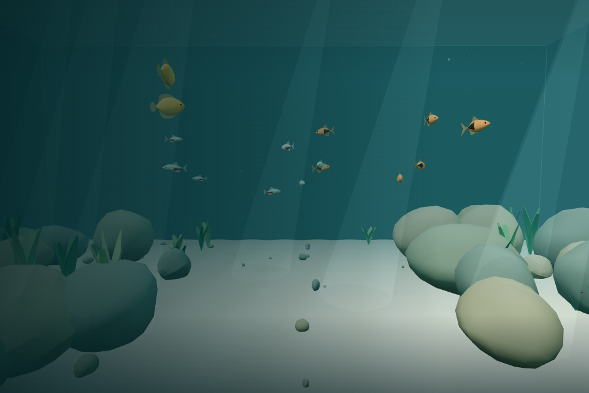
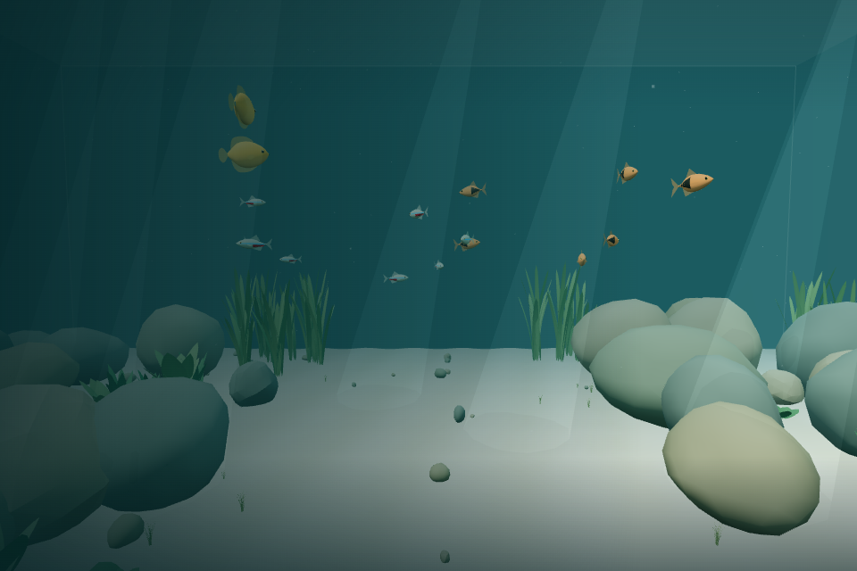
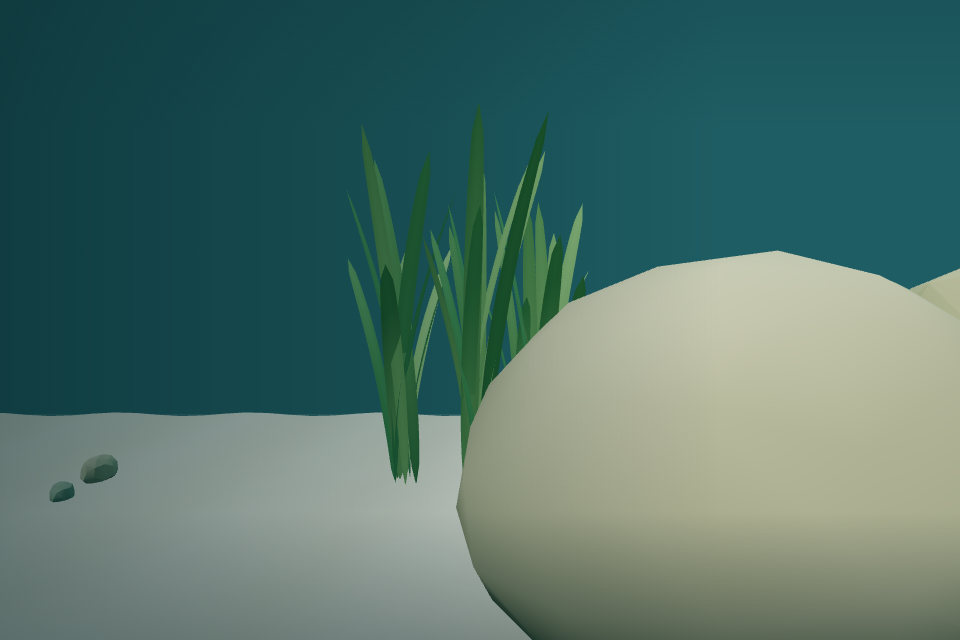
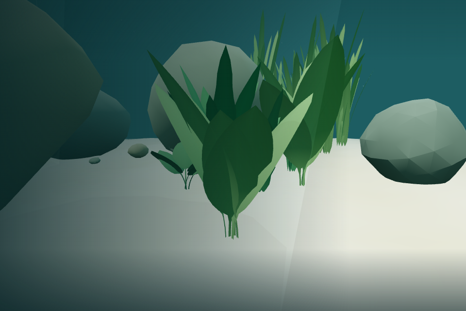
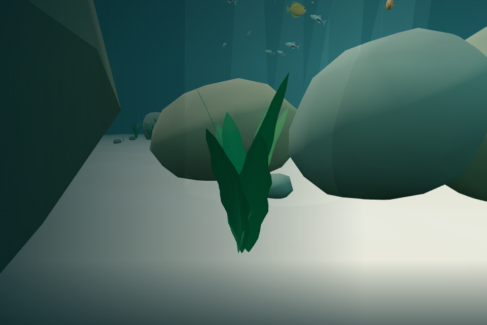
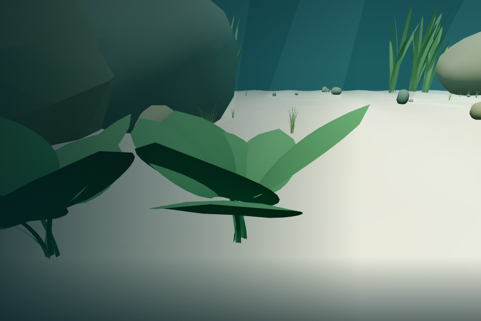
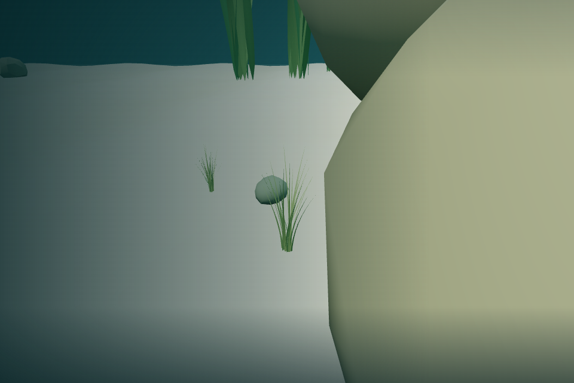
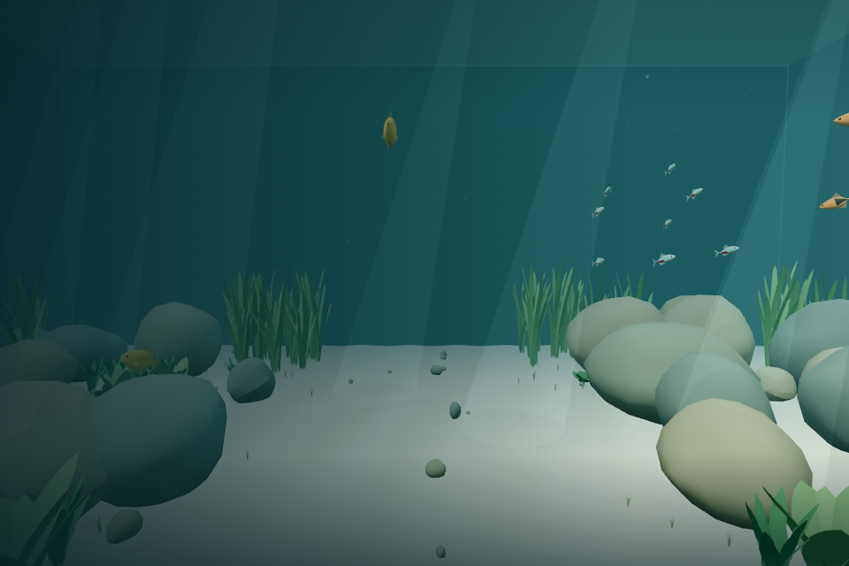

# v0.2 Pass 004 — Living Plants & Habitat

Validated **2026-11-06**, Linux / Node 24 / headless Chromium with SwiftShader. Base `0562aba` contains merged Pass 003. This record does not claim hardware MacBook Air results. Do not merge automatically or begin Pass 005 before manual macOS acceptance.

## Implementation

The aquarium retains 16 fish, all five existing individual activities plus recovery, the same fish models/animation, schooling, diver reactions, camera-directed swimming, breathing, controls, settings, 34 solid major rocks and 55 passable pebbles. No dependencies or external runtime assets were added.

Plant responsibilities move out of Aquarium into [PlantSpecies, PlantGeometry, PlantSystem, HabitatRegions and PlantAnimation](PLANTS.md). Aquarium only assembles the system and forwards lifecycle updates. There are **65 plant clusters**:

| Family          | Count | Height scale | Visual and motion character                                     |
| --------------- | ----: | ------------ | --------------------------------------------------------------- |
| Vallisneria     |    16 | 3.2–5.0      | Slender curved ribbons, varied lengths; most flexible tips      |
| Amazon Sword    |    12 | 1.4–2.5      | Lance-shaped cupped leaves with narrow petioles; stable rosette |
| Java Fern       |    14 | 1.1–2.0      | Narrow irregular dark fronds; gentle independent variation      |
| Anubias         |    10 | 0.55–0.95    | Compact oval leaves and short stems; very restrained motion     |
| Dwarf Hairgrass |    13 | 0.25–0.52    | Dense tapered strand tufts; subtle collective movement          |

Three seeded whole-plant variants per family are available; the default uses 14 occupied instanced batches, stress uses all 15. Geometry combines tapered profiles, directional curvature/twist, cross-leaf cupping, vertex gradients and subtle midribs. One shared rough, opaque, nonmetallic double-sided material replaces the old four leaf materials. Instance height, yaw and tint vary without unique geometry per plant.

### Habitat distribution and safety

Loose seeded cluster anchors produce rocky banks, tall rear/side stands and low sand transitions. A **6.4-unit-wide central channel** and initial player exclusion remain clear. Bounds include plant spread/sway. Roots use the existing sand ripple function and are slightly buried instead of floating over a flat assumed substrate.

Placement uses bounded three-dimensional envelope checks against the original convex rocks, permitting upper leaves above low formations while keeping bases beside rocks. Actual transformed vertices and bent poses are independently checked in tests. Delicate leaves and narrow stems remain passable, with no visually bulky uncollided base. No plant colliders, changed rock shapes, expanded player barriers or per-leaf physics are introduced. Rock transform hashing and all previous collision tests remain unchanged.

Plant generation has an independent seed. The original scenery RNG's 65 × 18 legacy plant draws are advanced before mote creation, preserving the existing downstream particle layout as well as sand and rocks.

### Current, pause and reduced motion

A deterministic low-frequency position/time field supplies broad shared flow. Each leaf has its own phase and species frequency. Quadratic flexibility is zero at the base and grows toward the tip. A small vertex shader hook bends vertices, adjusts normals for bend slope, and converts flow into each instance's rotated frame. The flow is calculated once per vertex; narrow grass/fronds avoid unnecessary width subdivisions. Expanded batch bounds include maximum sway.

Only one time uniform changes during ordinary updates: no geometry rebuilds, per-leaf transforms, scene searches, new buffers or per-frame vector allocations. PlantClock advances only while active. Paused/preview plants retain their exact pose. Reduced motion analytically eases phase rate to zero, freezing the current shape instead of resetting displacement; resuming motion eases the same phase back in. Player and fish clocks remain independently owned.

### Fish integration

Each plant exposes a read-only inspection region selected from its actual channel-facing upper leaf vertices, plus a safe outward/upward approach direction. Optional metadata includes family, region, height and broad-leaf flag. Gouramis softly favor broad leaves, tetras favor taller vegetation edges over low grass, and rasboras accept most planted areas. Fish never inspect Three.js meshes.

Body-size offsets, safe straight-route checks, progress timeouts, personal space, rock avoidance and diver interruption remain authoritative. A bounded nearest-safe fallback (at most 192 regions) helps when 24 random forage trials miss usable nearby habitat. This fixes a regression in activity variety caused by sparse new interest availability; the original behavior state machine, durations, weights and locomotion remain unchanged. Existing tests were preserved rather than weakening the activity-variety requirement.

## Automated results

| Command             | Result                                                                          |
| ------------------- | ------------------------------------------------------------------------------- |
| `npm run build`     | Pass: strict TypeScript + Vite, 36 modules                                      |
| `npm test`          | **174 tests / 14 files pass** — all 150 previous tests plus 24 vegetation tests |
| `npm run typecheck` | Pass                                                                            |
| `npm run lint`      | ESLint + Prettier pass                                                          |

Production JS is **650.95 kB / 170.59 kB gzip** (Pass 003: 640.35 / 166.94 kB). The existing >500 kB uncompressed advisory remains. There are no runtime texture/asset downloads.

New tests verify:

- All five categories, deterministic templates, finite vertices/unit normals, configured dimensions, varied heights and curved silhouettes.
- Seeded region placement, horizontal/aquarium-surface bounds, clear initial/channel space, roots aligned with the sand height, explicit invalid-density rejection and safe double density.
- Static and bent vertices outside rock hulls at times **0, 9 and 45 seconds**, seeds **48193 / 1729 / 9271**, including **130 clusters** at seed 48193. Broad-phase rejection keeps exhaustive geometry checks practical; their timeout allows the larger stress cases under software-renderer contention.
- Stable bases, stronger tip bending, species flexibility ordering, local current coherence, individual leaf variation, pause freeze, smooth reduced-motion stop/restart, and 30/60/120 FPS clock consistency.
- Matching plant metadata, safe exploration/foraging targets, the sparse-habitat fallback, and diver disturbance interrupting investigation near vegetation.
- Shared buffers/matrices, unchanged geometry contents through repeated animation updates, idempotent resource disposal and unchanged major-rock collider count.

All previous player swimming/breathing/controls/settings, swept collision, rock geometry, fish spawning, schooling, scatter, animation/interpolation, deterministic scheduling and ten-minute habitat regressions pass. The long behavior test still requires every individual to visit multiple activities, mostly cruising and zero containment corrections.

## Browser results

Two local Playwright harnesses captured the untouched Pass 003 baseline and final Pass 004 rendering. Test-only response instrumentation exposes the app instance without shipping a debug API. Chromium compiled the actual instanced vertex shader without page or console errors.

Passed real browser actions:

- Explicit entry/pointer lock; fish and plant clocks remain frozen before entry while the accepted breathing preview continues.
- Escape freezes fish state and the exact plant phase. Resume advances smoothly.
- Reduced-motion checkbox changes do not reset the paused pose; after resume the current's rate settles down. Turning it off restarts the phase without snapping.
- Real W propulsion passes through an actual Amazon Sword cluster along a clear rock-free path. The collision system continues to contain only the original 34 rocks.
- All five varieties were framed in their actual seeded locations, with safe camera routes. Close-ups show distinct ribbons, rosettes, fronds, compact oval leaves and grass tufts. Initial view stays open. Roots follow sand, and nearby rocks were visually inspected.

### Accelerated habitat observation

The final system advanced **180 simulated seconds** using genuine 1/30-second updates, rendering one sample every six simulated seconds. An earlier full-detail inspection also rendered one sample per simulated second; these are accelerated observations, not hardware real-time frame-rate tests.

The final six-second records include **412 cruising, 45 exploring, eight resting and 15 foraging fish samples** (480 total), with an arrived-foraging sample and **zero containment corrections**. Sampling does not count every short activity. Fish and plant simulation remain finite and plants show different shared-current/individual-phase poses across the observation.

A controlled gourami fixture at an actual Sword leaf inspection region showed a finite restrained inspection dip (**-0.0249 rad**), then switched to `recovering` when an approaching diver was supplied; scatter reached **0.523**. This verifies safety priority near new vegetation without claiming sparse behavior must occur for every fish during a brief observation. Existing schooling/reaction regressions additionally cover group stability and recovery.

### Comparative rendering and CPU measurements

Fixed **960 × 640 initial viewpoint with fish at their original spawn positions**:

| Scene    | Draw calls | Triangles | Unique scene geometries | Unique scene materials |
| -------- | ---------: | --------: | ----------------------: | ---------------------: |
| Pass 003 |        381 |    90,628 |                     366 |                     21 |
| Pass 004 |        207 |   130,028 |                      55 |                     18 |

Draw calls fall **45.7%**; triangles rise **43.5%** because leaves are shaped/subdivided and whole instanced batches render together. Plant geometry falls from 325 unique leaf buffers to 14 shared complete-plant templates. Width tessellation was reduced for thin grass/fronds, and the shader reuses the current calculation, preserving broad-leaf curvature. No extra render pass or transparent layer is added.

Subsequent final-view measurements after navigation and the habitat observation (same camera pose, different live fish positions):

| Scene             | Clusters | Draw calls | Triangles | Geometries / materials | Paused scene update mean | Plant clock/update mean      |
| ----------------- | -------: | ---------: | --------: | ---------------------- | -----------------------: | ---------------------------- |
| Pass 003 baseline |       65 |        381 |    90,628 | 366 / 21               |                 0.050 ms | Old group rotations included |
| Pass 004 default  |       65 |        181 |   112,832 | 55 / 18                |                 0.018 ms | <0.001 ms                    |
| Pass 004 stress   |      130 |        182 |   155,616 | 56 / 18                |                 0.008 ms | <0.001 ms                    |

CPU means average 10,000 calls. The paused scene bridge updates visual poses and ambient transforms with fish simulation inactive; this is **not a full fish simulation benchmark**. Plant-only updates use active 1/60-second calls. Smaller stress CPU means reflect warmup/scheduling noise, not intrinsically faster dense scenes.

Twenty rAF intervals per scene: baseline median/p95 **373.4 / 672.6 ms**, final default **333.0 / 681.6 ms**, stress **448.0 / 7575.4 ms**. View/culling and software-renderer scheduling differ, including a severe stress outlier. A separate initial-capture timing overlapped another browser and was excluded. These samples do **not establish hardware MacBook Air smoothness, 60 FPS, or a precise speedup**. Default draw calls and CPU work are controlled; hardware timing/comfort remain manual acceptance items.

### Resource cleanup

Default vegetation disposes all **14 geometries + one material**, and all **14 InstancedMesh resources**, exactly once even with repeated disposal. Actual renderer geometry memory drops **55 → 41** before replacement. Double density uses 15 shared templates/one material rather than per-instance geometry; total scene geometry is 56. Full application disposal removes the canvas. No page/console errors occur.

## Screenshots

Before:

Final initial view:

| Vallisneria                                                | Amazon Sword                                                |
| ---------------------------------------------------------- | ----------------------------------------------------------- |
|  |  |

| Java Fern                                              | Anubias                                                  | Dwarf Hairgrass                                             |
| ------------------------------------------------------ | -------------------------------------------------------- | ----------------------------------------------------------- |
|  |  |  |

## Limitations and Pass 005 preparation

- Plants remain lightly stylized thin surfaces. There is no true leaf thickness, growth, foliage physics, root/woody collision, or botanical texture simulation. Compact plants may be partly obscured by larger rocks from the initial view; close-ups show each family.
- Placement checks use sampled conservative envelopes; independent vertex tests cover the recorded seeds/times, not a mathematical proof for every possible random seed and phase. Static interest regions do not track every moving tip.
- A batch spans several plants, reducing draw calls but rendering some offscreen instance triangles. More spatial batching belongs to later measured optimization if hardware testing warrants it.
- Reduced motion freezes the existing bent shape after a short phase-rate settling interval rather than immediately straightening leaves. Preview/paused plants stay still. Current normals are a lightweight bend-slope approximation and assume the existing untransformed environment root.
- Fish behavior remains sparse, local and soft: not every individual investigates every family in three minutes. Closest-region fallback is bounded and still rejects unsafe/unreachable targets. Leaves remain passable; solid rock safety and diver reactions dominate.
- Coverage is Linux Chromium/SwiftShader plus pure tests. macOS Safari/Chrome/Firefox, real OS focus/tab switching, long subjective comfort and MacBook Air hardware timing require the checklist below.
- No fish population/model/scheduler tuning, new rocks, aquarium dimensions, player physics, audio, food, customization or backend is introduced. Pass 005 may add ambient audio with its own lifecycle; **await manual macOS acceptance before starting it**.

## Manual macOS acceptance checklist

Leave these unchecked until the macOS playtest. Observe for several minutes, visit each plant family, swim through foliage, approach fish near plants and compare reduced motion/pause/focus/tab transitions.

### Vegetation Appearance

- [ ] Multiple plant types are recognizable.
- [ ] Plants look natural rather than like flat repeated shapes.
- [ ] Vegetation has appropriate size and color variation.
- [ ] Tall plants, broad leaves and low grass are visually distinct.
- [ ] Plant placement feels organic.
- [ ] The aquarium remains open and comfortable to navigate.

### Vegetation Animation

- [ ] Plants sway gently.
- [ ] Movement varies between different plants.
- [ ] Leaves within the same plant move with subtle variation.
- [ ] Plant bases remain stable.
- [ ] Animation is not exaggerated or distracting.
- [ ] Reduced-motion settings work.
- [ ] Pause/resume does not cause plant animation jumps.

### Fish and Habitat

- [ ] Fish naturally explore planted areas.
- [ ] Fish can investigate vegetation without getting stuck.
- [ ] Honey gouramis can hover near suitable plants.
- [ ] Existing schooling remains natural.
- [ ] Diver scattering still works.
- [ ] Fish continue avoiding major rocks.
- [ ] Thin vegetation remains passable.

### Player Experience

- [ ] Player swimming feels unchanged.
- [ ] Breathing buoyancy remains comfortable.
- [ ] Camera movement remains smooth.
- [ ] Rock collisions remain reliable.
- [ ] The aquarium feels more alive without becoming cluttered.
- [ ] Performance remains smooth on macOS.
