# v0.2 Pass 004B — Aquarium Biodiversity & Habitat Expansion

Validated **2026-11-06** on Linux, Node 24 and headless Chromium/SwiftShader. Base `198e5b0` includes merged Pass 004. This pass is not automatically merged. Manual macOS testing remains outstanding; do not begin ambient audio before acceptance.

## Additions and preserved systems

| Species             |  Count | Role                                                 |
| ------------------- | -----: | ---------------------------------------------------- |
| Neon tetra          |      8 | Existing moderately cohesive school                  |
| Harlequin rasbora   |      6 | Existing looser social group                         |
| Honey gourami       |      2 | Existing independent calm behavior                   |
| Panda corydoras     |      5 | Bottom-relative exploration/foraging and short rests |
| Endler’s livebearer |      4 | Individually marked independent mid/upper swimmers   |
| Chili rasbora       |     20 | Tiny 3D fish in a larger active school               |
| **Default total**   | **45** | Existing 16 retained intact                          |

The accepted player swimming, breathing, camera controls, settings, pause lifecycle, original models/fin animation, behavior state machine and consistent 30 Hz schooling pipeline remain. No dependencies, external runtime assets, audio, food/hunger, marine biology, backend, growth or customization were added.

### Grass meadows and current tuning

Eight seeded irregular meadows supplement the 65 existing plant clusters. Each contains 120–180 single tapered curved blades, rather than duplicated Hairgrass tufts. Center-weighted density, wavy elliptical edges, mixed heights, occasional taller ribbons, root-level terrain sampling and restrained tint variation create coherent patches. Three instanced blade templates share the existing plant material/current clock. Grass remains passable and exposes eight useful edge interests. Placement protects the open central corridor, initial view and solid geometry.

Sway coefficients change selectively: Vallisneria **.045 → .072**, Sword **.014 → .023**, Fern **.025 → .037**, Anubias **unchanged .006**, Hairgrass **.022 → .039**; meadow blades use .075. Frequencies remain slow. Position-dependent leaf phase adds individual variation without replacing the shared current. Roots remain fixed, maximum motion bounds expand to .65, and the same clock freezes on pause / smoothly settles under reduced motion. No per-frame geometry reconstruction or independent meadow update loop is added.

### Coral-inspired freshwater hardscape

Nine ornaments (three variants each of branching, rounded/lobed and plate forms) use rough cream, muted coral-orange and lavender-gray materials with procedural mineral variation. Branches are smooth convex arms formed from tapered spherical samples along curved paths; rounded forms combine irregular sculpted lobes; plates use irregular softly domed layers and supporting stems. These are decorative freshwater ornaments, not living marine coral.

The same rendered convex components supply **39 static ornament hulls**, alongside the unchanged **34 original rock hulls** (73 solids total). This preserves open gaps between branches/layers instead of using an oversized whole-ornament proxy. Original swept player sliding and fish containment remain authoritative. Nine hardscape-edge and ten substrate interests reuse existing target safety. Hardscape/grass placement keeps the central corridor and existing rocky composition open. Resources detach before generic aquarium cleanup and dispose exactly once.

### Species identity and bursts

Corydoras have pale blunt bodies, dark masks/tail/dorsal markings, rounded undersides, downward mouths and small barbels. Their conservative sphere uses 65% of body length to include barbels. A substrate callback plus a 0.48–1.1 preferred offset and body-radius floor margin produce bottom-oriented movement with gentle excursions; low vegetation/substrate investigation and loose social tuning distinguish them from midwater tetras.

Endlers have four stable dark/orange/teal marking layouts/hues, streamlined bodies and articulated fins. They retain separation without alignment/cohesion and have occasional gentle speed bursts.

Chilis have 0.24-unit lofted red-orange bodies, dark lateral markings and actual 3D eyes/fins. Their local school uses alignment radius/weight 3.6/1.65, cohesion 8.5/1.4, reconnect radius 13, at most 12 neighbors and nearby wander weight .18. No leader, fixed path, group tether or synchronized clock is added.

`FishBurst` supplies separately seeded speed intentions: chili intervals **5–11 s**, envelope **0.4–0.8 s**, preferred speed **1.05**, acceleration cap **1.6**; Endlers use **8–15 s**, **0.45–0.8 s**, speed **.82**, acceleration **.8**. The envelope changes desired speed through existing acceleration limits, then allows a glide. Obstacle danger, close-neighbor pressure and large desired turns suppress the boost. Fear and voluntary resting/inspection interrupt it; escape still overrides it. Original species have no burst tuning and preserve their accepted movement.

A regrouping regression initially exposed persistent fragmentation after disturbance. Stronger finite local chili neighbor coverage and turn-dependent burst suppression fixed it without changing the original schooling algorithm or adding position constraints.

### Rendering and lifecycle

Original species retain their existing detailed models/rendering. New species use size-appropriate tessellation and `FishRenderBatch`: each actual front/rear/tail/fin component receives its articulated rig matrix in an InstancedMesh. Chilis remain real 3D fish, not particles/billboards or rigid single-mesh substitutes. Four Endler geometry-marking variants preserve individuality.

At 45 and 60 fish, resources stay **47 fish geometries / 19 materials**. Moving new-species batches deliberately disable per-instance frustum culling to avoid stale bounds at this small population; transparency sorting remains per batch. No new RAF loop or per-step array/vector allocation is introduced. The existing O(n²) bounded neighbor snapshot remains sufficient in the measured CPU results.

See [FISH.md](FISH.md) and [PLANTS.md](PLANTS.md) for ownership/tuning.

## Automated results

| Command             | Result                                     |
| ------------------- | ------------------------------------------ |
| `npm run build`     | Pass: strict TypeScript + Vite, 40 modules |
| `npm test`          | **195 tests / 15 files pass**              |
| `npm run typecheck` | Pass                                       |
| `npm run lint`      | ESLint + Prettier pass                     |

Production JS: **665.16 kB / 174.79 kB gzip**, versus Pass 004's 650.95 / 170.59 kB. The existing >500 kB uncompressed bundle advisory remains.

All 174 prior tests remain as regression coverage. Original 16-fish scenarios now explicitly use `ORIGINAL_FISH_SPECIES` fixtures; original-rock checks assert `rockColliders` (34) while new tests exercise the complete solid list. This keeps the old test intent rather than silently retaining a 16-fish production default or weakening assertions for old species. The shipping default is independently verified as 45.

New coverage includes:

- Six species / exact 16, 25, 45 and 60 gates; reproducible valid spawning, initial personal space, player exclusion, compact initial chili region, original registry retained.
- Shared articulated batches, four distinct Endler variants, moving matrices/fin phases, frozen paused instance data, exactly-once resource disposal and cory body sphere enclosing barbels.
- Bounded burst speed/acceleration/turn/displacement, varied first-start timings, low duty cycle and no whole-school synchronized burst. Chili schooling is more cohesive than a no-schooling control.
- A controlled chili disturbance causes spread then recovery through ordinary local steering; fixed-step state is identical at 30/60/120 FPS and all burst state freezes on pause.
- Corydoras remain predominantly substrate-adjacent in a five-minute variable-substrate scenario; Endlers have independent social tuning.
- Three-minute **25/45/60** real-habitat runs with a diver disturbance remain finite/contained and moving, with **zero guard corrections**.
- All three ornament forms, deterministic placement, finite geometry/unit hull support normals, every rendered ornament vertex inside its matching component union, and swept player contact/escape. A domed contact retains allowed tangential velocity; the check verifies the contact normal rather than assuming vertical velocity must be zero on a slope.
- Deterministic irregular meadow patches, mixed blade heights/root alignment, shared buffers, bent-blade clearance from all solids, selective sway ordering, stable bases and explicit shared-material ownership.

All previous swimming/buoyancy/controls, rock hash/collision, original fish behavior/schooling/scatter, plant generation/animation, reduced motion and settings checks pass.

## Actual browser validation

Chromium rendered the actual scene at **960 × 640** using SwiftShader. Test-only response instrumentation exposed the application instance without a production debug API. Photos of individual new fish use controlled side poses of their real articulated rigs; close-up camera distances differ, so use the wide overview to compare relative sizes.

Passed real actions:

- Entry/pointer lock, W propulsion, mouse look and physical diver presence triggering chili scatter.
- Escape freezes fish state (including burst clocks) and the shared plant phase; resume/reduced motion preserve lifecycle behavior. Essential fish motion continues while optional bank/sway is suppressed.
- Holding camera-directed W downward onto a substantial plate ornament stops/slides outside the full solid set; the actual camera remains outside all hulls.
- Each new fish model, each ornament type, grass meadow and chili school rendered without page or console errors. Species and default count were checked directly.

### Extended observation

The full 45-fish system advanced **180 simulated seconds** in genuine 1/30-second updates, with a rendered sample every six seconds. A five-second moving-velocity disturbance fixture was supplied near the chili group at seconds 60–65. This is an accelerated controlled observation, not a hardware real-time play session.

- Corydoras were within **1.6 units of the substrate for 23,187 / 27,000 fixed-step samples (85.88%)**; gentle excursions remain possible.
- Chili burst envelopes exceeded 0.1 for **5,523 / 108,000 fish-steps (5.11%)**; at most **six of twenty** were active simultaneously. Envelope activity is a speed intention; large turns/safety can further suppress the applied boost.
- Chili RMS spread: **0.976 before disturbance → 2.106 during scatter → 0.962 after recovery**. Peak scatter strength was **0.949**.
- **Zero containment corrections** and **zero overlaps in 29,700 pair samples**, checked once per rendered observation. Soft separation does not guarantee every between-sample pass is overlap-free.
- Recorded activity samples include cruising, exploring, resting, foraging and recovering. Existing individual activities remain sparse; the fixture does not claim every fish performs every activity.

### Motion comparison

The paired frames below use the same camera and current times **0 / 3 s**. Reference frames scale existing plant motion attributes to the previous amplitudes; enhanced frames restore the new amplitudes. The current field/layout is the new implementation in both pairs, so this isolates tuning rather than pretending to replay the previous binary. Geometry/attributes are restored afterward; production never rebuilds geometry each frame.

| Previous-amplitude reference, 0 s                                    | Reference, 3 s                                                                     |
| -------------------------------------------------------------------- | ---------------------------------------------------------------------------------- |
|  | 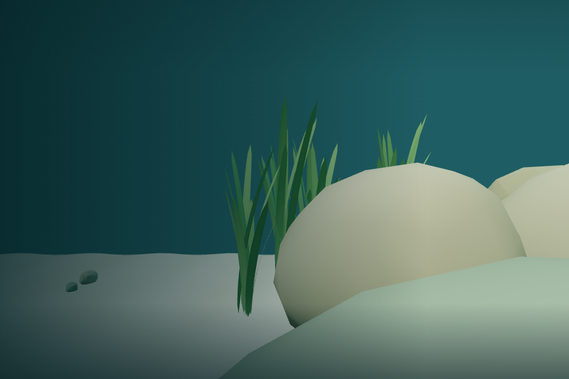 |

| Enhanced amplitude, 0 s                                            | Enhanced, 3 s                                                                    |
| ------------------------------------------------------------------ | -------------------------------------------------------------------------------- |
|  |  |

## Population and rendering performance

The untouched Pass 004 baseline was captured before editing: **207 draws, 130,028 triangles, 55 scene geometries / 18 materials**, rAF median/p95 **491 / 3107.7 ms**. Its 0.017 ms paused scene-update mean is not a fish simulation measurement.

The new-world rows below share the new vegetation/ornaments and fixed initial camera; only fish population changes. Each starts from deterministic spawn positions. This separates environmental additions from population scaling:

| Population                    | Draw calls |   Triangles | Scene geometries / materials | Fish geometries / materials | rAF median / p95     |
| ----------------------------- | ---------: | ----------: | ---------------------------- | --------------------------- | -------------------- |
| 16 original fish in new world |        213 |     152,398 | 68 / 21                      | 17 / 7                      | 459.5 / 1560.6 ms    |
| 25 (add corydoras + Endlers)  |        243 |     172,127 | 93 / 31                      | 42 / 17                     | 405.2 / 1249.1 ms    |
| **45 default**                |    **249** | **191,687** | **98 / 33**                  | **47 / 19**                 | **456.9 / 852.0 ms** |
| 60 temporary stress           |        249 |     206,357 | 98 / 33                      | 47 / 19                     | 474.0 / 1036.0 ms    |

Default draw calls rise **20.3%** over Pass 004 while population rises from 16 to 45 and adds meadows/hardscape. Adding fifteen more chilis for stress adds no geometry/material templates or draw calls. Triangle counts include complete submitted batches, including some offscreen instances. Shared articulated parts preserve natural motion without one draw per new fish part.

Frame timings use twenty rAF intervals. The software renderer is slow and noisy; reversed ordering/outliers do not imply the larger population is faster. **These results do not establish MacBook Air hardware smoothness, 60 FPS, or cross-browser comfort.** No population was silently reduced.

### Simulation CPU

Each scenario used 1,000 warmup plus 3,000 measured 30 Hz steps in the new real habitat. No rendering was performed inside the measured step; normal individual activities/bursts continued.

| Population | Mean / p95 step  | Maximum | Guard corrections |
| ---------- | ---------------- | ------: | ----------------: |
| 16         | 0.139 / 0.200 ms | 37.0 ms |                 0 |
| 25         | 0.124 / 0.200 ms | 37.5 ms |                 0 |
| 45         | 0.246 / 0.400 ms | 48.0 ms |                 0 |
| 60         | 0.374 / 0.500 ms | 37.5 ms |                 0 |

Long isolated outliers reflect JIT/GC/host scheduling variability. Vegetation's shared-clock update averaged **<0.001 ms** over 10,000 calls; meadows need no separate CPU animation update. No spatial index was justified by these step costs.

### Resource lifecycle

At 60 fish, all **47 fish geometries + 19 materials** emit exactly one disposal event even on repeated disposal. Actual GPU geometry memory drops **98 → 51** when that fish system is removed, then **to zero** after full application disposal. Instance buffers also have explicit disposal owners. The canvas is removed and no page/console errors are reported. Meadow geometry does not dispose its borrowed plant material; ornament and meadow resources are checked independently in unit tests.

## Screenshots

| Pass 004 before                                 | Pass 004B initial overview                                     |
| ----------------------------------------------- | -------------------------------------------------------------- |
| 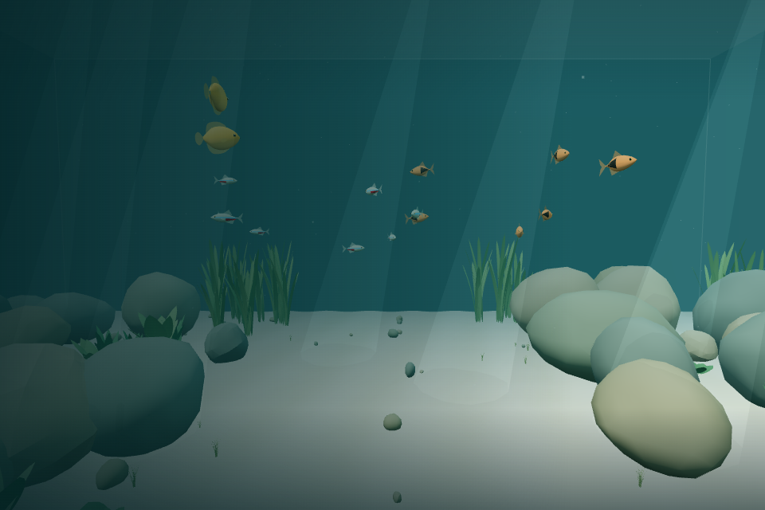 | 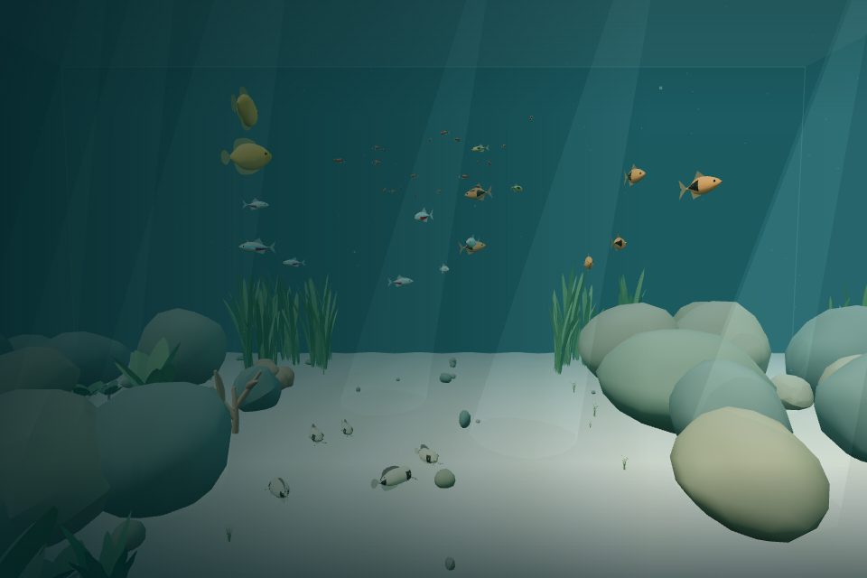 |

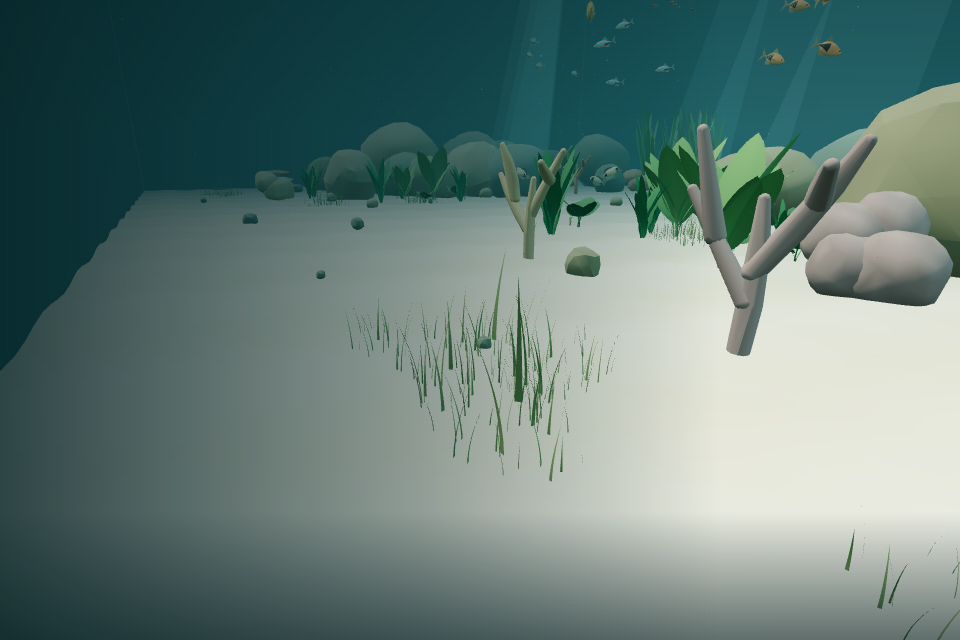

| Branching ornament                                    | Lobed ornament                                    | Layered plate ornament                        |
| ----------------------------------------------------- | ------------------------------------------------- | --------------------------------------------- |
| 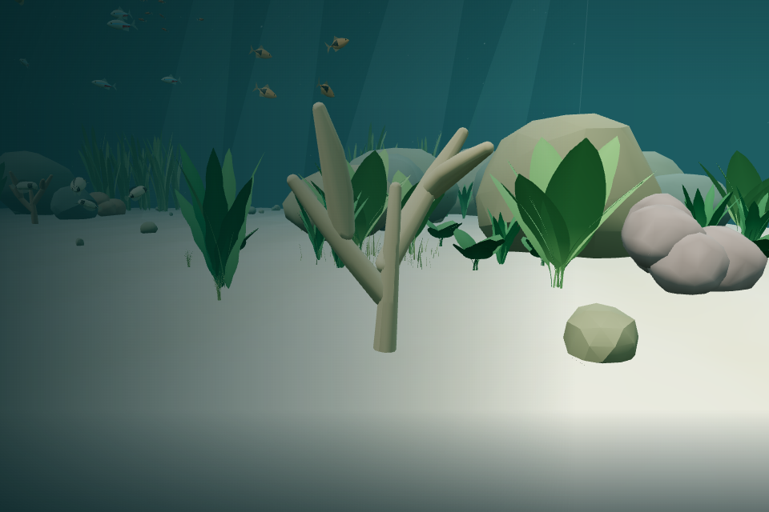 | 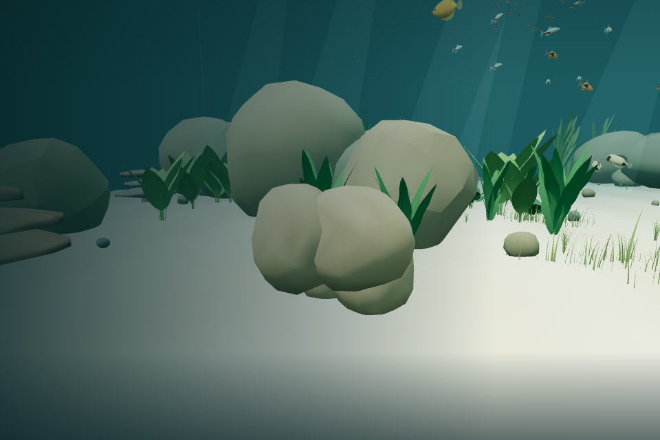 | 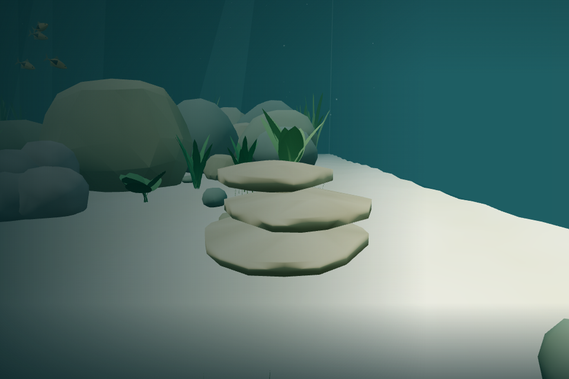 |

| Panda corydoras                                             | Endler’s livebearer                                         | Tiny chili rasbora                                             |
| ----------------------------------------------------------- | ----------------------------------------------------------- | -------------------------------------------------------------- |
| 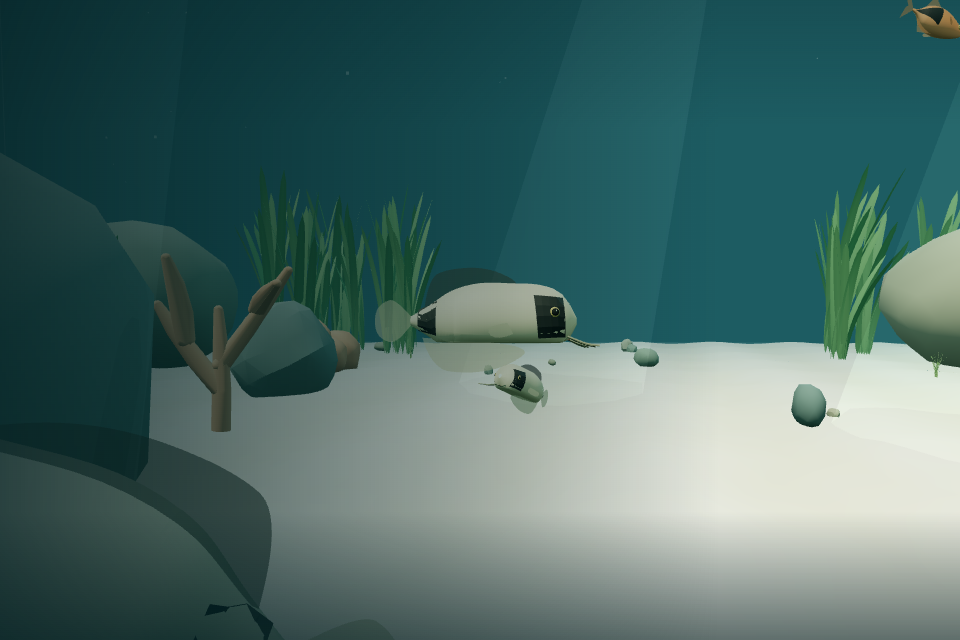 | 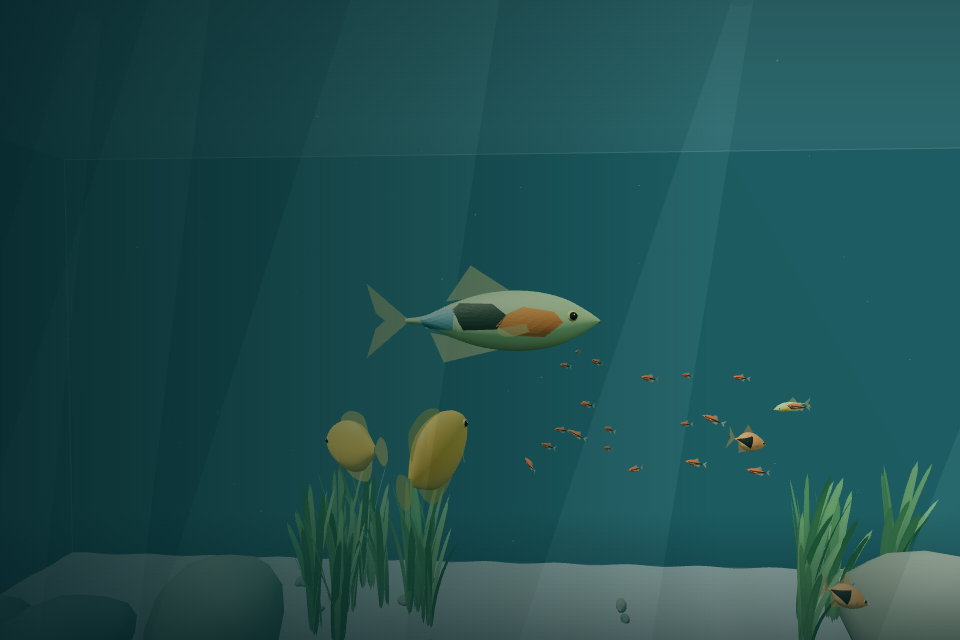 | 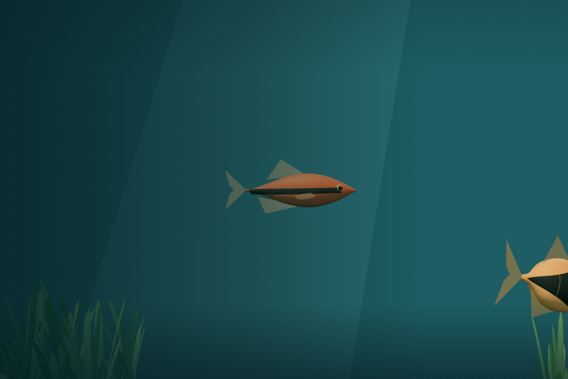 |

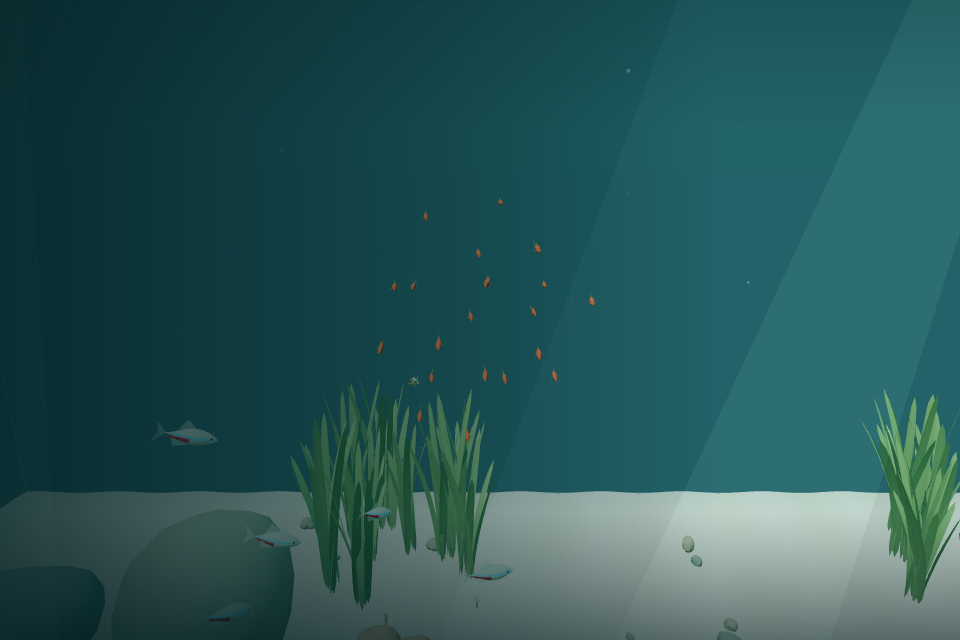

## Known limitations

- Art remains lightly stylized procedural geometry. Hardscape is an ornament, not marine coral; there is no chemistry, feeding or growth. Rounded lobes and domed plates have intentionally restrained detail/colors.
- Corydoras prefer a band above the substrate rather than exact belly/floor contact. Conservative spherical containment encloses barbels and fins; no new bottom-following rigid-body solver is introduced.
- Schooling/avoidance remain local soft steering. Exceptional close passes or temporary fragmentation are possible, especially under prolonged forced disturbance; no hard fish-player collision or global school tether guarantees perfect formation.
- Moving new-species batches submit offscreen instances and transparent fins are sorted per batch. Further spatial batching/LOD should follow actual hardware evidence rather than a new framework in this pass.
- Motion pair frames isolate amplitude tuning, not a full previous-binary replay. Reduced motion settles/fixes the existing pose without snapping leaves straight.
- Testing covers Linux Chromium/SwiftShader and deterministic logic. macOS Safari/Chrome/Firefox, real hardware performance, OS focus/tab transitions and long subjective comfort remain manual acceptance items. Escape pause/resume and reduced-motion changes were directly exercised.
- Initial plant placements can shift to clear new solid ornaments; original rocks, sand geometry/color RNG, mote RNG stream, aquarium dimensions and central composition remain intact.

## Manual macOS acceptance checklist

Leave these unchecked until manual testing. Watch the school for several minutes, approach and retreat, inspect all three ornament forms, swim through grass, compare motion/reduced motion and test pause/focus/tab transitions. **Do not merge automatically or begin ambient audio before acceptance.**

### Environment

- [ ] Larger grass-like patches are visible.
- [ ] Grass patch distribution looks natural.
- [ ] Plants move more noticeably but remain gentle.
- [ ] Different plants retain different movement characteristics.
- [ ] Coral-inspired formations look varied and organic.
- [ ] New hardscape matches the overall aquarium visual style.
- [ ] The central swimming corridor remains open.
- [ ] Player collisions with solid hardscape feel accurate.

### New Fish

- [ ] Panda corydoras are recognizable.
- [ ] Corydoras spend most of their time near the bottom.
- [ ] Endler's livebearers are recognizable and visibly distinct.
- [ ] Endlers swim naturally.
- [ ] Chili rasboras look like actual tiny fish, not particles.
- [ ] The chili rasboras form one recognizable larger school.
- [ ] Individual chili rasboras make occasional darting movements.
- [ ] Darting does not look frantic or synchronized.
- [ ] The chili school scatters and regroups naturally.
- [ ] Existing species still behave correctly.

### Player Experience

- [ ] All fish avoid solid obstacles.
- [ ] Fish react to the approaching diver.
- [ ] The aquarium feels more populated without becoming overcrowded.
- [ ] Swimming mechanics remain unchanged.
- [ ] Breathing buoyancy remains comfortable.
- [ ] Pause/resume works.
- [ ] Reduced-motion settings work.
- [ ] Performance remains smooth on the MacBook Air.
