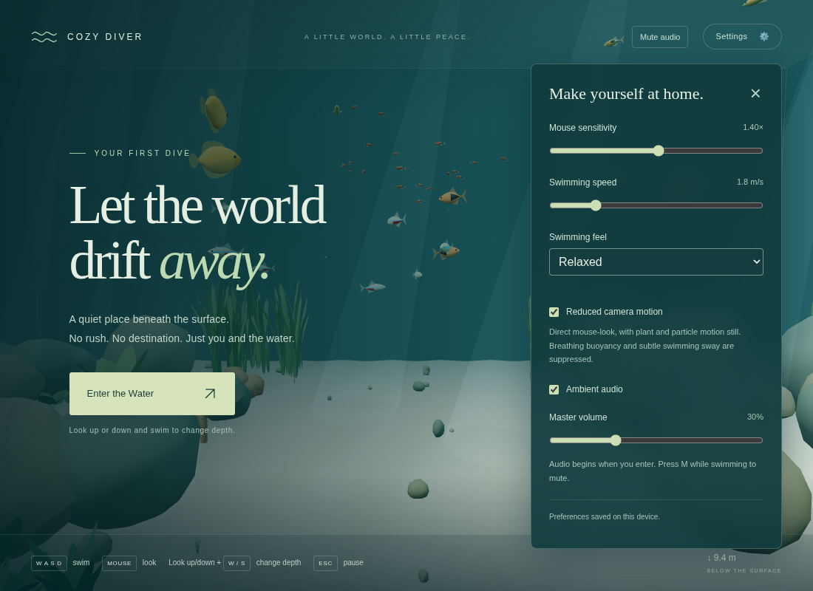

# v0.2 Pass 005 — executed validation

Executed November 6, 2026, on branch `codex/v0.2-pass-005-ambient-audio`, based on merged `main` at `21856f5` (Pass 004B plus removal of panda corydoras). The default remains 40 fish across five species. Player physics, controls, fish behavior and environment generation are unchanged.

## Architecture and sound generation

See [audio architecture and settings](AUDIO.md) for ownership, exact gains/filters, procedural noise seam overlap, swimming integration and lifecycle. One application-owned context drives three continuous filtered-noise layers (foundation, subtle current, movement) and at most one short environmental voice. Nine existing ornament positions supply plausible detail locations. No recordings, external assets, licenses/attributions, audio libraries, worklets, microphones or runtime downloads are involved.

Master volume defaults to 30%, maps nonlinearly to gain, and is retained on mute. Both the Settings checkbox and top-bar button toggle audio; M works during pointer lock. Existing v1 preferences migrate without losing swimming settings. Preview remains silent. Enter invokes resume inside the actual click, with a zero master until confirmed gameplay. Escape/mute use a smooth fade and suspend after 420 ms; hiding suspends immediately. Timers cancel on re-entry/disposal. Both rejected and indefinitely pending autoplay resume are contained; explicit user gestures can retry. Audio failure leaves the aquarium playable.

Environmental scheduling uses only bounded active time: first event 22–42 seconds, subsequent intervals 28–65 seconds, durations 1.6–2.8 seconds, one voice, no consecutive location repeats. Pause, mute, zero volume and hidden states do not accumulate events. Resume leaves at least 12 seconds of quiet before another detail. Stereo detail positioning uses camera-relative right and distance with mild pan; no HRTF or per-fish emitters.

## Automated checks

- `npm run test -- --maxWorkers=2`: **216 tests / 19 files passed** in 25.04 seconds, including 23 new audio tests.
- `npm run build`: passed, 44 modules.
- `npm run typecheck`: passed.
- `npm run format` and `npm run lint`: passed.

The added tests cover old preference migration, persistence, mute retaining volume, clamping, storage failure; gesture-only creation; zero-gain preview; repeated pause/resume; rapid suspend/re-entry races; hidden scheduling; rejected and pending autoplay; unsupported/device failure; native graph-update failures; idempotent cleanup; one-voice ownership; seeded 30-minute schedules; long-session finite/bounded filter, gain and pan values; smooth parameter variation; deterministic noise; distance attenuation; actual physical stroke/velocity integration across three presets and vertical/horizontal axes; read-only swimming state; coasting and silent breathing hover. Existing gameplay assertions are retained.

An initial concurrent run with software-rendered Chromium timed out an existing fish test. A later full-worker run timed out the existing synchronous rocky-bank collision test under runner contention. Final verification caps Vitest workers without changing tests, physics or timeout thresholds. These timing failures are reported separately from assertion failures.

## Functional Chromium validation

Headless desktop Chromium rendered the actual aquarium with SwiftShader. Browser automation instrumented the application only in its served test response, without shipping debug hooks. It checked:

- No AudioContext in preview, including setting changes before first entry.
- Real Enter click, pointer lock, running context, forward key movement, nonzero swimming gain and existing fish rendering.
- M mute/unmute, context suspension, preserved audio volume, checkbox/slider reload persistence and previous relaxed/speed/sensitivity/reduced-motion settings.
- A scheduled environmental voice starts and releases; overlap stays capped at one. This check advanced the audio subsystem with bounded test updates, rather than waiting 42 wall-clock seconds on a slow software GPU.
- Escape freezes the audio variation clock and event countdown; four entry/pause cycles keep one context, three loops and two buffers.
- The visibility-change handler immediately suspends and releases pointer lock, with no event backlog. Hidden state was controlled in the harness because headless tabs do not reliably hide; this is not a real macOS tab-switch measurement.
- Disposal closes the owned context. A second browser page with AudioContext unavailable still permits Enter and forward swimming and reports a quiet settings status.
- No page or console errors.

This is functional validation of real browser nodes and controls, not human listening. No claim is made about perceived naturalness, long-session listening comfort, Safari/Firefox behavior or MacBook Air performance.

## Resource and numerical measurements

| Measurement                       | Observed                                                                  |
| --------------------------------- | ------------------------------------------------------------------------- |
| Contexts after repeated entries   | 1                                                                         |
| Continuous graph                  | 18 nodes, including 3 looping sources                                     |
| Additional environmental voices   | 0–1 temporary source; native ended callback disconnects it                |
| Buffers                           | 2 mono buffers at 16 kHz; 1,868,800 bytes total (~1.78 MiB)               |
| Control updates                   | At most 20 Hz from the existing frame loop; no extra animation loop       |
| Synthetic graph-control benchmark | 5,000 calls in 608.9 ms, mean .122 ms/call on this contended cloud runner |
| Default environment               | 40 fish, five species; no per-fish audio nodes                            |
| Added runtime dependencies/assets | None                                                                      |

The microbenchmark measures JavaScript submission of Web Audio control automation in a synthetic offline graph, not audio-thread DSP or laptop frame rate. All sources/nodes remain bounded; paused/muted contexts stop processing after their fade, hidden contexts immediately. Temporary noise-generation arrays are released after initial construction.

Real Chromium OfflineAudioContext renders at 16 kHz/stereo for 40 seconds included the buffer seams, slow parameter changes and a full-strength bubble detail at the listener at 25 seconds. RMS excludes the first two seconds. Swimming scenarios deliberately hold movement gain at its .20 ceiling, above normal kick-and-glide averages.

| Render case                               | Absolute peak |    RMS | RMS dBFS |
| ----------------------------------------- | ------------: | -----: | -------: |
| Default 30%, ambience plus sparse detail  |         .0351 | .00825 |   -41.67 |
| Default 30%, maximum movement plus detail |         .0465 | .01041 |   -39.65 |
| 100%, maximum movement plus detail        |         .2363 | .05290 |   -25.53 |

Every rendered sample was finite; none approached clipping. These digital levels establish headroom only: speaker gain, headphones and individual comfort still require manual listening. Production JS is **674.12 kB / 177.59 kB gzip**, versus 662.18 / 173.94 kB on the removal pass: +11.94 / +3.65 kB. CSS is 6.33 / 2.20 kB gzip, up .29 / .07 kB. Vite retains its existing >500 kB chunk advisory; no new runtime dependency or audio asset was added.

## Known limits and manual acceptance

The finite noise buffers can eventually repeat; slow modulation and different playback rates reduce recognizable short-loop structure but cannot establish an absence of perceptual repetition. Spatialization is deliberately mild stereo, with no elevation, occlusion or tank reverberation. Environmental bubbles are a filtered-noise suggestion rather than a physical bubble model. Browser audio interruptions can require another Enter/toggle gesture. OS output volume is outside the application’s control. Automated finite samples and bounded levels do not establish acoustic realism or 15–30 minute comfort.

The following macOS checklist remains **unexecuted** and must be completed by a human before Pass 006. The PR is not merged automatically.

### Ambient Sound

- [ ] Underwater ambience sounds calm and natural.
- [ ] Background sound remains subtle.
- [ ] Water-current variation is noticeable but not distracting.
- [ ] No obvious electronic humming or harsh noise.
- [ ] No noticeable looping artifacts.
- [ ] Environmental details occur sparingly.
- [ ] There are quiet periods without unnecessary effects.

### Swimming Audio

- [ ] Swimming produces subtle water movement.
- [ ] Kick-and-glide changes the sound naturally.
- [ ] Coasting sounds quieter than active swimming.
- [ ] Hovering returns to gentle ambience.
- [ ] Swimming sounds do not become repetitive or annoying.

### Controls and Lifecycle

- [ ] No audio plays before entering.
- [ ] Audio starts after clicking Enter.
- [ ] Muting works.
- [ ] Volume slider works smoothly.
- [ ] Settings persist after refresh.
- [ ] Escape pauses audio.
- [ ] Resume restores audio smoothly.
- [ ] Switching tabs stops background sound.
- [ ] No duplicated audio after repeated pause/resume.
- [ ] Audio errors do not prevent gameplay.

### Overall Experience

- [ ] The aquarium feels more immersive with audio.
- [ ] The audio matches the visual atmosphere.
- [ ] The aquarium still feels peaceful.
- [ ] Sound remains comfortable after at least 15 minutes.
- [ ] Swimming and fish behavior remain unchanged.
- [ ] Performance remains smooth on the MacBook Air.
