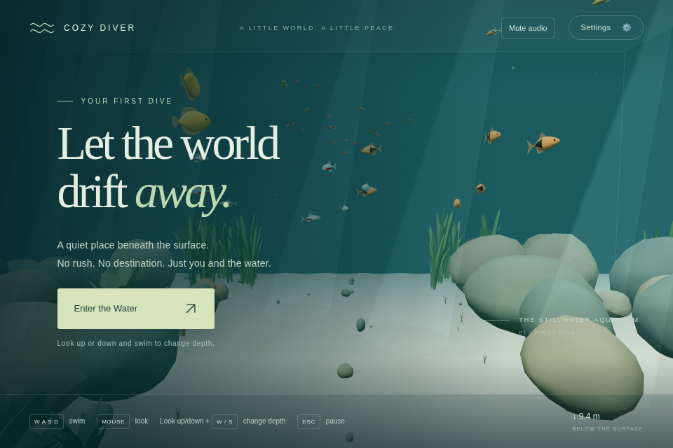
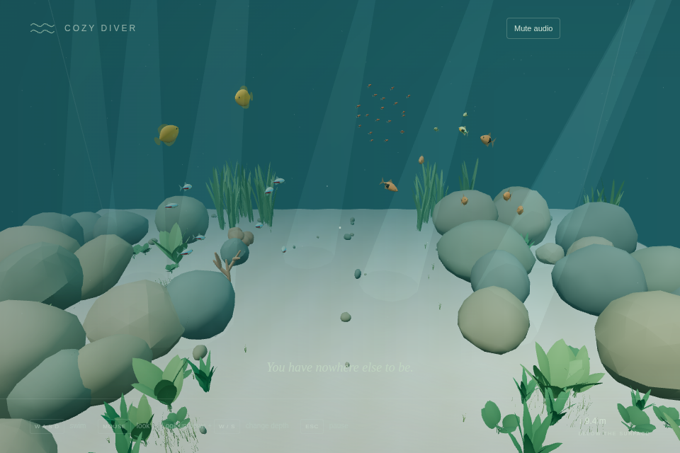
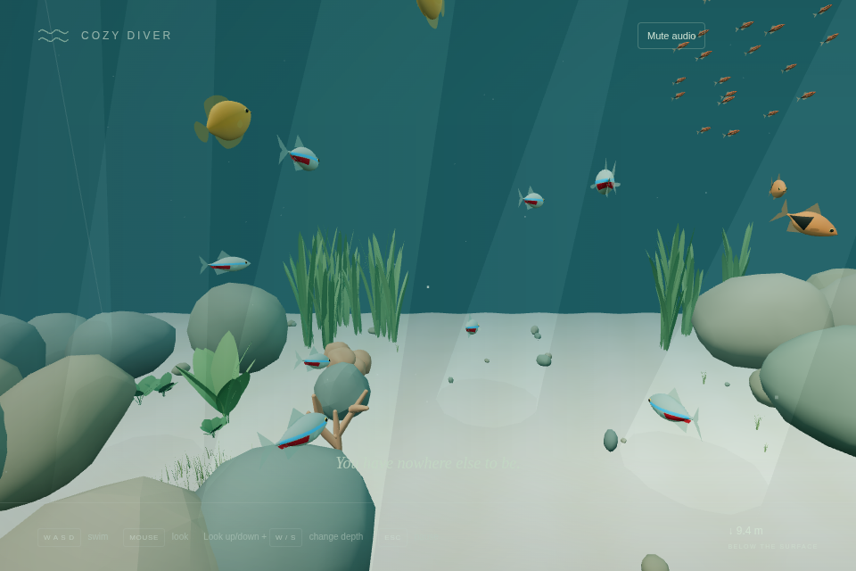
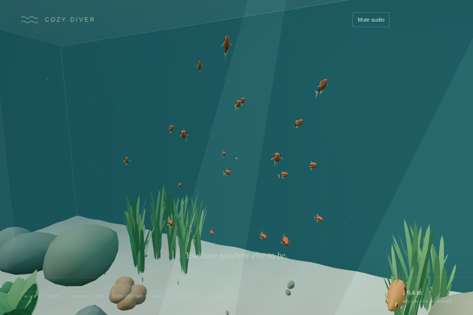
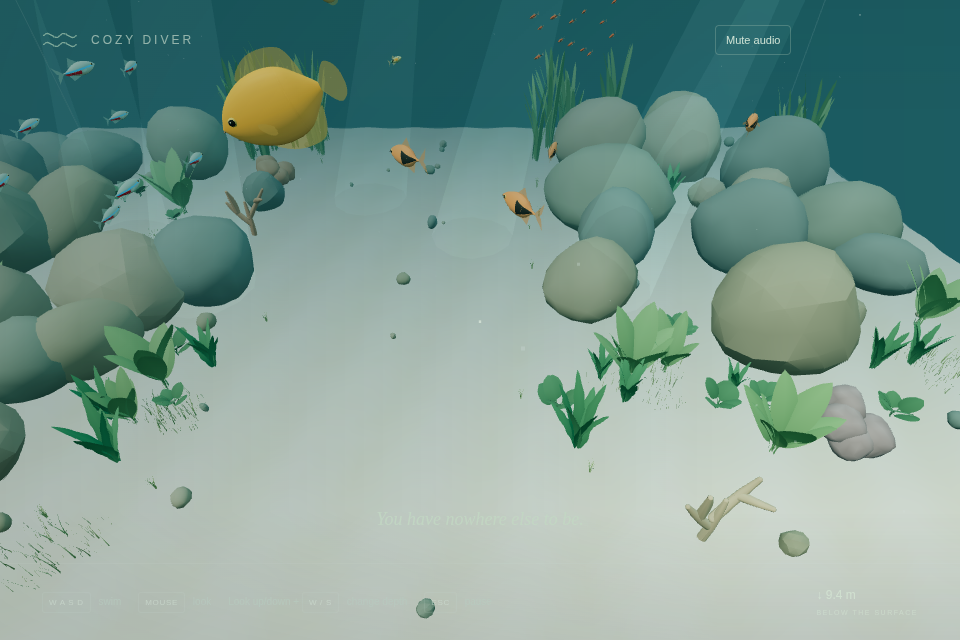
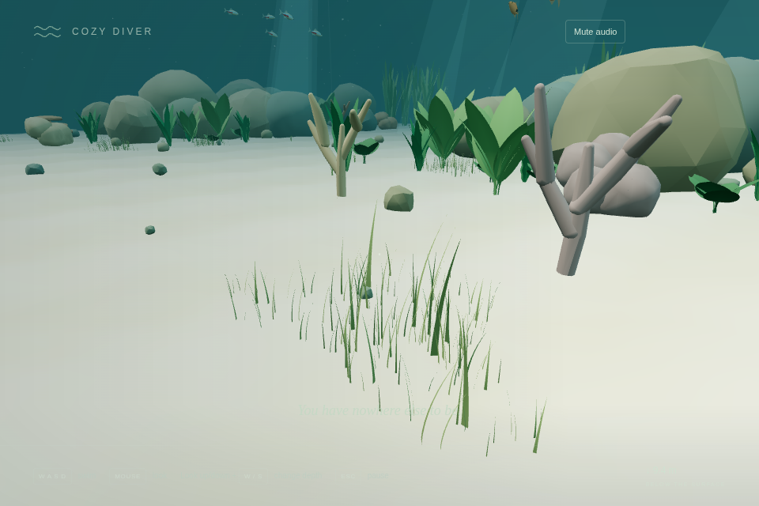
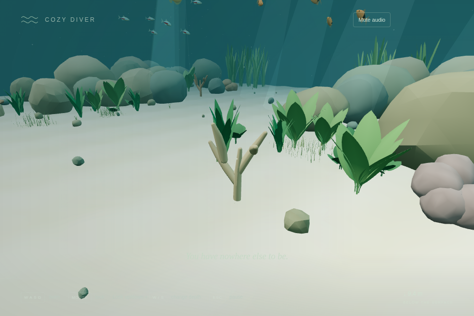
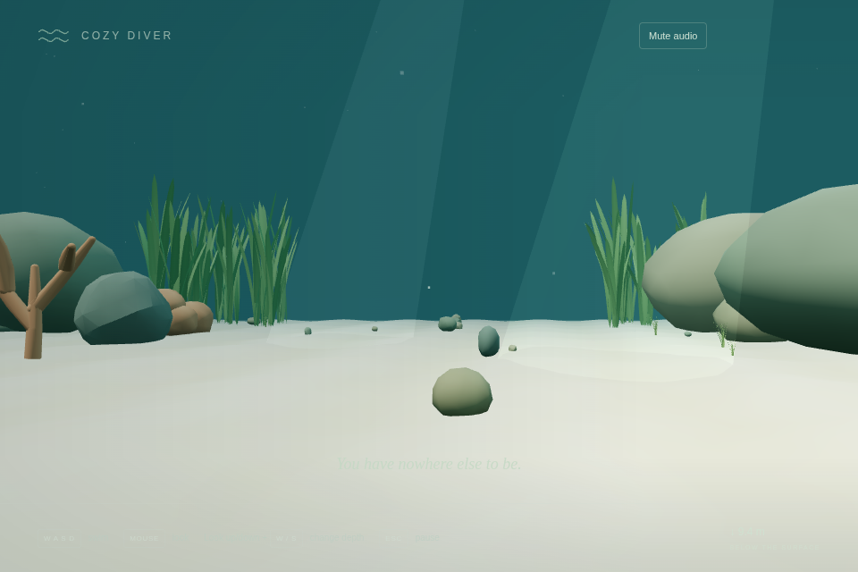
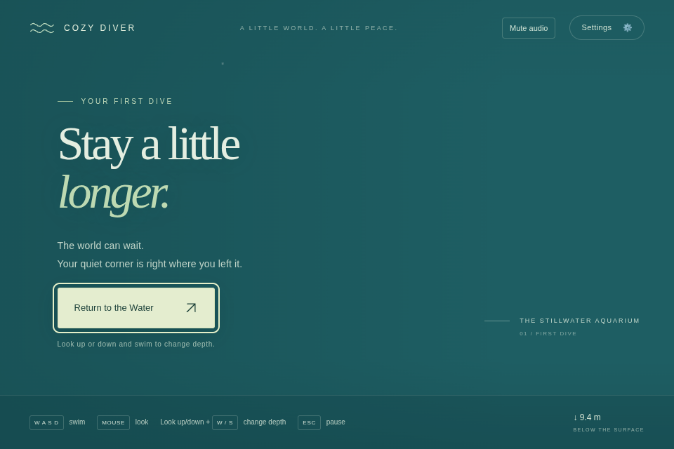
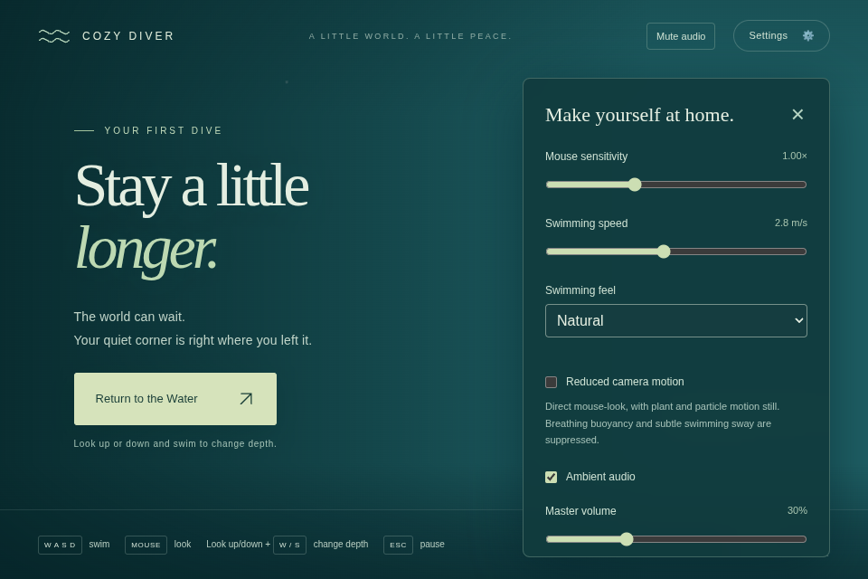

# v0.2 Pass 006 — Ecosystem Polish & Optimization

Executed November 6, 2026. Base: explicit `main` at `8d0da66`, including Pass 005B. Working branch: `codex/v0.2-pass-006-ecosystem-polish`. Node 24.22.1, Chromium 155.0.8059.79, Debian cloud execution; SwiftShader, 960×640/DPR 1. These measurements do not establish hardware 60 FPS or MacBook Air comfort.

## Candidate status and scope

This prepares private package **0.2.0-rc.1**, not a final release. No release, tag, merge or repository-setting change was made. Production remains 40 fish: 8 neon tetras, 6 harlequin rasboras, 2 honey gouramis, 4 Endlers and 20 chili rasboras. Panda corydoras remain absent. Five plant families, eight meadows/1,225 blades, nine ornaments, 34 rock hulls and 39 ornament hulls are preserved.

Runtime changes are deliberately narrow:

1. **Measured offscreen work:** new-fish instance batches bypassed frustum culling. Each articulated part now refreshes its conservative instance sphere after writing matrices, then uses ordinary camera-frustum culling. Spheres derive from actual geometry, including fins/eyes, rather than guessed body radii. No fish, geometry, material, animation or simulation update is removed. A new test encloses every transformed vertex across moving, turning and reduced-motion poses, and checks a look-away frustum rejects offscreen batches.
2. **Reproduced shortcut conflict:** pressing Ctrl+M while locked toggled audio. The shortcut now ignores Ctrl/Meta/Alt and key repeat, leaving browser/OS shortcuts alone. Plain M still works. Pure and real-browser regressions cover the change.
3. **Validation/release preparation:** opt-in stress/browser harnesses, shared-disposal integration coverage, current docs and a candidate version. Development-only Node types support typed benchmark JSON output; no runtime dependency was added.

No species/behavior constant, swimming force, buoyancy amplitude, collision algorithm, plant motion, scenery layout or Pass 005B audio parameter changed. Profiling did not justify a spatial index, collision rewrite, additional LOD, material redesign or subjective audio retune. Geometry/material sharing and anchored GPU vegetation already worked in the audit.

## Reproduction and evidence

[Validation procedure](../validation/README.md) explains routine checks, the separate long-test budget, optional Playwright setup, software versus native-GPU modes, camera fixtures, production-build MacBook profiling and output paths.

Raw reports: [before](benchmarks/v0.2-pass006/before.json), [after](benchmarks/v0.2-pass006/after.json), [dense/stress/recreation scenarios](benchmarks/v0.2-pass006/scenarios.json), [long simulation](benchmarks/v0.2-pass006/stress.json), [browser lifecycle/heap](benchmarks/v0.2-pass006/lifecycle.json). Before/after fixed-camera reports use the same seeds and 20 seconds of fish time. Camera fixtures only move the test camera; HUD depth still represents the unchanged player's location. They are not player navigation recordings.

The initial camera-centroid fixture had a non-finite calculation; it was rejected and corrected before the retained baseline run. A development hot reload interrupted the first browser soak; that attempt was discarded, and the retained run completed on unchanged source. Neither harness issue is represented as a product regression or a passing observation.

## Rendering baseline and optimization

Eight submitted render samples / seven rAF intervals per view. rAF timings include browser protocol/scheduling overhead, and p95/p99 both approach the maximum with such small samples. They are diagnostic snapshots, not stable percentile estimates. Use 120+ samples locally. CPU render/finish submission times are retained separately in JSON; they must not be mistaken for hardware frame latency. Timings vary enough that no general FPS improvement is claimed.

| View         | Draw calls before → after | Triangles before → after |   rAF mean ms |     Median ms |        p95 ms |        p99 ms |
| ------------ | ------------------------: | -----------------------: | ------------: | ------------: | ------------: | ------------: |
| overview     |                 256 → 250 |        183,620 → 181,154 | 371.4 → 485.7 | 483.4 → 483.3 | 550.0 → 533.3 | 550.0 → 533.3 |
| tetra-school |                 206 → 182 |        164,386 → 154,522 | 390.5 → 380.9 | 400.0 → 383.3 | 416.6 → 400.0 | 416.6 → 400.0 |
| chili-school |                   99 → 75 |        111,106 → 101,242 | 264.3 → 240.5 | 283.3 → 233.4 | 300.0 → 266.7 | 300.0 → 266.7 |
| gourami      |                   96 → 66 |         114,214 → 84,790 | 235.7 → 188.1 | 233.3 → 216.6 | 266.7 → 250.0 | 266.7 → 250.0 |
| meadow       |                 212 → 182 |        151,102 → 121,678 | 447.6 → 428.6 | 466.6 → 416.7 | 466.7 → 866.6 | 466.7 → 866.6 |
| hardscape    |                 233 → 203 |        166,561 → 137,137 | 459.5 → 438.1 | 433.4 → 449.9 | 916.6 → 466.7 | 916.6 → 466.7 |
| floor        |                  105 → 75 |         108,950 → 79,526 | 240.5 → 233.3 | 233.3 → 233.3 | 266.7 → 250.1 | 266.7 → 250.1 |
| glass-away   |                   50 → 20 |          92,544 → 63,120 | 102.4 → 107.1 | 100.0 → 100.0 | 116.7 → 150.0 | 116.7 → 150.0 |

Draw submissions decrease in every fixed view. The largest saving is **30 draws**; looking away removes 60% of submissions (50→20). The wide view saves six draws while retaining its visible fish. A separate 60-fish scene at the identical pose renders **256→250 draws / 203,180→200,714 triangles** when toggling only batch culling off/on. This is a controlled renderer comparison, not a production population change or a hardware throughput claim.

## CPU scenarios and allocation review

600 samples per browser CPU scenario; milliseconds. The simulation/behavior source is unchanged. Small before/after variations are runner/JIT noise, not attributed speedups.

| Population / measurement | Mean before → after |        Median |           p95 |           p99 |
| ------------------------ | ------------------: | ------------: | ------------: | ------------: |
| 40 / fixedStepMs         |       0.191 → 0.171 | 0.100 → 0.100 | 0.500 → 0.500 | 1.400 → 0.900 |
| 40 / schoolingMs         |       0.065 → 0.065 | 0.000 → 0.100 | 0.200 → 0.200 | 0.400 → 0.400 |
| 40 / poseMs              |       0.060 → 0.074 | 0.000 → 0.100 | 0.200 → 0.200 | 0.600 → 0.400 |
| 60 / fixedStepMs         |       0.302 → 0.299 | 0.200 → 0.200 | 0.800 → 0.600 | 1.400 → 1.300 |
| 60 / schoolingMs         |       0.151 → 0.147 | 0.100 → 0.100 | 0.400 → 0.300 | 1.100 → 0.800 |
| 60 / poseMs              |       0.084 → 0.115 | 0.100 → 0.100 | 0.200 → 0.300 | 0.400 → 0.600 |

Refreshing bounds costs approximately **.014 ms** per 40-fish pose update and .031 ms at 60 in this sample. That small CPU tradeoff removes measured offscreen draws; bounds reuse Three.js scratch storage and cached per-mesh spheres. Pairwise schooling averages about .065 ms at 40 and .15 ms at 60, so spatial partitioning would add complexity without an identified need.

Dense activity uses alternating slow/fast near-school approaches and withdrawal. Measured 40/60-fish fixed-step mean costs are 0.252/0.264 ms, with maximum scatter about .999 and zero containment corrections. The raw report includes median/p95/p99. No strict timing assertion runs in CI. Player collision is measured with the existing analytical swimming/swept-hull path in the long scenarios below; no accurate hull was replaced with a box.

GPU vegetation still shares templates/material/time uniform, never rebuilds geometry per frame, and keeps anchored roots. Meadows use three instance draws. No per-fish audio source, new scene traversal, framework or rendering pass was introduced.

## Long deterministic ecosystem scenarios

`npm run test:stress` runs separately from routine tests, with one worker and a 120-second budget per long scenario; existing timeouts/assertions are unchanged. All four stress checks passed. Five-minute stress uses 60 fish; fifteen/thirty-minute scenarios use the default 40. Seeds are 38147 with real generated geometry, 73 solids and vegetation interests. Paused/hidden/muted gates do not accumulate elapsed work. Physical swimming/hovering, boundary/solid contact, slow/fast scatter, recovery, plant clocks and one-voice audio scheduling participate. A full-habitat comparison is exactly equal across 30/60/120 FPS schedules.

| Duration / population | Fixed-step mean / median / p95 / p99 ms | Swimming + collision mean ms per 1/30 frame | Minimum travel in any 30 s window | Sparse events | Guard corrections |
| --------------------- | --------------------------------------: | ------------------------------------------: | --------------------------------: | ------------: | ----------------: |
| 5 min / 60 fish       |           0.399 / 0.247 / 0.738 / 1.988 |                                       0.068 |                              2.77 |             6 |                 0 |
| 15 min / 40 fish      |           0.185 / 0.123 / 0.435 / 0.915 |                                       0.045 |                              2.68 |            14 |                 0 |
| 30 min / 40 fish      |           0.187 / 0.117 / 0.395 / 1.097 |                                       0.044 |                              2.68 |            30 |                 0 |

All positions/velocities remain finite and contained, population stays constant, every fish changes activity, and all fish continue moving. Observed activities include cruising, exploring, foraging, resting and recovery. The moving/retreating fixtures do not claim a spontaneous calm-diver observation; existing dedicated curiosity tests cover that behavior. Existing coverage also verifies separation, species-specific schools, asynchronous chili bursts, regrouping, angular/acceleration limits, reachable targets and disturbance priority. No observed behavioral issue required retuning.

Swimming/buoyancy regressions retain W/S camera-axis motion, horizontal A/D, ignored Space/Shift, diagonal normalization, neutral-depth stability, floor/surface safety, boundary fading, preview breathing and reduced motion. Existing real-hull tests cover direct/glancing sweeps, tangential sliding, overlapping solids, glass/corners and reversal. Long scenarios use those actual hulls, not mocked boxes. Thin foliage/grass stays passable.

## Browser lifecycle, audio and memory

Actual Chromium controls passed: explicit Enter/pointer lock, forward swimming, look-up/W ascent and look-down/W descent, ignored Space/Shift, held-input clearing on blur, modified M ignored, ordinary M mute/unmute, volume/settings migration and persistence, Escape freeze and four resume cycles. Unsupported AudioContext still permits swimming. No console errors or unhandled rejections were observed. The benchmark reports no new WebGL/audio warnings or failed app resources. Real macOS visibility behavior remains manual: the headless visibility handler test uses controlled document hidden state.

The retained accelerated browser soak advances **54,000 real fixed ecosystem steps / thirty active simulated minutes**, including poses, native Web Audio, plant clocks and physical movement. Rendering is canceled during acceleration; it is not a thirty-minute real-time GPU session or listening evaluation. Native event sources are stopped after simulated duration so fast tests do not wait on wall-clock playback; this tests ownership and scheduling, not perceived timing. Every five minutes the context is actually suspended and resumed. No events accumulate, contexts do not multiply, and buffer/node counts remain bounded.

| Simulated minute | Fixed steps | Forced-GC JS heap bytes | Contexts / persistent nodes / buffers / loops | Event voices at snapshot | Guard corrections |
| ---------------- | ----------: | ----------------------: | --------------------------------------------- | -----------------------: | ----------------: |
| 0                |           0 |              13,798,892 | 1 / 19 / 3 / 3                                |                        0 |                 0 |
| 5                |       9,000 |              14,084,740 | 1 / 19 / 3 / 3                                |                        0 |                 0 |
| 15               |      27,000 |              14,228,132 | 1 / 19 / 3 / 3                                |                        0 |                 0 |
| 30               |      54,000 |              14,252,256 | 1 / 19 / 3 / 3                                |                        0 |                 0 |

The heap increases about .45 MB from warm-up, then only ~24 KB between 15 and 30 minutes; this run shows a plateau rather than runaway growth. Heap includes dev-server/module/test state and does not measure native audio memory. Persistent resources remain one context, 19 nodes, three buffers / 2,048,000 bytes, three loops and at most one temporary event voice. Pass 005B's mix and spectral/headroom results remain applicable because no audio synthesis parameter changed. Human approval of softness, repetition, clicks and long-session comfort is still pending.

Scene ownership remains **93 unique geometries / 31 materials** (fish templates 42 / 17). Culling can leave fewer geometries uploaded when a view never uses them. The baseline renders uploaded 93, after 92 across the fixed views; both return to zero geometries/textures on disposal and close the context. Two additional full Application constructions also return all uploaded geometries/textures to zero and close audio. The new pure integration test verifies shared fish, grass, hardscape, vegetation and scenery resources dispose exactly once across repeated calls. This does not imply the JS process heap returns to zero; module caches remain.

## Visual and UI audit

Compared the retained baseline/current camera set and historical Pass 004B/005 screenshots. Open channel, seeded layout, muted ornament palette, five plant families, meadow roots, individual fish proportions and living foliage are preserved. No broad artistic redesign or model simplification was justified. Shared articulated fins remain present; batch-level transparent sorting is still a known limitation. The conservative-bounds vertex test protects edge-of-camera visibility; it does not claim perfect per-instance transparency sorting.

The settings panel fits the captured 960×640 desktop and scrolls for lower controls. Labels, focus styling, depth readout, audio settings and minimal identity are retained. The shortcut conflict is the only UI behavior changed. Broader accessibility/device/browser approval remains manual.

The supplementary gourami/broad-leaf view advances the unchanged seeded simulation to 320 seconds and shows an exploring gourami over the planted bank. It is a composition inspection, not a claimed close foraging interaction or a manually repositioned fish.

## Checks, build and remaining limitations

Routine checks: **220 tests / 21 files pass** with two workers (28.44 seconds); build and strict typecheck pass. The separate four-case stress suite passes (27.20 seconds). `npm run format`, `npm run lint` and `git diff --check` pass. Baseline was 217 tests / 19 files passing in 33.70 seconds with two workers. Opt-in stress is four additional checks. Added routine tests cover conservative articulated bounds, shared scene disposal and modified shortcuts.

Baseline production JS was **674.67 kB / 177.82 kB gzip**; candidate is **674.76 / 177.85 kB**, +.09 / +.03 kB. CSS remains 6.33 / 2.20 kB. Vite's existing >500 kB chunk advisory remains. No final release or tag is created.

GitHub's current default remains `codex/v0.1-pass-001-foundation`, confirmed with `git ls-remote --symref origin HEAD`. This pass deliberately uses and targets `main`; changing the repository default is an owner housekeeping item, not performed here.

Technical evidence supports a v0.2 candidate for manual testing, not a declaration that v0.2 is complete. Limitations: software-GPU timing, small frame sample counts, accelerated versus real-time soak, finite audio textures, batch transparency ordering, soft finite-range schooling, no hardware macOS/Safari/Firefox measurements, no subjective audio/comfort approval. Follow [local GPU/production profiling procedure](../validation/README.md) for the ~16.7 ms target and meaningful p95/p99/long-session evaluation.

Potential v0.3 work, only after acceptance and scope agreement: hardware-driven transparency or rendering work, longer real-time browser soak coverage, and small optional interactions from the provisional roadmap. No new fish, plants, decorations, regions, audio layers, feeding, customization or progression were implemented.

## Manual MacBook Air acceptance (pending)

### Performance

- [ ] Aquarium feels smooth at default 40-fish population.
- [ ] No noticeable stutter while swimming through schools.
- [ ] No major frame drops when looking at vegetation.
- [ ] Performance remains comfortable near detailed hardscape.
- [ ] No degradation during a 15–30 minute session.

### Fish and Ecosystem

- [ ] All five species are recognizable.
- [ ] Fish movement remains natural.
- [ ] Tetra and rasbora schooling feels cohesive.
- [ ] Chili rasboras dart naturally.
- [ ] Gourami individual behavior remains believable.
- [ ] Fish respond correctly to the diver.
- [ ] Schools recover after scattering.
- [ ] Fish do not become persistently trapped.
- [ ] The 40-fish aquarium feels balanced rather than overcrowded.

### Environment

- [ ] Plant movement is gentle and visible.
- [ ] Grass meadows look natural.
- [ ] Rock and coral-inspired formations feel cohesive.
- [ ] Vegetation does not produce distracting artifacts.
- [ ] Solid-object collision remains reliable.
- [ ] The central swimming channel stays open.

### Swimming

- [ ] Kick-and-glide remains comfortable.
- [ ] Looking up/down and swimming changes depth naturally.
- [ ] Breathing buoyancy remains stable.
- [ ] No unwanted depth drift.
- [ ] Pause/resume causes no movement jumps.

### Audio

- [ ] The revised underwater ambience sounds soft rather than windy.
- [ ] Swimming sounds remain subtle.
- [ ] Bubble details are sparse.
- [ ] No audio clicks or obvious looping.
- [ ] Mute and volume controls work.
- [ ] Audio pauses and resumes correctly.
- [ ] Sound remains comfortable after 15–30 minutes.

### Interface and Stability

- [ ] Welcome screen works.
- [ ] Pointer lock works.
- [ ] Settings persist.
- [ ] Reduced motion works.
- [ ] Browser visibility changes are handled correctly.
- [ ] No obvious console errors.
- [ ] No crashes during extended exploration.
