# v0.2 Pass 016 — Reef Fish Overhaul

Validation date: November 9, 2026. Candidate `0.2.0-rc.10` for user review. No merge, release or next pass is authorized by this report. Browser evidence comes from Linux Chromium with SwiftShader software rendering; it is not MacBook Air performance.

## 1. What changed

All 40 fish now swim as authored morph rigs driven by the unchanged simulation. Body and median-fin stroke morphs follow tail effort, pectorals follow the existing pivots, and poses come from the existing fish visuals. Behaviour, schooling, homes, pause and reduced motion are untouched, and the procedural fish batches stay resident as the fallback.

| Species (count)         | Before (Pass 015 `main`) | Pass 016                                                                                                                             |
| ----------------------- | ------------------------ | ------------------------------------------------------------------------------------------------------------------------------------ |
| Blue-green chromis (20) | Procedural               | The accepted Pass 012 authored chromis, promoted from the benchmark into the normal aquarium                                         |
| Pajama cardinalfish (6) | Procedural               | Authored: deep body, tall fins, large red eyes; green-gold head, black bar, silver rear with orange-red spots                        |
| Firefish goby (6)       | Procedural               | Authored: slender body with a tall swept dorsal pennant; yellow head, white body, orange-red rear, crimson tail and dark fin margins |
| Yellow assessor (4)     | Procedural               | Authored: rounder body, truncate tail; yellow with a paler belly and orange fin edges                                                |
| Royal gramma (2)        | Procedural               | Authored: slim; violet front fading to gold, black line through the eye, dark dorsal spot                                            |
| Ocellaris clownfish (2) | Authored (Pass 013)      | Unchanged                                                                                                                            |

**How the new species were made.** `tools/art/pass016/fish.py` reshapes the accepted chromis rig, which survives a lossless Blender roundtrip including both morphs and pivots:

- **Shared contract**: every species keeps the exact topology, both stroke morphs and the pectoral pivots, so `AuthoredSchool` drives them exactly like the accepted fish.
- **Proportions**: each species is scaled per axis to its length, height and width, applied identically to the morph targets.
- **Anatomy**: species-specific changes, with eyes scaled uniformly about their own centres.
- **Colour**: object-space vertex patterns and countershading over luminance-only versions of the accepted chromis scale and fin-ray maps. Those maps keep their UV-aligned scale normal and fin alpha.

**Runtime.**

- **Schools**: `AuthoredAquarium` creates one `AuthoredSchool` per species (one lightweight cloned rig per fish; each library decodes once) and hides each procedural batch.
- **Shared textures**: identical maps share one GPU texture across species, cutting the fish scene's GPU textures from 88 to 74 (`main`: 48).
- **Benchmark**: the showcase hides the normal authored chromis while presenting its own school, so chromis are never drawn twice.

## 2. Matched captures

Both builds ran `validation/fish-overhaul.mjs` with the simulation frozen. Each view frames the first fish of a species from its right side at a distance proportional to its length, so fish positions differ between builds but framing matches.

| View            | Before (Pass 015)                                       | After (Pass 016)                                       |
| --------------- | ------------------------------------------------------- | ------------------------------------------------------ |
| Chromis         | 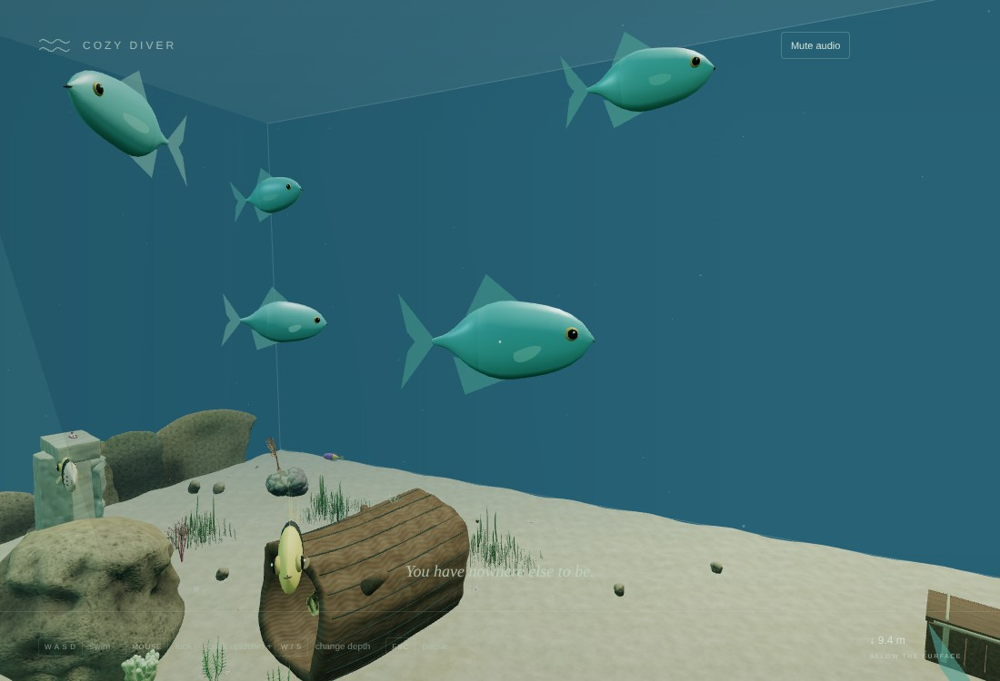        | 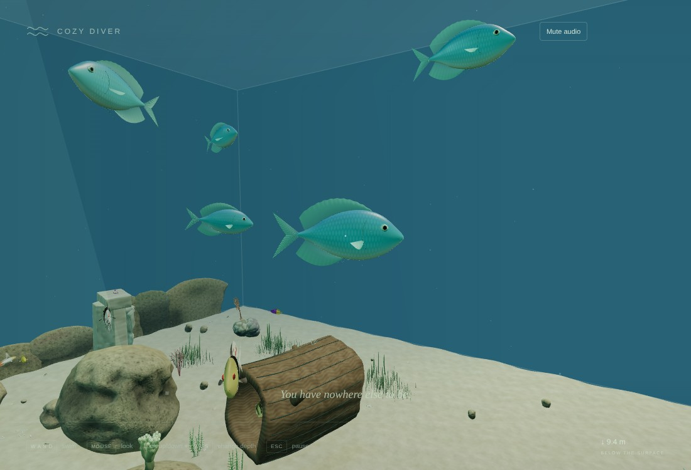        |
| Chromis school  |  | 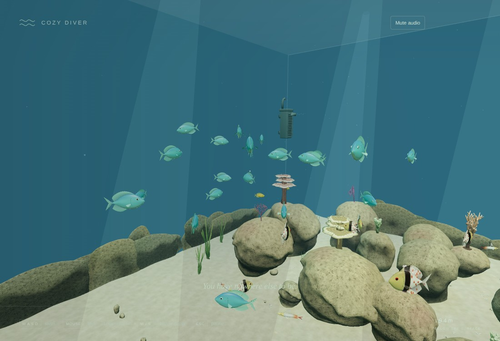 |
| Cardinalfish    | 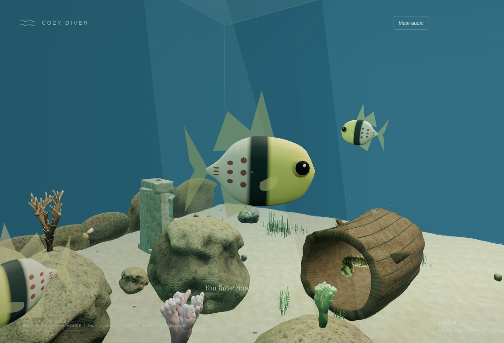   | 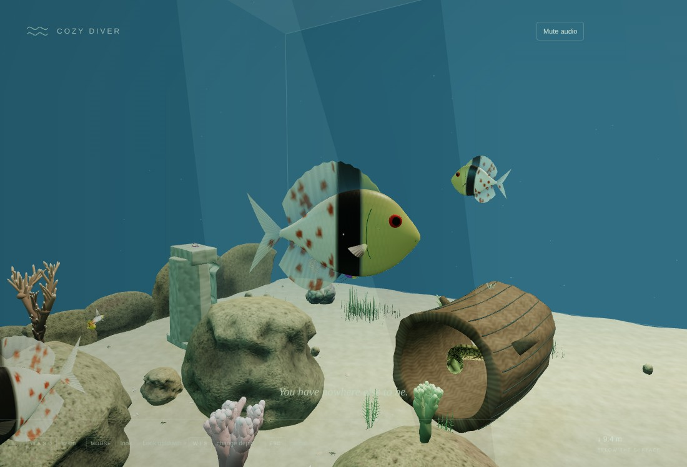   |
| Firefish        | 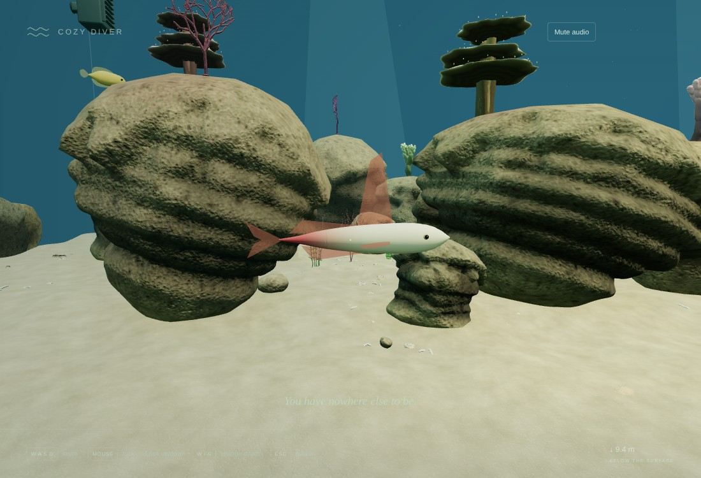       | 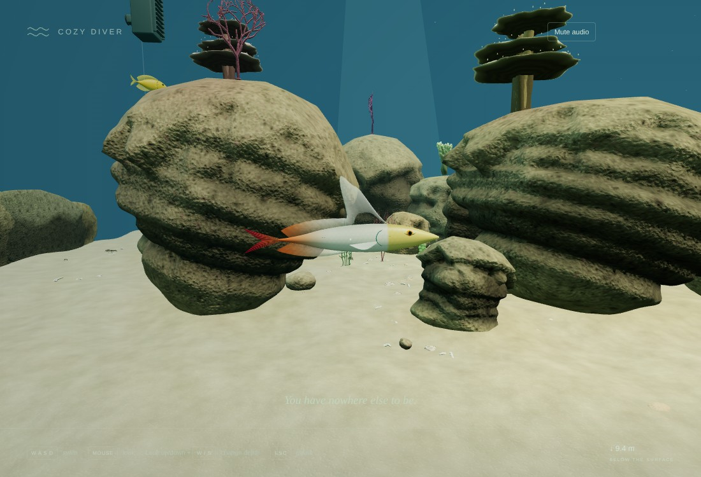       |
| Yellow assessor | 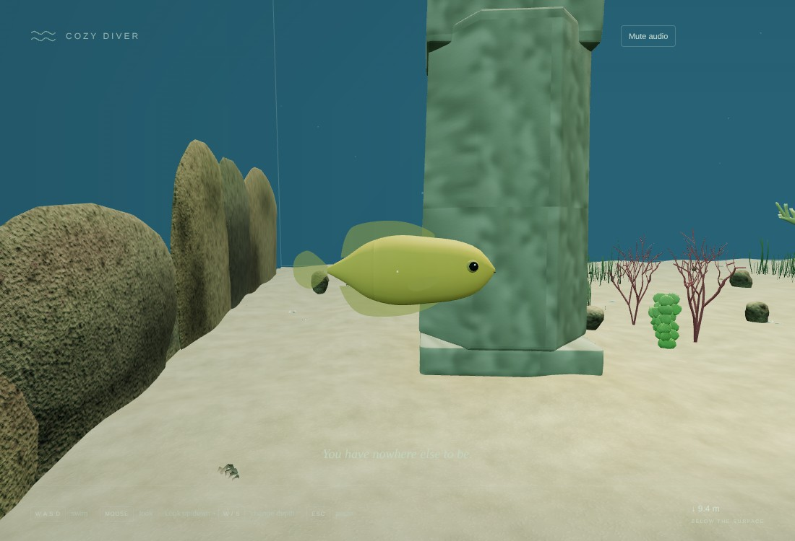       | 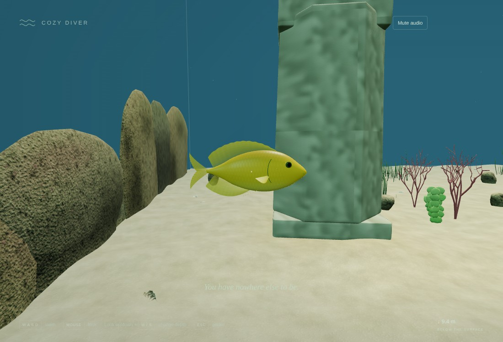       |
| Royal gramma    | 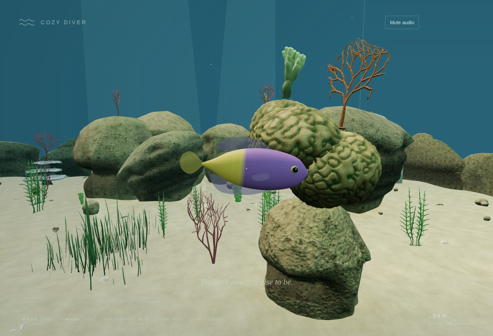         | 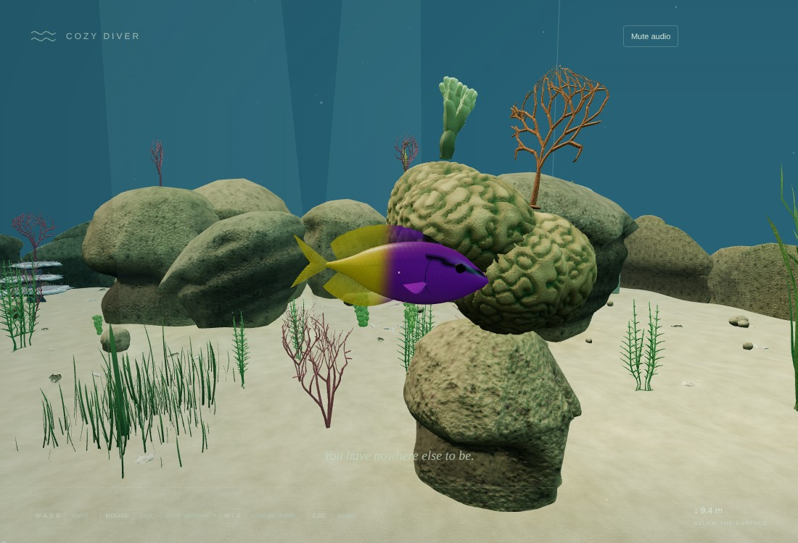         |
| Clownfish       | 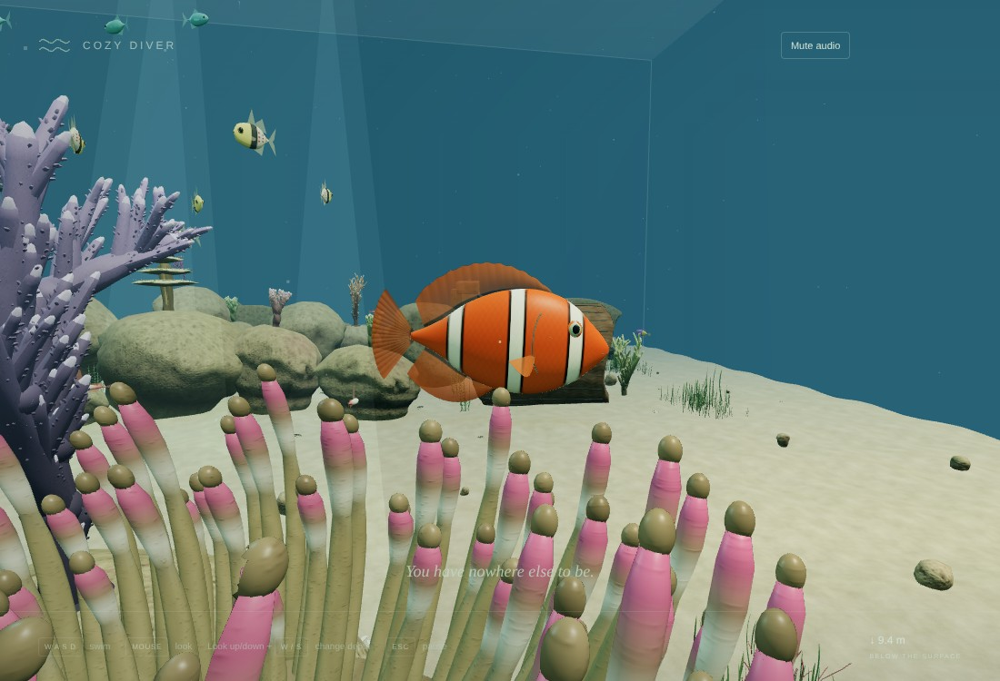      | 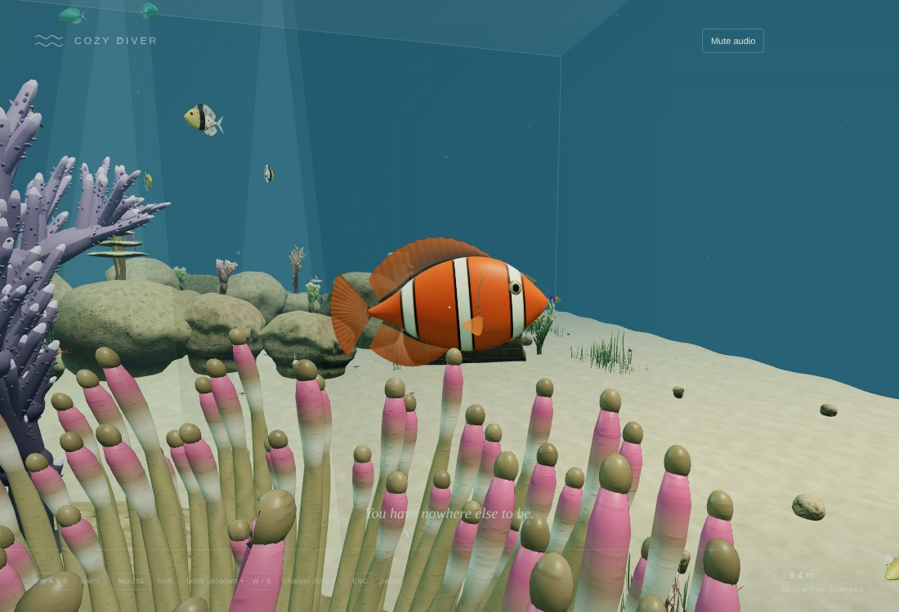      |

**My assessment, pending yours:**

- **Clear gains**: every species is now a modelled fish with resolved fins, eyes, gill covers and scale relief instead of a procedural shape, and each reads as its species. The firefish pennant, the cardinalfish bar-and-spots and the gramma's two-tone are distinctive.
- **Limits**:
  - Patterns are crisp vertex-colour fields rather than painted textures, so edges such as the gramma transition read slightly graphic up close.
  - All four new species share the chromis head and fin topology, so their mouths and fin-ray counts are chromis-like.
  - The assessor's tail is truncate rather than fully rounded.

## 3. Budgets (SwiftShader, framing matched per species)

| View           | Pass 015 draws / triangles | Pass 016 draws / triangles |
| -------------- | -------------------------: | -------------------------: |
| chromis        |              114 / 705,636 |            123 / 1,154,484 |
| chromis-school |              115 / 713,059 |            125 / 1,138,091 |
| cardinalfish   |              106 / 768,564 |              114 / 957,996 |
| firefish       |              104 / 810,401 |              112 / 999,833 |
| assessor       |               62 / 506,129 |               68 / 639,005 |
| gramma         |              105 / 904,225 |              109 / 958,173 |
| clownfish      |              148 / 983,459 |            157 / 1,406,191 |

- **Triangles.** Every fish is now a 12,686-triangle rig, so the 40 fish cost about 0.5 M submitted triangles. Instanced schools are culled as a whole, so this cost is paid whenever a school is in view. Views that include the chromis school gain about 0.45 M. **This is the largest cost in the pass; a fish LOD (a decimated rig level, or per-instance distance batching) is the recommended next optimisation once measured on the MacBook Air.**
- **Draw calls.** +4 to +10 per view: each species adds a few instanced part batches.
- **GPU textures.** 74 in the fish views, against 48 on `main`. CPU submission median is 1.6 → 2.4 ms (software renderer, diagnostic only).
- **Downloads.** Four new libraries of about 1.08 MB each, plus the chromis library (1.1 MB) in the normal scene, add about 5.4 MB. The normal scene is now about 53 MB in total, with no compression yet.
- **Inventory.** Resident CPU inventory is 462 geometries / 106 materials / 435 hulls (was 422 / 81 / 435).
- **Builds.** Production JS is 840.04 kB / 225.83 kB gzip (+1.4 kB).

## 4. Automated validation

| Check                                                                                   | Result                                                                                                                                                                       |
| --------------------------------------------------------------------------------------- | ---------------------------------------------------------------------------------------------------------------------------------------------------------------------------- |
| `npm run build` / `npm run build:benchmark` / `typecheck` / `lint` / `git diff --check` | Pass                                                                                                                                                                         |
| `npm run test -- --maxWorkers=2 --no-file-parallelism`                                  | **338 passed / 35 files**                                                                                                                                                    |
| `npm run test:stress`                                                                   | **10 passed**. Production composition at 5/15/30 minutes: zero recovery corrections, fish step p95 0.86–1.46 ms, swim+collision p95 0.23–0.26 ms, closest fish to glass 0.56 |
| `python3 tools/art/inspect_assets.py`                                                   | All 11 GLBs pass                                                                                                                                                             |

The new `fish-assets` tests (10) check:

- **Rig contract**: each species keeps the accepted chromis topology, both stroke morphs, pectoral pivots and vertex colour.
- **Proportions**: each matches its species' length, height and width.
- **Firefish pennant**: it rises above twice the body height.
- **Shared textures**: identical maps resolve to one texture.

Updated exact counts (measured, not loosened): 10 normal GLB requests, 12 benchmark GLB requests, 462 / 106 inventory. The geometry harness now looks up the clownfish school through the per-species API.

## 5. Browser evidence

| Harness                                                                                          | Result                                                                                                                                             |
| ------------------------------------------------------------------------------------------------ | -------------------------------------------------------------------------------------------------------------------------------------------------- |
| `fish-overhaul.mjs` (new)                                                                        | 7 matched views per build; all six authored schools freeze exactly on pause; no page or WebGL errors                                               |
| `geometry-overhaul.mjs`                                                                          | Pass. 2 animated clownfish rigs (moved, morphed, paused), no seahorse/frogfish intrusions, 40 / 7 / 435, cleanup 0 / 0, pending-load cleanup 0 / 0 |
| `ornaments`, `anchored-life`, `discoveries`, `integration`, `reef-overhaul`, `creature-overhaul` | Pass                                                                                                                                               |
| `lifecycle.mjs`                                                                                  | Pass. Native controls, pause and settings; 30-minute soak steady at 462 / 106 / 435; forced-GC heap 24.9 → 25.5 MB                                 |
| `production.mjs`                                                                                 | Pass. 10 GLBs return 200; no errors or warnings                                                                                                    |
| `visual-benchmark.mjs`, `asset-smoke.mjs`                                                        | Pass (benchmark dev and production build)                                                                                                          |

## 6. Known limitations

- **Fish triangles.** About 0.5 M submitted fish triangles with no fish LOD yet; MacBook Air frame time is unmeasured.
- **Shared topology.** The new species share chromis topology (mouth and fin rays), and their patterns are vertex-colour fields.
- **Clownfish unchanged.**
- **Downloads.** The total is about 53 MB uncompressed.
- **Tooling.** Sources need Blender 5.1+.

## 7. Manual macOS acceptance checklist

- [ ] Each species is recognisable at swimming distance and close up.
- [ ] Tail strokes, turning and pectoral motion look natural for every species.
- [ ] Schools, shelter use and diver reactions behave as before.
- [ ] Pause and reduced motion freeze or settle all fish.
- [ ] Frame rate stays comfortable while looking at the full chromis school.

## 8. Recommendations

1. **Fish LOD.** Measure on the MacBook Air first; if needed, add a decimated rig level or distance-split instancing.
2. **Asset compression.** Meshopt or Draco geometry and KTX2 textures across all libraries.
3. **Lighting.** Use the now fully authored scene as the lighting pass's reference.
