# v0.2 Pass 017 — Fish LOD & Asset Compression

Validation date: November 9, 2026. Candidate `0.2.0-rc.11` for user review. No merge, release or next pass is authorized by this report. Browser evidence comes from Linux Chromium with SwiftShader software rendering on localhost; MacBook Air frame time and real-network load time are not measured here.

## 1. Fish distance level

Pass 016 drew every fish as a 12,686-triangle authored rig, about 0.5 M triangles whenever a school was in view. Pass 017 adds a per-fish distance level:

- **Authoring** (`tools/art/pass017/fish_lod.py`): each of the six fish libraries gains `Body_LOD1`, `Median_Fins_LOD1` and `Eyes_Gills_Mouth_LOD1`. These are collapse-decimated copies totalling about 1,760 triangles (−86%). Their Stroke_Left / Stroke_Right morph targets are transferred from the nearest full-rig vertex, so distant fish still beat their tails. Pectorals are omitted at distance. The full-detail rig is verified identical to the accepted geometry.
- **Runtime** (`AuthoredSchool.update(camera)`): each frame, every fish is written into either the full or the distance instanced set, carrying its tint, pose and morph weights.
  - **Threshold**: full detail within 14 body lengths, with 10% hysteresis so fish don't flicker between levels.
  - **Without a camera** (benchmarks, matched captures): every fish stays at full detail.
  - **Cost**: no per-frame allocations, the same draw-call structure, and the simulation is untouched.

| View (same framing) | Pass 016 triangles | Pass 017, all full detail | Pass 017 with LOD | Fish at full detail |
| ------------------- | -----------------: | ------------------------: | ----------------: | ------------------: |
| Spawn, down channel |          1,366,914 |                 1,364,858 |       **980,785** |              5 / 40 |
| Chromis close-up    |          1,154,484 |                 1,129,780 |         1,040,628 |                  33 |
| Chromis school      |          1,138,091 |                 1,136,059 |         1,045,144 |                  33 |
| Cardinalfish        |            957,996 |                   957,108 |           875,356 |                  33 |
| Firefish            |            999,833 |                   997,777 |           894,175 |                  13 |
| Yellow assessor     |            639,005 |                   638,117 |           502,099 |                   3 |
| Royal gramma        |            958,173 |                 1,035,637 |           966,569 |                  29 |
| Clownfish           |          1,406,191 |                 1,406,435 |     **1,044,208** |                   8 |

From the player's spawn view the scene drops 28% (−386k triangles); with most fish at distance, fish now cost under 0.1 M there. Close-ups of a school keep nearby fish at full detail, as intended. Fish counts and positions differ slightly between builds because the simulation runs freely before capture; framing matches. The gramma close-up happened to include more fish this run, which explains its higher full-detail figure.

| View             | Pass 016                                                | Pass 017 (LOD active)                                  |
| ---------------- | ------------------------------------------------------- | ------------------------------------------------------ |
| Spawn            | 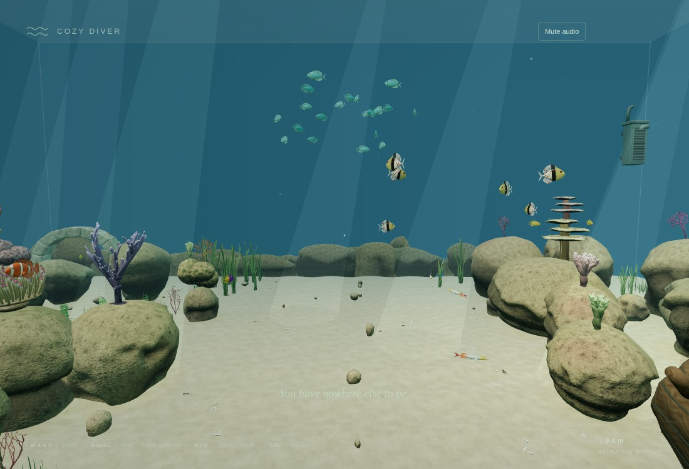          | 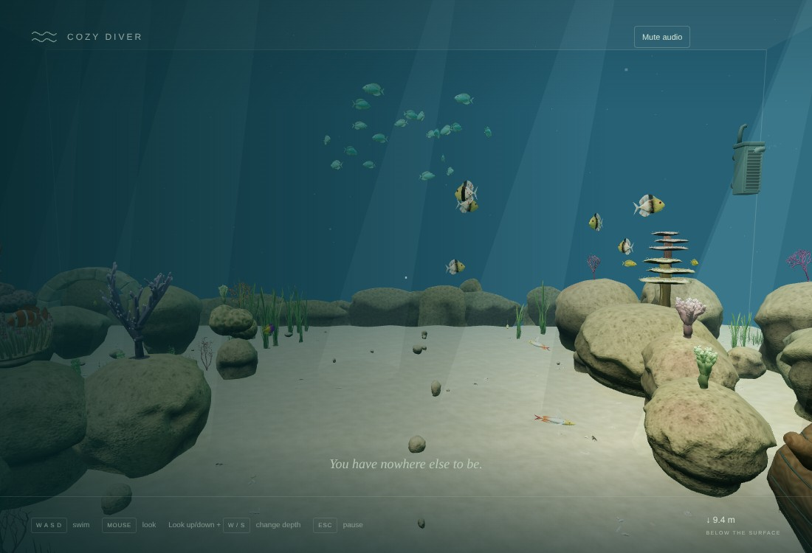          |
| Chromis school   | 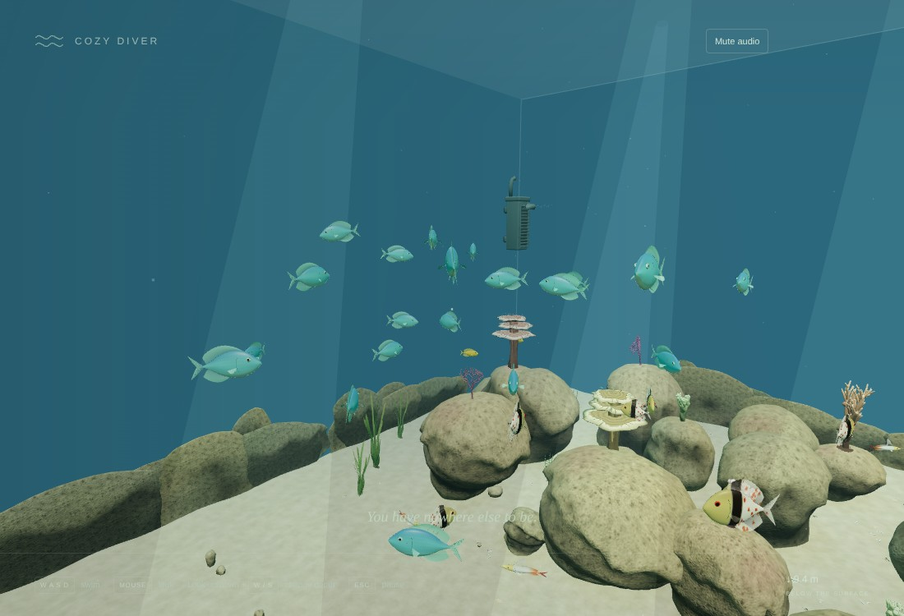 |  |
| Chromis close-up | 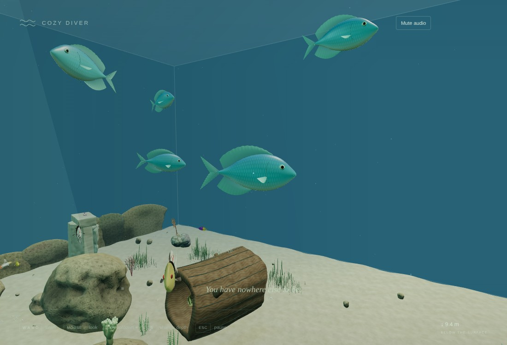        | 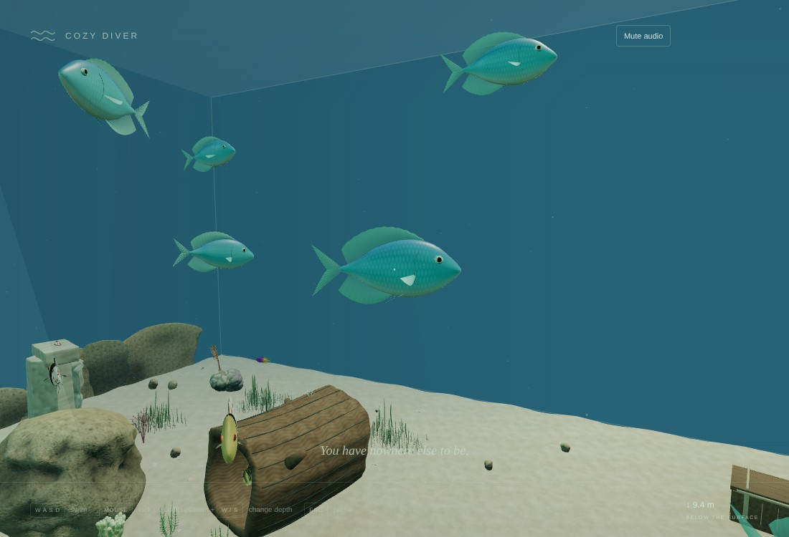        |
| Firefish         | 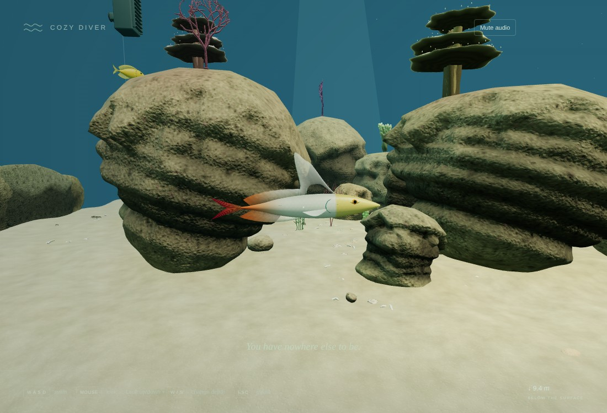       | 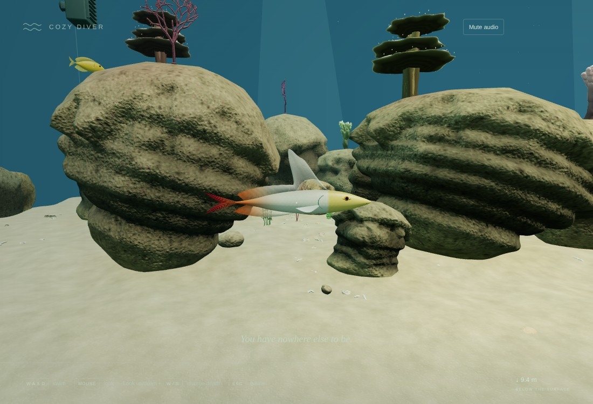       |
| Cardinalfish     | 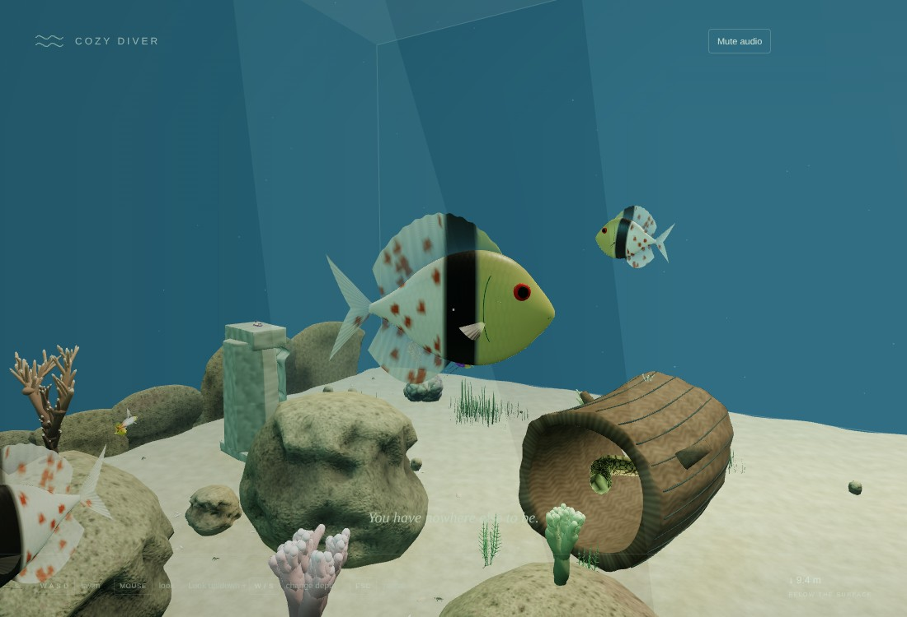   | 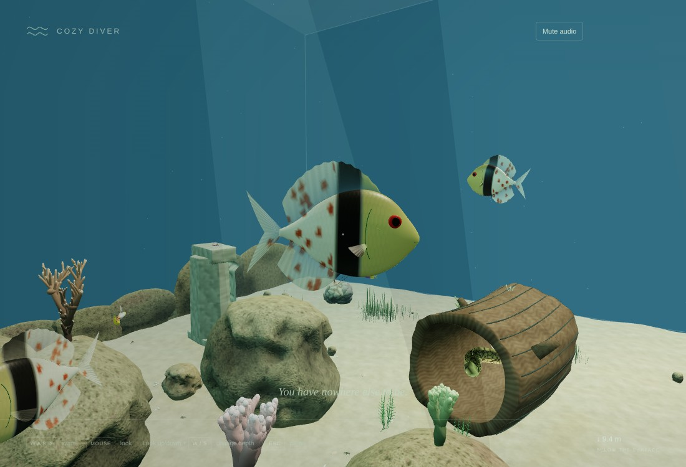   |
| Clownfish        | 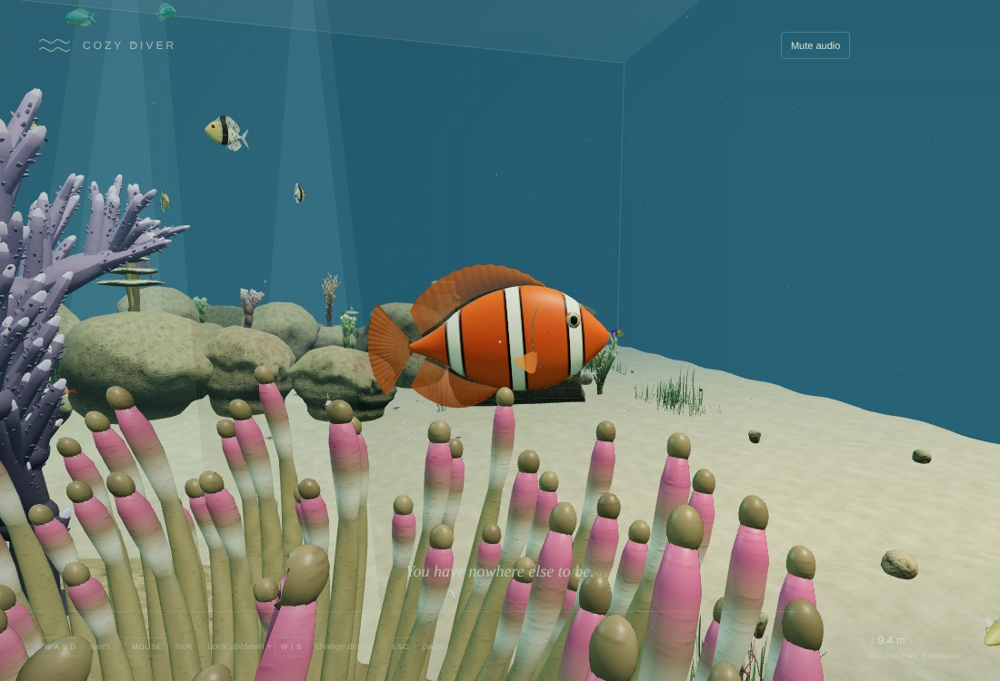      | 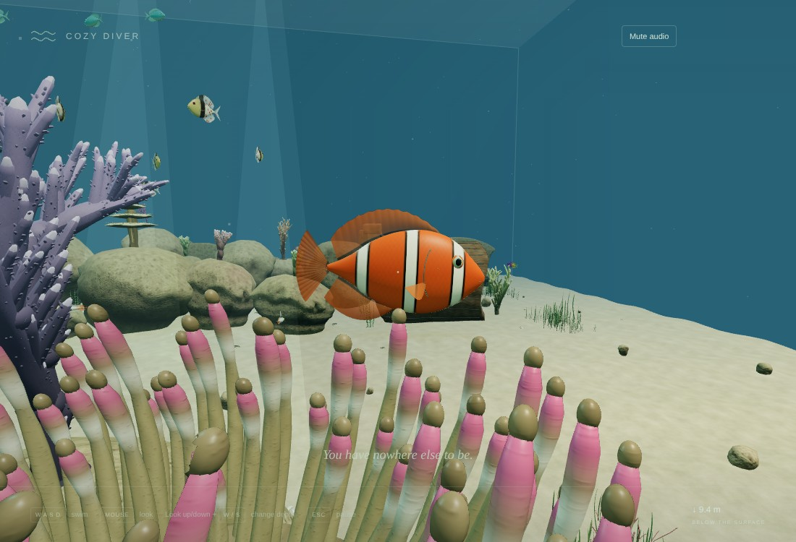      |

Distant fish are indistinguishable at their on-screen size, and the compressed textures match the originals in colour and detail. The spawn "after" frame is dimmer only because the intro text overlay was still fading at capture time.

## 2. Asset compression

`tools/art/pass017/compress.mjs` (gltf-transform 4.5.1, draco3dgltf, sharp) runs last in the pipeline:

- **Geometry**: Draco edgebreaker with 16-bit positions, 10-bit normals, 14-bit UVs and 8-bit colours. Primitives with morph targets stay uncompressed.
- **Textures**: WebP, at quality 88 for colour maps and near-lossless for normal/ORM data.
- **Node transforms**: untouched.

Separately, the 16 MB of source PNG maps moved from `public/assets/textures/` to `tools/art/textures/`. They are authoring inputs already embedded in the GLBs and no longer ship.

| Measure (production preview)                                  |            Pass 016 `main` |                                 Pass 017 |
| ------------------------------------------------------------- | -------------------------: | ---------------------------------------: |
| GLB bytes transferred at startup                              |                    52.9 MB |                              **16.4 MB** |
| Draco decoder (wasm and wrapper)                              |                          — |                                   0.2 MB |
| Total bytes transferred at startup                            |                    53.1 MB |                       **16.9 MB (−68%)** |
| `dist/` size                                                  |                      71 MB |                                **20 MB** |
| Time to fully prepared scene (localhost, SwiftShader, 3 runs) |                  3.6–4.3 s |                                3.8–4.5 s |
| JS bundle                                                     | 840.04 kB / 225.83 kB gzip | 848.33 kB / 228.74 kB gzip (DRACOLoader) |

**Load time.** On localhost the prepared time is about the same: download time is negligible there, and Draco decoding adds roughly 0.2–0.3 s. On a real network the reduction dominates. For example, at 50 Mbit/s the startup download falls from about 8.5 s to about 2.7 s (arithmetic, not measured).

**GPU memory.** Unchanged: WebP decodes to RGBA8. Cutting GPU texture memory would need KTX2/Basis. An encoder (`ktx2-encoder`) is available, but `KTX2Loader` needs the renderer inside `AssetLoader` and a transcoder bundle, and Blender cannot re-import KTX2 sources. It is left as a measured follow-up if the MacBook Air shows memory pressure.

**Precision.**

- **Positions**: 16-bit quantization keeps errors below 1/65535 of each primitive's extent (about 3e-5 units for the largest props).
- **Collision and attachments**: every existing collision, attachment, containment and route test passes on decoded data.
- **Moray centreline**: still within 2 mm.

## 3. Validation

| Check                                                                           | Result                                                                                                                                      |
| ------------------------------------------------------------------------------- | ------------------------------------------------------------------------------------------------------------------------------------------- |
| `npm run build` / `build:benchmark` / `typecheck` / `lint` / `git diff --check` | Pass                                                                                                                                        |
| `npm run test -- --maxWorkers=2 --no-file-parallelism`                          | **348 passed / 36 files** (new `fish-lod-compression`: 10)                                                                                  |
| `npm run test:stress`                                                           | **10 passed**; production composition (435 hulls installed from Draco-decoded reef parts) at 5/15/30 minutes with zero recovery corrections |
| `python3 tools/art/inspect_assets.py`                                           | All 11 compressed GLBs decoded (DracoPy, PIL WebP) and pass, including reef-rock hull containment on decoded geometry                       |

The new tests check:

- **Level choice**: the switching threshold and its hysteresis.
- **Distance levels**: every fish library's distance level is under 20% of its full triangles, keeps both stroke morphs and stays inside the full rig's bounds.
- **Instancing**: `AuthoredSchool` moves fish between the two sets without losing or duplicating any, and keeps full detail without a camera.
- **Compression**: every registered GLB is Draco- and WebP-compressed, the decoder is bundled locally, shipped models stay under 20 MB, and source maps no longer ship.

Browser harnesses (all pass):

| Harness                                                                                          | Result                                                                                                                        |
| ------------------------------------------------------------------------------------------------ | ----------------------------------------------------------------------------------------------------------------------------- |
| `fish-overhaul.mjs`                                                                              | LOD and full-detail triangles per view, six schools frozen on pause, no errors                                                |
| `load-budget.mjs` (new)                                                                          | Production bytes and prepared time, before and after                                                                          |
| `geometry-overhaul.mjs`                                                                          | No anatomy intrusions; 40 / 7 / 435; cleanup 0 / 0; **pending-load cleanup 0 / 0 with Draco workers**; props-library fallback |
| `ornaments`, `anchored-life`, `discoveries`, `integration`, `reef-overhaul`, `creature-overhaul` | Pass on compressed assets                                                                                                     |
| `lifecycle.mjs`                                                                                  | Pass; 30-minute soak steady at 498 / 106 / 435 (36 new LOD geometries); heap 25.7 → 26.3 MB                                   |
| `production.mjs`, `visual-benchmark.mjs`, `asset-smoke.mjs`                                      | Pass; no errors or warnings                                                                                                   |

## 4. Known limitations

- **LOD scope.** Fish only. Corals and rocks already had LODs (Passes 014/015); creatures and ornaments do not.
- **Close-up schools.** A school seen from close up still draws its nearby fish at full detail. That is intended, but those views remain about 1.0 M triangles.
- **GPU memory.** Unchanged; KTX2 is the follow-up.
- **Measurement.** MacBook Air frame time and real-network load time remain unmeasured.

## 5. Manual macOS acceptance checklist

- [ ] Distant fish never visibly pop between detail levels while swimming.
- [ ] Fish, corals, creatures, rocks and sand look identical to Pass 016 (compression is visually lossless).
- [ ] The aquarium becomes ready noticeably faster on first load from a real server.
- [ ] Frame rate at the spawn view and near the chromis school is comfortable.
