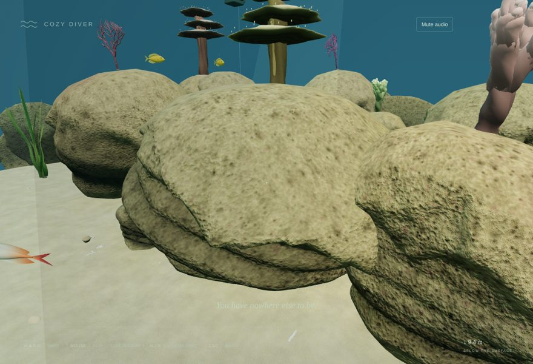
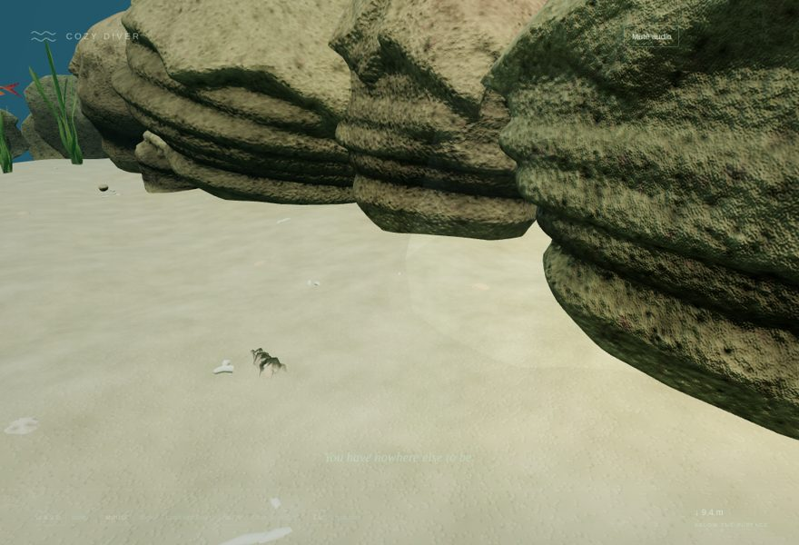
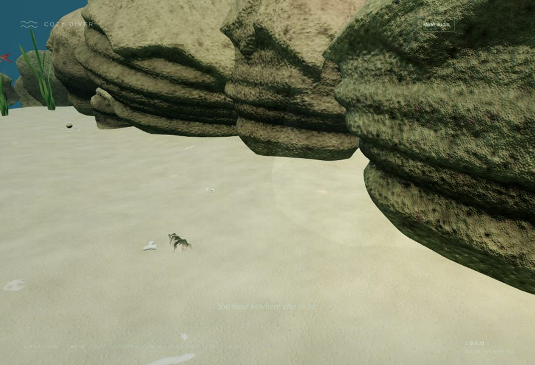
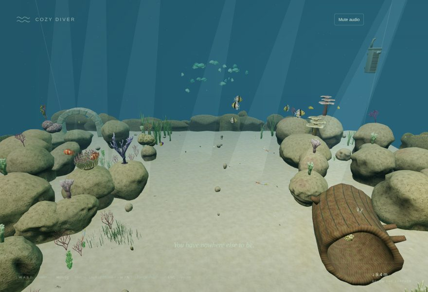
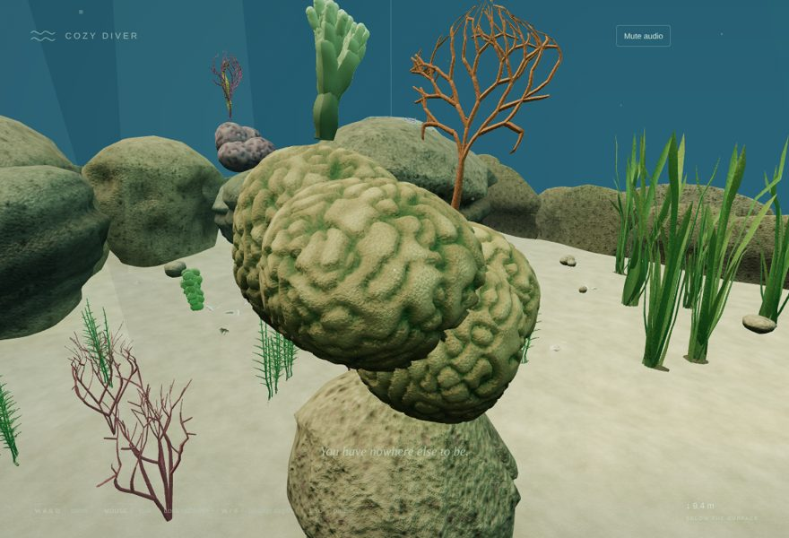
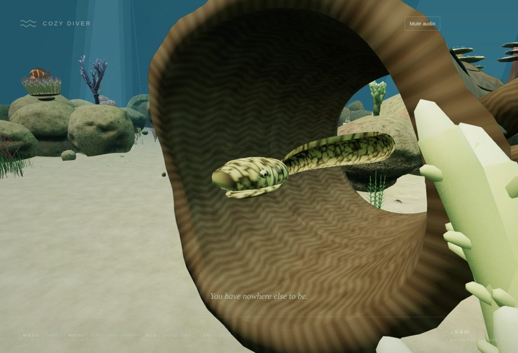
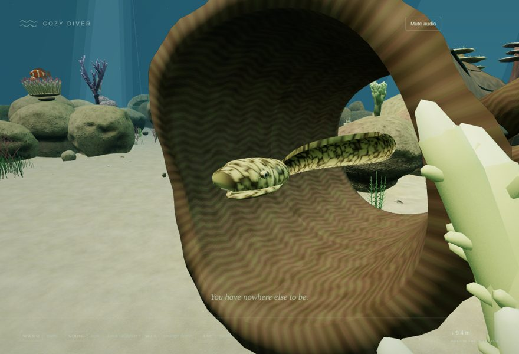
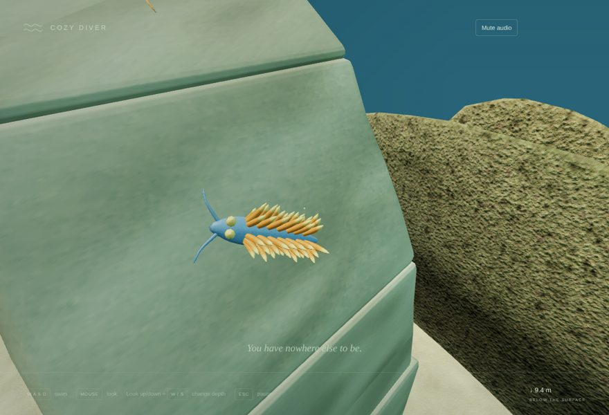
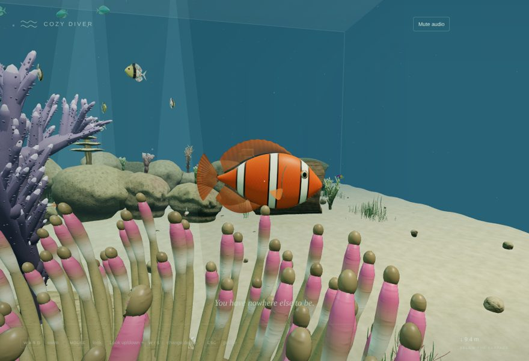
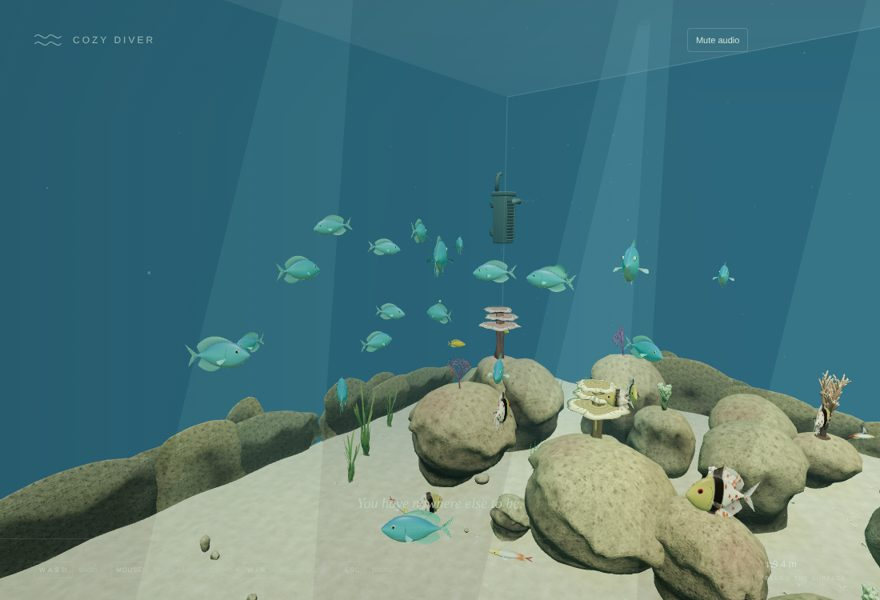

# v0.2 Pass 018 — KTX2 Texture Compression

Validation date: November 9, 2026. Candidate `0.2.0-rc.12` for user review. No merge, release or next pass is authorized by this report. Browser evidence comes from Linux Chromium with SwiftShader software rendering on localhost. MacBook Air frame time, GPU format choice and real-network load time are not measured here.

## 1. What changed

Pass 017 shipped WebP textures, which shrink downloads but decode to uncompressed RGBA8 on the GPU. Pass 018 ships every embedded texture as KTX2/Basis (`KHR_texture_basisu`), so textures stay block-compressed in GPU memory.

- **Encoding** (`tools/art/pass017/compress.mjs`, `ktx2-encoder` 0.6.0):
  - Each image is re-encoded from its original authoring PNG in `tools/art/textures/`, matched by name, not from the lossy WebP.
  - Every image gets a full mip chain.
  - Modes by role:
    - Normal maps: UASTC with RDO and Zstandard supercompression (22 images).
    - Colour maps: ETC1S with sRGB.
    - ORM data maps: ETC1S, linear.
  - Colour and data maps together are 50 images.
- **Geometry is unchanged.** Rewriting a GLB re-encodes its Draco data, and gltf-transform's defaults would have dropped positions to 14 bits. That broke a reef collision test on the first run. The script now pins the Pass 017 settings: edgebreaker, 16-bit positions, 10-bit normals, 14-bit UVs, 8-bit colours.
- **Runtime** (`AssetLoader`):
  - The renderer is passed to each asset cache.
  - All caches on one renderer share a single, reference-counted `KTX2Loader` (`leaseKtx2`). That means one transcoder download and one two-worker pool, disposed with the last cache.
  - The Basis transcoder is served locally from `public/assets/basis/` (Apache-2.0, unmodified from three r187).
  - three.js picks the GPU format from what the device supports, falling back to uncompressed RGBA if none.

The browser checks caught one issue during this pass. The aquarium, reef and benchmark caches each started their own transcoder pool, and three.js warned about it. Those warnings failed the visual-benchmark and asset-smoke checks; the shared lease fixes it.

## 2. Results

| Measure                                                       |     Pass 017 `main` (WebP) |                         Pass 018 (KTX2) |
| ------------------------------------------------------------- | -------------------------: | --------------------------------------: |
| Resident texture memory, loaded aquarium (62 textures)        |               **82.7 MiB** |                     **20.7 MiB (−75%)** |
| Textures held compressed on the GPU                           |                     0 / 62 |                                 62 / 62 |
| Shipped models (`public/assets/models`)                       |                    17.3 MB |                                 14.5 MB |
| Bytes transferred at startup (production preview)             |                    16.9 MB |                      **14.7 MB (−13%)** |
| of which decoders                                             |            0.20 MB (Draco) |                 0.75 MB (Draco + Basis) |
| Time to fully prepared scene (localhost, SwiftShader, 3 runs) |                  4.0–4.6 s |                               4.8–5.0 s |
| `dist/` size                                                  |                      20 MB |                                   18 MB |
| JS bundle                                                     | 848.33 kB / 228.74 kB gzip | 908.69 kB / 253.18 kB gzip (KTX2Loader) |

`validation/texture-memory.mjs` measured the memory figures. It walks every scene material, counts each texture source once, and takes compressed sizes from the transcoded mip data. Plain images count as RGBA8 with a 4/3 mip chain. In this environment every texture transcoded to **BC7** (`RGBA_BPTC`, 1 byte per texel). On Linux, three.js deliberately ignores the ETC2 and ASTC extensions, because Mesa emulates them in software.

On a Mac the format will differ:

- **Apple Silicon:** ASTC 4×4 or ETC2. ASTC is also 1 byte per texel; ETC2 RGB is 0.5.
- **Intel:** BC7 or BC1/BC3.

The saving should be at least as large on either, but it has not been measured there.

**Load time.** On localhost, transcoding adds about 0.6 s to the prepared time, because download time is negligible there. On a real connection, the 2.2 MB smaller download offsets some of this: about 0.35 s at 50 Mbit/s (arithmetic, not measured). The trade is a small startup cost for a quarter of the texture memory and steadier GPU behaviour.

## 3. Visual parity

Matched captures from the same camera, `main` (WebP) on the left and this branch (KTX2) on the right. Mean absolute pixel difference across the 16 reef views is 0.7–2.0 / 255, and across the creature views 0.7–1.9 / 255. That includes free-running fish and animation, so it is an upper bound on texture difference.

| View            | Pass 017 (WebP)                                         | Pass 018 (KTX2)                                        |
| --------------- | ------------------------------------------------------- | ------------------------------------------------------ |
| Rock close-up   |      |      |
| Sand and rubble |     |     |
| Wide reef       |            |            |
| Brain coral     |     |     |
| Moray           |           |           |
| Nudibranch      |    |    |
| Clownfish       |       |       |
| Chromis school  |  |  |

I saw no visible change in colour, rock and sand micro-detail, or normal-map relief. ETC1S is the lower-quality Basis mode; colour maps were kept on it because, in these views, it was indistinguishable from the WebP originals. If close inspection on the MacBook shows blockiness, the colour maps can move to UASTC by changing one slot setting.

## 4. Validation

| Check                                                                           | Result                                                                                                            |
| ------------------------------------------------------------------------------- | ----------------------------------------------------------------------------------------------------------------- |
| `npm run build` / `build:benchmark` / `typecheck` / `lint` / `git diff --check` | Pass                                                                                                              |
| `npm run test -- --maxWorkers=2 --no-file-parallelism`                          | **351 passed / 37 files**                                                                                         |
| `python3 tools/art/inspect_assets.py`                                           | All 11 GLBs pass: Draco geometry decoded (hull containment intact), every KTX2 header valid with a full mip chain |
| `npm run test:stress`                                                           | **Not run** in this pass, by request; to be covered in the user's playthrough                                     |

New and changed tests:

- **Compression:** every registered GLB uses Draco and `KHR_texture_basisu` and no longer uses WebP. Every image is `image/ktx2` with a valid KTX2 identifier and a full mip chain. The Basis transcoder is bundled locally.
- **Shared loader** (`ktx2-loader.test.ts`): caches on one renderer share a single loader. Releases are idempotent, the last release disposes it, and separate renderers stay independent.
- **Geometry:** the existing reef collision, attachment and route tests pass on the re-written files, confirming the pinned Draco settings.

Browser harnesses (all pass, no console errors or warnings):

| Harness                                                                | Result                                                                                            |
| ---------------------------------------------------------------------- | ------------------------------------------------------------------------------------------------- |
| `texture-memory.mjs` (new)                                             | 62 / 62 textures compressed (BC7 here); 82.7 → 20.7 MiB                                           |
| `fish-overhaul`, `creature-overhaul`, `reef-overhaul` (before / after) | Matched captures above                                                                            |
| `geometry-overhaul.mjs`                                                | No intrusions; 40 / 7 / 435; cleanup 0 / 0; **pending-load cleanup 0 / 0 with the shared loader** |
| `lifecycle.mjs`                                                        | 30-minute soak steady at 498 / 106 / 435; heap 26.1 → 26.7 MB                                     |
| `ornaments`, `anchored-life`, `discoveries`, `integration`             | Pass                                                                                              |
| `visual-benchmark`, `production`, `asset-smoke`                        | Pass, with no "multiple KTX2 loaders" warnings after the shared-loader fix                        |
| `load-budget.mjs`                                                      | Before and after figures above; it now counts the Basis transcoder under decoders                 |

`geometry-overhaul`, `lifecycle`, `integration`, `visual-benchmark`, `production`, `asset-smoke`, `load-budget` and `texture-memory` were re-run after the shared-loader change. The capture and placement harnesses ran on the earlier per-cache loader; the textures they render are identical.

## 5. Known limitations

- **Format on the target machine.** The GPU format and memory were measured only on SwiftShader (BC7). The MacBook Air's choice and its real memory saving are unmeasured.
- **Startup transcode.** Transcoding adds roughly 0.6 s on localhost. It runs on two workers, off the main thread.
- **Authoring order.** Blender cannot import KTX2 images, so `fish_lod.py`, `pass016/fish.py` and `pass015/creatures.py` must run on uncompressed output in the full regeneration order, never on the shipped files. See the [pipeline](ASSET_PIPELINE.md).
- **Dev server.** On the first `npm run dev` after pulling this branch, Vite may answer the new loader import with "504 Outdated Optimize Dep". Restarting with `npx vite --force` fixes it.
- **Stress suite** not run in this pass.

## 6. Manual macOS acceptance checklist

- [ ] Rocks, sand, corals, creatures and fish look the same as Pass 017, with no visible blockiness or colour banding up close.
- [ ] The aquarium becomes ready about as quickly as before on first load.
- [ ] Optional: in Chrome or Safari DevTools, the GPU memory of the tab is noticeably lower than Pass 017.
- [ ] Frame rate during a long swim is comfortable (stress coverage for this pass).
