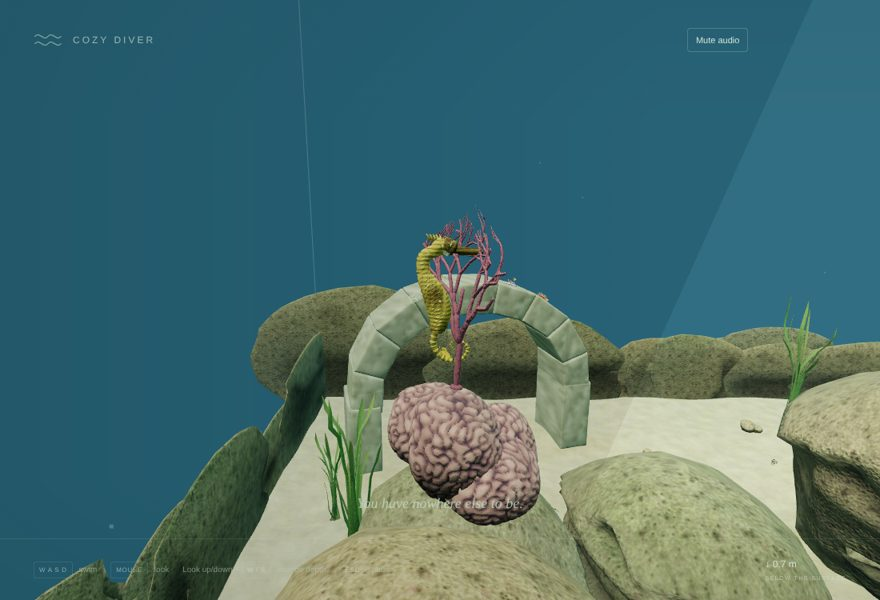
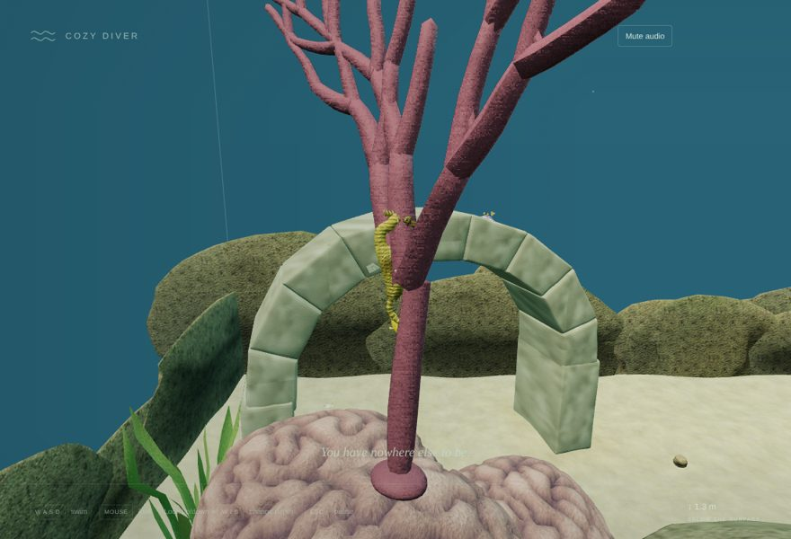
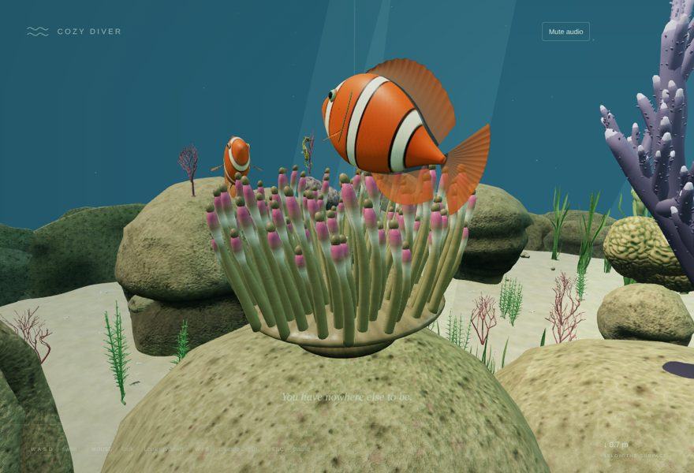
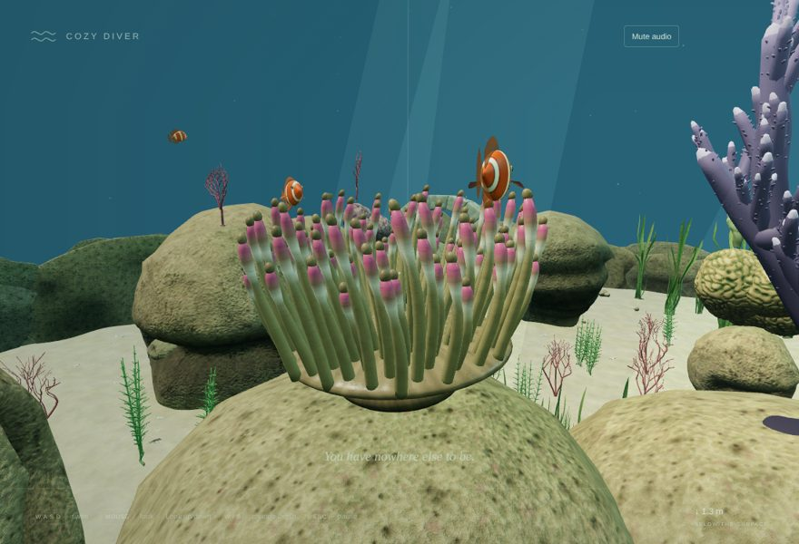
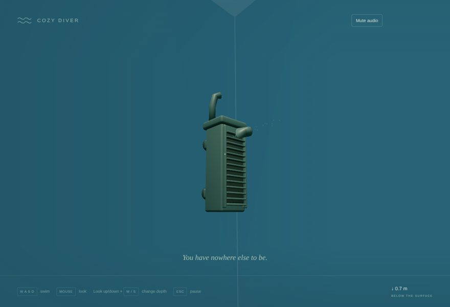
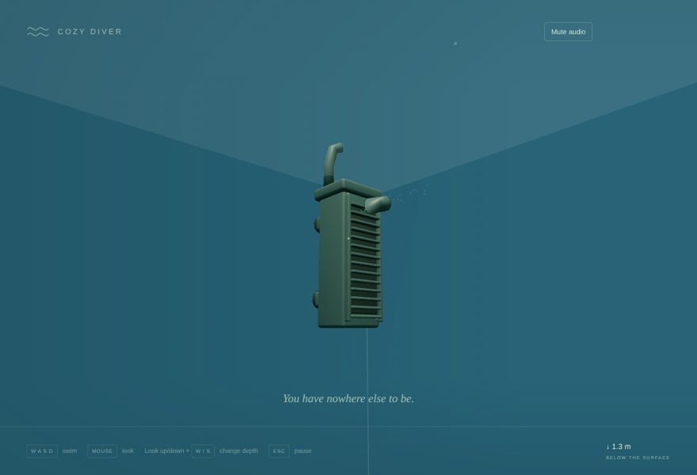
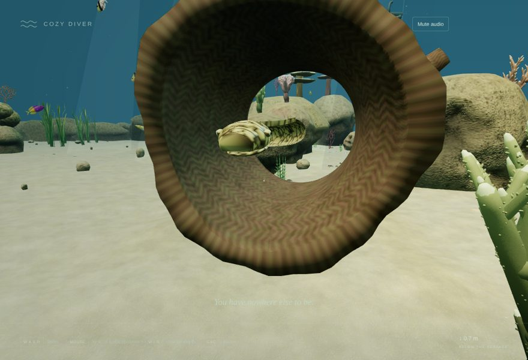
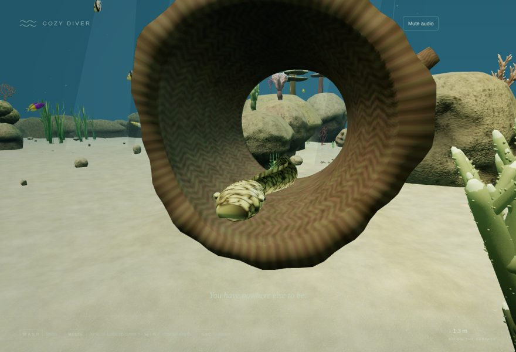

# v0.2 Pass 019 — Playtest Fixes

Validation date: November 10, 2026. Candidate `0.2.0-rc.13` for user review. No merge, release or v0.3 work is authorized by this report. Browser evidence comes from Linux Chromium with SwiftShader on localhost. The PR was opened at the user's request before the full browser suite finished; the user is testing on the MacBook directly.

## 1. Fixes from the Pass 018 playtest

| Playtest note                                        | Change                                                                                                                                                                                                                                                                                                                                 |
| ---------------------------------------------------- | -------------------------------------------------------------------------------------------------------------------------------------------------------------------------------------------------------------------------------------------------------------------------------------------------------------------------------------- |
| Seahorse should be 20% of its size                   | `SEAHORSE_SCALE = 0.2` on the root: 1.11 m → **0.22 m** tall. Grip offset, safety radius, view target and drift are scaled with it; it still clings to the same sea fan.                                                                                                                                                               |
| Clownfish 50%, plus a third at 10%                   | Pair length 0.68 → **0.34 m**; new juvenile at **0.067 m** (10% of the former size) in the same anemone, following the female. `authoredLength` scales the authored rig, which was modelled at 0.68 m. Fish total 40 → **41**; dense stress 60 → 61 (`fishPopulation('home' \| 'dense')`).                                             |
| Filter should hang in the top corner like a real one | `FILTER_MOUNT_Y = AQUARIUM.max.y - 1.55`: body just under the waterline (12.45–13.76 m), return pipe over the rim (top 14.72 m), outflow stirring the surface.                                                                                                                                                                         |
| Moray floats unnaturally in the log                  | The body lies on the bore floor (`MORAY_DEN.floor = -0.74`, the lowest height with 1 cm clearance from the bore hulls, found by measurement). Only the head lifts, by up to 0.22 m as it emerges.                                                                                                                                      |
| Max swim speed 20% lower                             | Default 2.8 → **2.24 m/s**; maximum 5 → **4 m/s**. Settings key v2; saved v1 speeds are multiplied by 0.8, so they keep their slider position (the new 0.08 m/s grid is the old 0.1 grid scaled by 0.8).                                                                                                                               |
| Texture pop-in when first swimming                   | Root cause measured: on `main` only 1 GPU texture was resident after preparation, and **93 uploaded during the first swim**. `warmUpScene` now compiles every program (hidden LOD levels included), uploads every material texture, and draws the whole scene once off-screen with culling off. Result: **0 uploads** during the swim. |

The roadmap now records the agreed sequence and vision: v0.3 Office & Dive Transition, v0.4 Personalization, v0.5 Beyond the Glass, v0.6 Expanding Oceans.

## 2. Measurements (`validation/playtest-fixes.mjs`, real input)

| Measure (default settings, same scripted swim) | `main` (rc.12) |        Pass 019 |
| ---------------------------------------------- | -------------: | --------------: |
| Speed setting                                  |        2.8 m/s |        2.24 m/s |
| Peak swimming speed                            |       3.35 m/s | 2.71 m/s (−19%) |
| Distance covered                               |         13.1 m |   10.5 m (−20%) |
| GPU textures resident after preparation        |              1 |             104 |
| Uploaded lazily during the swim                |         **93** |           **0** |

| View      | `main`                                             | Pass 019                                          |
| --------- | -------------------------------------------------- | ------------------------------------------------- |
| Seahorse  |   |   |
| Clownfish |  |  |
| Filter    |     |     |
| Moray den |      |      |

## 3. Checks

| Check                                                                                                                                                                                         | Result                                                                                       |
| --------------------------------------------------------------------------------------------------------------------------------------------------------------------------------------------- | -------------------------------------------------------------------------------------------- |
| `npm run build` / `build:benchmark` / `typecheck` / `lint`                                                                                                                                    | Pass                                                                                         |
| `npm run test -- --maxWorkers=2 --no-file-parallelism`                                                                                                                                        | **357 passed / 38 files**; new `playtest-fixes.test.ts` (5) and a v1→v2 speed-migration test |
| `playtest-fixes.mjs` (new), before and after                                                                                                                                                  | Pass; numbers above                                                                          |
| `fish-overhaul.mjs`                                                                                                                                                                           | Pass                                                                                         |
| Remaining browser harnesses (creature, reef, geometry, ornaments, anchored-life, discoveries, lifecycle, integration, visual-benchmark, production, asset-smoke, load-budget, texture-memory) | **Still running when the PR was opened**; fish-count assertions updated from 40 to 41        |
| `npm run test:stress`                                                                                                                                                                         | Not run                                                                                      |

New tests cover:

- the seahorse's world height and grip;
- clownfish pair and juvenile lengths and host;
- the filter's mount height, corner and waterline;
- the moray resting low in the bore with solid log close beneath, and its head lifting;
- warm-up texture collection and LOD reveal/restore;
- 20% slower defaults and limits, plus v1 migration.

## 4. Known limitations

- **Moray clearance.** The moray rests a few centimetres above the log's inner surface; it can't go lower without entering the bore's collision hulls.
- **Startup cost.** The warm-up adds a one-off full-scene draw during "Preparing aquarium details". It isn't timed here; check the startup feel on the MacBook.
- **Fish count.** The juvenile makes the aquarium 41 fish. Exact counts in tests and harnesses were updated to the measured values.
- **Distance levels.** Rock and coral distance-level switching still happens at fixed distances. If any pop-in remains on the MacBook, that is the next suspect.

## 5. Manual macOS checklist

- [ ] The seahorse reads as a small animal on its sea fan.
- [ ] The clownfish pair and juvenile look natural around the anemone.
- [ ] The filter sits at the top corner like a real filter.
- [ ] The moray lies in its log and lifts its head out naturally.
- [ ] Swimming feels calmer, and your saved speed setting carried over.
- [ ] No texture pop-in when you first swim around; startup still feels fine.
