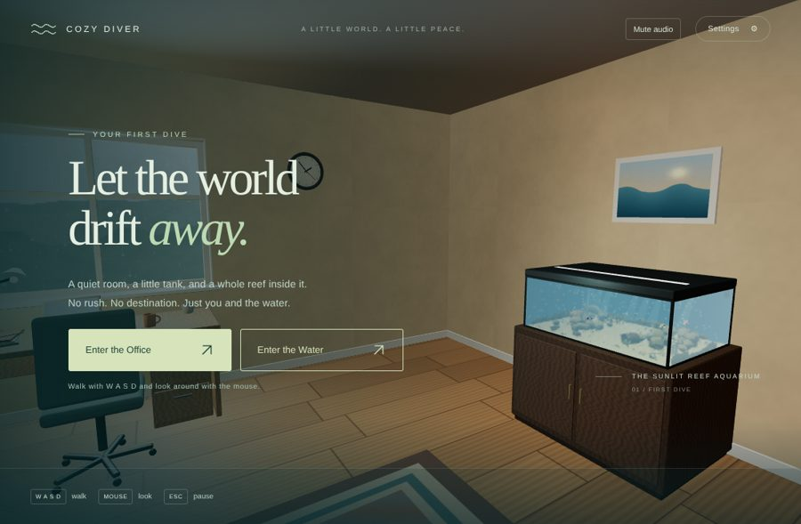
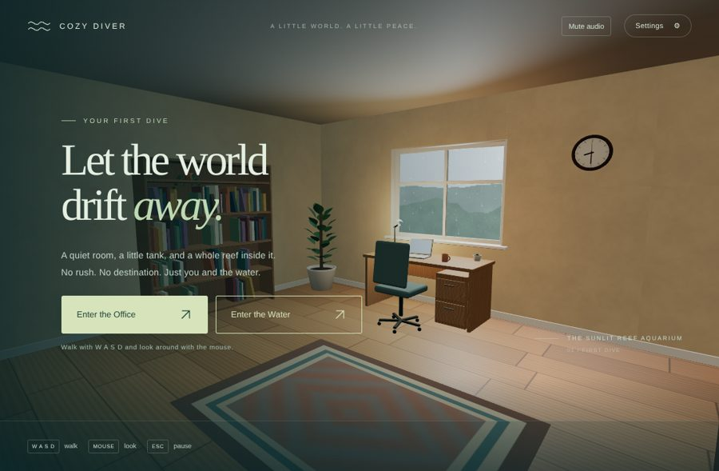
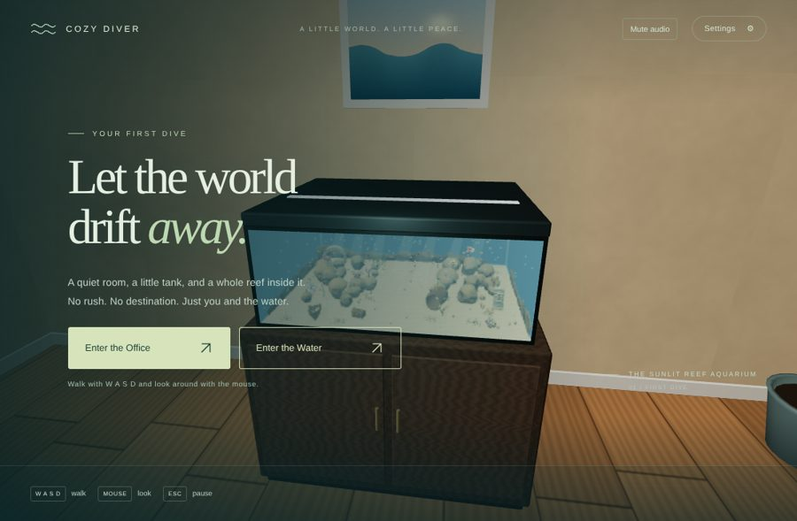
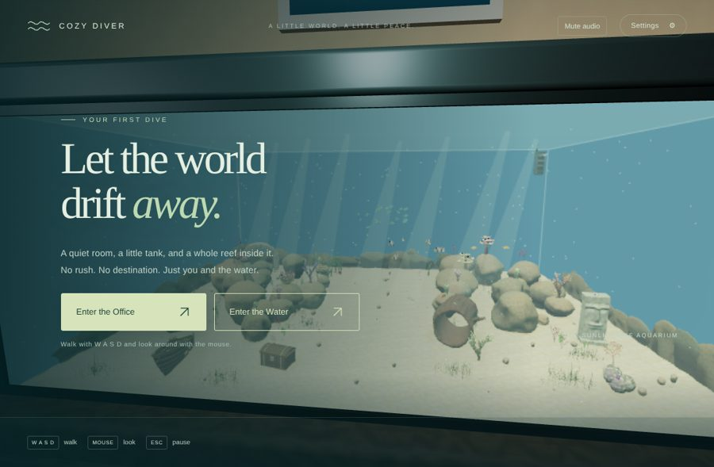
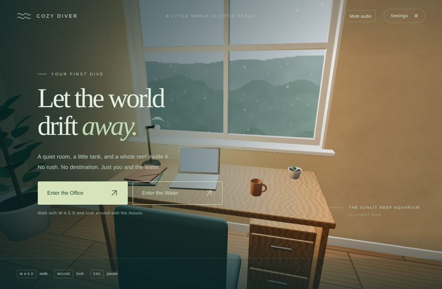
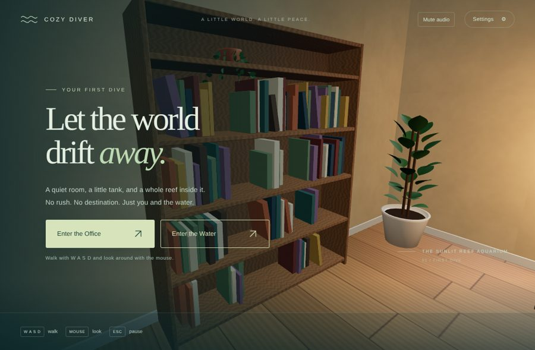

# v0.3 Pass 020 — The Office

Validation date: November 10, 2026. Candidate `0.3.0-alpha.1` for user review; v0.2 was accepted at `0.2.0-rc.15`. No merge or release is authorized by this report. Browser evidence is from Linux Chromium with SwiftShader software rendering on localhost. MacBook Air frame time, audio comfort and the look under real GPU lighting are not measured here.

## 1. What was built

- **The office.** A cosy home office, generated in code with procedural `DataTexture`s and no external assets. See [the office architecture](OFFICE.md).
  - **Window:** a rain-streaked window (animated rain shader) over a rainy garden.
  - **Desk:** with a laptop, mug, notebooks, pencil, desk lamp and succulent.
  - **Furnishings:** an office chair, a bookshelf of books and keepsakes, a tall fiddle-leaf plant and a snake plant, a woven rug, a framed ocean print and a door.
  - **Clock:** a wall clock showing your local time.
- **Walking.** Enter the Office walks with W A S D and the mouse at a fixed 1.6 m eye height, at 1.25 m/s with eased starts and stops. You slide along the walls and furniture (`player/walking.ts`, pure and tested).
- **The tank.** A roughly 1 m tank (1.0 × 0.39 × 0.78 m) sits on a cabinet stand. Its glass shows the real aquarium running live, rendered from the office camera mapped into aquarium space at 0.6× resolution.
  - **Cost:** seen from the room, every fish, coral and rock uses its distance level.
  - **Occlusion:** office objects in front of the tank still occlude it.
- **Sound.** A procedural office soundscape: rain wash and droplet taps, a distant tick/tock, and tank bubbling that rises as you approach. It shares the mute and volume settings, and only the current space is heard.
- **Switching.** The start screen offers Enter the Office (default) and Enter the Water. The pause screen switches between them, each space keeping its own look direction. The seamless dive is Pass 021.

| View                                      | Capture                                     |
| ----------------------------------------- | ------------------------------------------- |
| Start screen (office)                     |      |
| The room                                  |       |
| Tank on its stand                         |       |
| Live miniature aquarium through the glass |  |
| Desk under the rainy window               |       |
| Bookshelf and plant                       |      |

## 2. Measurements (`validation/office.mjs`, real input)

| Measure                                                              | Result                                                   |
| -------------------------------------------------------------------- | -------------------------------------------------------- |
| Start mode                                                           | office                                                   |
| Held W for 3.5 s with mouse look                                     | walked 2.21 m, eye height 1.6 m, inside the room         |
| Depth readout while in the office                                    | hidden                                                   |
| Office → water → office, three round trips                           | GPU memory unchanged (403 geometries / 112 textures)     |
| Office pass draw calls / triangles across five views                 | 11–21 calls, 18–51 k triangles                           |
| CPU submit per office frame (miniature render included), SwiftShader | 1.5–6.4 ms                                               |
| Console errors / warnings / WebGL errors                             | none                                                     |
| JS bundle                                                            | 959.65 kB / 271.76 kB gzip (v0.2: 921.54 kB / 257.79 kB) |

- **What the counts cover.** The draw-call and triangle counts are for the office pass only; three.js resets its counters per render call. The miniature render's own counts are not separately reported. Its cost is included in the CPU submit time.
- **Lighting choice.** An early version lit the window with an area light. Its lookup tables added about 280 kB to the bundle, so it was replaced by a wide, fully soft spotlight with a near-identical look.

## 3. Checks

| Check                                                      | Result                                                                                                                                                                             |
| ---------------------------------------------------------- | ---------------------------------------------------------------------------------------------------------------------------------------------------------------------------------- |
| `npm run build` / `build:benchmark` / `typecheck` / `lint` | Pass                                                                                                                                                                               |
| `npm run test -- --maxWorkers=2`                           | **373 passed**. New: `office-walking` (6) and `office` (6), covering bounds, the clock and rain, single disposal, the exact miniature projection, and audio scheduling and falloff |
| `validation/office.mjs` (new)                              | Pass                                                                                                                                                                               |
| `validation/production.mjs` (office as the default start)  | Pass                                                                                                                                                                               |
| `validation/lifecycle.mjs`                                 | Pass after updating exact counts to measured values (below). The 30-minute soak holds steady at 567 geometries, 109 materials and 503 hulls; heap 29.3 → 29.8 MB                   |
| Other browser harnesses, stress suite                      | Not run in this pass                                                                                                                                                               |

**Updated lifecycle counts.**

- **Geometries: 498 → 567.** The 498 dates from Pass 018. The Pass 019 warm-up now uploads every distance level up front; round 2 added the carved den rock and the new moray head; and the office adds 26 geometries.
- **Materials: 106 → 109.** These are counted in the aquarium scene only: the moray head skin, the frogfish camouflage and the wreck's draped sand.

## 4. Known limitations

- **No dive transition yet.** Switching spaces is a cut from the pause screen; Pass 021 adds the dive.
- **Tank view.** Beyond its walls the miniature shows the aquarium's teal background, like the background board of a real tank. The water surface is hidden by the hood.
- **Lighting.** No shadows. The soft spotlight stands in for window area light.
- **Office sound.** Procedural; its level and character need a listen on real speakers.
- **Hardware.** MacBook Air frame time is not measured.

## 5. Manual macOS checklist

- [ ] The office feels calm and cosy, and the rain and daylight read well.
- [ ] Walking pace and turning are comfortable, with no snagging on furniture.
- [ ] The miniature tank looks alive (fish moving) and convincing through the glass from several angles.
- [ ] Rain, clock and bubbling are gentle, with nothing irritating over a few minutes.
- [ ] Switching office ↔ water from the pause screen works, and audio follows.
- [ ] Frame rate in the office is comfortable.
