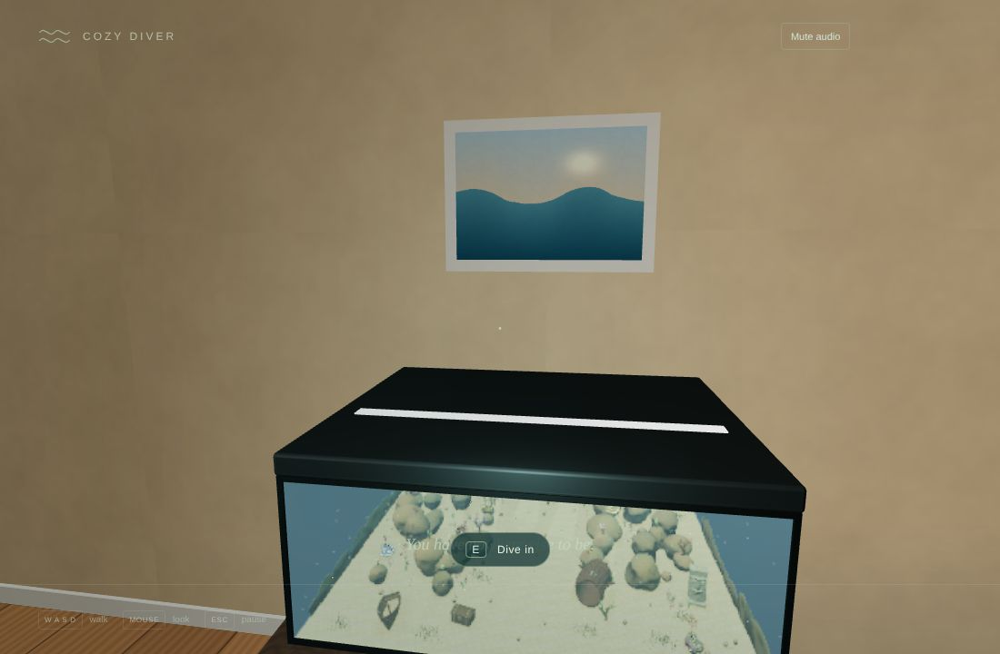
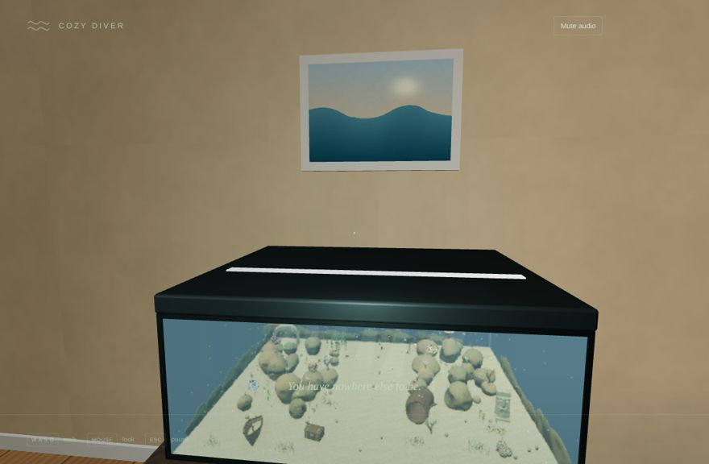
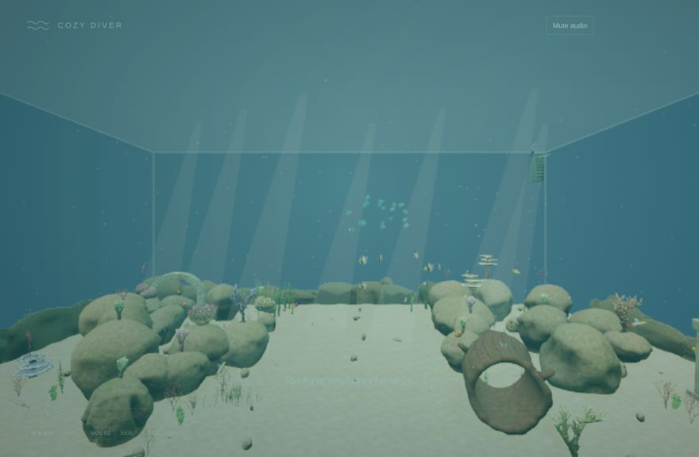
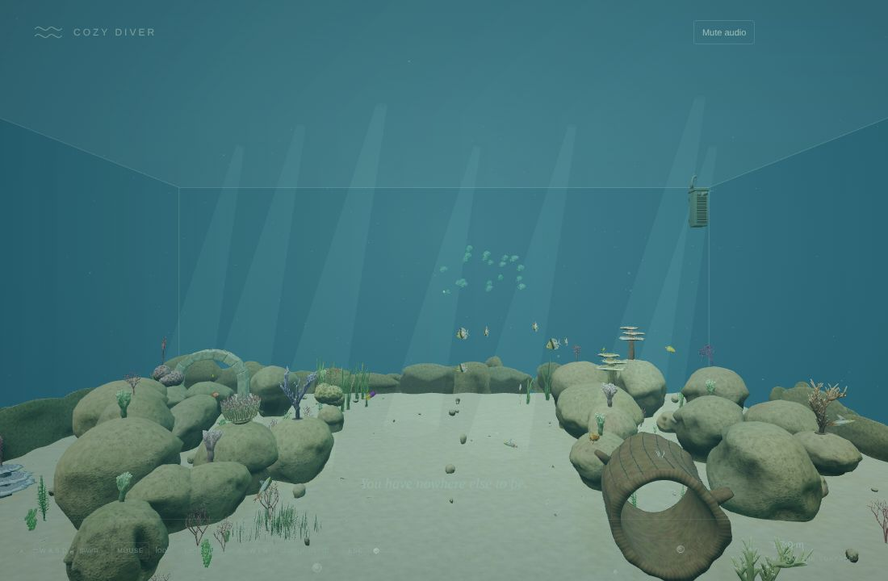
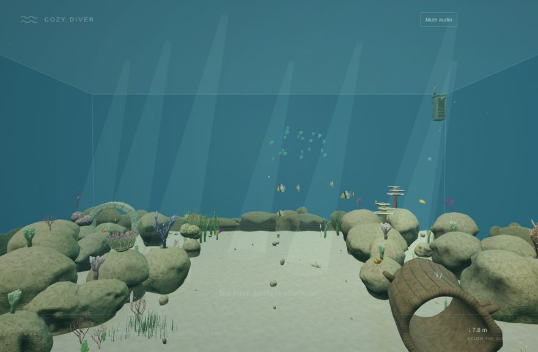
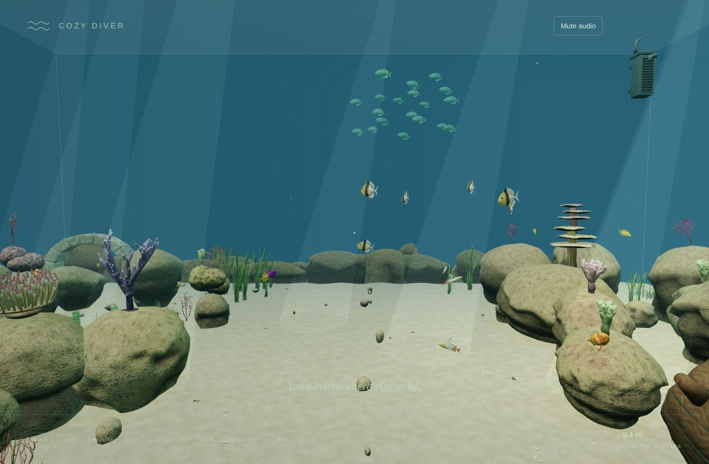
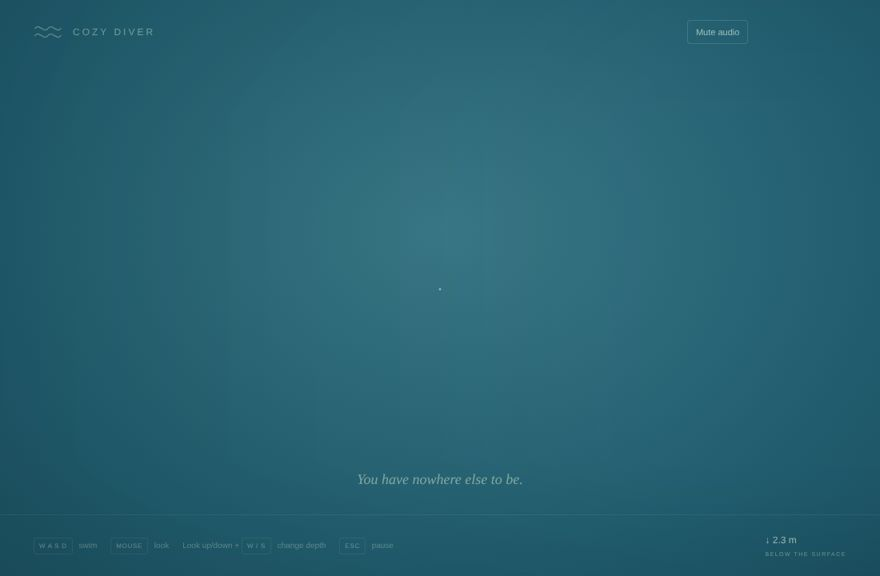
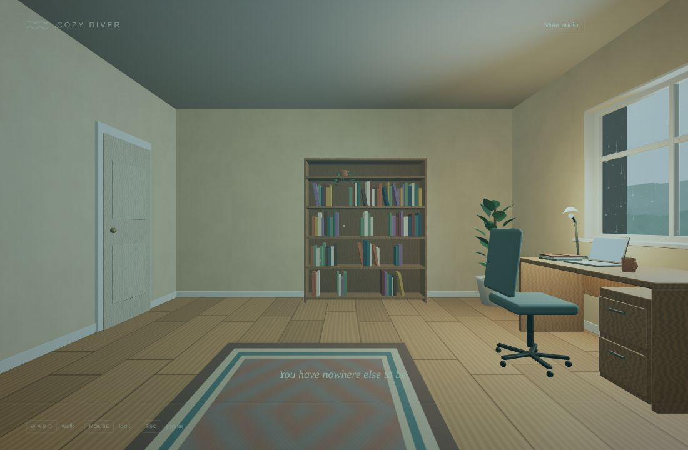
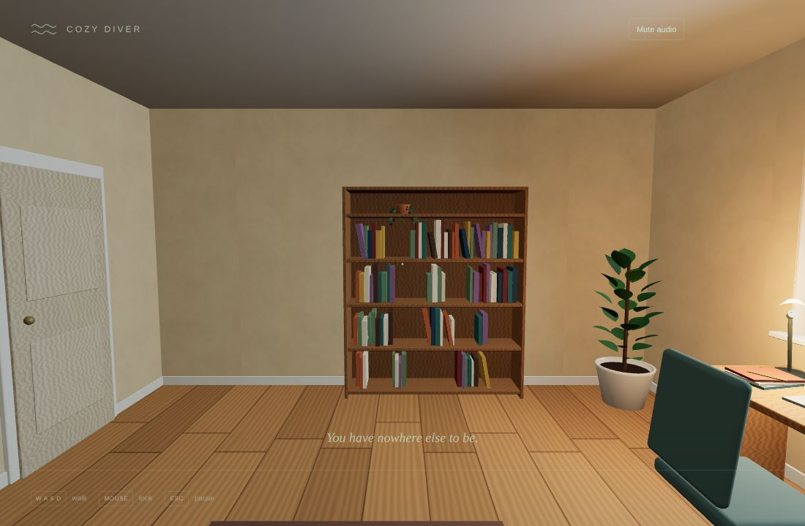

# v0.3 Pass 021 — The Dive

Validation date: November 10, 2026. Candidate `0.3.0-alpha.3` for user review (`0.3.0-alpha.2` plus the refinements in section 6). No merge or release is authorized by this report. Browser evidence is from Linux Chromium with SwiftShader software rendering on localhost. MacBook Air frame time, audio comfort and the look under real GPU lighting are not measured here.

## 1. What was built

- **The prompt.** Walk within 1.6 m of the tank and look at it: **E · Dive in** appears. Near the water's surface (within 1.3 m of the top), **E · Return to the office** appears. Prompts only show while playing (pointer locked) and not during a transition.
- **The dive** (`player/dive.ts`, pure and tested). Press E and the camera glides in front of the tank (1.8 s), leans into the front glass (0.55 s) and, 10 cm from it, switches to the full-size aquarium from the identical mapped viewpoint. It then drifts to the usual swim start (1.9 s) while the haze thickens from the miniature's 0.009 to the underwater 0.026.
  - **Contact:** a soft teal wash peaks (32%) exactly at the crossing and fades on both sides; a burst of bubbles rises as you enter.
  - **Sound:** the office soundscape hands over to the underwater one at the switch.
- **Surfacing.** Press E near the surface: you rise towards the front glass, pass out through it, and stand up in the room 1.05 m from the tank, facing back into the office at 1.6 m eye height, clear of the furniture.
  - **Reverse portal:** while surfacing, the aquarium's front wall shows the office rendered from the swimmer's mapped position (`OfficeScene.renderOutside`). The switch happens 3 cm inside the glass, so the office you see through the glass is the office you step into. Its plane and render target exist only during surfacing and are released when it ends.
- **Reduced motion.** The glide becomes a 0.45 s fade out, a cut and a 0.45 s fade in; there are no bubbles and no reverse portal.
- **Unchanged.** The pause screen still switches spaces instantly. Pointer lock is still only requested by explicit action.

| Moment                              | Capture                                                 |
| ----------------------------------- | ------------------------------------------------------- |
| The prompt in front of the tank     |          |
| Approaching the glass               |        |
| Last office frame before the switch |     |
| First aquarium frame after it       |      |
| Splash                              |          |
| Arrived at the swim start           |         |
| Last aquarium frame surfacing       |  |
| First office frame after it         |   |
| Standing in the room                |     |

## 2. Measurements (`validation/dive.mjs`, real input)

The harness clicks Enter the Office (real pointer lock), stands in front of the tank, waits for the prompt and presses E. It then steps the animation loop by hand at 60 Hz so the frames on each side of the switch are captured exactly.

| Measure                                                                                              | Result                                                         |
| ---------------------------------------------------------------------------------------------------- | -------------------------------------------------------------- |
| Dive prompt / surface prompt                                                                         | "E Dive in" / "E Return to the office"                         |
| Dive seam: mean / median per-channel difference (0–255) between the frames either side of the switch | **11.3 / 6** (alpha.2: 12.9 / 7)                               |
| Surface seam, same measure                                                                           | **5.5 / 2** (alpha.2: 6.5 / 2; 43.9 before the reverse portal) |
| Dive end                                                                                             | aquarium, at the swim start                                    |
| Swimming after the dive (held W)                                                                     | moved 0.31 m (W held until the diver moved)                    |
| Surface end                                                                                          | office, eye height 1.6 m                                       |
| Reduced-motion dive                                                                                  | 0.9 s fade, ends in the aquarium                               |
| GPU memory before the first dive / after dive, surface, reduced dive and return                      | 403 / 112 → 403 / 112 (geometries / textures)                  |
| New shader programs compiled by surfacing                                                            | 0                                                              |
| Console errors                                                                                       | none                                                           |
| JS bundle                                                                                            | 970.99 kB / 275.16 kB gzip (Pass 020: 959.65 / 271.76 kB)      |

- **What remains at the dive seam.** The two frames show the same scene from the same pose, but the miniature is drawn at 0.6× resolution, with distance levels of detail, and through the glass shader; the full aquarium is drawn at full resolution with near levels. The contact wash, at its peak on both frames, covers most of the remaining difference. At 60 fps the switch reads as continuous movement.
- **First run of this harness** found that surfacing left one geometry and one texture allocated (403/112 → 404/113). Both are now released when the transition ends.

## 3. Checks

| Check                                                                         | Result                                                                                                                                                                                                                                                                                                                        |
| ----------------------------------------------------------------------------- | ----------------------------------------------------------------------------------------------------------------------------------------------------------------------------------------------------------------------------------------------------------------------------------------------------------------------------- |
| `npm run build` / `build:benchmark` / `typecheck` / `lint`                    | Pass                                                                                                                                                                                                                                                                                                                          |
| `npm run test -- --maxWorkers=2`                                              | **384 passed**. New: `dive` (11), covering the tank mapping, an identical viewpoint at both switches, contact-wash continuity, smooth steps clear of furniture, the reduced-motion fade, the standing end pose, the prompts and their front-of-glass region, the interruption policy, glass clarity and the bubbling distance |
| `validation/dive.mjs` (new), `validation/dive-interrupt.mjs` (new, section 6) | Pass                                                                                                                                                                                                                                                                                                                          |
| Other browser harnesses, stress suite                                         | Not run in this pass                                                                                                                                                                                                                                                                                                          |

## 4. Known limitations

- **SwiftShader only.** Seam numbers and frame stepping were measured in software rendering; the transition at real frame rates on a GPU still needs a look.
- **Where you surface.** Surfacing always passes out through the middle of the front glass, wherever you were near the surface; the rise there takes 1.7 s.
- **No water surface crossing.** You leave through the front glass (the way you came in), not up through the water surface; the hood hides the surface from the room.
- **Pause screen.** Switching spaces from the pause screen is still an instant cut.
- **Hardware.** MacBook Air frame time and the sound handover are not measured.

## 5. Manual macOS checklist

- [ ] The prompt appears naturally when standing at the tank and looking at it, and not beside it or otherwise.
- [ ] Escape mid-dive, then Return/Enter on the pause screen: the destination resumes smoothly and the origin puts you back where you pressed E, with no jump.
- [ ] The dive feels smooth and inviting, with no visible jump at the glass.
- [ ] The wash and bubbles feel gentle, not flashy.
- [ ] The office sound fading into the underwater sound feels right.
- [ ] Swimming works immediately after arriving.
- [ ] Surfacing from near the top brings you out through the glass with no visible jump, standing comfortably in the room.
- [ ] With reduced motion on, both directions are a short, calm fade.
- [ ] Frame rate stays comfortable through the whole transition, including the first surfacing.

## 6. Refinements before playtest (`0.3.0-alpha.3`)

A self-review and a Codex review of the merged `0.3.0-alpha.2` found the following. Each is now fixed.

| Finding                                                                                                                                                                                                           | Fix                                                                                                                                                                                                                                                                   | Evidence                                                                                                                                        |
| ----------------------------------------------------------------------------------------------------------------------------------------------------------------------------------------------------------------- | --------------------------------------------------------------------------------------------------------------------------------------------------------------------------------------------------------------------------------------------------------------------- | ----------------------------------------------------------------------------------------------------------------------------------------------- |
| **Interrupted transitions could snap** (Codex P1). Escape mid-transition, then a pause-screen choice, discarded the transition without syncing the walking/swimming state, so the camera jumped to an older pose. | An explicit policy (`interruptedChoice`). Choosing the transition's destination resumes it from where it paused. Choosing its origin cancels it, restoring the space and exact pose where E was pressed. Walking/swimming state always matches the camera afterwards. | Unit tests; `dive-interrupt.mjs`: all 8 cases (dive and surfacing × before and after the switch × resume and cancel) pass, with no snap         |
| **Aquarium clock frozen during transitions** (Codex P2). Also, the office ran the miniature on its own wall-clock time, so animation phases jumped at the dive switch.                                            | One aquarium clock: the miniature, the transitions and swimming all use it, and it advances through transitions and pauses with the game.                                                                                                                             | `dive-interrupt.mjs`: the clock stops while paused and while the tab is hidden                                                                  |
| **The dive prompt could appear beside the tank** (Codex P2).                                                                                                                                                      | The prompt needs a bounded region in front of the glass: at least 15 cm out from it and no more than 20 cm past either end. The floor there is open, so nothing can block the view.                                                                                   | Unit tests: no prompt beside or behind the tank; from every offered position, the glide clears the furniture                                    |
| **First-surfacing shader hitch** (Codex P2).                                                                                                                                                                      | The surfacing view's shader is compiled during loading (a temporary plane, disposed straight after). The render target is still created per surfacing and freed afterwards.                                                                                           | `dive.mjs` asserts surfacing compiles 0 new programs. GPU counts are unchanged at startup and after cycles. It adds one program to the warm-up. |
| **Reverse view rendered in a hidden tab** (Codex P2).                                                                                                                                                             | The office's outside render is skipped while the tab is hidden.                                                                                                                                                                                                       | `dive-interrupt.mjs`: 0 outside renders while hidden, resumed after                                                                             |
| **No interruption, visibility or repetition coverage** (Codex P2).                                                                                                                                                | New `validation/dive-interrupt.mjs`: interruptions, a hidden tab mid-surfacing, five full dive/surface cycles and reduced-motion surfacing.                                                                                                                           | Pass. GPU geometries, textures and programs are 403 / 112 / 113 before and after, with no console errors                                        |
| **Per-frame allocation** (self-review). Rendering the miniature allocated a colour every office frame.                                                                                                            | Reused.                                                                                                                                                                                                                                                               | Code                                                                                                                                            |
| **Sound during the dive** (self-review). Bubbling used a fixed distance, and the underwater sound did not follow the drift.                                                                                       | Bubbling follows the real distance to the tank; the underwater soundscape follows the drifting camera.                                                                                                                                                                | Unit test for the distance; listening is on the checklist                                                                                       |
| **Glass clarity hard-coded to one axis** (self-review).                                                                                                                                                           | `glassClarity` is now a pure function built from the shared tank frame.                                                                                                                                                                                               | Unit test                                                                                                                                       |

**A harness finding, not a game leak.** The new harness at first crashed the browser after a few cycles, with the page process growing to over 6 GB. Measured:

- The heap and GPU counts stayed flat.
- Plain swimming with no transition grew the same way under manual stepping, and so did the merged `0.3.0-alpha.2`.
- With the app's own loop, the page process held steady at about 1.25 GB over two minutes.

The cause was the stepping technique: frames rendered back to back in one task are never presented, and SwiftShader's buffers accumulate. Both dive harnesses now yield a real animation frame before each stepped tick, and memory then stays flat (about 1.18 GB over 300 frames). The cost is slower runs.

## 7. Playtest change (`0.3.0-alpha.4`)

- **Eye height 1.6 m → 1.28 m.** The first real playtest found the office fine, but the person felt too tall, so the eye height is 20% lower. It is one constant (`OFFICE.eyeHeight`), and the spawn and the surfacing stand-up both follow it. The harnesses now expect 1.28 m.
