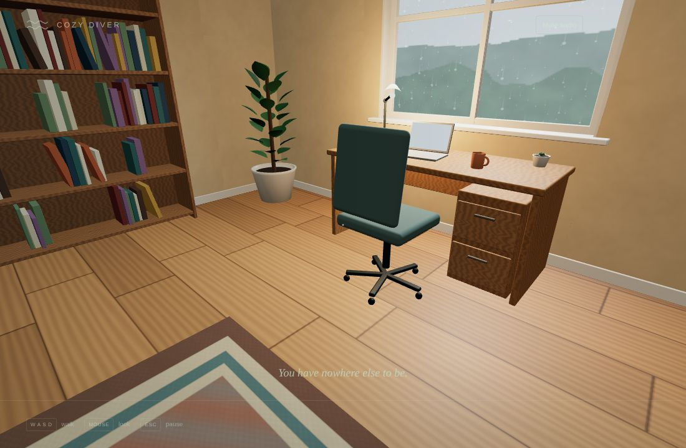
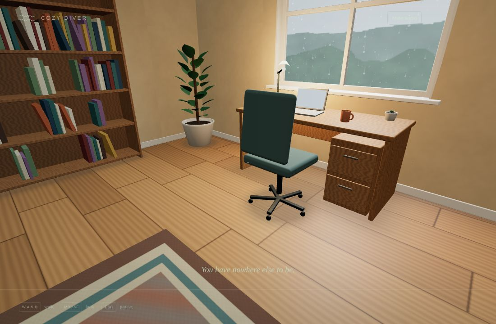
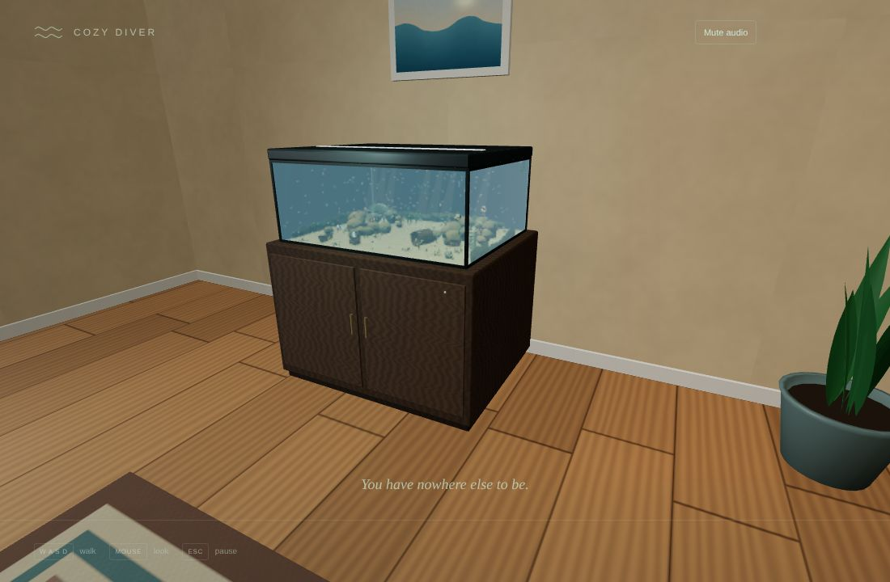
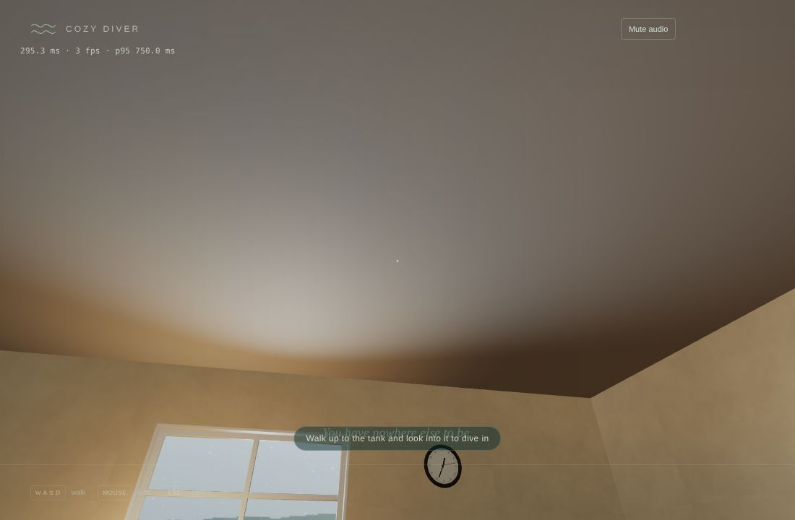
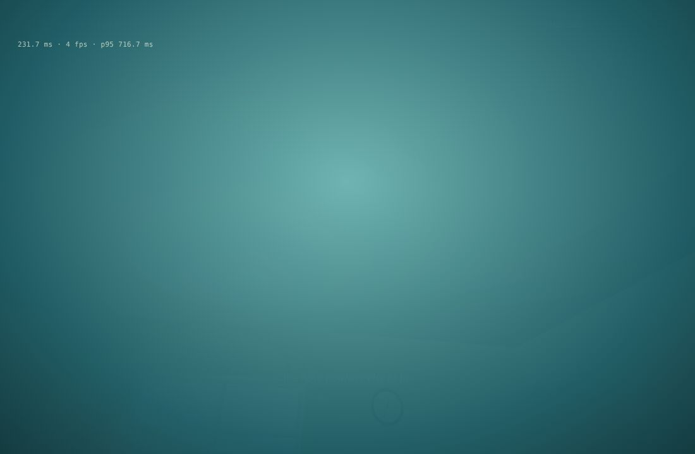
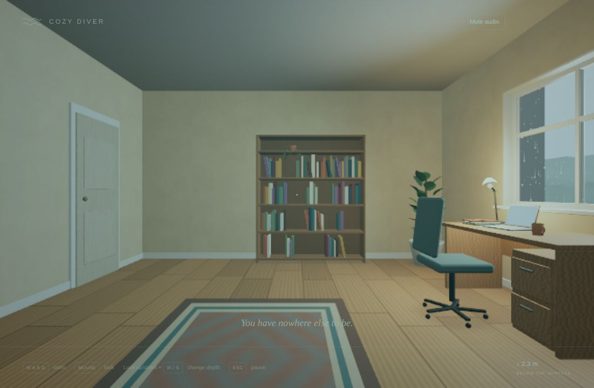
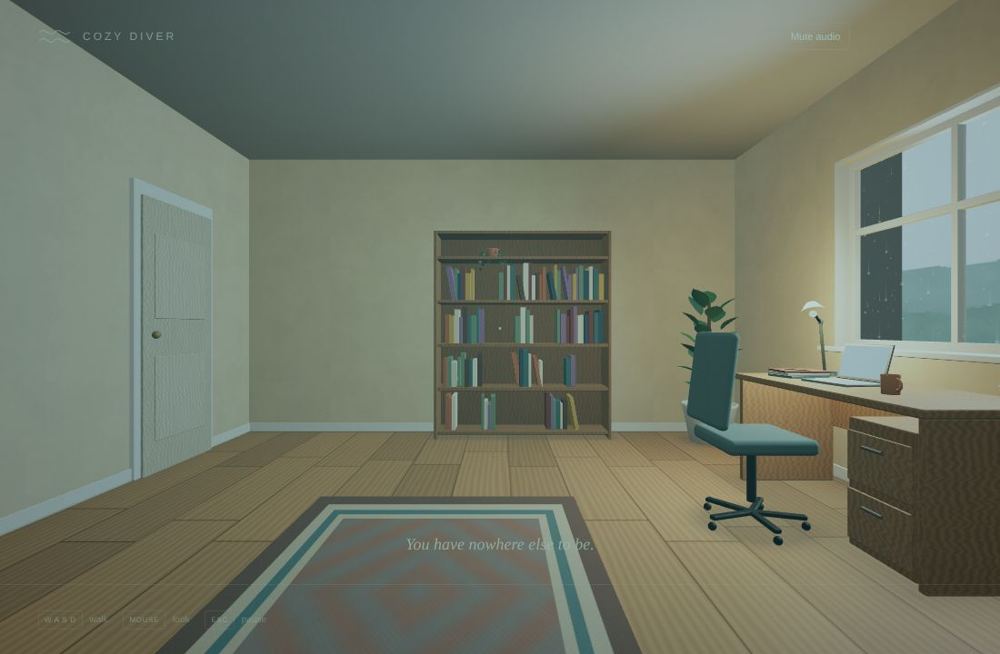
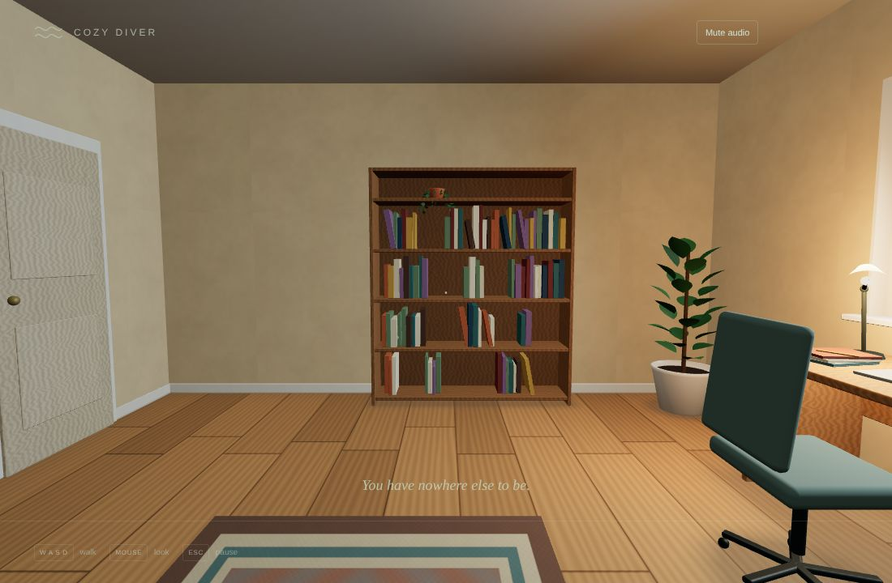

# v0.3 Pass 022 — Polish and acceptance

Validation date: November 11, 2026. Release candidate `0.3.0-rc.1` for v0.3 (Office & Dive Transition), for user review. No merge, release or tag is authorized by this report. v0.3 closes on the user's macOS acceptance.

**Limits of this evidence.** All browser evidence comes from Linux Chromium with SwiftShader software rendering, at 3–5 fps. That cannot show MacBook Air frame time, how the transitions feel at full frame rate, audio comfort, or the look under real GPU lighting. The new frame-time readout exists so you can measure the first of those yourself.

## 1. What changed

| Change                    | Details                                                                                                                                                                                                                                                                                          |
| ------------------------- | ------------------------------------------------------------------------------------------------------------------------------------------------------------------------------------------------------------------------------------------------------------------------------------------------ |
| **Surface where you are** | You leave through the front glass at your own position, kept 3 aquarium units in from either end, and stand 1.05 m in front of that point. The rise takes 0.9 s plus 0.05 s per aquarium unit of distance, between 1.1 and 2.2 s. Pass 021 always used the centre of the glass and a 1.7 s rise. |
| **Calm switching**        | The pause screen's office and water buttons fade (0.45 s out, 0.45 s in) instead of cutting, and each space keeps its own position and look. The fade can be interrupted like a dive. The first entry from the start screen stays a cut, since the overlay already covers the view.              |
| **Sound crossfade**       | Every dive, surfacing and switch carries an underwater share from 0 to 1. It is exactly ½ at the crossing and only moves one way. Both soundscapes play through the transition, mixed by that share, instead of swapping at the glass.                                                           |
| **Contact shadows**       | Soft baked shadows under the desk, chair base, bookshelf, tank cabinet and plant pots, plus a band along each wall's base. They are one merged mesh with vertex-alpha falloff: no texture, no shadow maps, one extra draw call.                                                                  |
| **First-visit hint**      | After 4 s in the office, "Walk up to the tank and look into it to dive in" shows until your first dive. That is stored locally, and storage failures just show the hint again.                                                                                                                   |
| **Frame-time readout**    | Settings → Show frame time (off by default). It shows the mean frame time, fps and 95th-percentile frame time, refreshed twice a second from a fixed 120-frame window, with no per-frame allocation.                                                                                             |

| View                                                        | Capture                                                                                                        |
| ----------------------------------------------------------- | -------------------------------------------------------------------------------------------------------------- |
| Desk and chair: shadows off / on                            |                       |
| Tank cabinet: shadows off / on                              |                           |
| First-visit hint and frame-time readout (top left)          |                                                                   |
| Pause-screen switch, mid-fade                               |                                                                   |
| Surfacing from aquarium x −3: last water / first room frame |   |
| Standing in front of that part of the glass                 |                                                              |

The office capture's upward camera angle comes from the harness's mouse click for pointer lock, not from the game's start view.

## 2. Checks

| Check                                                      | Result                                                                                                                                                                                                                                                                                                                                                                                   |
| ---------------------------------------------------------- | ---------------------------------------------------------------------------------------------------------------------------------------------------------------------------------------------------------------------------------------------------------------------------------------------------------------------------------------------------------------------------------------- |
| `npm run build` / `build:benchmark` / `typecheck` / `lint` | Pass. JS bundle 977.8 kB / 277.7 kB gzip (Pass 021: 971.3 / 275.4 kB)                                                                                                                                                                                                                                                                                                                    |
| `npm run test`                                             | **414 passed**. New coverage: • surfacing from seven positions: identical viewpoint at the crossing, exit at your position, clear of furniture, smooth • rise timing • the pause-screen fade • the sound crossfade for every transition kind • contact-shadow layout, falloff, containment and single disposal • the frame meter • the new setting and hint storage |
| `npm run test:stress`                                      | **10 passed**, including the 5-, 15- and 30-minute ecosystem soaks. It first failed on a stale hull count: see section 3                                                                                                                                                                                                                                                                 |

### Browser regression (every harness in `validation/`, run one at a time)

| Harness                                                                                                                  | Result                                                                                                                                                                                                                      |
| ------------------------------------------------------------------------------------------------------------------------ | --------------------------------------------------------------------------------------------------------------------------------------------------------------------------------------------------------------------------- |
| `office.mjs`                                                                                                             | Pass. Walked 2.02 m at 1.28 m eye height; three pause-screen round trips (now fades); GPU memory unchanged; 0 WebGL errors. Office draw calls 13–23 across five views (Pass 020: 11–21; shadows add one)                    |
| `dive.mjs`                                                                                                               | Pass. Dive seam 11.3 / 6 (mean / median per-channel difference). Surface seam 6.4 / 2. Surfacing compiles 0 new programs and ended in front of where the diver was (office z −0.083 m = aquarium x −3 ÷ 36)                 |
| `dive-interrupt.mjs`                                                                                                     | Pass, 5 cycles: 8 interruption cases, hidden tab, reduced-motion surfacing. GPU geometries / textures / programs 404 / 112 / 117 before and after                                                                           |
| Soak (`COZY_CYCLES=20`)                                                                                                  | 17 full cycles in 45 min, then stopped by the per-harness time limit (no failure). Each cycle: dive, swim, surface, and a pause-screen fade there and back. 404 / 112 / 117 and a 157 MB heap in every one of the 17 cycles |
| `lifecycle.mjs`                                                                                                          | Pass: audio, settings migration, mute, Escape freeze, four pause/resume cycles, visibility, disposal                                                                                                                        |
| `browser.mjs` (120 samples)                                                                                              | Pass                                                                                                                                                                                                                        |
| `integration.mjs`                                                                                                        | Pass, including the no-pointer-lock, rejected-lock and lost-lock paths                                                                                                                                                      |
| `production.mjs` (built preview)                                                                                         | Pass                                                                                                                                                                                                                        |
| `load-budget.mjs`, `asset-smoke.mjs` (benchmark build), `visual-benchmark.mjs`                                           | Pass                                                                                                                                                                                                                        |
| `texture-memory.mjs`                                                                                                     | Pass: 62 / 62 textures GPU-compressed, 20.67 MiB                                                                                                                                                                            |
| `ornaments`, `anchored-life`, `discoveries`, `geometry-overhaul`, `creature-overhaul`, `fish-overhaul`, `playtest-fixes` | Pass                                                                                                                                                                                                                        |
| `reef-overhaul.mjs`                                                                                                      | Pass after the same hull-count update (section 3)                                                                                                                                                                           |
| Console errors                                                                                                           | None in any harness                                                                                                                                                                                                         |

GPU geometries are now 404 in the office (403 in Pass 021). The extra one is the contact-shadow mesh.

## 3. Found during the regression run

- **Stale hull count since Pass 019.** `validation/ecosystem.test.ts` and `validation/reef-overhaul.mjs` still expected 216 authored collision hulls. The Pass 019 round-2 shipwreck redesign added 68: its commit records 503 hulls in the aquarium, up from 435, and 216 + 68 = 284. Neither suite was run in Passes 019–021, so this went unnoticed. Both now expect the measured 284, with a comment saying why. Pass 022 changes nothing in the aquarium.
- **Duplicate element id, caught in the browser before commit.** The frame-time checkbox and its readout first shared an id, so the readout wrote into the checkbox. Fixed (`frame-readout`) and re-verified with real input.
- **Harness timing.** Pause-screen switches are no longer instant, so `office.mjs`, `dive.mjs` and `dive-interrupt.mjs` now wait for the fade to finish.

## 4. Known limitations

- **Software rendering only.** Every timing here is SwiftShader at 3–5 fps. Use the frame-time readout on the MacBook Air.
- **Sound crossfade.** It is checked for continuity, not by ear; the levels need a listen on real speakers.
- **Shadows.** They are baked under fixed furniture: nothing moves in the office, and the clock, lamp and items on the desk cast none. There are still no real-time shadows.
- **Leaving the tank.** You leave through the front glass, never up through the water's surface, as agreed for v0.3.
- **First entry.** The first entry from the start screen is still a cut, by design.
- **The hint.** It is per browser profile: clearing site data shows it again.

## 5. macOS acceptance checklist (v0.3)

- [ ] The office feels calm and grounded; the contact shadows read as soft and natural, not as dark stains.
- [ ] The first-visit hint appears after a few seconds and is gone for good after your first dive.
- [ ] The dive feels seamless, and the sound gently changes from room to water as you go through.
- [ ] Surfacing from different spots (left, right, far back) brings you out in front of the matching part of the glass, standing comfortably.
- [ ] Switching office ↔ water from the pause screen is a calm fade; Escape mid-fade, then either button, behaves sensibly.
- [ ] Swimming holds a steady chill speed while held, and glides to a stop a couple of seconds after letting go.
- [ ] Settings → Show frame time: note the mean and p95 in the office, in the water and during a dive. Aim for about 16.7 ms mean, with p95 well under 33 ms.
- [ ] Reduced motion: dive, surfacing and switching are all short fades.
- [ ] A 15–30 minute session stays smooth, with no audio or visual glitches.
