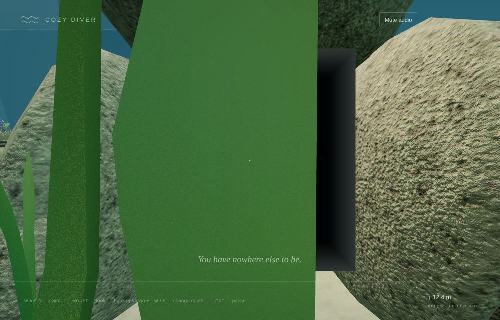
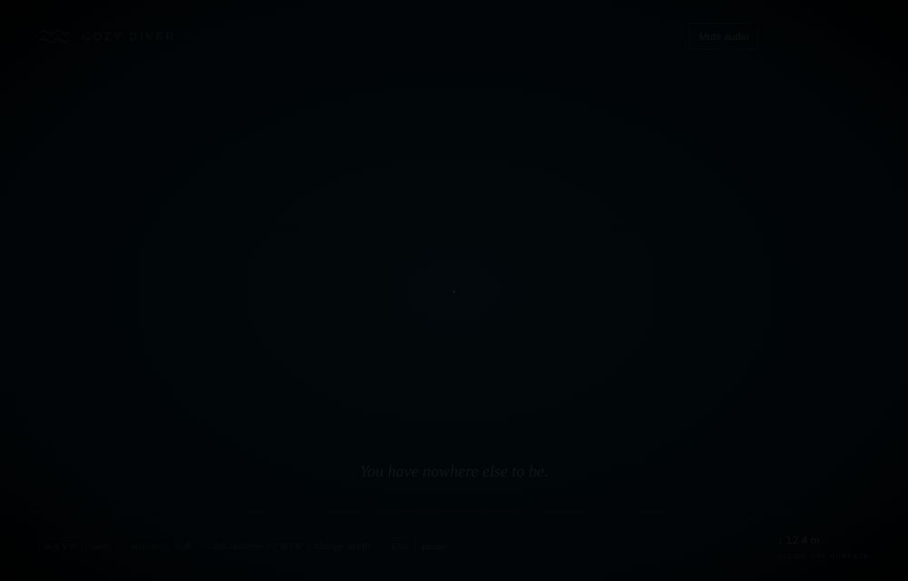
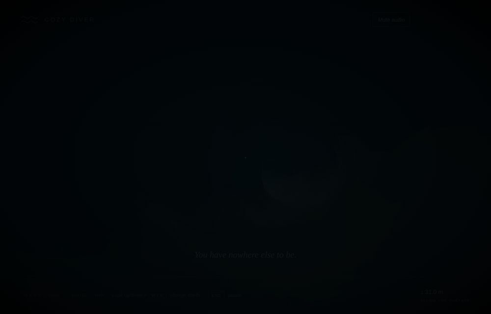
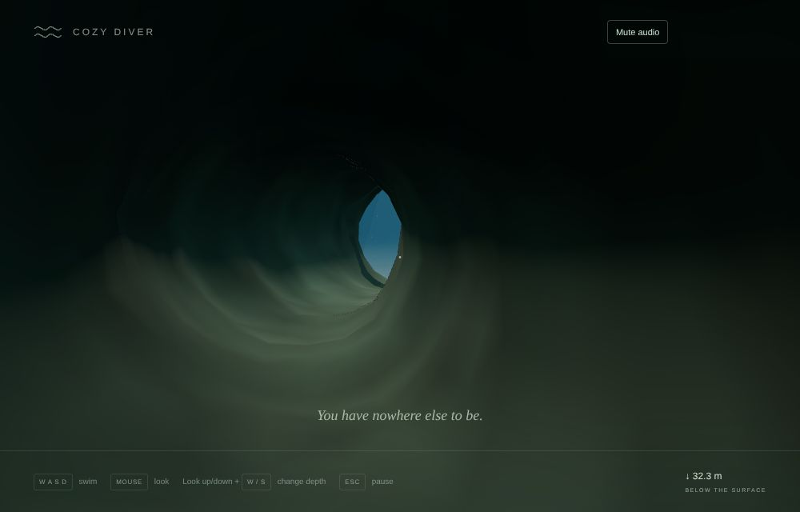
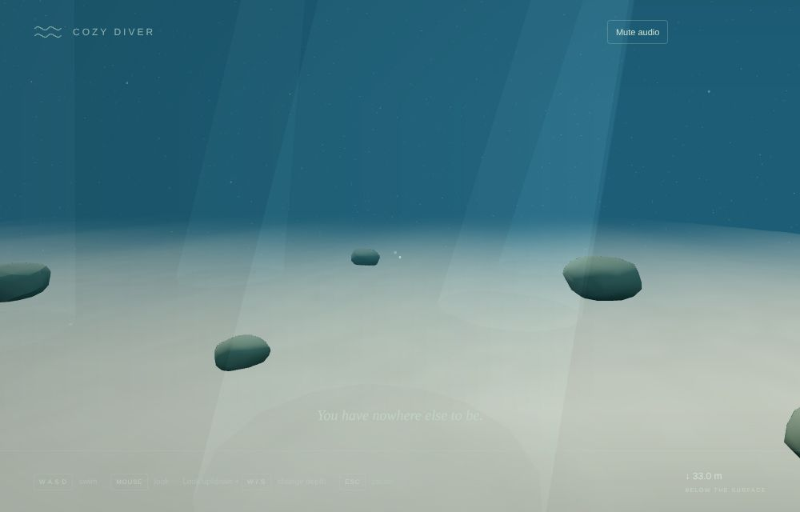
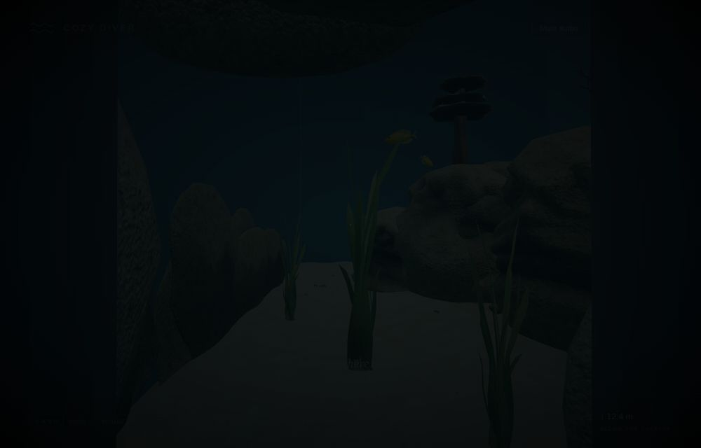
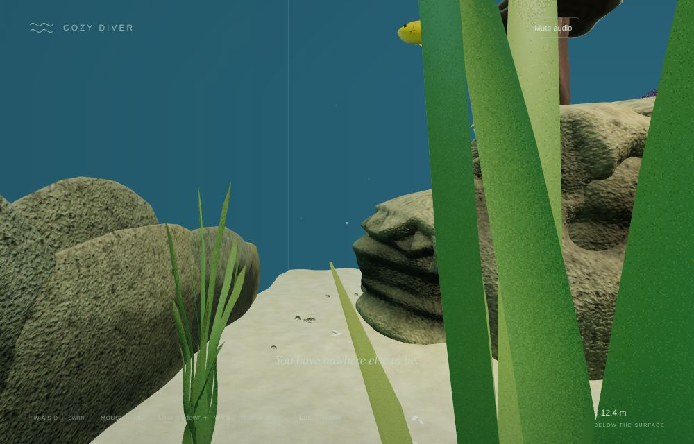

# v0.4 Pass 023 — The opening

Validation date: November 11, 2026. Candidate `0.4.0-alpha.1`, the first pass of v0.4 First Passage (order swapped with Personalization after v0.3 was accepted at `0.3.0-rc.1`). No merge or release is authorized by this report.

**Limits of this evidence.** All browser evidence comes from Linux Chromium with SwiftShader software rendering, so frame rate on the MacBook Air is not measured. The outer waters are a deliberate placeholder in this pass.

## 1. What was built

See [the passage architecture](PASSAGE.md).

- **A hidden crevice.** A rock outcrop in the tank's back-right corner, built from seven convex boulders around an open channel and dressed in the reef's own rock material. Its crack opens into the alley between the right bank and the back glass, screened by seagrass, and is out of view from the swim start.
  - **Clearances:** the central sand channel stays clear along its whole length, and every plant's metadata point stays clear (tested).
  - **Order:** it is added after everything else, so earlier placements drawn from the shared random stream are unchanged.
- **A seamless passage.** Deep inside the crack, darkness peaks. Past the threshold the swimmer continues in the outer waters' tunnel from the identical relative pose: position, velocity, thrust, resting depth and look all carry across. Control never stops and held keys keep swimming. Swimming back reverses it.
- **The outer waters (placeholder).** A winding 30 m tunnel through a cliff opens 7 m above a sand plain in open blue water, with boulders, motes and light shafts.
  - **Sealing:** 233 convex hulls seal the tunnel and cliff.
  - **What's next:** Pass 024 replaces this area with the outer reef.
- **One world at a time.** The outer waters are built within 11 m of the mouth and kept within 17 m. They are released after 4 s further away; only the current water world renders.
- **Return to the tank.** A pause-screen option in the outer waters. It arrives 1.4 m outside the mouth, facing out, and fades in from darkness.
- **Sightings journal (foundation).** A versioned local journal plus a dwell-based tracker: about 1.5 s in view, within 6 m. It is wired into the water worlds, but nothing in the outer waters counts as a sighting until creatures arrive in Pass 025.
- **Scope.** `docs/ROADMAP.md` and `AGENTS.md` now record the v0.4/v0.5 swap and the agreed gentle discovery unlocks.

| Moment                                     | Capture                                                                                        |
| ------------------------------------------ | ---------------------------------------------------------------------------------------------- |
| The crack, from the alley                  |                                                       |
| Last tank frame / first outer-waters frame |   |
| In the tunnel, light ahead                 |                                                      |
| Out of the cliff, into open water          |                                                  |
| Swum back: in the crack again              |                                               |
| After Return to the tank                   |                                                    |

## 2. Measurements (`validation/passage.mjs`, real input)

| Measure                                                           | Result                                                                    |
| ----------------------------------------------------------------- | ------------------------------------------------------------------------- |
| Outer waters loaded on approaching the crack                      | Yes, ready before the swimmer reached the threshold                       |
| Main-thread cost of building them                                 | 73 ms (SwiftShader; shader warm-up is asynchronous)                       |
| Darkness either side of the swap                                  | 0.94 / 0.94                                                               |
| Swap position (tank → tunnel)                                     | 2.57 m along the channel → 0.08 m down the tunnel, the same relative pose |
| Steering through the tunnel                                       | Out of the cliff at z −34.7, 7 m above the sand                           |
| Pause → office → water from the outer waters                      | Back in the outer waters at the same place                                |
| Swimming back through the tunnel                                  | Back in the crack's channel (x 2.66)                                      |
| Return to the tank                                                | Outside the mouth, darkness 1 fading to 0                                 |
| Released far from the crack; GPU geometries / textures / programs | 412 / 112 / 119 before and after                                          |
| Console errors                                                    | None                                                                      |

## 3. Checks

| Check                                                     | Result                                                                                                                                                                                                                                                                                                                                                                                                                                              |
| --------------------------------------------------------- | --------------------------------------------------------------------------------------------------------------------------------------------------------------------------------------------------------------------------------------------------------------------------------------------------------------------------------------------------------------------------------------------------------------------------------------------------- |
| `npm run build` / `typecheck` / `lint`                    | Pass. JS bundle 995.7 kB / 283.9 kB gzip (Pass 022: 977.8 / 277.7 kB)                                                                                                                                                                                                                                                                                                                                                                               |
| `npm run test`                                            | **429 passed**. New, in `passage` (11): • mapping and its round trip, the swap with hysteresis, darkness continuity, the return pose • the crevice: clear channel, central channel untouched, reachable threshold, sealed in every direction, every reachable point maps to open tunnel • the outer waters: swimmable through the cliff, sealed, single disposal New, in `journal` (4): storage tolerance, dwell, glances, already seen |
| `npm run test:stress`                                     | **10 passed**, after the exact-count updates below                                                                                                                                                                                                                                                                                                                                                                                                  |
| `validation/passage.mjs` (new)                            | Pass (section 2)                                                                                                                                                                                                                                                                                                                                                                                                                                    |
| `office.mjs`, `dive.mjs`                                  | Pass. Dive seam 11.3, surface seam 5.9; surfacing compiles 0 new programs; GPU memory unchanged                                                                                                                                                                                                                                                                                                                                                     |
| `lifecycle.mjs`                                           | Pass after the count updates: 575 geometries (567 + 8: seven boulders and the liner), 111 materials (+2: the crevice's rock and liner), 515 hulls                                                                                                                                                                                                                                                                                                   |
| `discoveries.mjs`, `reef-overhaul.mjs`, `integration.mjs` | Pass. Hull counts updated: 515, and 296 in the fallback                                                                                                                                                                                                                                                                                                                                                                                             |
| `production.mjs` (built preview)                          | Pass                                                                                                                                                                                                                                                                                                                                                                                                                                                |
| Other harnesses                                           | Not rerun in this pass (all passed in Pass 022, and nothing they cover changed)                                                                                                                                                                                                                                                                                                                                                                     |

**Updated exact counts.** The crevice adds 12 convex hulls: 7 rocks and 5 thin plates sealing its channel. These counts change by exactly that, with the reason recorded beside each:

- the aquarium's colliders: 139 → 151, or 503 → 515 with the authored reef;
- the stress suite's authored hulls: 284 → 296, and its procedural hulls: 139 → 151;
- the discoveries and lifecycle harnesses: 503 → 515;
- the reef harness fallback: 284 → 296.

## 4. Known limitations

- **Placeholder outer waters:** a sand plain, boulders and a cliff, with no life, coral or soft edges yet. All of that is Pass 024.
- **Sound:** the underwater soundscape continues unchanged in the outer waters; its effects are placed for the tank.
- **The tank pauses** while you are in the outer waters. The office miniature still shows it.
- **The crack's mouth** is a dark, roughly rectangular opening between rounded boulders. It should read as a natural crack; please judge it in play.
- **Build hitch:** building the outer waters costs about 70–80 ms of main thread in software rendering, as you approach the crack. Check for a hitch on the Mac.
- **Hardware:** MacBook Air frame time is not measured.

## 5. Manual macOS checklist

- [ ] The crack is hidden but discoverable: not visible from the start, found by exploring the back-right corner behind the rocks.
- [ ] Swimming into the crack feels natural: it darkens, and you emerge in the tunnel with no jump or stutter.
- [ ] No hitch as you approach the crack (the outer waters are built then). Check with Settings → Show frame time.
- [ ] The tunnel feels calm and leads somewhere: light ahead, then open blue water.
- [ ] Swimming back through the tunnel returns you to the crack.
- [ ] Return to the tank works from the pause screen.
- [ ] The office and the dive still work as in v0.3.
