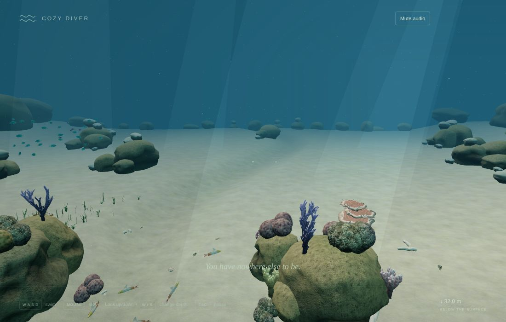
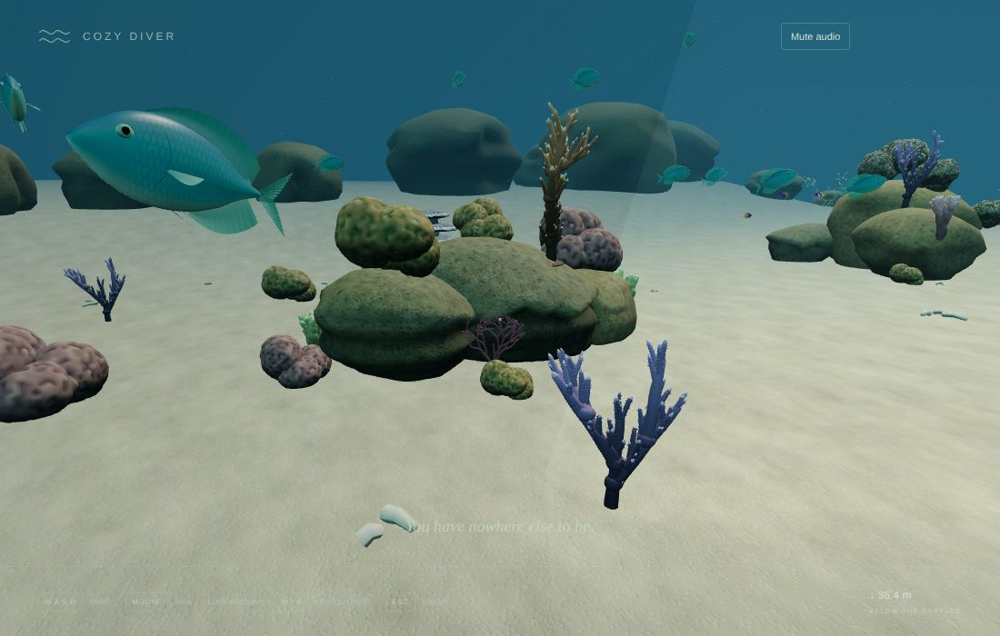
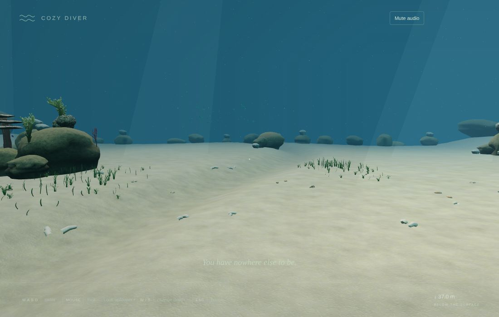
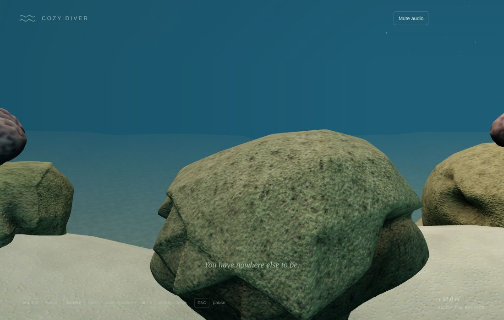
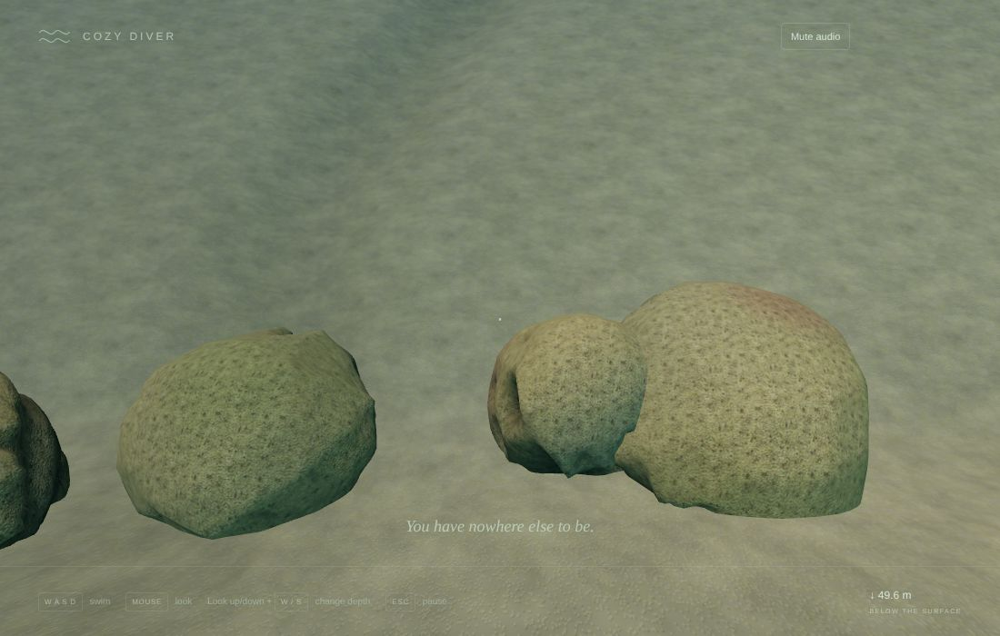
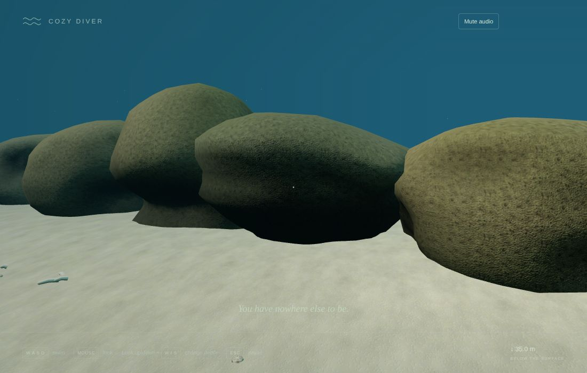

# v0.4 Pass 024 — The outer reef

Validation date: November 11, 2026. Candidate `0.4.0-alpha.2` for user review. No merge or release is authorized by this report.

**Limits of this evidence.** All browser evidence comes from Linux Chromium with SwiftShader software rendering, so frame rate on the MacBook Air is not measured. The triangle and draw counts below are what the Mac's GPU will be asked to draw. For context, the tank's own close-up views were about 1.0 M triangles in Pass 017, and your playtests found the frame rate good.

## 1. What was built

See [the outer reef](OUTER_REEF.md).

- **A real reef beyond the tunnel**, replacing Pass 023's placeholder:
  - a sand plain with a winding channel, and a drop-off falling 23 m into deep blue;
  - eleven coral heads (rock mounds crowned with colonies, with massive corals at their feet and soft corals and sea fans on their flanks);
  - lone colonies, six seagrass meadows and about 300 shells and pieces of rubble;
  - reef along the drop-off's lip, a rocky wall below it, and big rocks framing the sides.
- **Built from the tank's own art library**, leased from the tank's loader, so nothing decodes twice.
  - **Instancing:** every piece is instanced per template and detail level, and re-sorted by distance a few times a second.
  - **Seating:** colonies sit exactly on the rock beneath them.
  - **Fallback:** if the library cannot load, plain rocks stand in at the same places.
- **About 100 reef fish** in six schools beside the coral heads. They use the tank's species, behaviour and authored rigs (again leased from the tank's loader), and switch to their light rigs at 8 body lengths (14 in the tank).
- **Soft edges.** A gentle current turns the swimmer back near the reef's edges and high up, instead of a wall.
- **The seabed is the floor.** You can swim down the drop-off.
- **Collision for about 1,400 hulls.** A uniform grid hands the solver only the nearby ones.
- **Sound.** The soundscape's small sounds come from the coral heads while you are out here.
- **Loading.** It starts at 15 m from the crack (11 m in Pass 023) and releases beyond 22 m. The outer scene uses the tank's light setup, so it reuses the tank's compiled shaders: it adds 1 program, not dozens.

| View                          | Capture                                          |
| ----------------------------- | ------------------------------------------------ |
| Out of the tunnel             |  |
| A coral head and its fish     |      |
| The sand channel and seagrass |         |
| The drop-off's lip            |        |
| Down the wall                 |   |
| The reef's edge               |       |

## 2. Measurements (`validation/outer-reef.mjs`, real input)

| View           | Draw calls | Triangles | CPU submit (ms, SwiftShader) | Reef pieces drawn / reef draws |
| -------------- | ---------- | --------- | ---------------------------- | ------------------------------ |
| From the cliff | 80         | 595 k     | 8.2                          | 263 / 45                       |
| Coral head     | 75         | 1.14 M    | 11.2                         | 466 / 49                       |
| Channel        | 66         | 828 k     | 3.2                          | 521 / 53                       |
| Drop-off       | 31         | 404 k     | 4.3                          | 229 / 45                       |
| Reef edge      | 29         | 465 k     | 5.2                          | 240 / 40                       |

| Check                                                                    | Result                                                                                  |
| ------------------------------------------------------------------------ | --------------------------------------------------------------------------------------- |
| Shader programs: tank / with the outer reef                              | 119 / 120                                                                               |
| Main-thread long tasks while the reef prepares                           | 1 (336 ms); an earlier run measured 1.5 s. See section 4                                |
| Preparation steps (separately timed)                                     | Environment 54 ms, reef 95 ms, fish 42 + 27 ms, collision grid 8 ms (about 1,400 hulls) |
| Fish                                                                     | 100; 99 moved within 2 s; none below the sand                                           |
| Diving straight down with W                                              | Rests exactly on the seabed (0.094 m, the floor)                                        |
| Swimming down the drop-off                                               | Reached −9.7 m over the wall                                                            |
| Holding W towards the reef's edge                                        | Turned back by the current at x 53.9 (edge band 46–54, hard bound 59.35)                |
| GPU memory: tank / after visit 1 and release / after visit 2 and release | 412 / 112 each time: nothing kept, nothing growing                                      |
| Console errors                                                           | None                                                                                    |

**Where the triangles go.** In the busiest view, a coral head seen from close up, corals account for about 0.5 M triangles and fish about 0.3 M, before frustum culling. To get there:

- full-detail massive colonies (82 k each) are limited to within 6 m;
- a 1.3 k mound stands in for them from 28 m;
- colonies are weighted towards massive corals, which have the light far level;
- fish switch to their light rigs sooner than in the tank.

## 3. Checks

| Check                                                                                                                                  | Result                                                                                                                                                                                                                                                                                                      |
| -------------------------------------------------------------------------------------------------------------------------------------- | ----------------------------------------------------------------------------------------------------------------------------------------------------------------------------------------------------------------------------------------------------------------------------------------------------------- |
| `npm run build` / `typecheck` / `lint`                                                                                                 | Pass. JS bundle 1,013.5 kB / 290.0 kB gzip (Pass 023: 995.7 / 283.9 kB)                                                                                                                                                                                                                                     |
| `npm run test`                                                                                                                         | **440 passed**. New, in `outer-reef` (11): seabed channel and drop-off, soft-edge current, deterministic layout and its constraints, sand burial, exact seating on hulls, detail levels and culling, the collider grid against brute force, the seabed floor, and outer schools spawning beside their heads |
| `npm run test:stress`                                                                                                                  | 10 passed                                                                                                                                                                                                                                                                                                   |
| `validation/outer-reef.mjs` (new)                                                                                                      | Pass (section 2)                                                                                                                                                                                                                                                                                            |
| `validation/passage.mjs`                                                                                                               | Pass. The swap is unchanged (darkness 0.94 / 0.94). After the reef is released, GPU geometries / textures / programs are 412 / 112 / 119, as before it loaded                                                                                                                                               |
| `office.mjs`, `dive.mjs`, `lifecycle.mjs`, `discoveries.mjs`, `reef-overhaul.mjs`, `integration.mjs`, `production.mjs` (built preview) | Pass                                                                                                                                                                                                                                                                                                        |
| Console errors                                                                                                                         | None in any harness                                                                                                                                                                                                                                                                                         |

## 4. Known limitations

- **No new species yet.** The fish are the tank's six species in bigger schools. New reef species need new models and come with Pass 025's modelling.
- **The reef is calm and static.** Nothing reacts to the swimmer except the fish, as in the tank.
- **Shader compilation on first visit.** SwiftShader cannot compile shaders in parallel, so one new program compiles on the main thread while the reef prepares: 0.3–1.5 s in these runs. Real GPUs with parallel compilation (Chrome on macOS) do this in the background, but it is not measured here. Check for a hitch near the crack on the Mac.
- **Triangles near coral heads.** Up to about 1.1 M in the busiest views, comparable to the tank's accepted close-ups but not yet measured on the Mac.
- **Sound.** The tank's soundscape continues out here, with its small sounds moved to the coral heads; there is no distinct open-water bed yet.
- **The tank pauses** while you are outside it, as in Pass 023.

## 5. Manual macOS checklist

- [ ] The reef feels inviting and natural: coral heads, the sand channel, seagrass, fish schools.
- [ ] Settings → Show frame time: note the mean and p95 at a coral head, over the channel and at the drop-off.
- [ ] No hitch as you approach the crack (the reef is prepared then).
- [ ] Corals sit on their rocks; nothing floats.
- [ ] The drop-off is a nice moment, and swimming down it feels calm.
- [ ] Near the edges the current turns you back gently, never abruptly.
- [ ] Return through the tunnel or with Return to the tank; the tank, the office and the dive still work as before.
