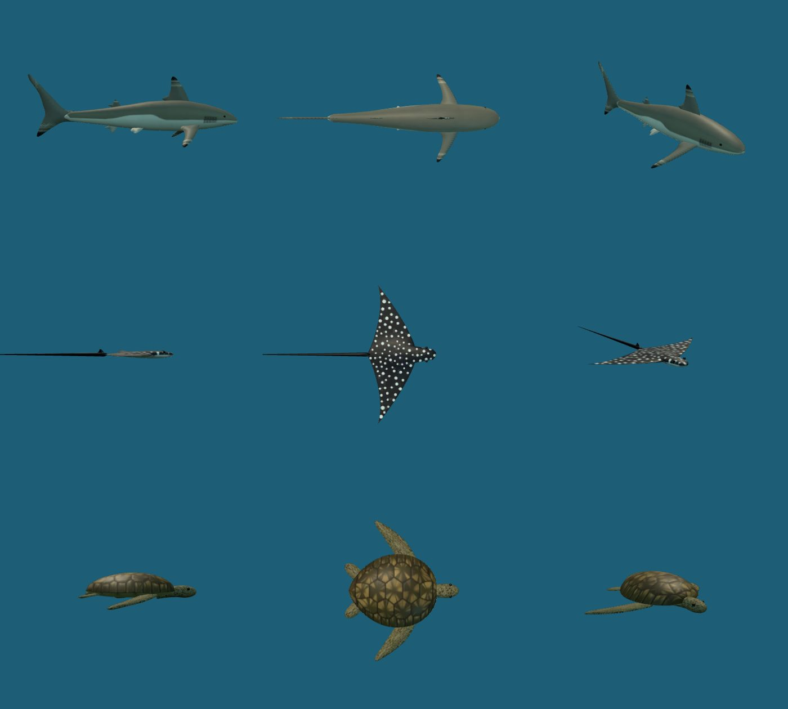
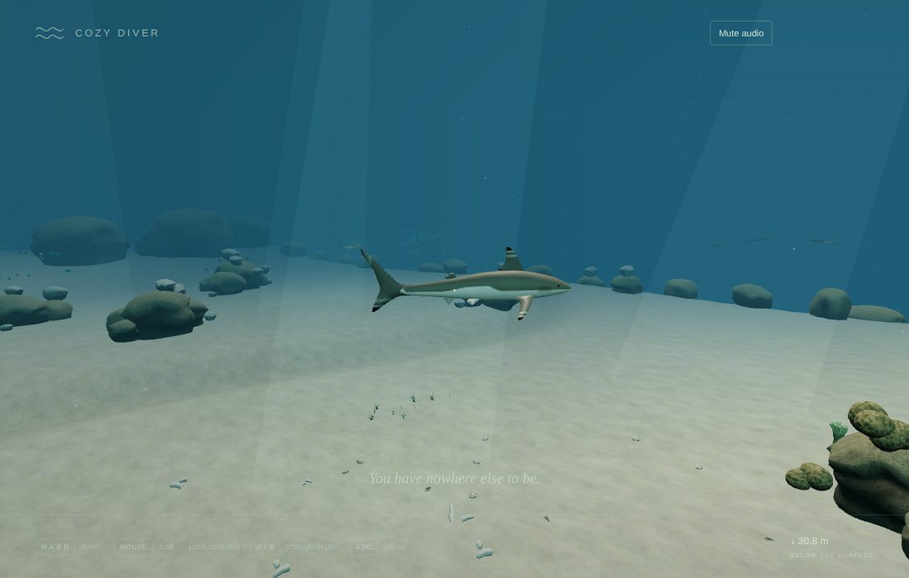
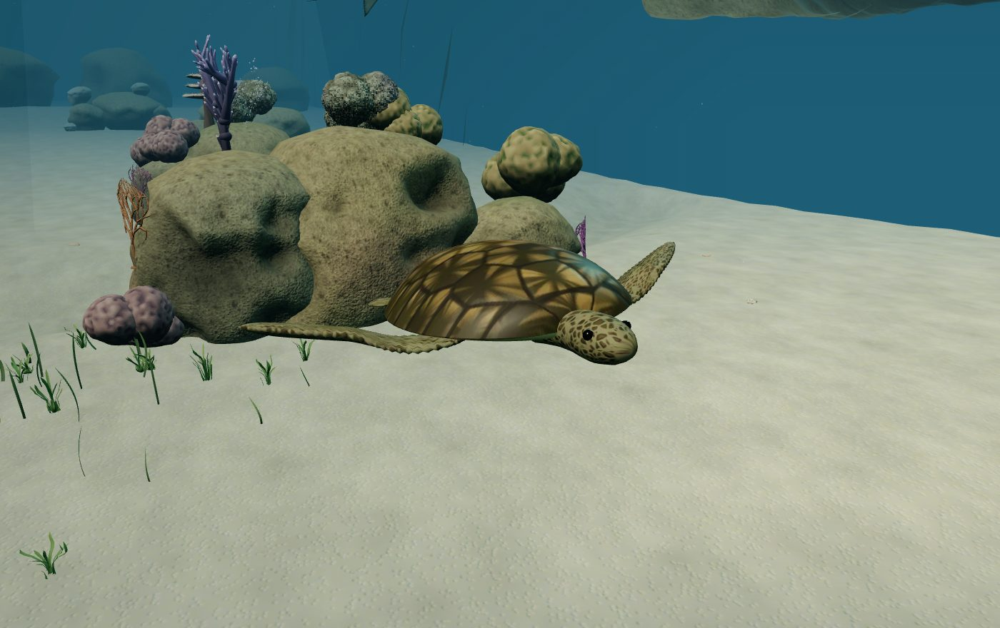
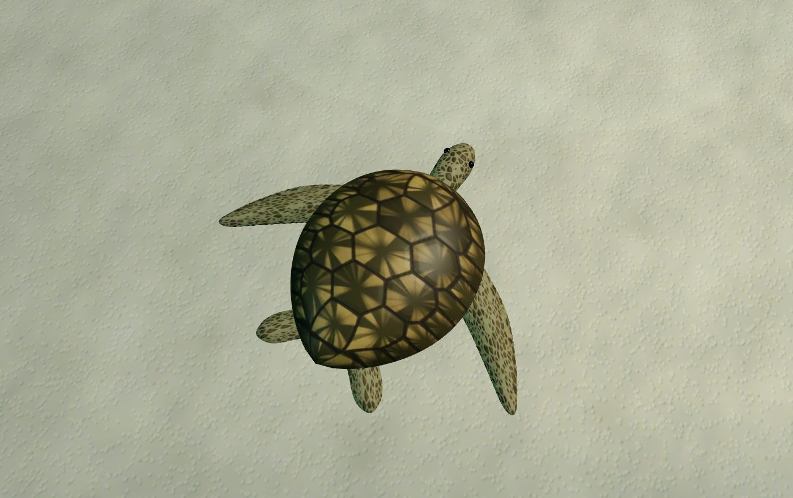
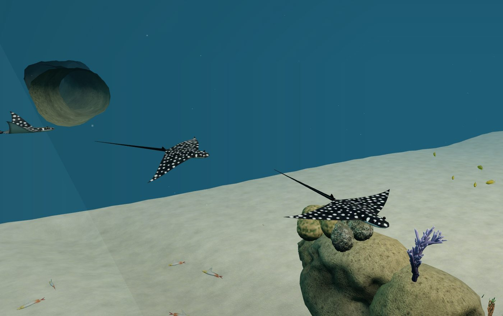
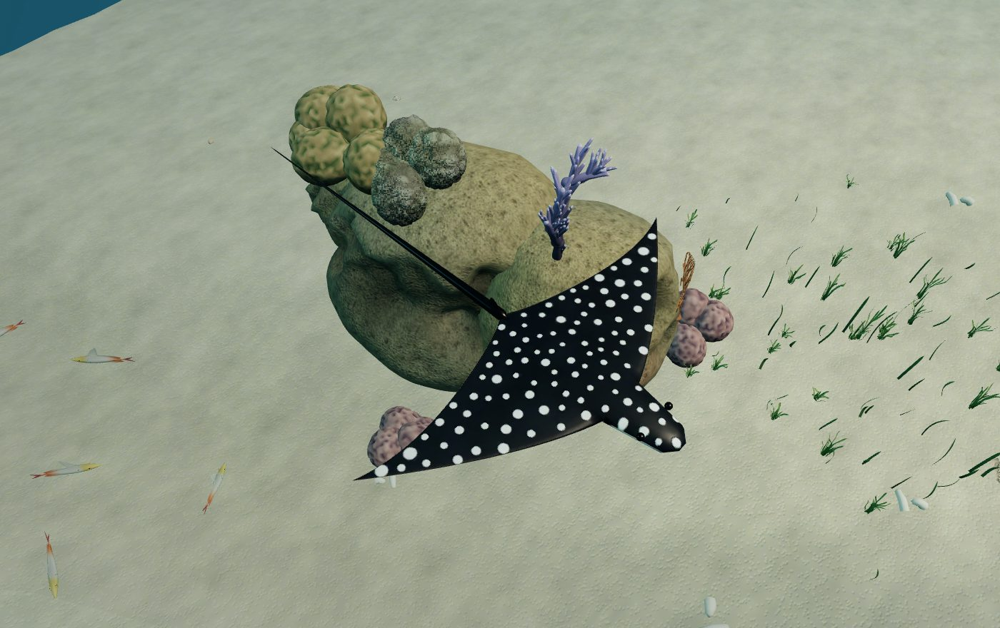
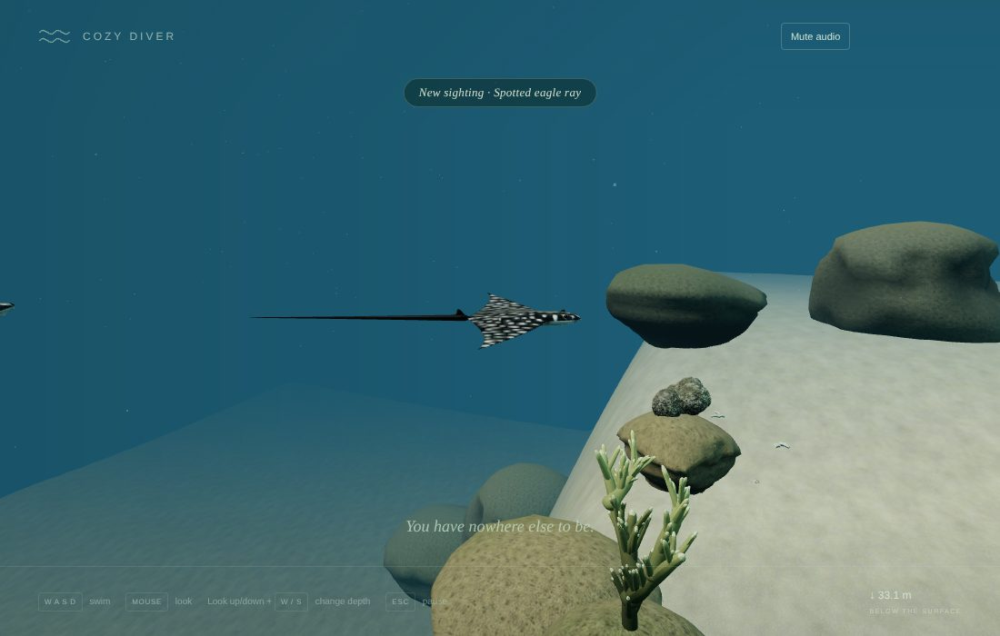
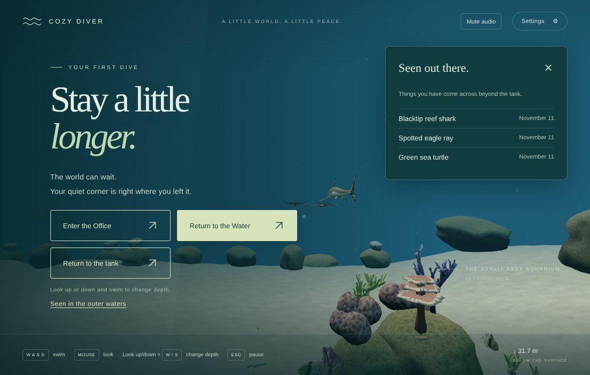

# v0.4 Pass 025 — Big creatures

Validation date: November 11, 2026. Candidate `0.4.0-alpha.3` for user review. No merge or release is authorized by this report.

**Limits of this evidence.** All browser evidence comes from Linux Chromium with SwiftShader software rendering, so frame rate on the MacBook Air is not measured. Draw calls and triangles below are what the Mac's GPU will be asked to draw. This branch includes `main`'s pause, surfacing and office audio fixes (PR #39), merged before validation.

## 1. What was built

See [big creatures and sightings](BIG_CREATURES.md).

- **Three new animals, modelled from scratch in Blender** (`tools/art/pass025/creatures.py`):
  - two blacktip reef sharks;
  - three spotted eagle rays;
  - one green sea turtle.

  Each creature is one mesh with one material, with painted 512 px maps, a stroke morph pair and a light distance level.

- **Calm cruising.** Each follows a smooth loop that is lifted over the reef beneath it:
  - the sharks in mid-water, one dipping over the drop-off;
  - the rays down the sand channel and back over the reef;
  - the turtle between the western coral heads.
- **They give the swimmer room.** Near you, a creature eases sideways or up, never down or towards you. It keeps one side per encounter, starts early, and drifts back afterwards.
- **Sightings.** The three creatures and six kinds of reef feature can be seen:
  - branching, boulder, plate and soft corals;
  - sea fans;
  - seagrass.

  A quiet note fades in on a first sighting, and the journal is saved on this device.

- **The "Seen" page.** The pause screen offers _Seen in the outer waters_ once anything has been seen. It lists names and first dates, with no counts.
- **Fixes along the way:**
  - The sightings tracker now keeps one timer per kind. Many pieces (three rays, two dozen sea fans) no longer double-count or wear each other's progress down.
  - `AssetLoader.evict()` frees a library after its last lease. The creatures are freed with the outer reef instead of staying cached on the GPU.

| View                            | Capture                                        |
| ------------------------------- | ---------------------------------------------- |
| The models (side, top, strokes) |        |
| A reef shark over the sand      |         |
| The turtle, from the front      |  |
| The turtle, from above          |  |
| Eagle rays over a coral head    |    |
| An eagle ray, from above        |     |
| The "New sighting" note         |  |
| The pause screen's "Seen" list  |     |

The close-ups were staged with the creatures held still and the HUD hidden; in play they ease away when you come this close.

## 2. Measurements

**`validation/big-creatures.mjs` (new; real pointer lock and keys)**

| Check                                                                    | Result                                                   |
| ------------------------------------------------------------------------ | -------------------------------------------------------- |
| Creatures loaded / with models                                           | 6 / 6                                                    |
| Each creature cruises and strokes (over 6 s)                             | Moved 2.7–6.6 m; stroke range up to ±0.9                 |
| Two minutes of cruising: body points inside a reef hull                  | 0 of 14,400 (centre, nose, tail and both sides)          |
| Lowest body point above the seabed                                       | 1.54 m                                                   |
| Waiting on a shark's route: closest it came                              | 5.17 m (it gave way)                                     |
| Looking at each creature                                                 | Each noted (_New sighting · …_) and saved to the journal |
| Pause screen "Seen" list                                                 | Names all three; no counts; Escape closes it             |
| After a reload                                                           | The list is still offered                                |
| GPU memory: tank / after visit 1 and release / after visit 2 and release | 412 / 112 each time: nothing kept                        |
| Shader programs: tank / with the outer reef                              | 119 / 122 (Pass 024: 119 / 120)                          |
| Draw calls / triangles beside a shark, the rays, the turtle              | 72 / 791 k, 30 / 337 k, 34 / 420 k                       |
| Console errors                                                           | None                                                     |

**`validation/outer-reef.mjs` (Pass 024's fixed views, now with the creatures)**

| View           | Draw calls (Pass 024) | Triangles (Pass 024) |
| -------------- | --------------------- | -------------------- |
| From the cliff | 85 (80)               | 614 k (595 k)        |
| Coral head     | 75 (75)               | 1.14 M (1.14 M)      |
| Channel        | 68 (66)               | 832 k (828 k)        |
| Drop-off       | 31 (31)               | 404 k (404 k)        |
| Reef edge      | 29 (29)               | 465 k (465 k)        |

The creatures add at most a few draw calls and about 20 k triangles in these views (each creature is one draw; beyond 20–34 m it is a 0.8–1.7 k triangle level).

**Long tasks while the reef prepares:** 0.63 s in the creatures run and 2.25 s in the outer-reef run (Pass 024: 0.3–1.5 s). See section 4.

## 3. Checks

| Check                                                                                       | Result                                                                                                                                                                                                                                                                                                                                  |
| ------------------------------------------------------------------------------------------- | --------------------------------------------------------------------------------------------------------------------------------------------------------------------------------------------------------------------------------------------------------------------------------------------------------------------------------------- |
| `npm run build` / `typecheck` / `lint`                                                      | Pass. JS bundle 1,029.5 kB / 295.2 kB gzip (Pass 024: 1,013.5 / 290.0 kB; includes `main`'s audio fixes)                                                                                                                                                                                                                                |
| `npm run test`                                                                              | **469 passed** (50 files). New: `big-creatures` (14): route sampling and lifting, outer routes clear of the reef, the obstacle field, frame-rate consistency, banking, giving way for each species, strokes and glides, the tracker counting once per kind, reef sightings, stable ids and the "Seen" list; `asset-lifecycle`: eviction |
| `validation/big-creatures.mjs` (new)                                                        | Pass (section 2)                                                                                                                                                                                                                                                                                                                        |
| `validation/passage.mjs`                                                                    | Pass. The swap is unchanged (darkness 0.94 / 0.94); after release, GPU geometries / textures / programs are 412 / 112 / 119, as before the outer waters loaded                                                                                                                                                                          |
| `validation/outer-reef.mjs`                                                                 | Pass. 100 fish, 99 moved, none below the sand; the seabed is a floor; the drop-off can be swum down; the edge turned the swimmer back at x 53.9; memory unchanged across two visits                                                                                                                                                     |
| `validation/runtime-fixes.mjs` (from `main`)                                                | Pass                                                                                                                                                                                                                                                                                                                                    |
| `office.mjs`, `dive.mjs`, `lifecycle.mjs`                                                   | Pass                                                                                                                                                                                                                                                                                                                                    |
| `discoveries.mjs`, `reef-overhaul.mjs`, `integration.mjs`, `production.mjs` (built preview) | Pass                                                                                                                                                                                                                                                                                                                                    |
| Console errors                                                                              | None in any harness                                                                                                                                                                                                                                                                                                                     |

## 4. Known limitations

- **Shader compilation on first visit.** The creatures add two programs (morphing, non-instanced meshes), and SwiftShader compiles them on the main thread while the reef prepares. The longest stall measured was 0.6–2.3 s, against 0.3–1.5 s in Pass 024. Chrome on macOS compiles in parallel, so this should not show as a hitch there, but it is not measured. Check for a pause near the crack on the Mac.
- **No new reef fish species.** The reef's fish are still the tank's species; new species need new models and were not part of this pass.
- **Simple stroke animation.** Each creature blends between two stroke poses, so the shark's tail beat is a standing bend rather than a travelling wave, and the rays' wings flap as a whole. It reads well at a calm distance; up close it is simpler than real swimming.
- **The turtle's shell pattern is geometric**, a mosaic of scutes with streaks. Real green turtles look softer and more mottled.
- **Giving way is gentle, not absolute.** A swimmer who chases a creature can get close, since it only moves off its route, never flees. Nothing can harm the swimmer either way.
- **One creature failing to load hides all of them** (the reef and its fish are unaffected; an error is logged).
- **The tank still pauses** while you are outside it, as in Passes 023 and 024.

## 5. Manual macOS checklist

- [ ] Meet each creature: the sharks feel calm, not threatening; the rays and the turtle are a pleasure to come across.
- [ ] Swim into a creature's path: it eases aside smoothly and never swerves towards you.
- [ ] Look at a creature for a moment: the "New sighting" note appears quietly and fades.
- [ ] Pause: _Seen in the outer waters_ lists what you have seen, by name, with no counts. It works with the keyboard.
- [ ] Reload: the list is still there, and nothing is noted twice.
- [ ] Settings → Show frame time: note the mean and p95 near the rays and near a shark.
- [ ] No hitch as you approach the crack.
- [ ] Reduced motion: strokes are gentler and the creatures do not bank.
