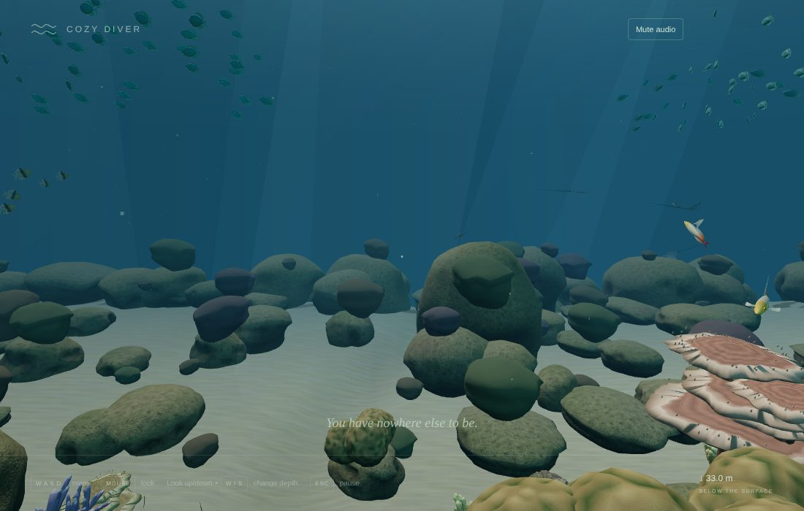
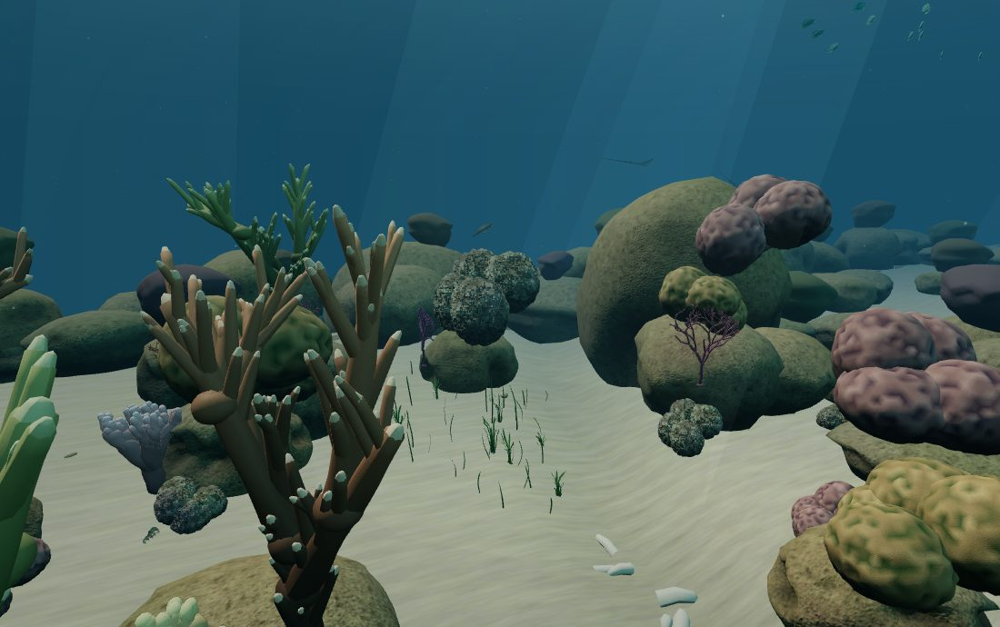
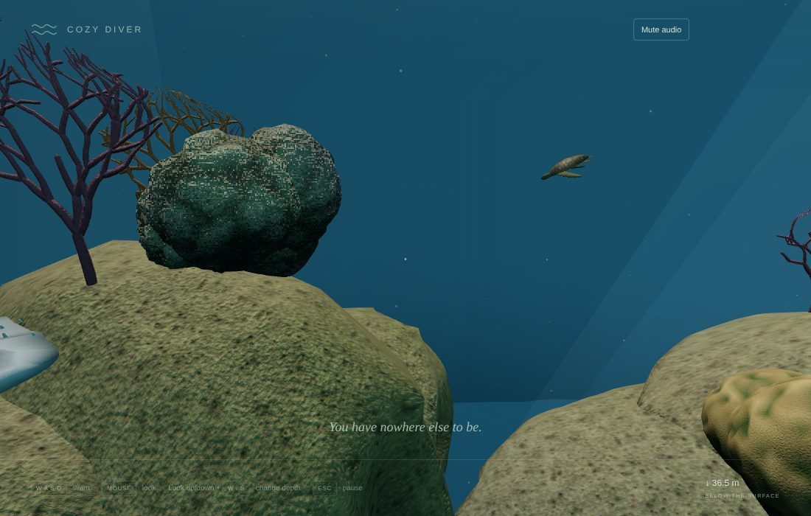
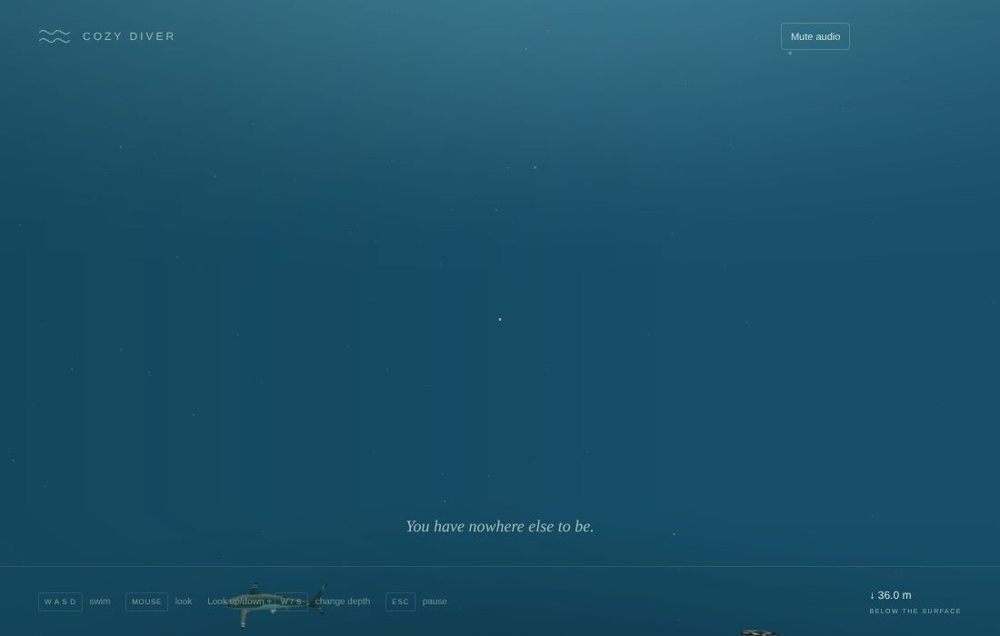
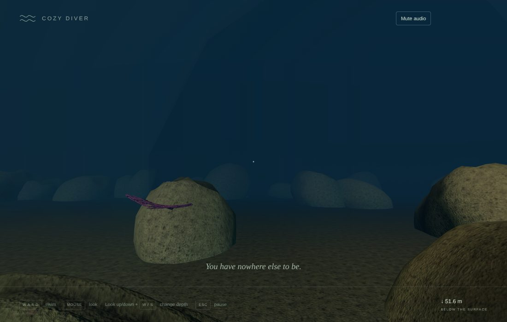
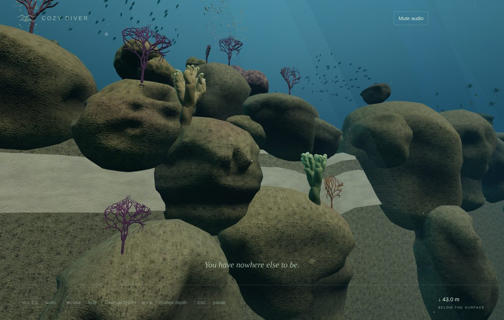

# v0.4 Pass 026 — The wall and the blue

Validation date: November 12, 2026. Candidate `0.4.0-alpha.4` for user review. No merge or release is authorized by this report.

**Limits of this evidence.** All browser evidence comes from Linux Chromium with SwiftShader software rendering, so frame rate on the MacBook Air is not measured. Triangles and draw calls below are what the Mac's GPU will be asked to draw. How breathtaking the arrival feels can only be judged on the Mac; the captures here are software-rendered.

## 1. What was built

See [the wall and the blue](WALL_AND_BLUE.md). In short:

- **The tunnel is the loading screen.**
  - Only the tunnel and cliff are prepared at the crack.
  - The reef, 169 fish and the big creatures are prepared while you swim through the dark.
  - The exit stays dark, and swimming eases to a stop before it, until they are ready.
  - Then the light opens over about two seconds.
- **A dense reef top, close to the edge.**
  - **Reef:** eight bommies in a near-continuous reef of rock and coral, with a narrow sand gully and a little seagrass.
  - **Fish:** two big chromis schools (70 and 55) over the reef top, and smaller fish low over the coral.
  - **The edge:** the lip is 26 m from the tunnel mouth.
- **The wall.**
  - **Depth:** it falls 38 m, with rocks, sea fans and soft corals jutting from its face.
  - **Beyond its foot:** the bottom keeps falling away out of sight.
  - **Light:** it darkens with depth.
- **The blue.**
  - **Colour:** a water dome and fog fade distance from blue to dark: lighter towards the surface, deep blue at the horizon, near-black below.
  - **Depth:** deeper, the light dims and the fog thickens.
- **Slowing to a hover near the edges**, instead of a current pushing you back:
  - out over the blue 5–8 m past the lip;
  - some way down the wall;
  - at the sides and up high.
- **The big creatures pass by in the blue.**
  - **Routes:** long loops along the wall at different depths: sharks, eagle rays below the lip, the turtle along the wall face.
  - **Sightings:** big animals count as seen from 3 m further across the clear blue.

| View                                     | Capture                                                |
| ---------------------------------------- | ------------------------------------------------------ |
| The arrival, from the tunnel mouth       |               |
| Among the bommies on the reef top        |              |
| At the lip, a turtle passing in the blue |            |
| Hovering past the lip                    |  |
| Looking down the wall                    |         |
| Back at the wall from the blue           |      |

## 2. Measurements (`validation/outer-reef.mjs`, real input)

| View             | Draw calls | Triangles | CPU submit (ms, SwiftShader) |
| ---------------- | ---------- | --------- | ---------------------------- |
| From the cliff   | 66         | 948 k     | 10.2                         |
| At a bommie      | 53         | 1.09 M    | 7.6                          |
| Reef top         | 67         | 1.27 M    | 9.0                          |
| At the lip       | 61         | 1.37 M    | 5.6                          |
| Into the blue    | 39         | 825 k     | 5.8                          |
| Back at the wall | 56         | 870 k     | 10.1                         |

Pass 024's busiest view was 1.14 M and Pass 025's 1.14 M. The busiest views here (at the lip, reef top) are up to 20% heavier.

| Check                                                                    | Result                                                                             |
| ------------------------------------------------------------------------ | ---------------------------------------------------------------------------------- |
| Reef ready after entering the tunnel                                     | 2.7 s (SwiftShader); the tunnel takes longer than that to swim                     |
| Longest main-thread stall while it prepares                              | 2.9 s, in the dark tunnel (previously 0.3–2.3 s at the crack, in view of the tank) |
| Shader programs: tank / with the outer reef                              | 119 / 125 (Pass 025: 119 / 122): the dome, the mound colours and dressed wall      |
| Fish                                                                     | 169; all moved; none below the sand                                                |
| Diving straight down onto the reef top                                   | Rests exactly on the seabed                                                        |
| Swimming down the wall (holding W)                                       | Hovered at −11.6 m                                                                 |
| Swimming out over the blue (holding W)                                   | Hovered 5.6 m past the lip                                                         |
| Swimming towards a side (holding W)                                      | Hovered at x 28.1 (eases from 24, stops by 33)                                     |
| GPU memory: tank / after visit 1 and release / after visit 2 and release | 412 / 112 each time                                                                |
| Console errors                                                           | None                                                                               |

**Where the triangles go**, in the busiest views:

- **Coral:** massive and branching colonies, about 0.6 M; full detail only within 2.5–3.5 m.
- **Rock:** about 0.35 M.
- **Fish:** about 0.3 M. Distant fish now leave out their sub-pixel eyes, saving 64 k.

The fog is denser (0.04), so nothing is drawn beyond 40 m.

## 3. Checks

| Check                                                                                                                                                      | Result                                                                                                                                                                                                                                                                      |
| ---------------------------------------------------------------------------------------------------------------------------------------------------------- | --------------------------------------------------------------------------------------------------------------------------------------------------------------------------------------------------------------------------------------------------------------------------- |
| `npm run build` / `typecheck` / `lint`                                                                                                                     | Pass                                                                                                                                                                                                                                                                        |
| `npm run test`                                                                                                                                             | **470 passed** (50 files). Rewritten for Pass 026: the gully, reef top and wall; edge easing (monotonic slowing, then stopping; never slowing a return); depth shading; the denser layout with fans on the wall; schools over the reef top; creature routes out in the blue |
| `validation/outer-reef.mjs` (updated views and edge checks)                                                                                                | Pass (section 2)                                                                                                                                                                                                                                                            |
| `validation/big-creatures.mjs`                                                                                                                             | Pass. 0 of 14,400 body points in a hull; lowest 27 m above the bottom; the shark gave way (5.1 m closest); each creature noted and saved; memory unchanged across visits                                                                                                    |
| `passage.mjs`, `runtime-fixes.mjs`, `office.mjs`, `dive.mjs`, `lifecycle.mjs`, `discoveries.mjs`, `reef-overhaul.mjs`, `integration.mjs`, `production.mjs` | Pass. No console errors (the reef-overhaul harness logs two only in its deliberate missing-library fallback case, as before)                                                                                                                                                |

## 4. Known limitations

- **The arrival's middle distance.** Up close the reef top is crowded with colourful coral. From the tunnel mouth, colonies past about 13 m are simple mounds in muted coral colours, so the middle distance reads more as rock than coral in these captures. Fuller coral further out costs triangles the Mac may not have. Judge it on the Mac; it is the main thing to tune next.
- **Triangles** in the busiest views (1.3–1.4 M) are up to 20% above Pass 024/025's busiest, not yet measured on the Mac.
- **The stall while the reef prepares** is now hidden in the dark tunnel, and the exit waits for it. On the Mac it should be shorter (parallel shader compilation), not measured.
- **The blue can be empty.** The creatures loop on fixed routes; something passes every half-minute or so, but not on demand.
- **Sound** is unchanged; there is no distinct open-water bed.
- **The tank pauses** while you are outside it.

## 5. Manual macOS checklist

- [ ] The tunnel: dark, calm, and the light opens at its end without a hitch. Does it feel like a moment?
- [ ] The arrival: is the reef top breathtaking? Note anything that reads as bare rock.
- [ ] Swim to the lip and out over the blue: it slows to a calm hover, never a wall.
- [ ] Hover and watch: the sharks, rays and turtle pass by; it makes you want to stop.
- [ ] Look out and down: blue fading to dark.
- [ ] Settings → Show frame time: note the mean and p95 on the reef top, at the lip and hovering in the blue.
- [ ] Return through the tunnel or with Return to the tank; the tank, the office and the dive still work as before.
