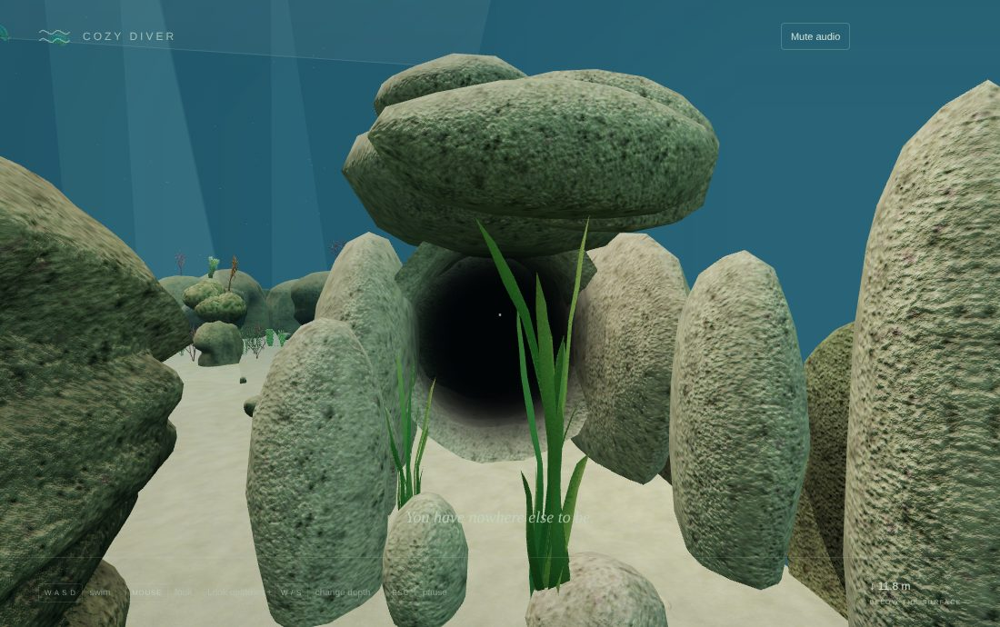
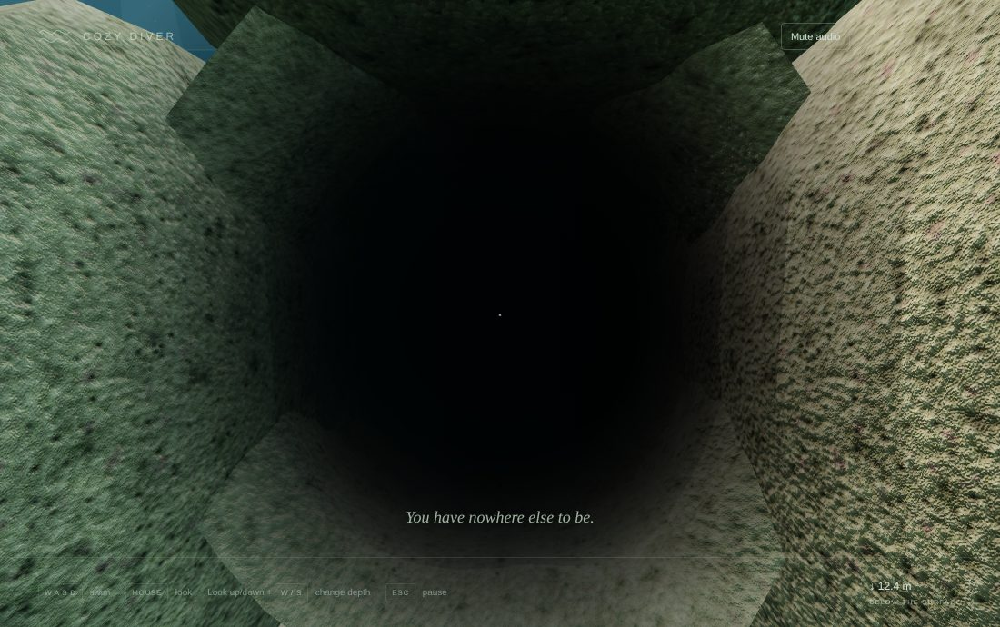
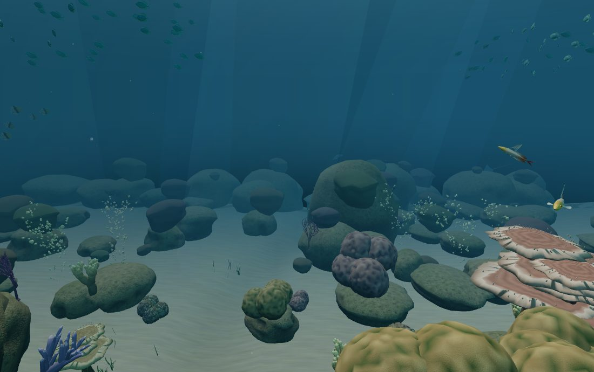
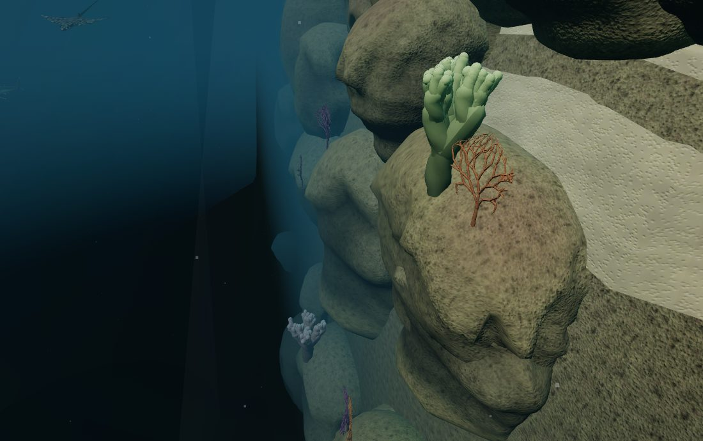

# v0.4 Pass 026 playtest round

Validation date: November 12, 2026. Candidate `0.4.0-alpha.5` for user review. No merge or release is authorized by this report.

Changes asked for after playing Pass 026 on the Mac.

## What changed

- **Less clear water, less pop-in.**
  - **Fog:** the outer waters' fog is 0.06 (was 0.04), and nothing is drawn beyond 32 m.
  - **Detail changes:** the far ones now happen in the haze. The near ones moved out a little: full-detail rock within 4.5 m (was 4), massive coral 3 m, branching coral 4 m.
- **The deep gets darker.**
  - **Below 2 m:** the fog fades towards an ever darker blue and veils deep surfaces even close by (`rendering/deepFog.ts`). Looking over the edge, the wall and bottom sink into near-black.
  - **Looking down:** the water dome darkens sooner, so the deep bottom never meets a lighter blue.
  - **How it works:** it is a change to three.js's fog shader code for every material, installed before anything compiles. The tank never goes below y 0, so for it the fog is exactly as before.
- **Darker the deeper you go:** light dims by up to 70% (was 45%), the fog thickens with depth, and the horizon goes nearly black at the bottom of the reach.
- **A hidden crevice.**
  - **More rock:** six more rocks frame and screen the tank's crack: a low overhang, buttresses either side, two low rocks in front and a standing rock in the alley.
  - **Rock-coloured edges:** the dark box liner is gone. An irregular rock tube in the boulders' own rock lines the passage.
  - **A dark centre:** soft veils inside it are dark at the centre, where you swim in, and clear at the rock edges, deepening towards the threshold.

| View                             | Capture                                                   |
| -------------------------------- | --------------------------------------------------------- |
| The crevice from the alley       |   |
| Just inside the crevice          |  |
| The arrival, in less clear water |         |
| Down the wall into the dark      |   |

## Checks

| Check                                      | Result                                                                                                                                                                      |
| ------------------------------------------ | --------------------------------------------------------------------------------------------------------------------------------------------------------------------------- |
| `npm run build` / `typecheck` / `lint`     | Pass                                                                                                                                                                        |
| `npm run test`                             | **474 passed**. New: the deep fog (installed once, standard fog above the deep, linear fog untouched); the crevice tube never narrows the channel and is lumpy; its shading |
| `npm run test:stress`                      | 10 passed                                                                                                                                                                   |
| Exact counts updated (the six new rocks)   | Tank colliders 151 → 157 (procedural), 515 → 521 (authored), 296 → 302 (fallback); tank geometries 575 → 582; materials unchanged (111)                                     |
| Triangles (development views, SwiftShader) | 0.97–1.47 M; the busiest reef-top view rose from 1.27 M as detail changes moved out                                                                                         |
| Browser regression harnesses               | **Not completed for this round.** A run was started and stopped at the user's request; the user is testing on the Mac                                                       |

## Known limitations

- **Pop-in up close.** The detail changes nearest you (3–4.5 m) can still be seen. Hiding them fully needs cross-fading between levels.
- **Triangles.** The busiest view is up to 1.47 M, not measured on the Mac.
- **The crevice** is still visible as a dark gap if you look straight in from the alley. That is intended: hidden, but findable.
