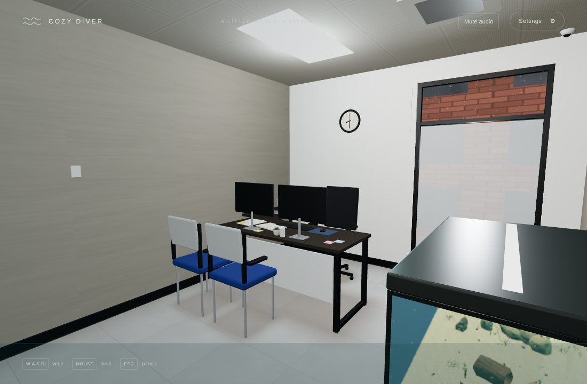
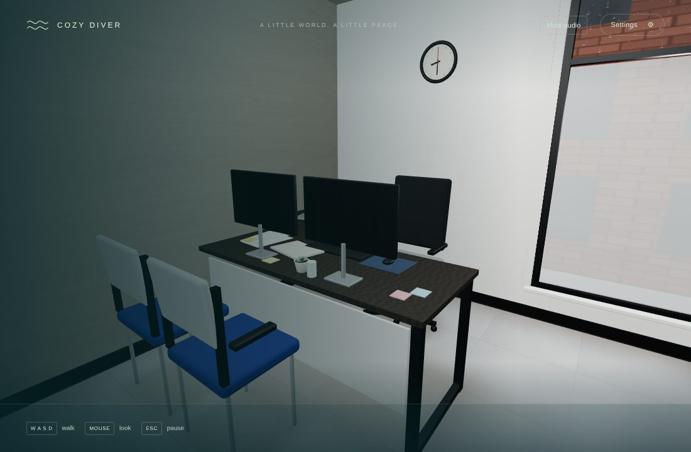
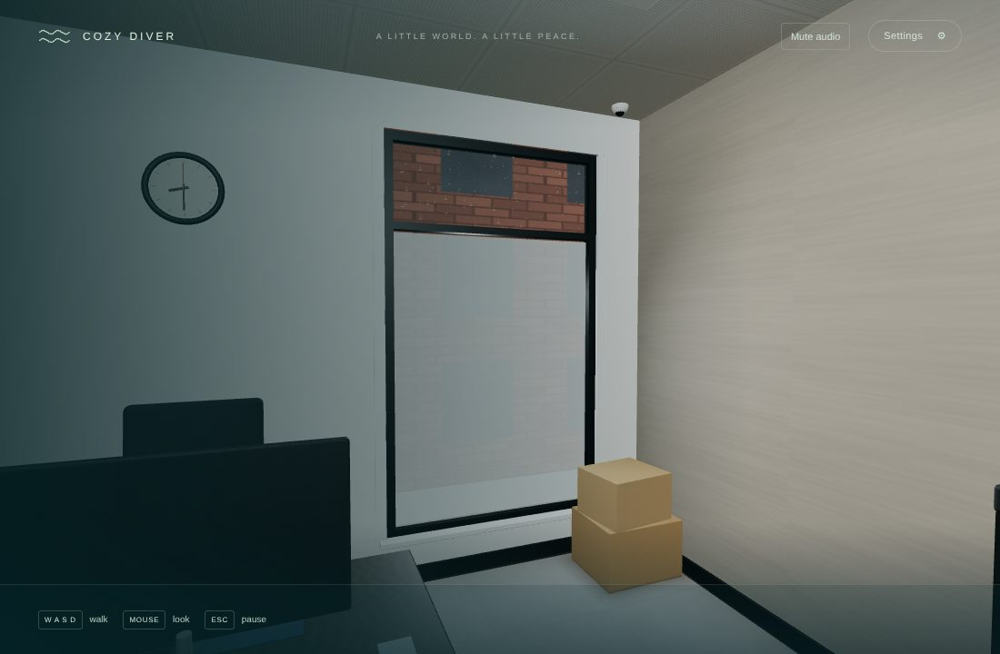
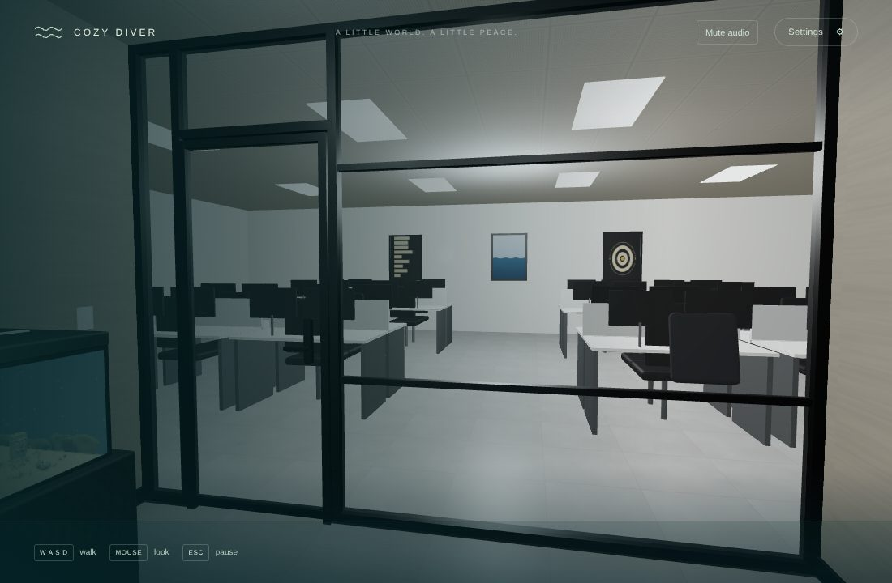
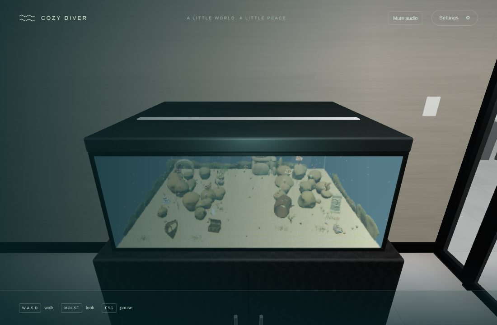
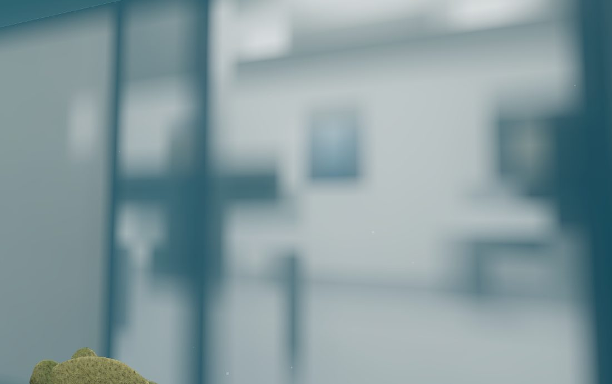
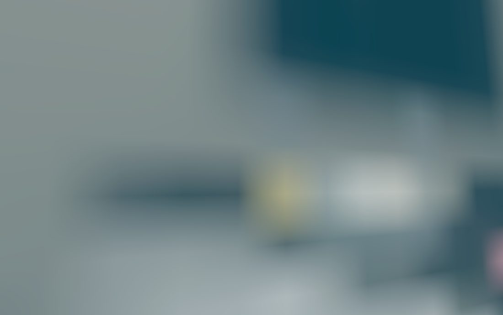

# v0.4 Pass 027 — The glass office

Validation date: November 12, 2026. Candidate `0.4.0-alpha.6` for user review. No merge or release is authorized by this report.

The office is remodelled after the user's own: a small glass-walled private office. You stay in the room with the door closed, and can look out through the glass at the open-plan office. The aquarium stands in the room, and from inside it you see the office, blurred, through the glass. The details are generic: no logos, brand names or real screen content. Design notes are in [the office](OFFICE.md#the-glass-office-v04-pass-027).

## What changed

- **The room** (3.6 × 4.2 m, with a 2.7 m ceiling; was 6 × 5 m).
  - **Surfaces:** grey grasscloth walls, a white back wall, porcelain tiles, and an acoustic ceiling with LED panels.
  - **Fixtures:** an air-conditioning cassette, a camera dome, a switch, a thermostat and a clock.
  - **Furniture:** a dark L-desk with two monitors, an executive chair, two blue guest chairs, boxes, and the aquarium on a charcoal cabinet against the right wall.
- **The glass front:** a black-framed glass partition with a closed glass door, and the walls stop you at it.
- **The open-plan office:** seen through the glass, with workstations, neighbouring glass offices, a filing cabinet, a plant and three framed posters (generic art). It is 11 merged meshes in its own group.
- **The window:** frosted below, clear above, with rain on the glass and a brick building opposite.
- **From inside the tank** (`rendering/TankOutlook.ts`).
  - **Capture:** the office is captured once, after loading, into a 128 px cube map from the tank's centre.
  - **Display:** in the aquarium, a box just outside the glass shows the capture at a soft mip level, drawn towards the water colour and fogged with the tank's haze.
  - **Where it shows:** the room's miniature of the tank hides it.
- **Walking, the dive and surfacing:** unchanged in behaviour. Their poses follow the new layout: you start just inside the door, facing the tank, and surfacing still stands you clear of all furniture for every exit point (tested).

| View                                     | Capture                                               |
| ---------------------------------------- | ----------------------------------------------------- |
| The room from the door                   |                 |
| The desk                                 |                 |
| The window                               |               |
| The glass front and the open-plan office |          |
| The aquarium                             |                 |
| From the tank: the glass front, blurred  |   |
| From the tank: the desk, blurred         |  |

The two views from the tank are close-ups of the outlook alone, with the camera at the glass. In play, the tank's haze and the reef lie in front of it.

## Checks

| Check                                                                        | Result                                                                                                                                                                                                                                                                   |
| ---------------------------------------------------------------------------- | ------------------------------------------------------------------------------------------------------------------------------------------------------------------------------------------------------------------------------------------------------------------------ |
| `npm run build` / `typecheck` / `lint`                                       | Pass                                                                                                                                                                                                                                                                     |
| `npm run test`                                                               | **474 passed** (51 files)                                                                                                                                                                                                                                                |
| `npm run test:stress`                                                        | 10 passed                                                                                                                                                                                                                                                                |
| Office test, updated                                                         | The room keeps its 27-mesh budget, and the open-plan office is checked separately (at most 11 meshes, all beyond the glass). The glass front's frame may straddle the front plane by its own profile (5 cm).                                                             |
| Dive and walking tests, updated                                              | Poses derive from `TANK` and `STAND_FOOTPRINT`, not the old room. The prompt-region test samples only poses where you can stand.                                                                                                                                         |
| `validation/office.mjs` (views updated to the new room)                      | **Pass.** Walked 1.92 m with held W, eye height 1.28 m, GPU memory unchanged over three office ↔ water round trips (431 geometries, 116 textures), no WebGL or console errors                                                                                            |
| Office frame (SwiftShader, 1100 × 690, miniature included)                   | 24–36 draw calls, 21–44 k triangles                                                                                                                                                                                                                                      |
| `validation/dive.mjs` (pose updated)                                         | **Pass.** The dive prompt shows in front of the new tank, the dive switches at 2.35 s, swimming works afterwards, surfacing compiles no new programs and stands you at 1.28 m, and reduced motion takes 0.9 s. GPU memory before and after: 431 geometries, 116 textures |
| `validation/dive-interrupt.mjs` (poses updated, surfacing pose fixed, below) | **Pass.** All eight interruptions behave as before, the hidden tab freezes everything, and five full cycles hold at 431 geometries, 116 textures and 127 programs (heap 167 MB throughout)                                                                               |
| `validation/lifecycle.mjs`                                                   | **Pass**, with exact counts unchanged (tank geometries 582, materials 111, hulls 521) and 17 checks                                                                                                                                                                      |

### Harness fix (pre-existing)

`dive-interrupt.mjs` surfaced from (4, 12.6, −2). That point is 14.97 m from the crevice mouth, inside the 15 m preload radius, so every surfacing began loading the outer waters. The harness steps the loop by hand, so the 4 s release delay had not passed when it took its snapshot, and the snapshot then failed by +7 geometries and +2 programs (the outer water dome). This was not caused by Pass 027: a step-by-step probe shows office frames, aquarium frames in every direction and the reverse view all create nothing new. The surfacing now starts at (−4, 12.6, 2), 20 m from the mouth.

## Performance

- **Draw calls:** the room's own draw calls are unchanged: 27 meshes, within the existing test budget.
- **Open-plan office:** 11 meshes, culled when out of view. The three posters share one texture and one mesh, and their frames are merged with the rest of the trim.
- **Outlook:** one draw call in the aquarium, plus a 128 px cube target (about 0.5 MB with mipmaps), captured once.

None of this has been measured on the Mac.

## Known limitations

- **A still picture.** The view from the tank is a still capture: the clock and the rain in it do not move. Through the blur this is not noticeable.
- **No parallax.** The outlook sits at the glass, so the office does not shift as you swim. It reads as farther away than one to three metres.
- **Lighting.** The open-plan office is lit by one point light and the hemisphere fill. It has no shadows.
- **SwiftShader only.** All evidence here is from SwiftShader (software rendering) in a container, not from a Mac.

## macOS checklist

- [ ] **The room:** it reads as a small glass office. The floor is not too bright, and the grasscloth is subtle.
- [ ] **The glass front:** the open-plan office is visible through it, and the door stays closed. You cannot walk through the glass.
- [ ] **The window:** frosted glass, rain above, a building opposite.
- [ ] **The dive:** the prompt appears in front of the tank. The dive and surfacing feel as before, and surfacing never puts you inside furniture.
- [ ] **From inside the tank:** looking out through each side, the office is blurred but recognisable: the glass front, the desk, the window. It never looks sharp or distracting.
- [ ] **Frame rate:** the frame-time readout in the office and in the tank is comparable to `0.4.0-alpha.5`.
