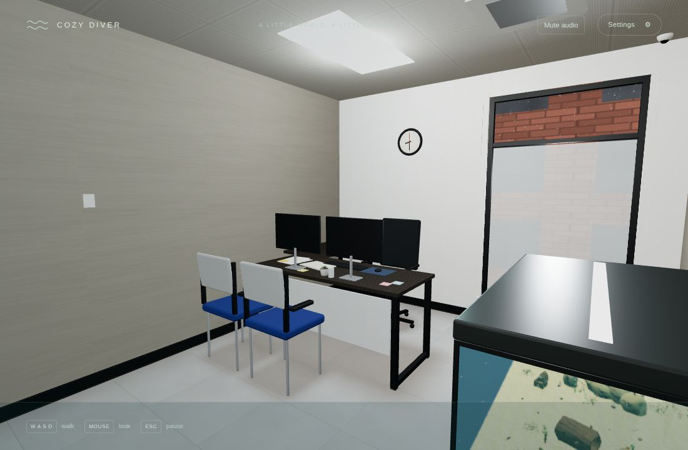
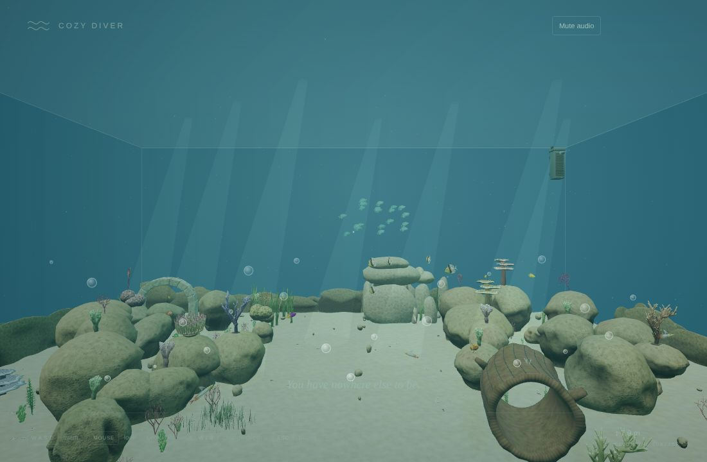
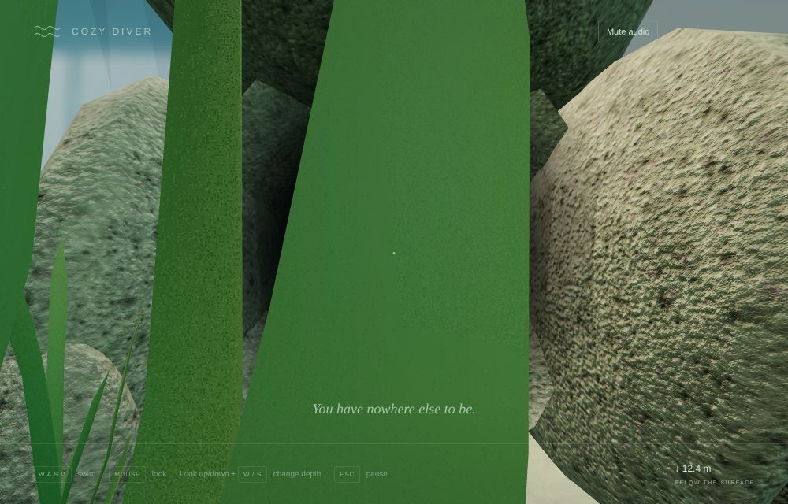
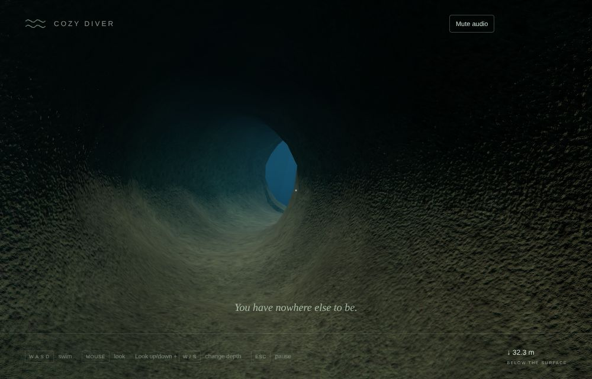
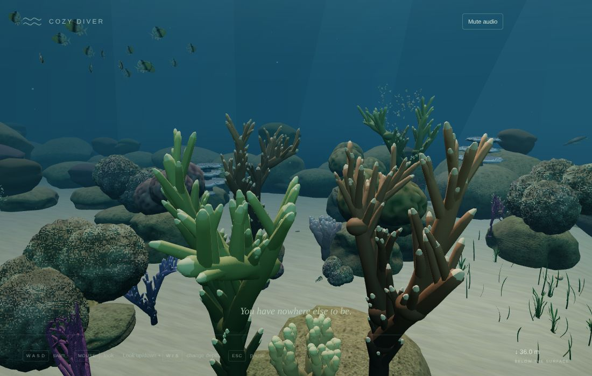
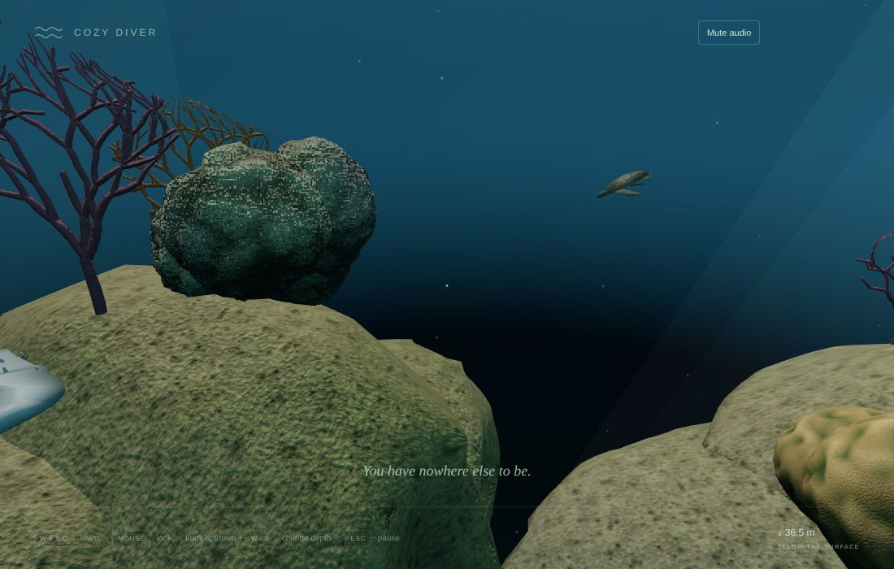
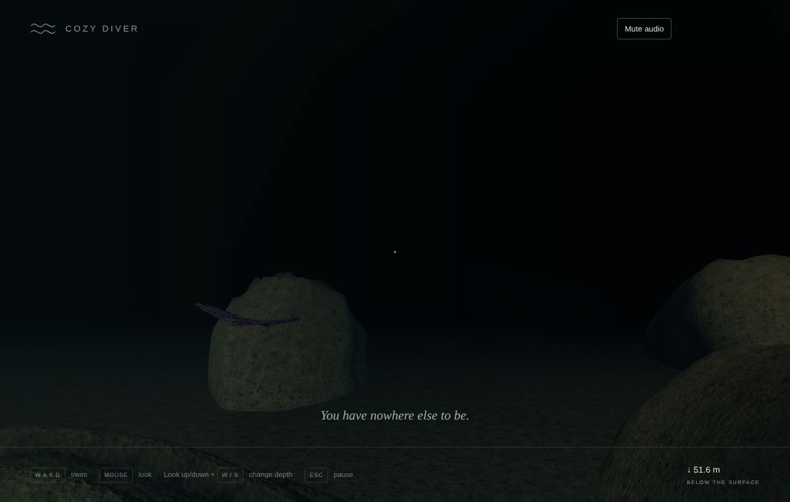
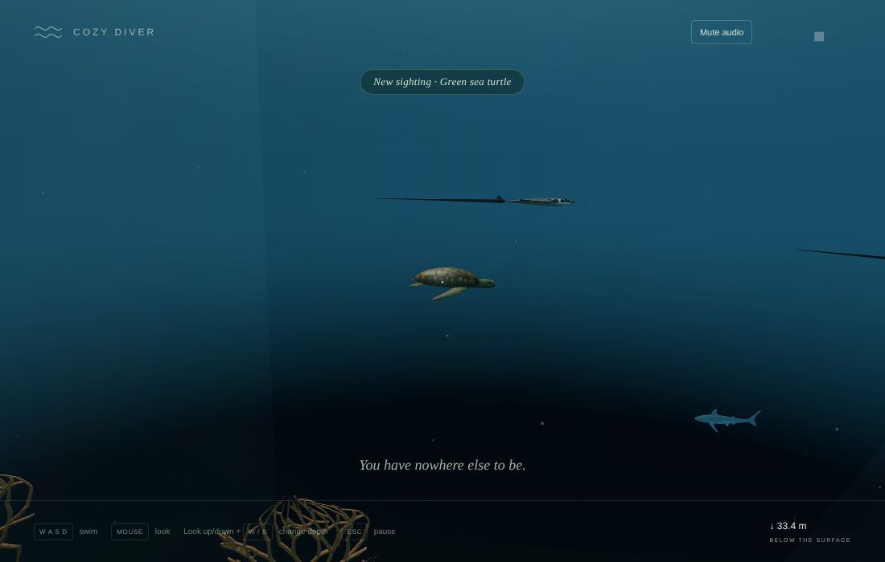
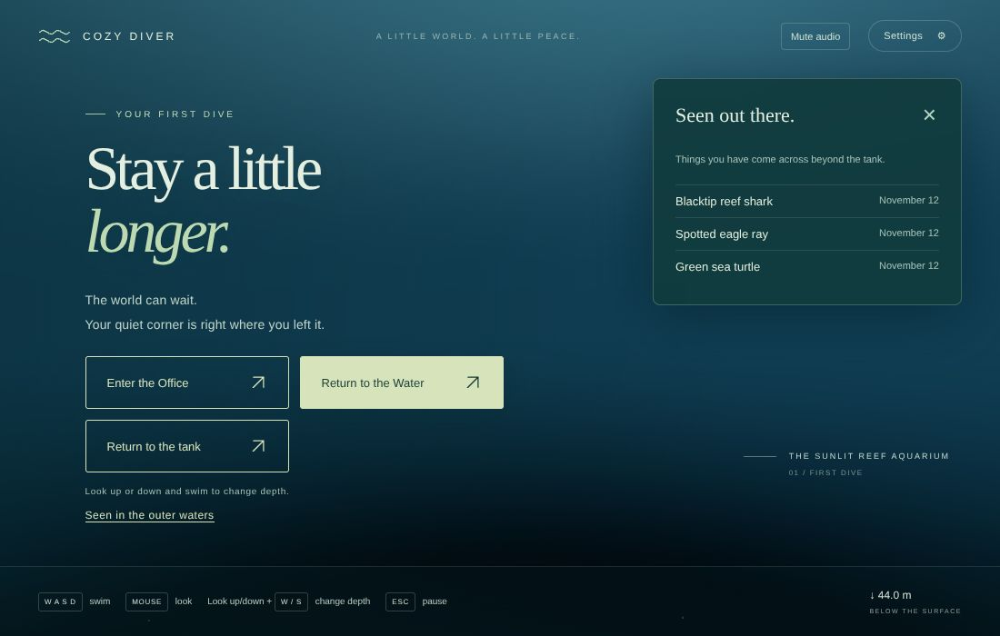

# v0.4 Pass 028 — Polish and acceptance

Validation date: November 12, 2026. Release candidate `0.4.0-rc.1` for v0.4 (First Passage), for user review. No merge, release or tag is authorized by this report. v0.4 closes on the user's macOS acceptance after a full play-through.

**Limits of this evidence.** All browser evidence comes from Linux Chromium with SwiftShader software rendering, in managed cloud containers. It cannot show:

- MacBook Air frame time;
- how swimming, the passage and the transitions feel at full frame rate;
- audio comfort;
- the look under real GPU lighting.

Use the frame-time readout (Settings → Show frame time) on the Mac for the first of these.

## 1. What v0.4 contains

| Pass                        | What it added                                                                                                                                                                                                                                                                                                            |
| --------------------------- | ------------------------------------------------------------------------------------------------------------------------------------------------------------------------------------------------------------------------------------------------------------------------------------------------------------------------ |
| 023 — The opening           | A hidden crack at the back of the tank. Swimming through it carries you, without a pause, into a tunnel in the outer waters. Only the current world renders; outer waters preload near the crack and stay available for the return. Groundwork for the sightings journal.                                                |
| 024 — The outer reef        | An open reef beyond the tunnel, built from the tank's own art library: coral heads, rock mounds, seagrass, rubble, about 100 reef fish in schools, and open-water sound.                                                                                                                                                 |
| 025 — Big creatures         | Two blacktip reef sharks, three spotted eagle rays and a green sea turtle that cruise calmly and give you room. Quiet "New sighting" notes, and a "Seen in the outer waters" page.                                                                                                                                       |
| 026 — The wall and the blue | The reef reshaped as a wall dive. A dense reef top, a wall falling into the deep, and the blue fading to dark. Swimming slows to a hover near the edges. Big animals pass along the wall. The tunnel doubles as the loading screen. Playtest round: thicker water, a darkening deep, and a better-hidden crevice.        |
| 027 — The glass office      | The office remodelled as a small glass-walled office with an open-plan office beyond the glass. From inside the tank, the office is seen blurred through the glass. Codex follow-ups: that view now fades in after the dive's scene switch, it no longer shows through the sand as blue dots, and the laptop is removed. |
| 028 — Polish and acceptance | This report: a full regression run, reliable unit tests and the release candidate.                                                                                                                                                                                                                                       |

| Moment                                                 | Capture                                           |
| ------------------------------------------------------ | ------------------------------------------------- |
| The glass office                                       |           |
| Just arrived in the tank                               |     |
| The crack, half hidden in seagrass                     |          |
| The tunnel to the outer waters                         |           |
| The reef top                                           |         |
| At the lip of the wall                                 |       |
| Down the wall                                          |    |
| A turtle and a shark in the blue, with a sighting note |  |
| The "Seen out there" page                              |        |

The captures are from the regression harnesses, with fixed, staged camera poses. They are not gameplay recordings.

## 2. Checks

| Check                                  | Result                                                                                                                                                                   |
| -------------------------------------- | ------------------------------------------------------------------------------------------------------------------------------------------------------------------------ |
| `npm run build` / `typecheck` / `lint` | Pass in the post-merge review. JS bundle 1,043.0 kB / 299.9 kB gzip                                                                                                      |
| `npm run test`                         | **481 passed** (52 files) in the post-merge review, run with one worker. The original 477-test concurrent run predated the four frogfish checks from PR #47 (section 3). |
| `npm run test:stress`                  | **10 passed** in the original Pass 028 run (not rerun for this cleanup), including the 5-, 15- and 30-minute ecosystem soaks                                             |

### Browser regression (run one at a time)

Unless marked post-merge, these are the original Pass 028 measurements from before the frogfish asset refresh. Their GPU counts describe that earlier snapshot; current inventory and focused reruns are recorded below.

| Harness                                                                                | Result                                                                                                                                                                                                                                                                                                          |
| -------------------------------------------------------------------------------------- | --------------------------------------------------------------------------------------------------------------------------------------------------------------------------------------------------------------------------------------------------------------------------------------------------------------- |
| `passage.mjs`                                                                          | Pass. The swap at the threshold is seamless (equal darkness either side). The reef is ready when you reach the crossing. You can return through the tunnel and from the pause screen. The outer waters are released afterwards. GPU 431 geometries / 116 textures / 127 programs before and after               |
| `outer-reef.mjs`                                                                       | Pass. 169 fish all moving, none below the seabed. You can swim down the wall and 5.6 m out past the lip, and the edge slowdown holds (furthest x 28.1 m). The reef is ready 6.4 s after the crossing. Memory is back to 431 / 116 after two visits. 43–74 draw calls and 0.91–1.73 M triangles across six views |
| `big-creatures.mjs`                                                                    | Pass. All six animals move. No reef contact in 14,400 clearance samples. They give way (closest 5.1 m). All three "New sighting" notes appear, and the Seen page lists them and survives a reload. 46–54 draw calls                                                                                             |
| `runtime-fixes.mjs`                                                                    | Pass: the office pauses, its audio context is suspended, and E cannot surface from the outer waters                                                                                                                                                                                                             |
| `office.mjs`                                                                           | Pass. Walked 2.08 m at 1.28 m eye height. GPU memory unchanged over three office ↔ water round trips. 24–36 draw calls, 20–43 k triangles                                                                                                                                                                       |
| `dive.mjs`                                                                             | Pass. The scene switches at 2.37 s, and the office backdrop is still blue at the switch (Codex's #45 checks). Surfacing compiles no new programs. Memory 431 / 116 before and after                                                                                                                             |
| `dive-interrupt.mjs`                                                                   | Pass: eight interruption cases, a hidden tab and reduced-motion surfacing. Five full cycles hold at 431 / 116 / 127                                                                                                                                                                                             |
| `lifecycle.mjs`                                                                        | Post-merge rerun: 17 checks pass. Resident tank inventory is 583 geometries, 108 materials and 521 hulls. Thirty accelerated minutes (54,000 steps) with 0 corrections. Uploaded GPU inventory stays at 432 geometries / 113 textures.                                                                          |
| `discoveries`, `anchored-life`, `ornaments`, `reef-overhaul`, `integration`, `browser` | Pass                                                                                                                                                                                                                                                                                                            |
| `production.mjs` (built preview)                                                       | Pass                                                                                                                                                                                                                                                                                                            |
| `load-budget.mjs` (built preview)                                                      | Pass. 14.8 MB downloaded (13.7 MB models). Prepared in 7.7–9.8 s over three runs                                                                                                                                                                                                                                |
| Console errors                                                                         | None, apart from `reef-overhaul`'s deliberate missing-asset fallback check. That check blocks the reef library on purpose and expects the warning                                                                                                                                                               |

The original Pass 028 run skipped the older before/after comparison harnesses. The post-merge review now reruns `creature-overhaul` for the frogfish and `geometry-overhaul` in probe mode for anatomy, fallback and disposal. `fish-overhaul` and `playtest-fixes` remain outside this cleanup; `asset-smoke`, `texture-memory` and `visual-benchmark` target the separate benchmark page.

## 3. Found during this pass

- **Unit tests were sensitive to machine load.** Codex's review of PR #43 saw three simulation tests time out at the default 5 s while a build and lint ran, and pass when re-run alone.
  - **The cause:** 20 tests relied on that default yet take 1.2–3.6 s on their own, so a threefold slowdown under load fails them.
  - **The fix:** each now carries an explicit 20 s budget, as the suite's other heavy simulations already do (20–120 s). No assertion changed. The global 5 s default is unchanged.
  - **Original check:** the earlier 477-test suite passed with the default lowered to 1.2 s and during concurrent build/lint/typecheck. That evidence predates PR #47's four frogfish checks. The post-merge review confirms all 481 tests with the accepted timeouts and one worker; it does not repeat the concurrency or 1.2 s experiment.
- **The reef-overhaul "error" is expected.** Its "failed to load reef" message comes from the fallback check, which aborts the reef download on purpose. The Pass 026 run reported the same entry.
- **The busiest outer-reef view is heavier than recorded.** `outer-reef.mjs` measures 1.73 M triangles "at the lip". The Pass 026 playtest round recorded up to 1.47 M, but from its own development camera poses, not this harness, so the two figures are not directly comparable. It is noted for the Mac check below.

## Post-merge review before macOS acceptance

Reviewed merged PRs #47 and #48 at `bb06953`. The frogfish's authored body, jaw, lure and feet are attached and the closed/yawning poses render correctly. Its skin now receives one camouflage tint: the body already contains the lure, so traversing the lure again had darkened it twice and allocated an extra material clone.

- **Motion tests:** retain all ten minutes of gape samples and the same bounds, continuity and duty-cycle assertions, but compare aggregate extrema instead of making four assertions per sample. Pause/reduced-motion coverage now includes the jaw angle. No test timeout or assertion threshold changed in this cleanup.
- **Geometry validation:** the old harness omitted the crevice's 18 hulls. The exact authored expectation is 503 + 18 = **521**; the missing-props fallback is 358 + 18 = **376**. Probe mode passes with **0 intrusions in 58,152 anatomy samples**, usable fallback, and zero GPU geometries/textures after normal and in-flight disposal.
- **Rendered frogfish:** five skin meshes share one tinted material; closed jaw is 0 rad and the held yawn is 0.42 rad. No console or WebGL errors. The staged comparison harnesses pause their preview loops during preparation, then render the requested views normally.
- **Native lifecycle:** all 17 checks pass, including pointer lock, keyboard swimming, audio/settings persistence, pause/resume, controlled visibility, unsupported audio and disposal. The accelerated 30-minute soak uses the harness's reduced-motion preference: stable inventory, one audio context, 19 nodes, three buffers, 54,000 fish steps and zero corrections. It is not a 30-minute real-time recording or perceptual audio check.
- **Art scope:** no GLB, texture or Blender source is regenerated by this cleanup. The untouched seahorse, moray and anemone decoded point clouds match the previous library to five decimal places; Draco re-encoding can reorder vertices. Mac frame time, subjective swimming/audio comfort and final art acceptance remain user checks.

## 4. Known limitations

- **Software rendering only.** Every timing here is SwiftShader. Frame rate on the MacBook Air is unmeasured.
- **Close detail switches.** Coral and rock can visibly switch to more detail 3–4.5 m away. Hiding it fully needs cross-fading between levels.
- **Outer-reef load.** Up to 1.73 M triangles in the busiest view, and the reef needs a few seconds to prepare. The tunnel covers that.
- **The view from the tank.** It is a still, blurred capture with no parallax, so the clock and rain in it do not move.
- **Sound.** Checked for function and continuity, not by ear.
- **Sightings.** Stored per browser profile; clearing site data forgets them. In v0.5 they will unlock things for the tank.

## 5. macOS acceptance checklist (v0.4)

Use the production build (`npm run build`, `npm run preview`) in Chrome or Safari, with Settings → Show frame time on.

**The office**

- [ ] The glass office reads as a calm, believable small office. The open-plan office is visible through the glass, and the door stays shut.
- [ ] The dive prompt appears in front of the tank. The dive is seamless, and the blurred office fades in behind the glass only once you are in the water.

**The tank and the passage**

- [ ] The frogfish sits on its rock, breathes and occasionally yawns; the lure matches its skin, and the jaw settles still with reduced motion.
- [ ] The crack at the back is hidden but findable. Its edges look like rock, and its centre is dark.
- [ ] Swimming into it never stops or jumps. The tunnel feels like a natural, slightly mysterious passage, and the light at its end opens without a hitch.
- [ ] Coming back (through the tunnel, or Return to the tank) feels just as smooth.

**The outer reef**

- [ ] The reef top feels alive: dense coral, rock and schools of fish, without distracting pop-in.
- [ ] Over the lip, the wall falls away and the blue fades to dark. It gets darker the deeper you go.
- [ ] Near the edges, swimming eases to a hover with no invisible wall.
- [ ] Sharks, eagle rays and the turtle pass calmly in the blue and make you want to stop and watch. They never chase or bump you.

**Sightings**

- [ ] "New sighting" notes are quiet and unobtrusive.
- [ ] The "Seen in the outer waters" page lists what you saw, with dates and no counts.

**Throughout**

- [ ] Frame time: note the mean and p95 in the office, in the tank, on the reef top and at the lip. Aim for about 16.7 ms mean, with p95 well under 33 ms.
- [ ] Reduced motion: the dive, surfacing and switches are short fades.
- [ ] A 20–30 minute session moving between all three spaces stays smooth, with no audio or visual glitches.
