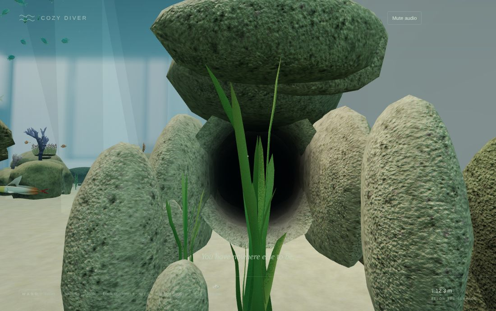
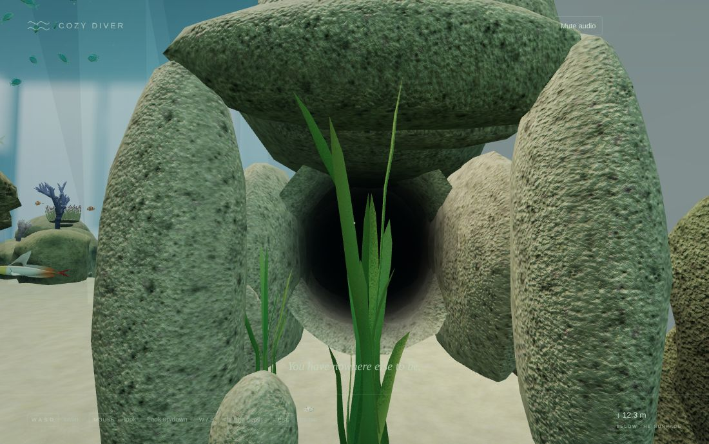
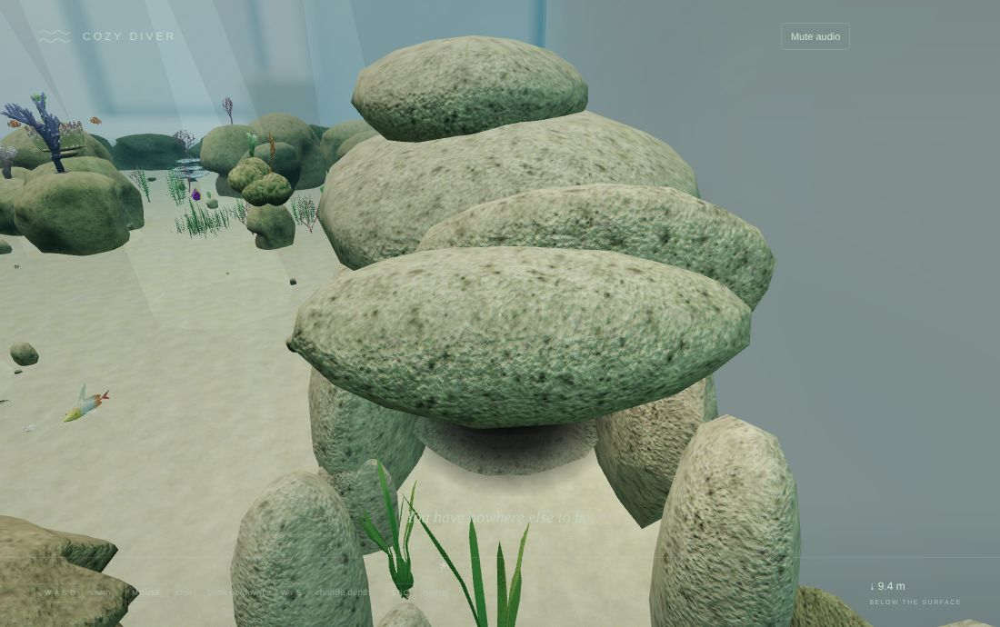
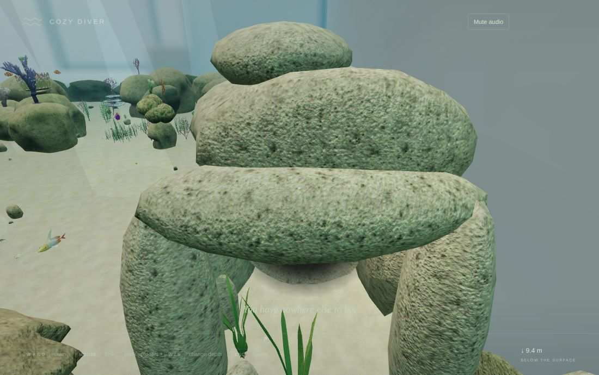
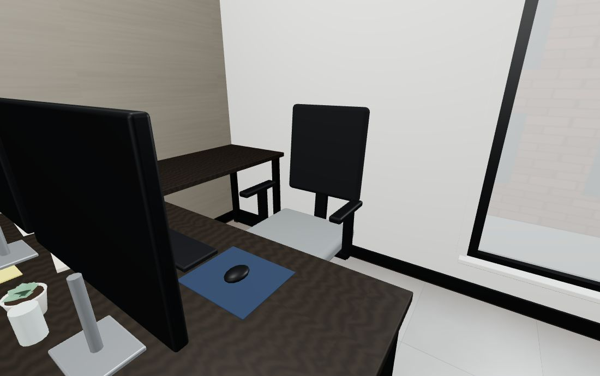
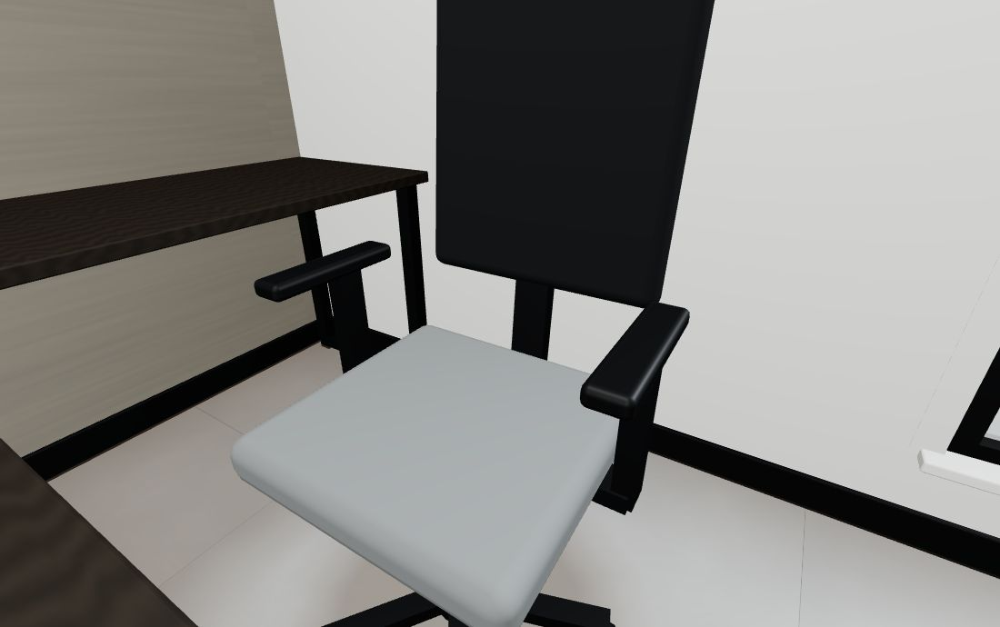
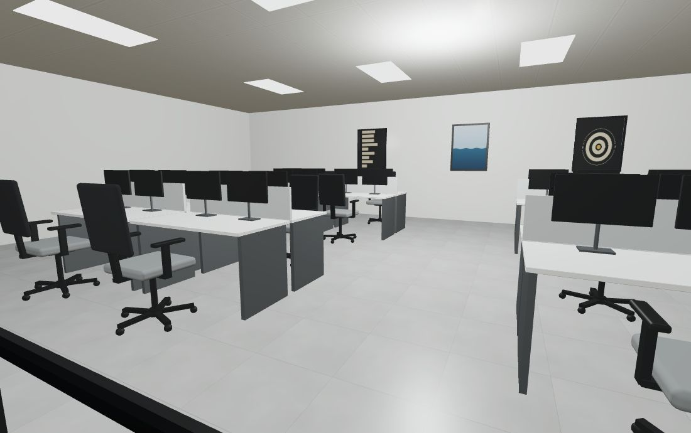

# v0.4 Pass 028 playtest round

Validation date: November 13, 2026. Release candidate `0.4.0-rc.2` for user review. No merge, release or tag is authorized by this report.

These are the changes asked for after playing `0.4.0-rc.1` on the Mac. The rest of the [release-candidate report](VALIDATION_V04_PASS_028.md) and its macOS checklist still apply.

## What changed

- **One complete task chair** (`taskChair` in `environment/office/OfficeEnvironment.ts`).
  - **Your desk chair:** its armrests floated, with pads at elbow height and nothing under them, and the backrest was not joined to the seat.
  - **The shared chair:** there is now one chair in which every part touches the next:
    - casters under a five-star base;
    - a gas lift to a plate under the seat;
    - a spine from that plate up into the backrest;
    - armrests on posts that rise from brackets under the seat.
  - **Where it is used:** at your desk and at every open-plan desk.
- **The open-plan workstations.**
  - **The bug:** a sign error put every chair through the partition, inside the desk opposite, and the monitors at the open edge of the desk. That is why the chairs looked broken.
  - **Now:** the monitors stand along the partition, each on a foot plate on the desk, and each of the 16 chairs sits on the open side, facing its own desk. The coat hangs over the new backrest.
- **The crevice's overhang is carried, not floating.**
  - **The cause:** the big slab over the mouth touched the buttresses either side only at its tips: 0.15–0.3 m of overlap, with their rounded tops stopping below it. Light showed under it from every angle.
  - **Now:** the slab is longer and a little lower, and both buttresses rise into it, so each end rests about 0.7 m deep on solid rock. It reads as a dolmen over the opening.
  - **The rock behind it:** it is larger and lower, so it merges with the outcrop instead of perching on top.
  - **Unchanged:** the channel and the way in, which the existing passage tests check.

| View                       | Before                                                          | After                                                          |
| -------------------------- | --------------------------------------------------------------- | -------------------------------------------------------------- |
| The crevice from the alley |        |        |
| From above                 |  |  |

| View                                      | After                                                       |
| ----------------------------------------- | ----------------------------------------------------------- |
| Your desk chair                           |        |
| Close up: the armrest posts and the spine |  |
| The open-plan office through the glass    |  |

## Checks

| Check                                  | Result                                                                                                                                                                                                                                                                                                                                                                                    |
| -------------------------------------- | ----------------------------------------------------------------------------------------------------------------------------------------------------------------------------------------------------------------------------------------------------------------------------------------------------------------------------------------------------------------------------------------- |
| `npm run build` / `typecheck` / `lint` | Pass                                                                                                                                                                                                                                                                                                                                                                                      |
| `npm run test`                         | **482 passed**. New: the overhang must rest on both buttresses. Each must rise at least 0.5 m into it and carry at least 0.6 m of its length, and the slab must stay clear of the swim path. On the old layout this test fails (the glass-side buttress stopped 0.25 m below the slab)                                                                                                    |
| Office tests                           | Unchanged and passing. The chairs are part of the existing merged batches, so the room keeps its 27-mesh budget                                                                                                                                                                                                                                                                           |
| Browser harnesses                      | `office.mjs` **passes**: walked 1.78 m, GPU memory steady over three office ↔ water round trips, no errors. `lifecycle.mjs` **passes**, with exact counts unchanged (the crevice keeps the same rocks and colliders). `passage.mjs` was still running when this round was merged at the user's request. The crevice's swim-in and channel clearance are covered by the passing unit tests |

## Known limitations

- **Triangles.** Views that see the open-plan office gained about 18 k triangles from the complete chairs: the room view went from 43 k to 62 k, measured by `office.mjs`. That is mainly casters and rounded parts. They are merged, so there are no extra draw calls, and it is small next to the outer reef's 1–1.7 M.
- **Guest chairs.** They are unchanged; their armrests already sit on uprights from the seat to the backrest.
- **Rounded rock.** Where rocks meet, some rounding still shows. The overhang is now carried by its buttresses, but the outcrop is still made of separate stones.
