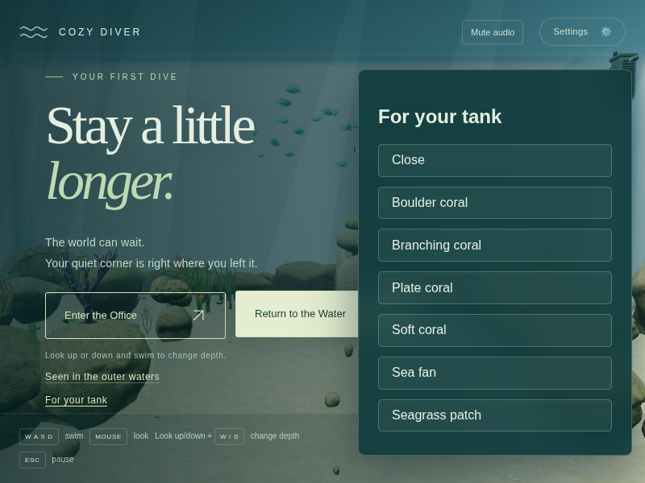
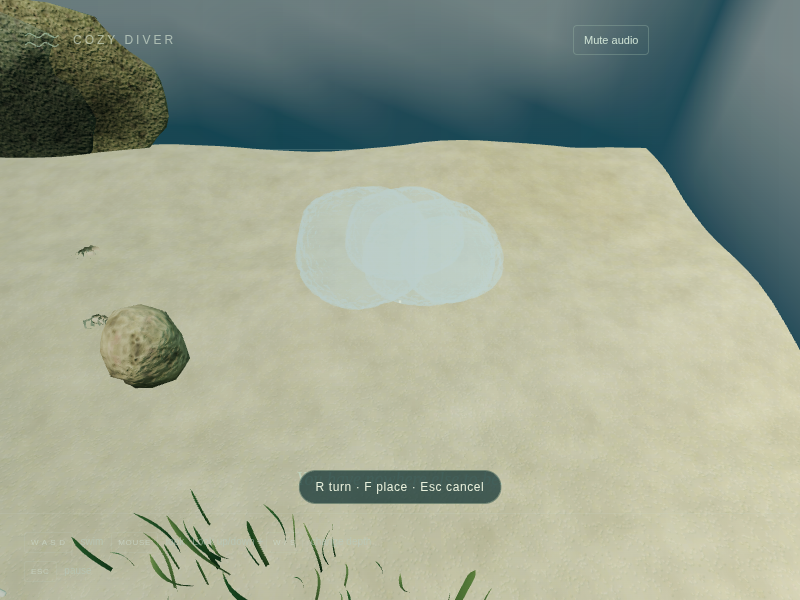
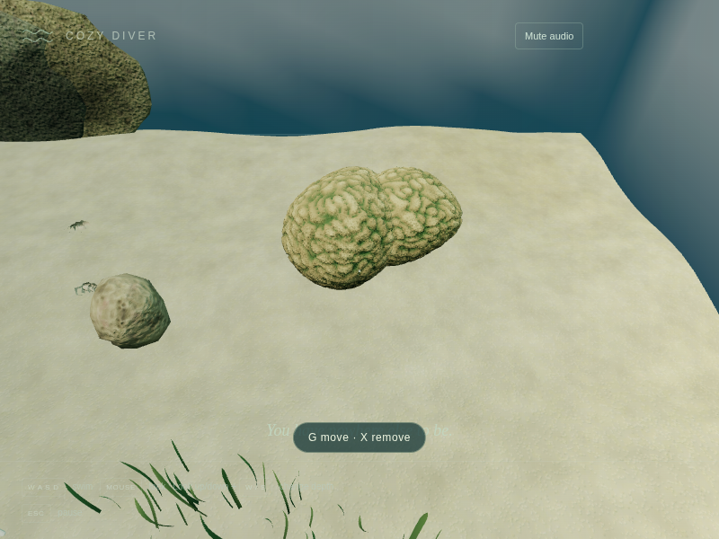
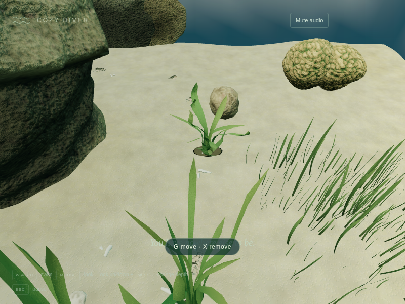
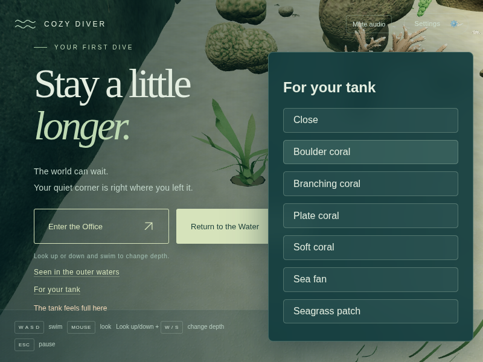
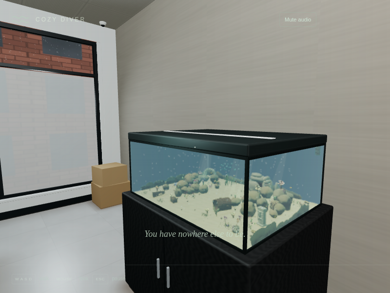

# v0.5 Pass 029 — The tank catalog

Candidate: `0.5.0-alpha.1`. v0.5 begins alongside v0.4 by user request. v0.4 remains open at `0.4.0-rc.3`, awaiting the user's macOS play-through.

## Changes

Six journal sightings unlock boulder, branching, plate and soft corals, sea fans and seagrass. Unseen items have no slots or progress display. Aquarium-only editing offers a translucent, seated preview, rotation, placement, transactional pickup, removal, a quiet cap note and versioned local saving. Settings resets additions only after confirmation. See [the design note](TANK_CATALOG.md) for controls, architecture, collision and ownership.

Placement preserves the central channel, glass clearance, crevice boulders/mouth/return alley, ornaments, creature homes and twelve protected paths, including the established discovery, arch, wreck, anemone and moray routes. Rotated footprint/support checks reject floating or overlapping pieces. Passing fish can temporarily dim the preview; placement waits for clearance.

## Evidence and limits

All browser evidence for this pass uses cloud Chromium with SwiftShader. It does not establish macOS FPS, Safari compatibility or subjective placement comfort. The catalog harness seeds the journal and stages clear swimmer aim positions, then uses actual buttons, pointer lock and keys. These are deterministic feature checks, not evidence of finding each sighting through an unassisted play-through.

Initial browser attempts exposed unsuitable fixture destinations near the channel and temporary fish obstruction. The fixture now samples room for the rotated footprint and waits for swimming fish to clear; placement validity is not bypassed. One targeted CPU test timed out while overlapping a software-rendered browser run; the browser was stopped and the unchanged test passed when run alone. Subsequent validation is sequential.

## macOS checklist

- Discover a coral or seagrass outside, return to the aquarium, pause and find it under **For your tank**. Unseen items should be absent.
- Choose an item, aim toward nearby sand or a broad rock top, **R** to turn and **F** to place. Check that placing feels calm and the colony looks naturally seated. Invalid previews should dim quietly.
- Look at an addition: **G** picks it up and **X** removes it. Escape during a move must preserve the original.
- Swim along the central channel, through the arch, around the wreck and through the crevice. Visit the anemone, moray and hidden discoveries; watch fish flow around additions.
- Add grass, let it sway, then enable reduced motion and check it settles still. Pause and resume without jumps.
- Reach the gentle cap and check the full-tank note. Reload and confirm saved additions return. Visit the office and inspect its miniature.
- In Settings, test both cancelling and confirming **Restore the original tank**. Sightings must remain.
- Compare frame time and comfort against `0.4.0-rc.3` in the same views, including twenty additions, and repeat dive/surface and passage trips.

## Automated checks

`npm run build`, `npm run typecheck`, `npm run lint` and all **498 tests / 53 files** pass after the final implementation changes. The unit suite ran with `--maxWorkers=1` in 131.46 seconds. New heavy route coverage uses an explicit 20-second timeout; the global default is unchanged.

The ecosystem stress suite passed all ten scenarios in 237.31 seconds. It covers 5-, 15- and 30-minute accelerated ecosystems with procedural, authored ornament and production reef collision, plus render-schedule equivalence. It runs separately from browser rendering.

## Catalog browser results

`validation/tank-catalog.mjs` passed in 533.2 seconds at 800×600. It exercises all six authored item types with native catalog clicks and keyboard placement, rotates a preview, cancels a pickup without losing the original, moves and removes an item, fills the tank, reloads all twenty unchanged, checks the office miniature, repeats two office/tank cycles and tests both reset choices. Sightings remain after reset. No page or console errors were recorded.

The filled tank stayed at **365 uploaded geometries / 113 textures** before and after the two cycles. These are renderer upload counts, distinct from the lifecycle harness's resident scene inventory. All six templates had finite, nonzero dimensions and the miniature retained the same twenty placements with distance batches selected for its camera.

| Rendered view                       | Draw calls | Triangles |
| ----------------------------------- | ---------: | --------: |
| Fixed tank view, no additions       |        179 | 1,007,618 |
| Same camera, twenty mixed additions |        186 | 1,196,139 |
| Preview close view                  |         20 |    56,658 |
| Placed coral close view             |         42 |   418,492 |
| Grass close view                    |         46 |   473,278 |
| Final office render                 |         28 |    59,558 |

The fixed-camera comparison includes changing fish poses and distance levels; its 7-call difference is the observed scene difference, not an isolated per-item cost. Items are instanced by kind and available detail level. The office number is the final office pass. The miniature renders in a separate earlier pass, so this is not their combined cost. No hardware FPS is inferred.

[Raw catalog report](screenshots/v0.5-pass029/catalog-report.json)

## Validation corrections

Final review expanded home keep-outs to at least each anchor’s declared radius (3 m for the anemone and 2.8 m for the moray), with regression coverage for the actual anchors. The placement/browser flow is rerun after that correction.

An initial dive run completed entry but failed the swimming-distance assertion: SwiftShader rendered too few frames during its ten-second wall-clock allowance (0.03 m measured). The harness now holds real W input for a bounded number of rendered frames, keeps the same movement threshold, and resynchronizes its manual clock after native rendering. Long regressions can use DPR 0.5 at their original CSS viewport; they verify and log that scale. The scene, geometry and behavior assertions stay intact. Catalog screenshots and measurements use DPR 1. All results remain SwiftShader-only.

The catalog harness also caught stale preview probing on the first frame after pointer-lock resume. The editor now invalidates that cache on lock changes; the full 498-test suite and catalog flow are rerun after the fix. Fixture preparation checks clear camera positions and sightlines as well as valid item footprints.

## Transition regression

The full `dive` harness passed at verified DPR 0.5 (1100×720 CSS viewport, 550×360 buffer) in 1,026.9 seconds. Real W input moved 0.40 m after entry; normal surfacing returned to the office with zero new shader programs, and reduced-motion entry completed in 0.9 simulation seconds. Before/after uploaded resources matched at **432 geometries / 113 textures**. The difference from the catalog run reflects different warmed render paths, not growth across a cycle.

[Raw dive report](screenshots/v0.5-pass029/dive-report.json)

`dive-interrupt` passed in 1,155.5 seconds at DPR 0.5: interruption before/after each switch, resume/cancel choices, five full dive/swim/surface/pause-screen cycles and reduced-motion surfacing. Resources stayed at **432 geometries / 113 textures / 123 programs** across every cycle.

[Raw interruption report](screenshots/v0.5-pass029/dive-interrupt-report.json)

`lifecycle` passed in 339.0 seconds at DPR 0.5, including the accelerated 30-minute ecosystem, native input/audio lifecycle, preference persistence, four pause/resume cycles, disposal and unsupported-audio fallback. The empty catalog preserves the measured resident inventory at **583 geometries / 108 materials / 521 hulls**, so its exact-count assertions remain unchanged. Visibility uses a controlled hidden state; Web Audio checks are functional, not perceptual listening.

[Raw lifecycle report](screenshots/v0.5-pass029/lifecycle-report.json)

## Remaining testing

The cloud environment disconnected during `passage`, after its tank-to-tunnel swap. Passage did not complete; `integration`, `reef-life`, and `production` were not run for this pass. On reconnection the user explicitly requested skipping further testing and opening the PR for their own testing. No additional tests were run after that instruction. The macOS checklist above remains pending, and v0.4 is not closed by this pass.
