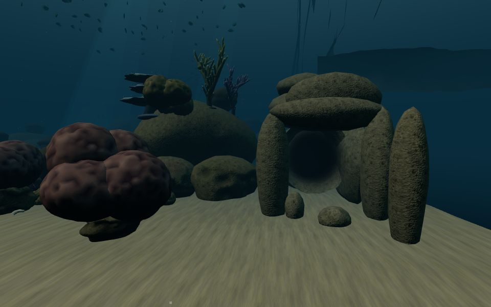
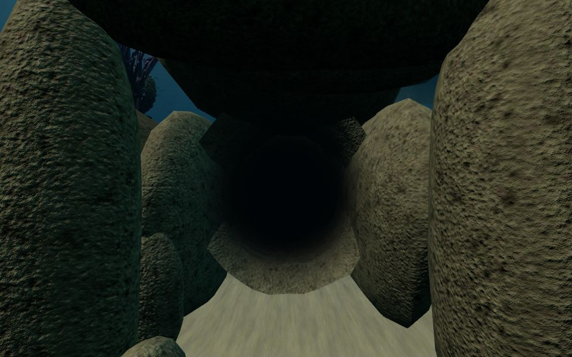
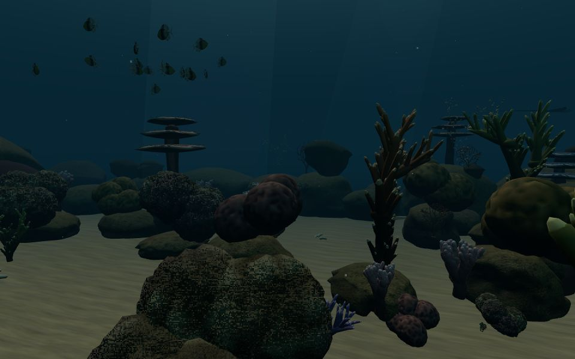
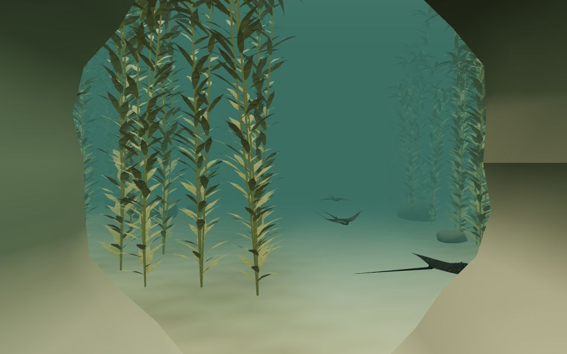
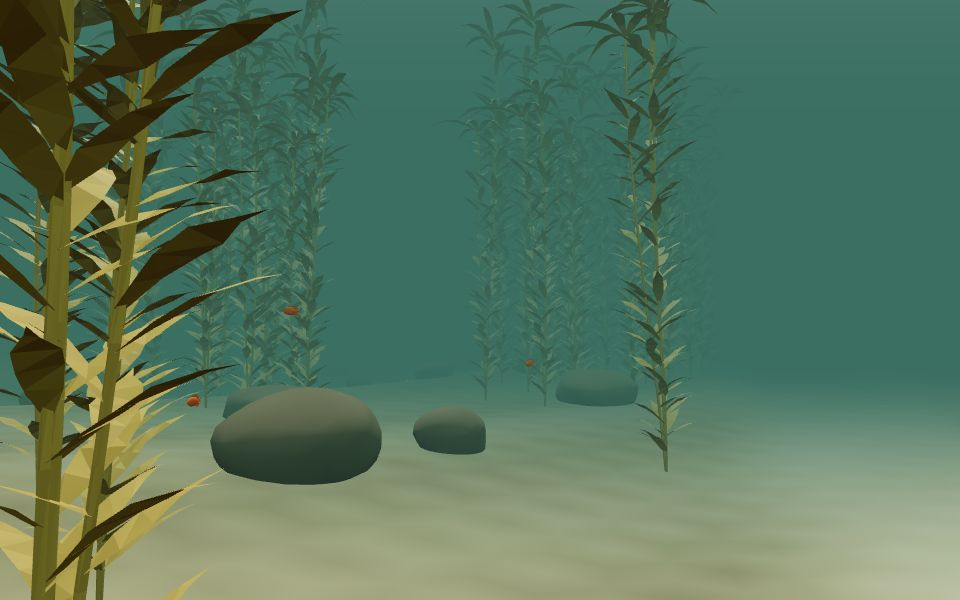
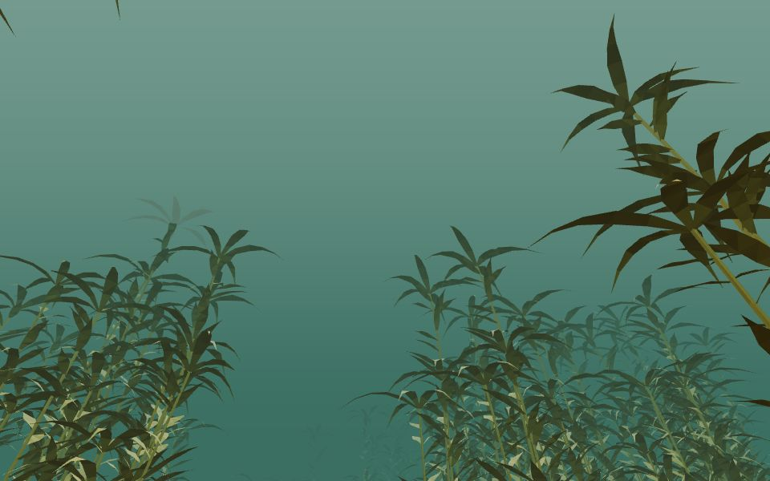
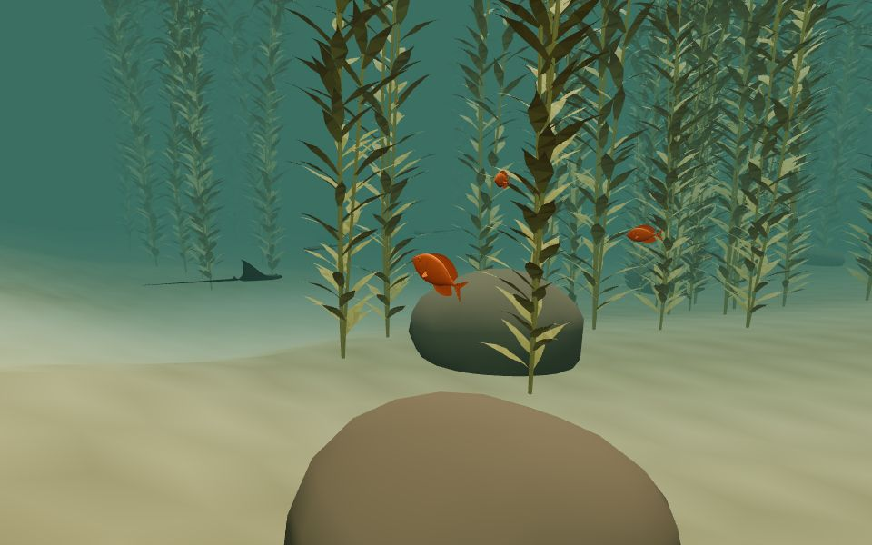
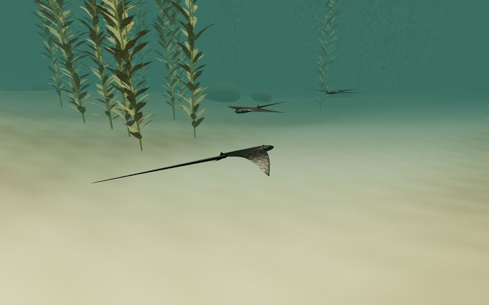

# v0.6 Pass 032 — The kelp forest

Validation date: November 14, 2026. Candidate `0.6.0-alpha.1` for user review. No merge or release is authorized by this report. v0.6 starts by user request; v0.4 (`0.4.0-rc.3`) and v0.5 (`0.5.0-rc.1`) remain open, awaiting the macOS play-through.

**Limits of this evidence.** All browser evidence comes from Linux Chromium with SwiftShader in a four-core container, with long harnesses at `COZY_DPR=0.5`. Nothing here measures MacBook Air frame time, Safari, or how the forest feels. Design notes are in [the kelp forest](KELP_FOREST.md).

## What changed

- **A second hidden passage.** A copy of the tank's crevice stands at the foot of the outer reef's cliff, west of the tunnel.
  - **Orientation:** it is turned so its glass side lies against the cliff, and its mouth faces west.
  - **Hidden:** a coral bommie screens it from the reef top.
  - **Seamless:** swimming through it, you continue into the kelp forest's tunnel past its threshold, at full darkness, without a break.
- **Passages as links between worlds** (`crossing()`). The tank ↔ outer waters link is unchanged. Return to the tank works from either outer world.
- **The kelp forest:**
  - a tunnel through a rock wall into a rocky seabed with 44 dark boulders and a sandy lane;
  - 150 giant kelp plants, each with three stipes of golden blades and a canopy near a bright surface, swaying on simulation time (still while paused and with reduced motion);
  - green water with about 15 m of visibility, and soft edges where swimming eases to a hover.
- **Life:**
  - **Garibaldi:** 20 in five groups around the larger boulders, on the chromis rig in solid orange, never in the tank.
  - **Bat rays:** four gliding along the lane, on the eagle ray's model tinted dark.
- **Discovery:** sightings for giant kelp, garibaldi and bat ray. Seeing the kelp unlocks a **Kelp** stand for the tank.
- **The outer reef keeps its look:** only the 11 reef pieces standing where the cleft goes were removed, after generation. Every other piece is identical (checked against the previous layout).

| View                                         | Capture                                        |
| -------------------------------------------- | ---------------------------------------------- |
| The cleft at the cliff's foot, from the west |         |
| Just inside the cleft's mouth                |   |
| From the reef top: the bommie screens it     |  |
| Out of the tunnel into the forest            |   |
| Among the kelp                               |        |
| Looking up at the canopy                     |        |
| Garibaldi at their boulder                   |     |
| Bat rays along the lane                      |      |

## Checks

| Check                                  | Result                                                                                                              |
| -------------------------------------- | ------------------------------------------------------------------------------------------------------------------- |
| `npm run build` / `typecheck` / `lint` | Pass                                                                                                                |
| `npm run test`                         | **531 passed** (59 files). New: `kelp-passage.test.ts` (5) and `kelp-forest.test.ts` (10), covering the items below |

The new tests cover:

- **The cleft:** it is the turned crevice, sealed except at its mouth, swimmable to its threshold and resting on the reef top.
- **The crossing:** only past the threshold, only once the forest is ready, and back. The tank passage is unchanged.
- **Darkness:** only inside each channel.
- **The reef:** kept out of the cleft, with its bommie intact.
- **Into the kelp tunnel:** every point you can reach at the cleft threshold maps into open kelp tunnel.
- **The kelp forest itself:**
  - the tunnel is sealed and swimmable, and its exit and the lane are clear;
  - the kelp placements are deterministic, and the sway runs on simulation time only;
  - the garibaldi stay out of the tank's population, and the rays' routes clear the boulders;
  - the sights are named, the kelp stand unlocks, the edges ease, and disposal happens exactly once.

### Browser regression (one at a time, `COZY_DPR=0.5`)

| Harness                          | Result                                                                                                                                                                                                                                                                                                      |
| -------------------------------- | ----------------------------------------------------------------------------------------------------------------------------------------------------------------------------------------------------------------------------------------------------------------------------------------------------------- |
| `kelp-forest.mjs` (new)          | **Pass.** The full route with real input and held W: tank crevice → outer reef → the cleft (the kelp forest loads within 15 m and is ready before you arrive) → swap into the kelp tunnel at full darkness on both sides (0.94 / 0.94) → out into the forest. Detailed in the list below the table          |
| `tank-catalog.mjs`               | **Pass**, now also placing the new kelp stand with real keys among the 20 additions. Seven item templates, seven unlocked. The first run stopped on a stale count in the harness itself (it counts the Close button, so seven items make eight buttons); corrected and re-run                               |
| `passage.mjs`                    | Pass: the tank's crevice is unchanged. GPU 363 / 113 / 113 before and after                                                                                                                                                                                                                                 |
| `outer-reef.mjs`                 | Pass. 235 fish, all moving, none below the seabed. Memory back to 432 / 113 after two visits. 47–83 draw calls and 1.04–1.83 M triangles: "back at the wall" rose from 67 to 83 draw calls because it now looks toward the cleft (13 boulders, rock tube and veils). Other views are unchanged within noise |
| `big-creatures.mjs`              | Pass, with the creature routes now a parameter: no reef contact in 21,600 samples, give-way closest 5.6 m                                                                                                                                                                                                   |
| `lifecycle.mjs`                  | Pass, with exact counts unchanged                                                                                                                                                                                                                                                                           |
| `dive.mjs`, `integration.mjs`    | Pass                                                                                                                                                                                                                                                                                                        |
| `production.mjs` (built preview) | Pass                                                                                                                                                                                                                                                                                                        |
| Console errors                   | None                                                                                                                                                                                                                                                                                                        |

`kelp-forest.mjs` checks, in the forest:

- **The kelp:** it sways, and is still while paused.
- **Life:** all 20 garibaldi and all 4 bat rays move.
- **Sightings:** looking at them records `species:garibaldi`, `species:bat-ray` and `plant:giant-kelp` in the journal.
- **Return to the tank:** it works from the forest. Both outer worlds are then released, and GPU memory returns exactly to its first counts (362 geometries, 113 textures).

#### Merged with main's outer-reef hotfixes

`main` gained Codex's outer-reef hotfixes during the run: denser haze, a 25 m camera range, cruisers 4 m closer, and a viewing edge 3 m past the lip (#57–#59). They were merged in.

- **One stale test:** `outer-reef.test.ts` still required the old 5–8 m easing band, and failed on `main` itself after #59. It now checks the agreed viewing edge (1 m ease, then the 2 m stop). Every behavioural check is unchanged.
- **Re-checked:** all 531 unit tests pass, and `kelp-forest.mjs` passes again on the merged code (the full route, all life moving, three sightings, memory back to 362 / 113).
- **No conflict with the cleft:** the viewing edge only limits the swimmer beyond the lip (z < −60). The cleft is at z −32.

## Cost of the kelp forest (development views, SwiftShader)

| View                        | Draw calls | Triangles |
| --------------------------- | ---------: | --------: |
| Tunnel exit                 |         14 |     355 k |
| In the forest               |         12 |     347 k |
| Canopy, looking up          |          9 |     333 k |
| On the floor among boulders |         17 |     358 k |

That is a quarter of the outer reef's triangles and a fifth of its draw calls. Most of it is the kelp: three instanced templates, one draw each.

## Known limitations

- **Procedural look:** the kelp, rock and sand are simpler than the reef's authored art.
- **The bat ray:** a tinted eagle ray, whose spots show faintly.
- **Water:** no light shafts, and the surface is a plain bright plane.
- **The cleft:** it looks like the tank's crevice, intentionally, as kin.
- **Not yet for the tank:** the garibaldi and bat rays (a later pass).
- **Software rendering only:** frame rate on the Mac is unmeasured.

## macOS checklist

- [ ] **Finding the cleft:** from the outer reef's tunnel exit, swim to the cliff's foot west of the tunnel. The cleft should be hidden from the reef top but findable along the cliff, looking like the tank's crack.
- [ ] **The crossing:** swimming in, the dark deepens and you continue into a tunnel without any jump. Swimming back out returns you to the reef the same way.
- [ ] **The forest:** it feels calm and inviting; the kelp sways slowly and naturally, golden against green water; the garibaldi and bat rays read clearly.
- [ ] **Edges:** swimming eases to a hover with no wall.
- [ ] **Sightings and the tank:** "New sighting" notes for giant kelp, garibaldi and bat ray. Back in the tank, a Kelp stand appears under For your tank and can be placed; it sways.
- [ ] **Return to the tank:** it works from the forest.
- [ ] **Frame time:** in the forest it is comparable to or better than the outer reef.
- [ ] **Reduced motion:** the kelp stands still.
