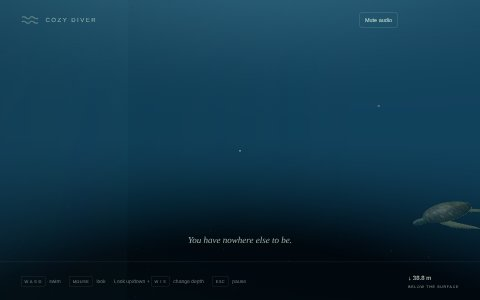
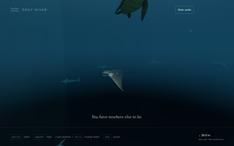
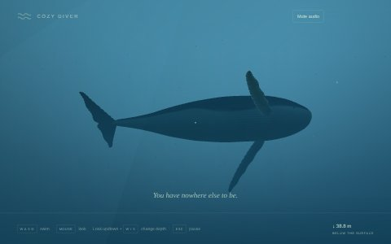
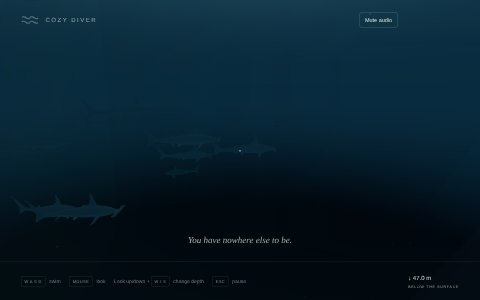
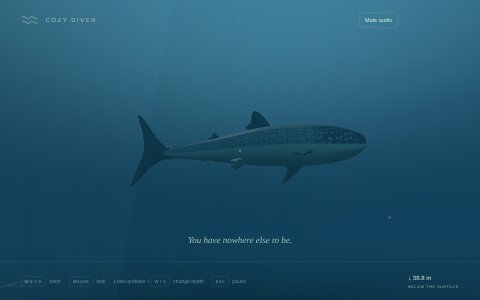
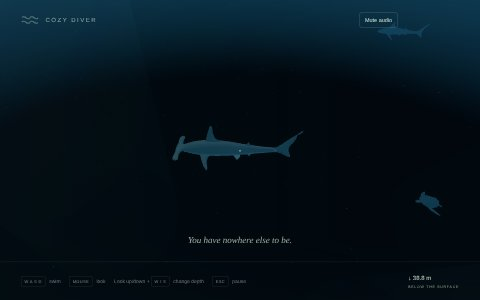
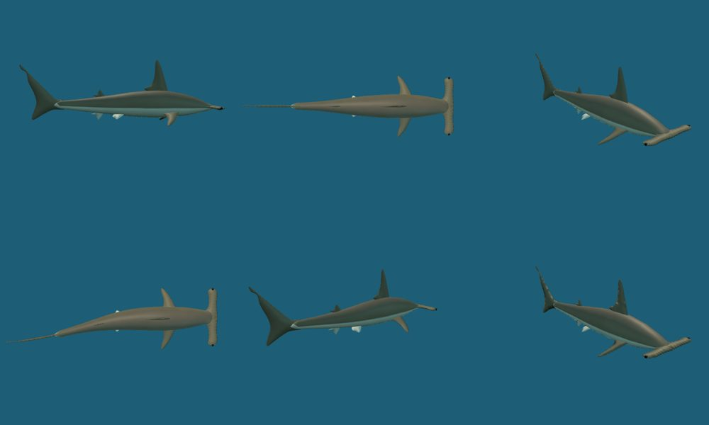
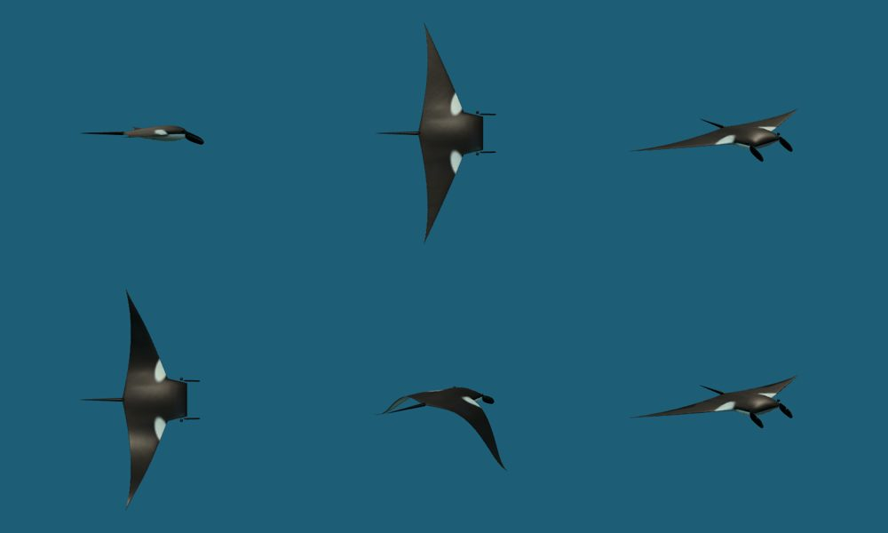
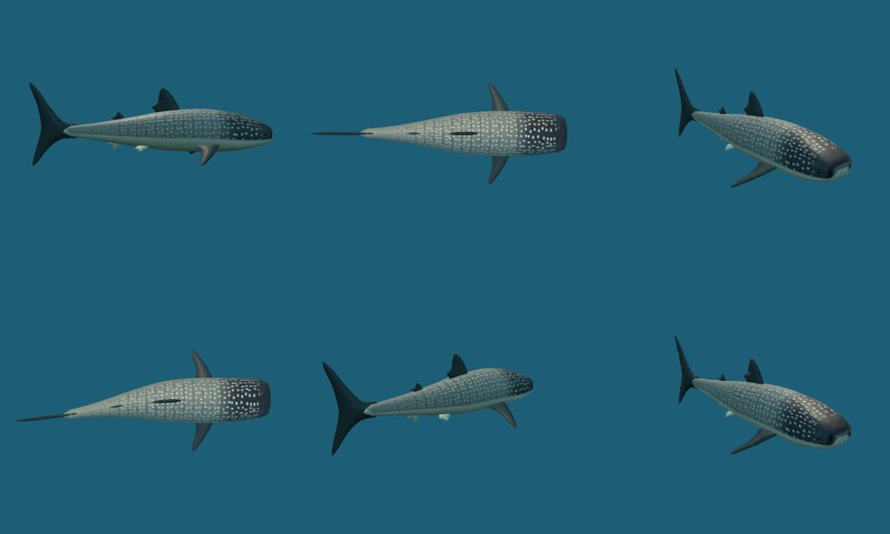
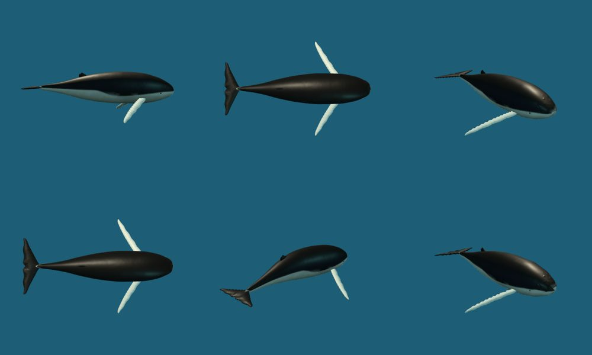

# v0.6 Pass 033 — Wall visitors

Validation date: November 15, 2026. Candidate `0.6.0-alpha.2` for user review. No merge or release is authorized by this report. v0.4 (`0.4.0-rc.3`) and v0.5 (`0.5.0-rc.1`) remain open, awaiting the macOS play-through.

**Limits of this evidence.** All browser evidence comes from Linux Chromium with SwiftShader in a four-core container, at `COZY_DPR=0.5` (so the in-game captures below are small). Nothing here measures MacBook Air frame time, Safari, or how the visitors feel to watch.

## The request

> Lets add some bigger creatures swimming by on the outer reef.

The answers to the follow-up question, as given:

- **The creatures:** "Schooling Hammerheads", plus the manta ray, whale shark, humpback whale and great hammerhead.
- **Behaviour:** "The creatures should just loop back and forth, the player should be surprised by different creatures the longer that sit at the edge."
- **Variety between visits:** "Each time the player enters the outer reef, what creature passes first should be difference".

## What changed

- **Four new authored animals** (`tools/art/pass033/visitors.py`, built on Pass 025's Blender helpers and compressed like every creature):

  | Model          | Look                                                                                                          | Stroke            |
  | -------------- | ------------------------------------------------------------------------------------------------------------- | ----------------- |
  | Hammerhead     | wide cephalofoil with eyes at its tips, tall sickle dorsal, bronze-grey back                                  | side to side      |
  | Reef manta     | broad pointed wings, cephalic fins, short tail; black back with pale shoulder patches, white belly with spots | slow wing beat    |
  | Whale shark    | broad flat head, wide front mouth, ridges, crescent tail; blue-grey with pale spots and stripes               | side to side      |
  | Humpback whale | long white scalloped flippers, small dorsal hump, wide notched flukes, throat grooves                         | vertical (flukes) |

  Each has a full and a light distance level with stroke morphs, and 512 px textures (KTX2). Each GLB is 380–560 KB after compression.

- **Sizes:** each model is about 3 m long (the manta 4.4 m across), scaled at runtime:
  - a 4.4 m manta;
  - an 8 m whale shark;
  - a 12.6 m humpback;
  - a 4.5 m great hammerhead;
  - twelve 2.7 m scalloped hammerheads.

  A group with no scale now keeps its species' own size, so these can exceed the 0.5–1.5 limit that group scales still have.

- **They loop back and forth.** Each swims a long stadium-shaped loop past the lip:
  - along a near lane one way, about 6–7 m beyond where the swimmer can go;
  - round a wide turn beyond the reef's swimmable width, deep in the haze;
  - back along a lane further out.

  They pass one above another, about 4.5 m apart: the humpback highest against the bright water, then the whale shark, the manta, the great hammerhead, and the school deepest beside the wall's face.

- **The longer you stay at the edge, the more come.**
  - Nobody is passing when you arrive.
  - Time counts only at the edge (within 5 m of the lip, across the reef's width) and only while playing.
  - The first visitor comes after 8 s, then one more kind every 45 s, until all five are passing.
  - Once come, they keep looping for the rest of the visit.

- **A different first animal each visit.**
  - Each entry to the outer reef (from the tank or from the kelp forest) is a new visit, numbered by a counter kept in local storage (`cozy-diver.visits.v1`).
  - The first visitor steps along the five each visit, so two visits in a row never open the same way, and five visits open with each of the five.
  - The rest follow in an order shuffled from the visit's number.
  - The counter tolerates absent, corrupt or unavailable storage: without it, visits still vary within a session.

- **Nothing appears from nowhere.**
  - Each visitor starts 26 m along its loop before the point where it passes closest to you, and further back still if needed, so it is at least 16 m away plus half its body and its school's spread.
  - At that distance the outer waters' fog leaves about 1% of it.
  - In the browser run every visitor appeared 26.7–42 m away, beyond the 25 m view distance.

- **Discovery:** each visitor is a new sight (Reef manta ray, Whale shark, Humpback whale, Great hammerhead, Scalloped hammerhead). It can be seen only once it has come. Nothing is counted or scored, and no visitor is a tank baby.

| View                                               | Capture                                                |
| -------------------------------------------------- | ------------------------------------------------------ |
| Waiting at the edge                                |                  |
| A reef manta passes below the lip                  |                 |
| A humpback overhead                                |              |
| Scalloped hammerheads beside the wall, in the haze |     |
| A whale shark                                      |           |
| A great hammerhead                                 |      |
| Model sheet: hammerhead                            |      |
| Model sheet: reef manta                            |       |
| Model sheet: whale shark                           |     |
| Model sheet: humpback whale                        |  |

The model sheets show side, top and three-quarter views, both stroke extremes and the light distance level. They were rendered in a plain lit scene without fog.

## Checks

| Check                                  | Result                                                      |
| -------------------------------------- | ----------------------------------------------------------- |
| `npm run build` / `typecheck` / `lint` | Pass                                                        |
| `npm run test`                         | **549 passed** (60 files). New: `wall-visitors.test.ts` (9) |

The new tests cover:

- **The order:** each visit opens with a different animal, five visits in a row open with each of the five, the rest vary, and nonsense visit numbers still give a full order.
- **The schedule:** none before 8 s, then one more every 45 s, capped at five.
- **The edge:** counts only near the lip and within the reef's width.
- **Storage:** the counter survives absent, corrupt and throwing storage.
- **The loops:**
  - every point lies past where the swimmer can go;
  - each loop clears the reef and wall beneath it and stays below the surface limit;
  - within the reef's width each runs along the wall in both directions, so every turn is out of reach;
  - no two loops come within half their bodies' combined size.
- **Arrival:** from 28 places along the edge, every visitor starts beyond its hidden distance. Within 90 s it passes within 9 m (beyond its body) of the swimmer, at one of the edge's depths wherever along it they are.
- **The full system with stand-in models:**
  - nobody comes away from the edge or while paused;
  - at the edge each comes on schedule, every member out of sight, and becomes seeable;
  - they swim;
  - the next visit starts over with no one passing, no sights, and a different first animal;
  - disposal is safe twice.
- **Existing suites:** the give-way test now also covers the five new species. The asset checks cover the four new models and their manifest entries.

### Browser regression (one at a time, `COZY_DPR=0.5`)

| Harness                   | Result                                                                                                |
| ------------------------- | ----------------------------------------------------------------------------------------------------- |
| `wall-visitors.mjs` (new) | **Pass**, with real pointer lock and held W through the crevice. Detailed in the list below the table |
| REGRESSION_ROWS           |

The `wall-visitors.mjs` run, in order:

- **Arrival:** nobody was passing and the visit was stored (the next is visit 1). Visit 0's order was manta, humpback, scalloped hammerheads, whale shark, great hammerhead.
- **Away from the edge:** no time counted.
- **At the edge, stepped in real time:** the manta came after exactly 8.0 s.
- **Paused:** time did not count.
- **Each visitor, followed until it passed closest:**

  | Visitor               | Appeared at | Passed within |
  | --------------------- | ----------- | ------------- |
  | Manta                 | 27.2 m      | 6.7 m         |
  | Humpback              | 27.3 m      | 11.1 m        |
  | Scalloped hammerheads | 27.8–42.2 m | 10.0 m        |
  | Whale shark           | 26.7 m      | 8.2 m         |
  | Great hammerhead      | 27.4 m      | 9.0 m         |

  Each was seen and saved to the journal. The waits between later visitors were skipped by advancing the edge time.

- **Back to the tank and in again:** visit 2 was stored, nobody was passing, and the whale shark was due first.
- **Released far from the crevice:** GPU memory returned to its first counts (362 geometries, 113 textures). No page errors.

The first browser run found a real fault that unit tests could not:

- **The fault:** the manta's wing-beat morphs widen its measured bounds to 5.2 m, past the registry's 4.8 m limit. The load was refused, and with it the whole visitor set.
- **The fix:** its limit is now 5.5 m, noted as the turtle's is. The asset unit test does not decode the morph bounds the browser measures.

## Known limitations

- **Visibility.** The outer waters' visibility (fog 0.13, about 96% haze by 14 m) is unchanged, and it bounds how much of the visitors you see:
  - **Near lanes:** the near lanes are as close as the reef at the lip allows (routes lift over anything within their reach).
  - **Deeper visitors:** the deepest (the school, at about -9.5 m) are clearest from lower down at the wall's edge, and are faint silhouettes from the reef top.
  - **The humpback:** it passes overhead, against the brighter water.
- **Separation.** The visitors keep apart by lane, not by timing. A visitor may pass behind one of Pass 026's sharks or rays; those keep their own routes.
- **Giving way.** Visitors give the swimmer room as the other creatures do, but their lanes lie beyond the swimmer's reach, so it rarely matters.
- **Loop timing.** At these speeds a loop takes 2–3 minutes, so after its first pass a visitor comes back along the far lane, then near again about every 2–3 minutes.
- **One failed model.** If any visitor model fails to load, none of the visitors appear (the rest of the reef is unaffected).
- **Model fidelity.** The models are stylized, built procedurally in Blender. Details such as the manta's mouth or the humpback's head knobs are textures and normal maps, not geometry.

## macOS checklist (for the user)

1. Enter the outer reef and swim to the lip. Nobody is passing yet.
2. Wait at the edge, looking out. After a few seconds something comes in from the side, out of the haze, and passes along the wall.
3. Keep waiting. About every 45 s another kind joins, until there are five. Try sinking a little down the wall's face to see the hammerhead school.
4. Watch one pass: it should glide and stroke naturally and turn far out of sight, then come back along a further lane.
5. Pause, wait, resume: nothing new arrives while paused.
6. Return to the tank and swim back out: a different animal comes first. Repeat a few times.
7. Check the Seen list for the new names, and that frame rate at the edge stays smooth with all five passing.
