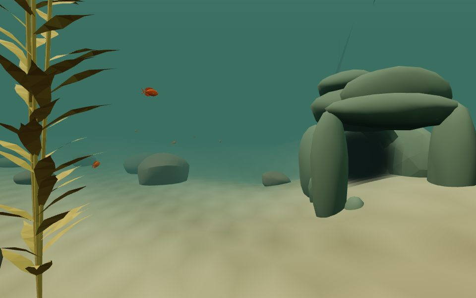
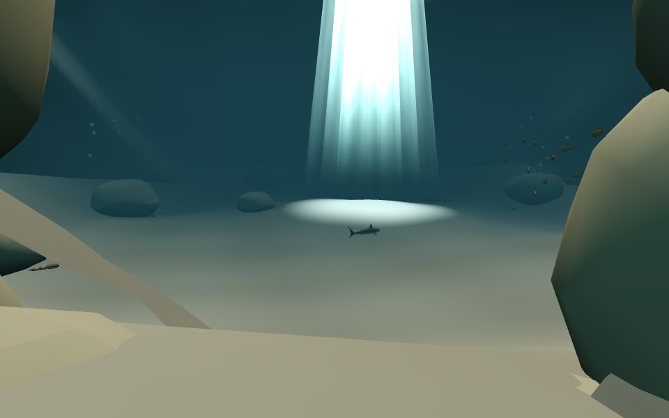
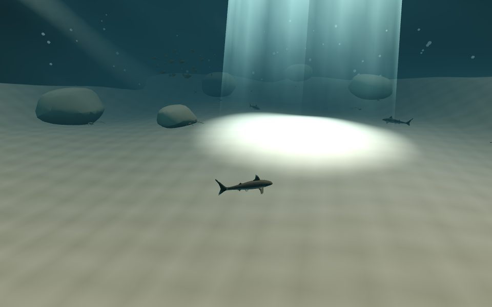
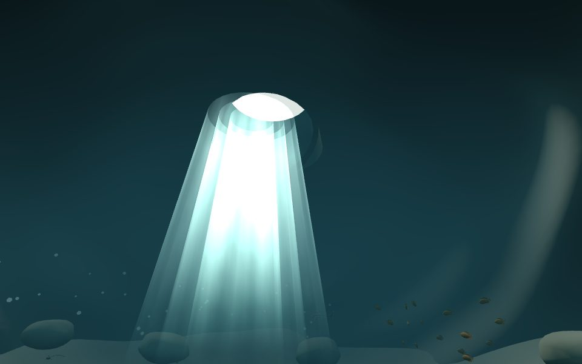
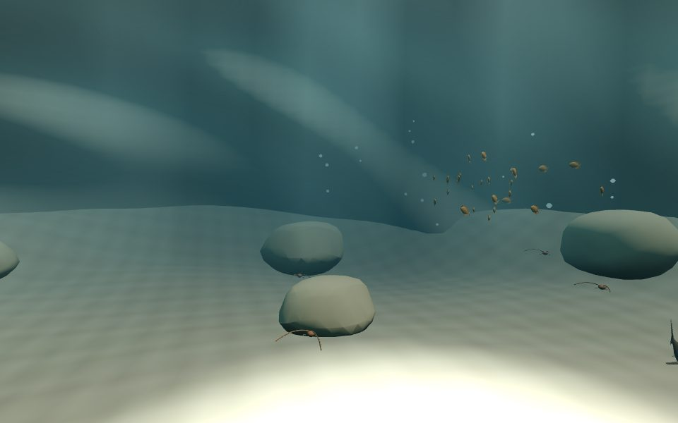

# v0.6 Pass 034 — The sea cave

Date: November 15, 2026. Candidate `0.6.0-alpha.3` for user review. No merge or release is authorized by this report.

**Testing was kept to a minimum, at the user's request: the user is doing the play-testing.** Only the standard checks, a small new unit test file and a few still captures of the new scenes were run. No browser harnesses or regressions were run for this pass. All captures come from Linux Chromium with SwiftShader.

## What changed

- **A third hidden passage.** Another copy of the tank's crevice (the "grotto") stands against the kelp forest's rock wall, east of its tunnel at about x 21–25, with its mouth facing west. Kelp and boulders keep clear of it. Swimming in, past its threshold at full darkness, you continue in the sea cave's tunnel. Swimming back out returns you to the grotto, and Return to the tank works from the cave as well.
- **The sea cave**, the fourth water world:
  - **The cavern:** a dome of pale limestone about 32 m across and 14 m high, lumpy and stained darker low down. Its sand floor ripples softly and banks up at the walls.
  - **The light:** a shaft of sunlight falls through a hole in the roof (three nested additive cones, so its edges are soft) onto a pool of light on the sand. The beam breathes slowly, only while playing and not with reduced motion.
  - **Movement:** dim blue-green water with about 12 m of visibility. Swimming towards the walls or roof eases to a hover about a metre short of the rock; the tunnel is sealed by colliders.
- **Life:**
  - **Whitetip reef sharks:** three rest on the sand around the light, flexing slightly as they breathe, and one circles slowly. This is a new model, `whitetip-shark.glb`: the Pass 025 reef shark body with a new skin (white fin tips, grey-brown back), built by `tools/art/pass034/whitetip.py`.
  - **Glassy sweepers:** two copper-coloured schools in the shade, on the chromis rig. They never appear in the tank.
  - **Spiny lobsters:** eleven, built in code, peer out of cracks at the feet of the boulders and the back wall; their antennae sweep slowly.
  - **Glowing sponges:** a scatter of faintly glowing sponges on the lower back walls.
- **Discovery:** four new sights: Sea cave, Whitetip reef shark, Glassy sweeper and Spiny lobster. Seeing the cave unlocks a **Limestone arch** for the tank, built in code.

| View                                         | Capture                                                 |
| -------------------------------------------- | ------------------------------------------------------- |
| The grotto in the kelp forest                |                 |
| Into the cave from its tunnel                |          |
| Whitetips resting by the pool of light       |      |
| The sunbeam through the roof                 |                |
| Sweepers in the shade, lobsters at the rocks |  |

## Checks

| Check                                  | Result                                                 |
| -------------------------------------- | ------------------------------------------------------ |
| `npm run build` / `typecheck` / `lint` | Pass                                                   |
| `npm run test`                         | **554 passed** (61 files). New: `sea-cave.test.ts` (3) |

The new tests cover:

- **The crossing:** both ways, only once the cave is ready.
- **The tunnel:** it can be swum from its start into the cavern.
- **The walls:** pushing at them and the roof in six directions never reaches the rock.
- **Discovery:** the new sights' names, and the arch unlock.

Asset validation also covers the new whitetip model.

## Known limitations

- **Not play-tested here:** the full route (tank → outer reef → kelp forest → grotto → cave and back), loading and release, pause, sightings in play and the tank arch were not exercised in the browser.
- **Memory:** while you are in the cave, the outer reef and the kelp forest stay loaded, so the way back is seamless. Memory use with all four worlds loaded was not measured.
- **Soft walls:** the cave's walls stop you by easing, not by solid collision, so a very fast approach could come closer than a metre before stopping.
- **Shape:** the walls are a smooth lumpy dome, with no overhangs or side passages.

## What to try (for the user)

1. Swim through the cleft into the kelp forest, then east along its rock wall (right as you leave the tunnel) to find the grotto among the kelp.
2. Swim into the grotto: the darkness should peak and clear into the sea cave's tunnel without a jump.
3. In the cave, look for the sunbeam, the resting and circling whitetips, the sweeper schools, the lobsters at the rocks, and the glowing sponges at the back.
4. Swim at the walls and roof: you should slow to a hover before the rock.
5. Swim back out through the tunnel into the kelp forest, then use Return to the tank from inside the cave.
6. Check the Seen list, and place a Limestone arch in the tank.
7. Note frame rate in the cave and on the way back.
