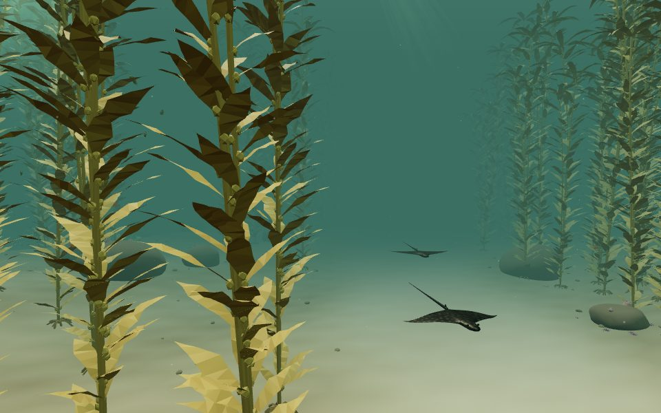
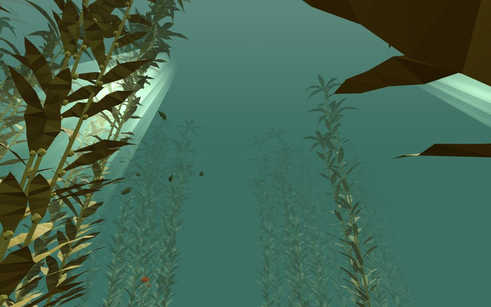
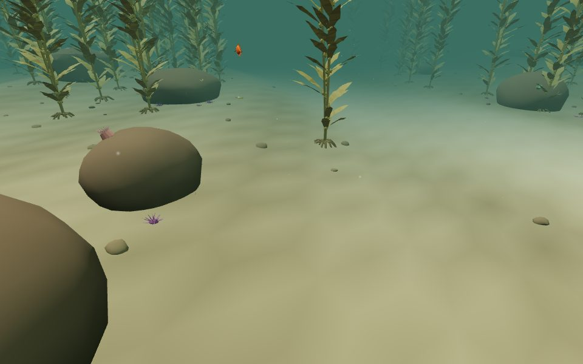
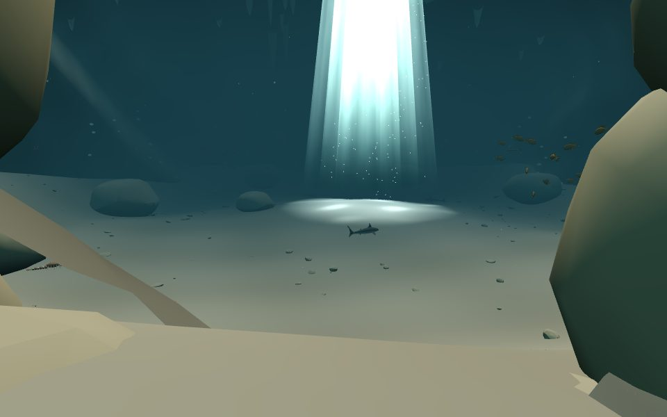
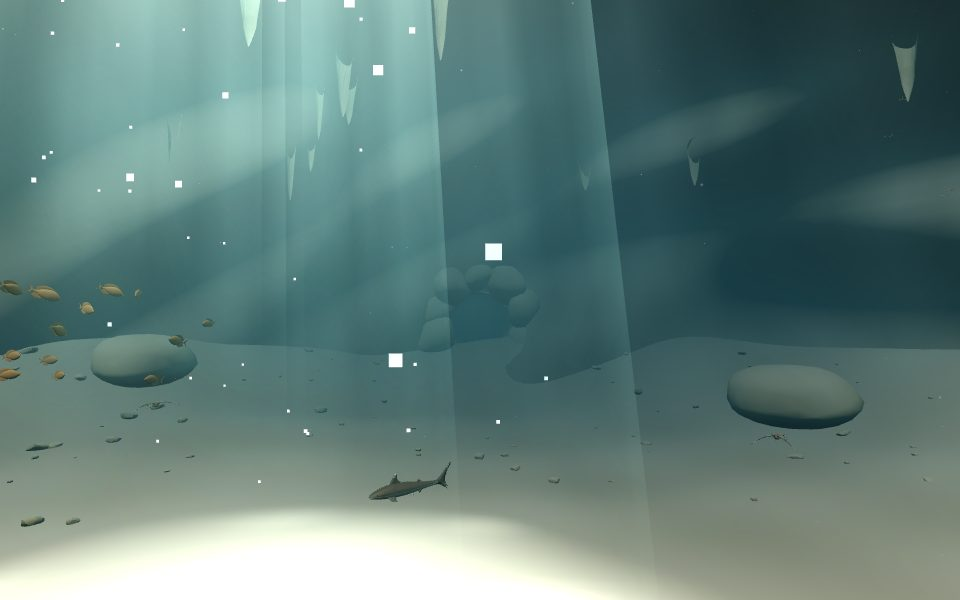
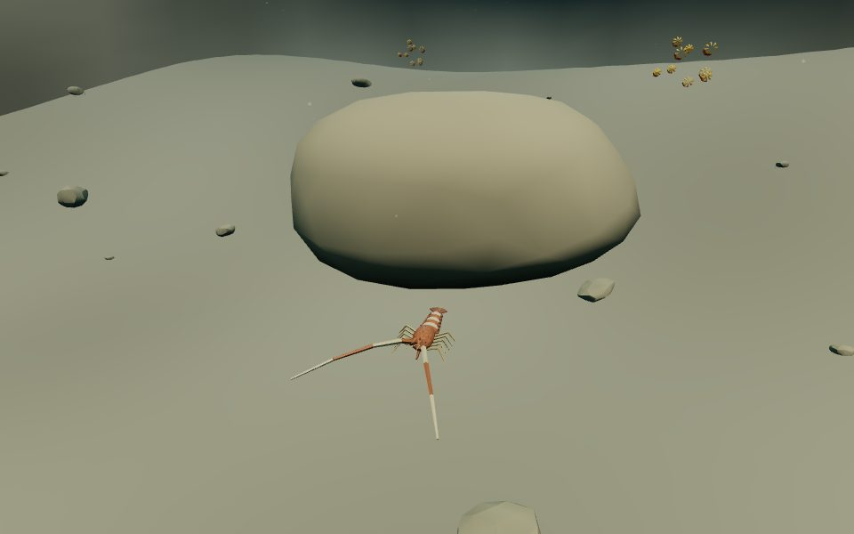

# v0.6 Pass 035 — Detail for the kelp forest and the sea cave

Date: November 16, 2026. Candidate `0.6.0-alpha.4` for user review. No merge or release is authorized by this report.

**Not tested, at the user's request: the user is doing the testing.** Build, typecheck and lint were run, and a few still captures confirmed the new detail renders without page errors (Linux Chromium with SwiftShader). The unit tests and browser harnesses were not run.

## What changed

### Both areas

- **Drifting particles:** "marine snow" drifts slowly in the water around you. The particles keep their place in the world as you move, so you see them slide past, and they stop while paused or with reduced motion (`environment/shared/MarineSnow.ts`).
- **Soft sunbeams:** the beams are now built by a shared helper (`environment/shared/LightBeam.ts`) from nested additive cones that fade in from the top and out towards the bottom, so their edges are soft.

### Kelp forest

- **The kelp itself:**
  - a tangled root holdfast at each plant's base;
  - a small gas bulb (pneumatocyst) at the base of every blade;
  - blades with more segments and ruffled edges;
  - each blade's colour varies a little, and the blades shade darker at the base and paler at the tip.
- **Life on the rocks and floor** (`KelpDressing`, one instanced draw per kind):
  - **Purple sea urchins** (340): spiny, clustered at the boulders' feet and on the rock.
  - **Sea stars** (170): in orange, red, purple and gold, on boulder faces and the floor.
  - **Anemones** (150): green and strawberry pink on the boulders. Their tentacles stir in the swell, only while playing and not with reduced motion.
  - **Cobbles:** about 420 scattered over the seabed, off the middle of the sandy lane.
- **Sunbeams:** ten beams slant down through gaps in the canopy, leaning with the sun and swaying slightly. They fade with distance, so only those near you show.
- **Kelp bass:** three loose groups of olive-brown fish hang in mid-water among the kelp, with a new sight (Kelp bass).

### Sea cave

- **The walls:** water streaks and faint bands of strata on the limestone.
- **The roof:** about 46 knobbly limestone formations, each one tapered lump rooted in the rock.
- **Sun corals:** orange cup-coral clusters on the bare lower walls and the shaded sides of the boulders. Their yellow polyps open and close slowly.
- **The floor:** rubble and broken shell litter the sand, thicker near the walls.
- **The light:** the pool of light ripples with moving caustics, and motes of sediment glitter and drift in the sunbeam.
- **Spiny lobsters**, rebuilt and given behaviour:
  - **The body:** a spiny carapace with horns over stalked eyes, five pairs of jointed, banded walking legs, a segmented tail with pale bands and side lappets, and a five-flap tail fan.
  - **The antennae:** long, thick and banded, with spiny bases and a pair of short feelers between them.
  - **Behaviour:** when you come within about 2.6 m, a lobster backs quickly into its crack, antennae flicking. It creeps out again slowly once you have moved away.
- **Resting whitetips:** every 20–45 seconds or so, a resting shark stirs. A few strong tail beats lift it slightly and turn it a little, then it settles again. With reduced motion they only breathe.

### Removed while checking the captures

- I tried a group of the tank's pajama cardinalfish in the cave. At cave distances their simplified distant model looked blocky, so they were removed.
- Sun corals had been placed on the sand banked against the walls, where they read as floating. They now sit on the bare rock above the sand.

| View                              | Capture                                           |
| --------------------------------- | ------------------------------------------------- |
| Kelp: out of the tunnel           |        |
| Kelp: sunbeams through the canopy |    |
| Kelp: urchins and anemones        |   |
| Cave: in from the tunnel          |          |
| Cave: formations and motes        |  |
| Cave: a spiny lobster             |     |

## Known limitations

- **Frame rate:** the kelp templates now carry gas bulbs and holdfasts (about 2,000 more triangles per kelp plant), and the forest has several hundred more small instanced pieces. Frame rate on a Mac was not measured.
- **Placement:** small life on the boulders is placed on a rounded estimate of each boulder's shape, so a few pieces may sit slightly proud of the rock or sink into it.
- **Lobster behaviour:** the lobsters only notice the swimmer, not the circling whitetip.
