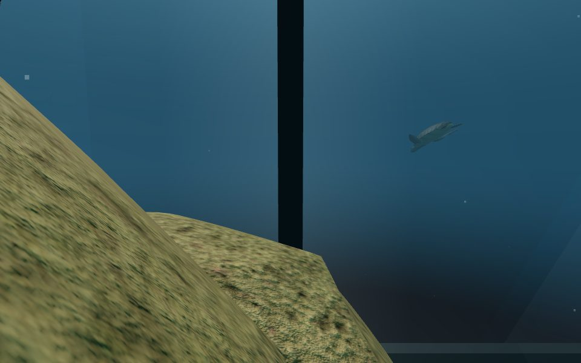
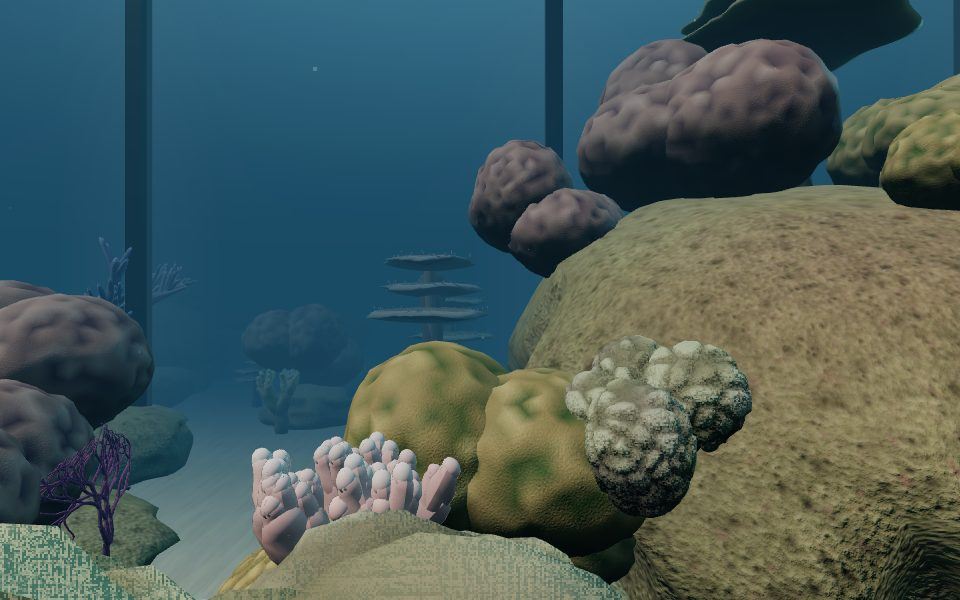
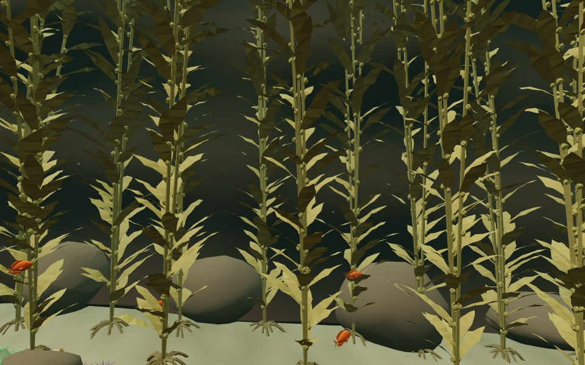
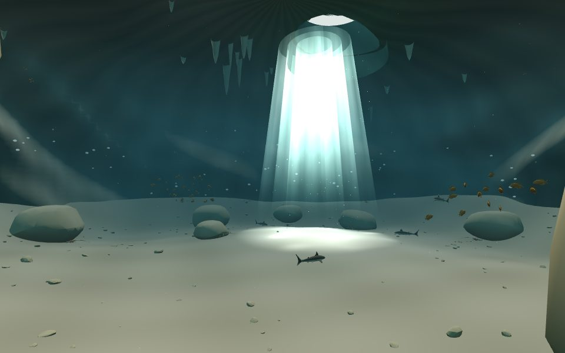

# v0.6 Pass 036 — Every area is a tank

Date: November 16, 2026. Candidate `0.6.0-alpha.5` for user review. No merge or release is authorized by this report.

**Not tested, at the user's request: the user is testing in game.** Build, typecheck and lint pass. A few still captures (Linux Chromium with SwiftShader) confirmed each area renders without page errors.

## What changed

Every area beyond the tank is now boxed in, like stepping into the next display tank.

- **Outer reef: the glass back wall.**
  - **The window:** a great aquarium window stands just past the reef's lip (z -59.4), with glass panes on both sides (x ±32.5). It reaches from deep down the wall to near the surface.
  - **Its look** (`environment/shared/TankGlass.ts`): faint blue-green glass with a sheen at the pane edges and soft diagonal reflections, and dark frame posts every 8 m. Frame bars run along the top and bottom, plus one just below the reef's lip, where the window meets the reef.
  - **Swimming up to it:** you now swim out over the lip at normal speed, slow gently over the last metre and a half, and stop about half a metre from the glass. That replaces the earlier long slow crawl short of an invisible edge. The side glass stops you the same way.
  - **Outside the glass:** the big animals and the wall visitors keep swimming in the blue beyond it.
- **Kelp forest: rock walls behind dense kelp.**
  - **The walls:** lumpy walls of stacked rock, with cracks and coralline pink low down, close the sides (x ±36) and the far end (z -84), rising from the seabed past the surface. The tunnel's wall closes the near end.
  - **The base:** about 50 big rocks are piled along the walls' feet.
  - **Kelp:** two staggered rows (165 extra plants) stand in front of the walls.
  - **Collision and layout:** solid rock lies behind the faces. Swimming eases only in the last couple of metres. The forest's own kelp and boulders now stay inside the walls, which changes their layout.
- **Sea cave: a tank-sized cave.**
  - **The shape:** the cavern is now a rounded box the size of the tank, about 36 m wide, 28 m deep and 12 m from the sand to a solid rock roof. It is still lumpy, streaked and hung with formations.
  - **The light:** the hole in the roof and its sunbeam are kept. The hole's chimney no longer hangs down into the cave.
  - **Seeing the roof:** the water is clearer (fog 0.042, from 0.07), and the sky light's ground colour now lights the roof from below, so the roof and far walls read all round.
  - **Moved to fit:** the boulders and one resting whitetip were moved to suit the new shape.

| View                                   | Capture                                            |
| -------------------------------------- | -------------------------------------------------- |
| Outer reef: at the glass past the lip  |       |
| Outer reef: the side glass             |  |
| Kelp forest: a side wall               |         |
| Sea cave: the tank-sized cave and roof |         |

## Known limitations

- **Fish and the glass:** the outer reef's fish and creatures still use the open ocean's bounds, so a reef fish could occasionally drift through the glass.
- **Frame rate:** the extra wall kelp roughly doubles the kelp the forest draws; frame rate was not measured.
- **Unit tests:** some existing tests encode the old edge distances, kelp layout and cave shape, and will need updating to the new ones. They were not run, at the user's request.
