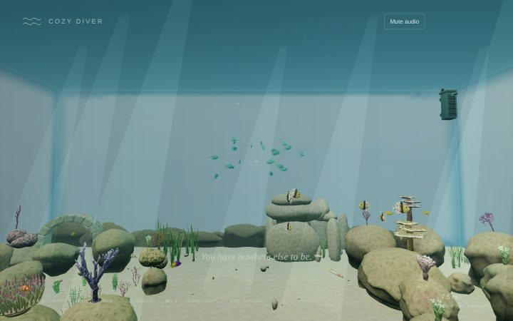
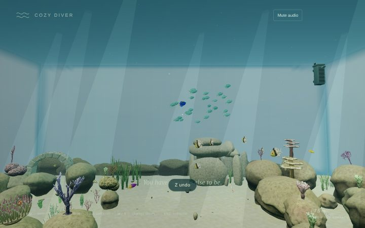
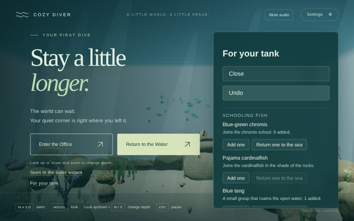
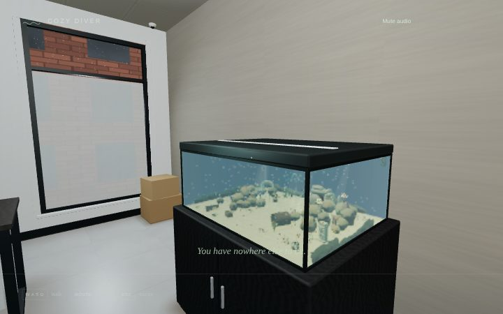

# v0.6 Pass 051: full aquarium personalization (`0.6.0-rc.12`)

**Evidence limits.** All evidence here is Linux Chromium with SwiftShader software rendering plus Node unit tests. MacBook Air frame time, Safari and how adding fish feels are not established; they need the user's play-through (steps below). The full browser regression and long-session harness remain scheduled for the agreed full run-through.

## What changed

See [the tank catalog](TANK_CATALOG.md#pass-051-full-aquarium-personalization) for the inventory and design.

- **Fish:**
  - Add and return **8 species**, in two groups:
    - **schooling:** chromis, cardinalfish and blue tang;
    - **aquarium fish:** firefish, assessor, gramma, butterflyfish and Moorish idol.
  - **Limits:** per-species maximums and a total of 24 added fish.
  - **Not for this tank:** the clownfish, big fish, and cold-, dark- or polar-water fish are listed with a reason once seen.
- **Living fish:**
  - **Simulation:** the ordinary fish simulation and authored rigs.
  - **Schooling:** added schooling fish join the home school through one-way companions in `FishSchooling`, and the home fish are unchanged.
- **Decorations:** seven more from the existing reef library.
  - **Corals:** tall branching coral and tiered plate coral.
  - **Algae:** caulerpa, halimeda and red algae.
  - **Rocks:** reef rock and smooth stone.
  - **Catalog groups:** schooling fish, aquarium fish, little visitors, plants and corals, and rocks and decorations.
- **Placing:**
  - **Turning:** Shift+R turns back.
  - **Undo:** Z or the Undo button steps back through the last 20 changes, and Z also cancels a preview.
  - **Hints:** the hints name the keys.
  - **Keyboard:** fish rows keep focus, and disabled buttons carry their reason.
- **Saves:** version 3 adds fish counts.
  - **Migration:** versions 1 and 2 migrate untouched.
  - **Kept entries:** unseen or unknown fish are kept through edits, as are additions (Pass 050).
  - **Newer saves:** a newer save is never overwritten.
  - **Restore the original tank:** also returns added fish. Sightings and settings stay.

## Checks

| Check                                          | Result                                                                                                                                                                                                                                                                                                                                                                                                                  |
| ---------------------------------------------- | ----------------------------------------------------------------------------------------------------------------------------------------------------------------------------------------------------------------------------------------------------------------------------------------------------------------------------------------------------------------------------------------------------------------------- |
| `npm run build`, `typecheck`, `lint`           | Pass                                                                                                                                                                                                                                                                                                                                                                                                                    |
| `npm run test`                                 | **693 passed** (69 files). New: `tests/tank-fish.test.ts` (15 tests): grouping, compatibility, capacity, school membership, the home fish unchanged, persistence and migration, kept fish, placement of every decoration, turning, undo, and lifecycle (stale loads, release, fallback). Updated: version 3 in the save tests; starter items in the kelp and cave unlock tests.                                         |
| `validation/tank-personalization.mjs` (new)    | **Pass.** Real catalog buttons. It checks the five groups and the "Not for this tank" reasons; adds 6 chromis, 1 gramma and 2 blue tang; and checks that focus stays on the button used. Undo takes back the second tang. 8 fish then swim on authored rigs (3 schools). The save is version 3 and matches. After a reload the same 8 fish are back. The office miniature is entered without errors. No console errors. |
| `validation/tank-catalog.mjs` (updated counts) | **Pass** against this revision: all 15 decoration templates load, every one is offered, and 20 placements, moves and removals work, with reload persistence and no console errors.                                                                                                                                                                                                                                      |
| Full browser regression, long session          | **Not run, by agreement**; scheduled for the full run-through.                                                                                                                                                                                                                                                                                                                                                          |

## Performance observations

| Measure                                                                           | Before                           | After                                         |
| --------------------------------------------------------------------------------- | -------------------------------- | --------------------------------------------- |
| Fish simulation step (Node, fixed 30 Hz step), tank's 41 fish                     | 0.142 ms                         | 0.142 ms (unchanged)                          |
| Added fish step at the cap (24: 12 chromis, 6 cardinalfish, 4 firefish, 2 gramma) | —                                | **0.065 ms**                                  |
| Tank view from the front (SwiftShader, 8 added fish)                              | 190 draw calls, 985.8k triangles | 194 draw calls, 987.2k triangles              |
| Office view                                                                       | —                                | 28 draw calls, 59.6k triangles                |
| Unpersonalized tank                                                               | —                                | No added-fish owner, leases or updates (lazy) |

The added fish use the existing authored rigs, with the same distance levels as the tank's own (14 body lengths), so far fish cost only about 1.8k triangles each. Each added species adds about one draw call for its school. The new decorations come from the reef library already leased, so there are no new downloads.

## Screenshots

| Before                                        | With 8 added fish (6 chromis joined the school, a royal gramma and a blue tang) |
| --------------------------------------------- | ------------------------------------------------------------------------------- |
|  |                                 |
| **The grouped catalog**                       | **The office miniature**                                                        |
|      |                               |

## Manual playtest (macOS)

Use the production build (`npm run build`, `npm run preview`) with Settings → **Show frame time** on. Keep a copy of `cozy-diver.tank.v1` from DevTools first if you want to compare migration.

1. **Migration.** Load with your existing tank. Expected: every coral, plant and visitor is still there; nothing moved.
2. **Starters.** In the tank, pause → **For your tank**. Expected:
   - the groups listed are schooling fish, aquarium fish, little visitors (if seen), plants and corals, and rocks and decorations;
   - caulerpa, halimeda, red algae, reef rock and smooth stone are offered without being seen.
3. **Schooling fish.** **Add one** blue-green chromis six times, then return to the water. Expected: they join the existing chromis cloud within about half a minute, and swim and turn like it. They don't stack on top of the home fish, and they never clip rock or glass.
4. **Aquarium fish.** Add a royal gramma and a firefish. Expected: each settles near a rock or sand home and stays there calmly, and the gramma keeps to its shelter.
5. **Limits.** Keep adding gramma. Expected: after two, **Add one** dims, with "The tank has all the royal gramma it suits." Then fill to 24 added fish. Expected: a calm note to return some first.
6. **Outer reef fish.** After seeing blue tang, butterflyfish or Moorish idol on the outer reef, add one. Expected: tang roam in a small group, while butterflyfish and idols pair up.
7. **Not for this tank.** After seeing a parrotfish or garibaldi, check that it is listed with its reason and cannot be added.
8. **Decorations.** Place a reef rock, a smooth stone and each algae.
   - **Turning:** **R** and **Shift+R** turn both ways.
   - **Cancelling:** **Z** while previewing cancels.
   - **Undo:** after placing, **Z** removes it again; repeat with a move and a removal.
9. **Persistence.** Reload, then quit the browser and relaunch. Expected: the same fish and decorations, swimming.
10. **Office.** Surface. Expected: the miniature shows the added fish swimming and the new decorations.
11. **Restore.** Settings → **Restore the original tank** → **Restore tank**. Expected: all added fish, visitors and decorations are gone; sightings and settings remain.
12. **No regressions.** Swim the crevice to the outer reef and back. Expected: the home fish, moray, clownfish and seahorse behave as before.
13. **Frame time.** Note the mean and p95 in the tank with nothing added, then with 24 added fish, 20 decorations and 3 visitors. Target: about 16.7 ms mean, with p95 well under 33 ms.

## Known limitations

- **Little visitors:** they give way to the home fish but not yet to added fish. The added fish do keep apart from the visitors through the shared habitat.
- **One-way schooling:** the home fish don't make room for added ones; added fish keep their own distance. This is chosen so that the home fish's behaviour cannot change.
- **Rebuilding:** each fish change rebuilds the added population, so added fish re-seat (from the panel, while paused). Home fish don't move.
- **Variety:** there are no new fish species beyond those already authored for the tank and outer reef, and no new ornaments, because the six ornaments carry unique creature homes.
- **Turning:** rotation is in fixed 30° steps.
- **Evidence:** SwiftShader only. MacBook Air performance is unmeasured.
