# v0.6 Pass 052B: open-ocean freedom and boundaries (`0.6.0-rc.14`)

The design and boundary map are in [OPEN_OCEAN.md](OPEN_OCEAN.md).

**Evidence limits.** All of this is Linux Chromium with SwiftShader software rendering at reduced resolution, plus unit tests. It says nothing about MacBook Air frame time. How open the ocean feels is for the playtest below.

## Edge-by-edge exploration audit

`validation/edge-audit.mjs` travels tank → outer reef → kelp forest → sea cave → under the ice through each passage, holding W as a player would. At each of 16 boundaries it swims hard outward for 8 s from just inside, then:

- records where the swimmer ended;
- checks they stayed inside valid space;
- screenshots the view outward;
- records draw calls and triangles.

The same route ran before the changes and after them. Both runs finished with every swimmer inside valid space. The "after" run had no console errors. The "before" run logged one: the polar bear failed to load (see Defects found).

| World         | Edge                 | Before: where you stop      | After                                            | Draw calls before → after |
| ------------- | -------------------- | --------------------------- | ------------------------------------------------ | ------------------------- |
| Outer reef    | Out over the blue    | z −51.5 †                   | **z −62.7** (the window is at −63.4)             | 109 → 70                  |
|               | Down the wall        | y −0.4 †                    | **y −9.1**                                       | 100 → 69                  |
|               | Left side            | x −32.0 (at the side glass) | x −32.0, no glass, the reef runs on              | 93 → 90                   |
|               | Right side           | x 31.8                      | x 31.8, no glass                                 | 90 → 87                   |
|               | Up                   | y 15.9                      | y 15.9 (unchanged)                               | 70 → 73                   |
|               | Cliff                | z −30.3                     | z −30.3 (unchanged)                              | 61 → 71                   |
| Kelp forest   | Left wall            | x −20.7                     | **x −22.3** (at the rock)                        | 24 → 24                   |
|               | Right wall           | x 20.7                      | **x 22.3**                                       | 36 → 36                   |
|               | Far wall             | z −56.6                     | **z −58.2**                                      | 31 → 23                   |
|               | Surface              | y 20.4                      | y 20.4 (unchanged)                               | 32 → 32                   |
| Sea cave      | Far wall             | (natural dome)              | unchanged                                        | 31 → 31                   |
| Under the ice | Left icebergs        | x −20.7                     | **x −22.0**                                      | 43 → 43                   |
|               | Right icebergs       | x 20.7                      | **x 22.0**                                       | 43 → 43                   |
|               | Far icebergs         | z −56.6                     | **z −57.9**                                      | 42 → 42                   |
|               | Under the sea ice    | y 11.0                      | y 11.0 (unchanged, keeps clear of the brinicles) | 52 → 52                   |
|               | Back to the entrance | z −11.4                     | **z −10.1**                                      | 48 → 48                   |

† In the "before" run, these two edges started against the reef and stopped on coral. The "after" run starts them clear of it, so for these two compare against the config: before, the stop was about 1 m past the lip (z ≈ −59) and the wall eased from −6 m.

**Draw calls and triangles.** Draw calls at each edge are the same or fewer. Over the blue they drop because there is no frame and less reef is in view. The silhouettes add one or two draws where they are in view, about 6–10k triangles, and up to 272k on the cliff view, where the whole far ridge is in frame. No world's figure grew beyond that.

### Screenshots (before → after)

| Edge                          | Before                                                        | After                                                        |
| ----------------------------- | ------------------------------------------------------------- | ------------------------------------------------------------ |
| Outer reef, left side         | 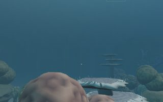     | 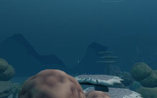     |
| Outer reef, right side        | 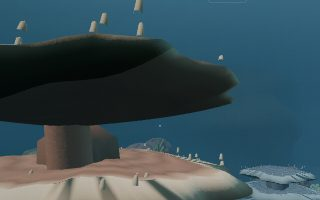    | 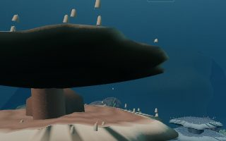    |
| Outer reef, out over the blue | 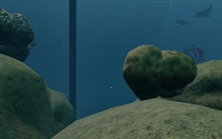          |           |
| Outer reef, down the wall     | 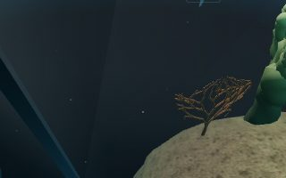 |  |
| Kelp forest, left wall        | 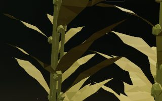      | 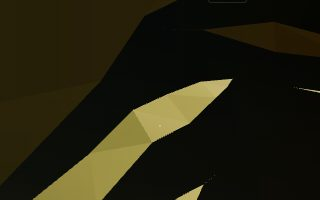      |
| Kelp forest, far wall         | 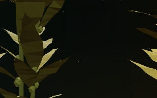       | 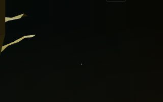       |
| Under the ice, left icebergs  |    |    |
| Under the ice, entrance       | 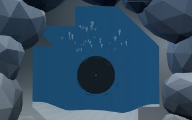        | 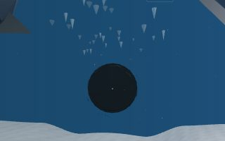        |

## Wildlife containment (outer reef, measured in the browser after the swim)

|                                             | Before                                                   | After                                                |
| ------------------------------------------- | -------------------------------------------------------- | ---------------------------------------------------- |
| Turtles                                     | z −66.9 and −70.4: **out in the blue**, despite Pass 052 | z −40.7 and −51.0: **on the reef top**               |
| Nearest big animal (other than the turtles) | beyond the glass                                         | z −65.9, beyond the glass (−63.4)                    |
| Reef fish (307)                             | inside the tank                                          | inside the tank (deepest z −59.0, widest \|x\| 27.8) |

## Defects found by the audit (fixed here)

- **Turtles carried back into the blue.** Pass 052 moved their loops onto the reef, but `PassingLanes` shifted every outer creature group onto a glass-relative lane, the turtles included. Turtles are now marked as reef residents and are never shifted.
- **The polar bear never loaded.** At runtime it measures 2.80 m against a registry limit of 2.70 m, so the asset check rejected it. The limit is now 3.1 m. The browser run has no errors with it loaded.

## Checks

| Check                                       | Result                                                                                                                                                                                                                                                                                                                                          |
| ------------------------------------------- | ----------------------------------------------------------------------------------------------------------------------------------------------------------------------------------------------------------------------------------------------------------------------------------------------------------------------------------------------- |
| Build, typecheck, lint                      | Pass                                                                                                                                                                                                                                                                                                                                            |
| `npm run test`                              | **700 passed**. New: `tests/open-ocean.test.ts` (7 tests): reach over the drop and down the wall, the collision stop at the window, the sides, big animals beyond the glass with the turtles left on the reef, the frameless window's fade, silhouettes at least 16 m from reachable space, kelp wall colliders and easing, and the ice easing. |
| Edge audit (new), before and after          | Pass (16 edges each)                                                                                                                                                                                                                                                                                                                            |
| Full regression and long-session memory run | Not run here; scheduled in Pass 055 (v0.6 acceptance).                                                                                                                                                                                                                                                                                          |

## macOS playtest: how open does it feel?

Use the production build, with Settings → Show frame time on.

1. **Out over the blue.** Swim off the reef's lip and keep going. Expected:
   - you hang out over the drop for several metres;
   - nothing frames the view;
   - only as you come within a few metres does a faint pane appear, explaining why you stop.

   Does it feel like a window onto open ocean, or a wall?

2. **Down the wall.** Drift down past the lip. Expected: the water darkens around you as you sink about 9 m down the wall before you ease to a hover.
3. **The flanks.** Swim along the reef to either side. Expected: the reef carries on into the haze, faint ridges suggest more reef beyond, and a gentle ease stops you without a visible wall.
4. **Far shapes.** Hover at the lip and watch the deep. Do you notice far pinnacles, or a whale, manta or school passing at the edge of sight? They should be faint, never close.
5. **Turtles.** Find the two turtles gliding over the reef top.
6. **Kelp and ice walls.** Swim at the kelp forest's rock walls and the icebergs under the ice. Expected: you reach the rock or ice itself, not an invisible stop several metres short.
7. **Passages and the way home.** Every passage still works both ways, and Return to the tank works from every world.
8. **Frame time.** Note the mean and p95 at the lip looking out, and along the reef's flank.

## Known limitations

- **Outer reef sides:** the side limit is still a soft ease, a current rather than something you can see. The reef beyond it is real (to ±44 m) but cannot be reached.
- **Sea cave and under the ice:** both remain enclosed by design.
- **Silhouettes:** they are flat-coloured shapes, and judging them takes real hardware and real eyes. Their opacity is a tuning value (`OUTER_HORIZON.opacity`).
